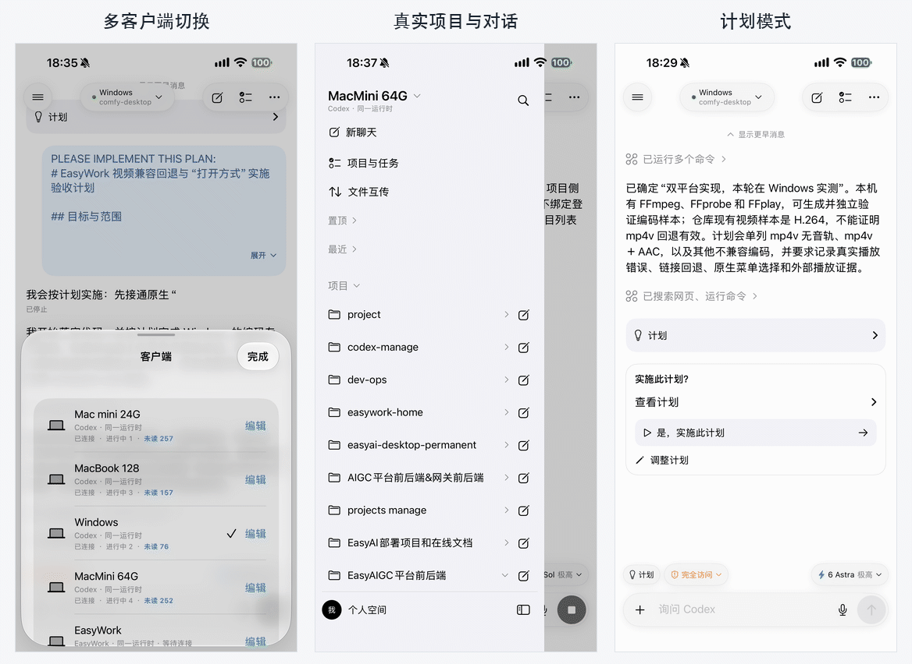

# Agent Hub

**在手机上一键切换多台电脑、多种 Agent 客户端。**

连接电脑上的 Codex、EasyWork，随时管理项目、对话和任务。任务继续在所选电脑上执行，手机负责查看、交互与控制。

## 核心特点

- **多客户端一键切换**：在不同电脑的 Codex、EasyWork 之间快速切换，每个客户端的项目、对话和草稿独立保存。
- **按电脑连接，Codex 不绑定登录账号**：通过电脑身份与设备密钥建立连接，Codex 切换登录账号无需重新添加电脑；其他客户端沿用各自的认证规则。
- **局域网直接连接**：手机与电脑在同一局域网即可直连；跨网络可按需配置 Tailscale／VPN。
- **手机与桌面协同**：在手机上查看桌面已有对话、接收任务进度、发送后续指令和处理审批，任务仍在原电脑执行。
- **跨 Agent 协作**：通过 Host 协议分派任务、交换进度与交付物；已有 Codex 跨电脑协调工具，其他 Agent 可接入同一协作流程。

<p align="center">
  
</p>

<p align="center">iPhone 15 Pro Max 真机截图：多客户端切换 · 真实项目与对话 · 计划模式</p>

## 支持的客户端与扩展方式

| 客户端                                 | 接入状态         | 接入方式                                                    |
| -------------------------------------- | ---------------- | ----------------------------------------------------------- |
| **Codex**                              | 已接入           | 电脑端 Host Agent 对接 Codex CLI／App Server 与原桌面运行时 |
| **EasyWork**                           | 已接入           | 对接桌面内置 Host，支持局域网／VPN 直连及其远程连接协议     |
| **其他 Agent CLI、客户端与工作流工具** | 可扩展，尚未内置 | 为 Host Agent 增加对应客户端适配器                          |

提供可调用 **CLI 或 API** 的客户端，都可以作为扩展接入的目标，例如 Claude Code 或其他工作流工具。接入时，将其项目、对话、消息、任务、附件和审批操作映射到统一领域协议，再注册客户端类型及能力；已有手机界面可复用，新增能力可继续扩展协议和界面。

设计目标是把桌面通过接口开放的能力带到手机。具体能否复用桌面已有会话、支持哪些操作，取决于客户端提供的接口与授权。协议、认证与传输差异留在适配层，详见[架构设计](docs/architecture.md)与[通用 Agent 协议](docs/protocol.md)。

## 跨 Agent 协作

Agent Hub 的 Host 协议也可作为 Agent 之间的协作通道。用户指定协作目标与任务后，来源 Agent 通过协调工具查询目标电脑的项目与会话，在对应项目中新建专用对话、提交任务、查询进度与回执，再核对代码或文件交付物。

- **同类 Agent**：例如 Mac 上的 Codex 分派给 Windows 上的 Codex，复用目标电脑已有登录与原桌面运行时。仓库提供 `contact-host.mjs` 协调工具和 `transfer-host.mjs` 文件交付工具。
- **不同 Agent**：例如 Claude Code ↔ Codex、Codex ↔ EasyWork。来源侧接入协议调用工具，目标侧通过 Host 适配器将统一操作转换为对应 CLI／API；双方无需使用同一种模型。Claude Code 等新增客户端仍需实现适配，已有手机接入不等于所有组合的自动协作已完成。
- **可追踪的协作**：固定目标 Host、runtime、项目和会话；同一任务使用稳定 task ID，每次提交使用独立 operation ID。目标忙碌时按能力排队，未知结果先查原回执，避免重复执行。


客户端差异由适配器处理，协作层使用项目、会话、消息、队列和回执等具名操作。协作以用户明确授权为前提；使用方法与扩展边界见 [跨 Agent 协作说明](skills/codex-host-connect/references/agent-collaboration.md)及 [协调流程](skills/codex-host-connect/references/coordination-guide.md)。

## 核心功能

- **项目管理**：浏览、切换和添加授权目录下的项目；移除项目记录、批量管理，保留电脑上的文件与对话。
- **对话管理**：项目内或无项目新建对话，查看历史、搜索全文、置顶、归档、恢复与删除。
- **任务交互**：发送与续聊、实时流式回复、工具进度与 Diff、计划查看与执行、停止／恢复、原生任务排队。
- **文件与图片**：发送图片和文件作为附件，手机向电脑独立传文件，下载与预览任务中的资源。
- **模型与权限**：选择模型、推理强度与执行模式，设置权限并在手机处理审批和问题回复。
- **语音输入**：将录音转写为可编辑草稿，支持电脑端转写与手机本地听写。
- **通知与恢复**：未读标记、任务和审批通知、草稿保存、缓存浏览与断线重连；后台推送需配置通知服务。

各客户端、平台及 Host 版本的能力不同，手机按实际能力开放操作。归档、恢复、删除等生命周期操作仍受上游接口与任务状态约束，逐项状态见[双端功能清单](docs/product/mobile-parity.md)与[聊天管理说明](docs/chat-actions.md)。

## 平台与连接

- **手机端**：原生 iOS／SwiftUI 与 Android／Kotlin／Jetpack Compose。Android 源码和 KMP 共享核心均已包含在本仓库，已有 Codex 执行、EasyWork 接入及聊天管理等实现；完整双端对齐与各场景验收继续按[当前计划](docs/plans/android-alignment-20261022.md)推进。
- **电脑端**：Codex Host 支持 macOS 与实验性 Windows 接入；EasyWork 使用桌面内置 Host。Linux Host 尚未实现。
- **网络**：优先局域网直连，跨网络按客户端接入方式配置 Tailscale／VPN 或已支持的远程通道。
- **语言**：简体中文与 English，可跟随系统或在 App 内切换。

## 开始使用与开发

源码开发需要 Node.js 24.x、pnpm 11.19.0；iOS 编译另需完整 Xcode 和 iOS Simulator SDK。

```bash
git clone https://github.com/easyaigc/agent-hub.git
cd agent-hub
pnpm install
pnpm build
```

- **接入 Codex 电脑**：按 [codex-host-connect Skill](skills/codex-host-connect/SKILL.md) 安装和配置 Host Agent；完整接入包可运行 `pnpm package:connect` 生成。
- **接入 EasyWork**：查看 [EasyWork 接入协议](docs/integrations/easywork-ewdap-1/README.md)。
- **编译 Android App**：按 [Android 工程说明](apps/android/README.md) 配置 JDK 17 和 Android SDK，运行 `pnpm build:android`；开发 APK 输出到 `.build/native/android/outputs/apk/debug/`。
- **运行手机 App**：用 Xcode 打开 `apps/ios/CodexManage.xcodeproj`，选择 `CodexManage` Scheme 和模拟器运行；真机需要自己的签名配置。
- **检查源码**：运行 `pnpm check`；编译 iOS 使用 `pnpm build:ios`。

Host 的正式连接、能力配置与故障排查见[运行指南](docs/runtime.md)。`pnpm dev` 启动的是开发服务，默认只监听回环地址并提供健康检查；手机直连需要另行完成 Host 配置。

## 项目结构

```text
apps/
  ios/                SwiftUI 原生 iOS App
  android/            Compose 原生 Android App
  host-agent/         电脑端 Host Agent
  relay/              中继与通知服务
packages/
  protocol/           版本化领域协议与能力契约
  codex-adapter/      Codex CLI／桌面运行时适配
  mobile-core/        KMP 共享业务核心
  service-runtime/    服务启动与健康检查
docs/                 产品、架构、接入与开发文档
scripts/              构建、检查与验收工具
skills/               电脑接入 Skill
```

## 更多文档

- [运行与连接](docs/runtime.md) · [文件互传](docs/file-transfers.md) · [通知配置](docs/notifications.md)
- [开发指南](docs/development.md) · [架构设计](docs/architecture.md) · [领域协议](docs/protocol.md)
- [双端功能清单](docs/product/mobile-parity.md) · [界面规格](docs/design/mobile-parity.md) · [验收规范](docs/acceptance/mobile-parity.md)
- [Android 开发计划](docs/plans/android-native.md) · [共享核心决策](docs/adr/0002-native-mobile-shared-core.md)

## 开源许可

[MIT License](LICENSE)。
