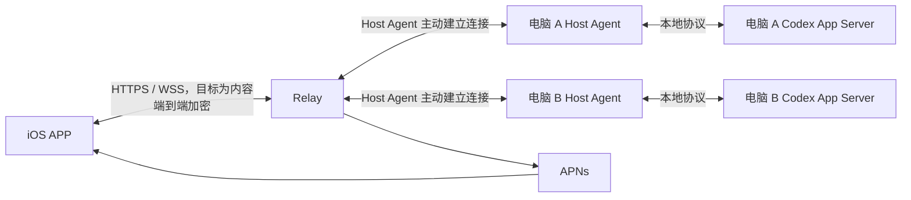
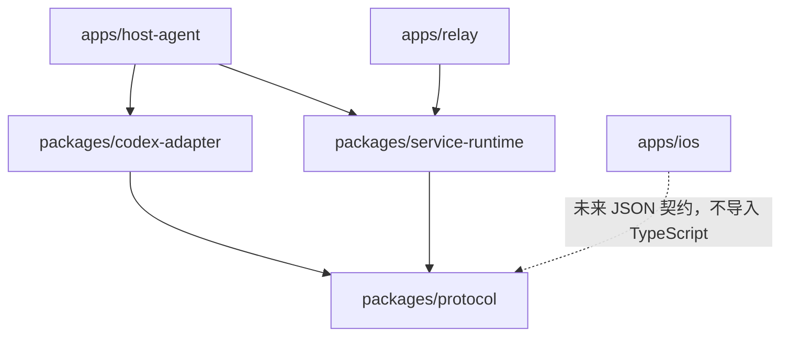
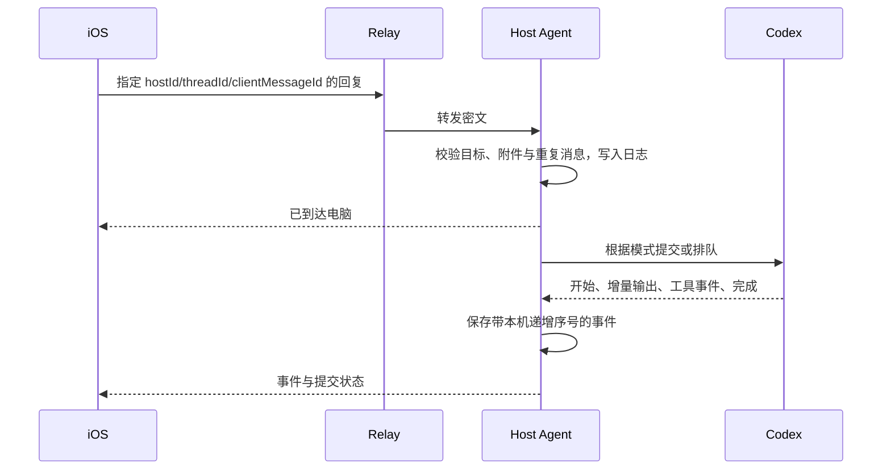

# 架构设计

2026-10-28 iOS 主动丢弃录音与生命周期保留分离：输入条“×”和重新录音先落盘丢弃标记，再删除手机音频，恢复时排除该原操作；普通导航／后台仍保留恢复。Host 回执与不可变操作不变，取消代次隔离迟到结果。Android 新断言待对齐，验收见[专项记录](acceptance/voice-discard-20261028.md)。

2026-10-28 Android PAR1：流式迁移、手机独立阅读/逐事件查询与普通通知本地回执已形成窄模块，通知认领在同根锁内重检阅读；系统/认证事件接线与全部子存储仍开放。Android新文件封套v2/归档v3暂非iOS互通格式，原生合成通过不代替真实Desktop/模型或后台送达。[分工与当前范围](plans/android-alignment-20261022/parallel/README.md)。

2026-10-28：Host bridge 的速度能力只按模型目录的稳定 ID 解析，保留 standard／fast／ultrafast，fast 在桌面 wire 边界统一为 priority；未知 ID 不按展示名称猜测能力。原 owner 当前 service tier 优先于保留的旧轮次设置，明确 null 表示标准。iOS 多档选择使用原生菜单；实现、模拟器真实任务与未验收平台见[本次记录](acceptance/host-ultrafast-20261028.md)。

2026-10-28 Windows 安装与连接：按用户要求移除桌面与 CLI 的 Publisher／签名文案／Store 包身份门禁；同一管道句柄、当前用户与登录会话、准确路径／摘要及真实 IPC 方法检查继续执行。私有状态 bootstrap 与常驻 worker 共用文件句柄实现，只读所有者与 DACL、只写受保护 DACL，保留 SACL，不提权或接管他人文件。源码与辅助检查不代表目标 Windows／手机功能通过，见[专项记录](acceptance/windows-install-20261028.md)。

内置 Markdown 与可注册原生预览器；iPhone 真实原桌面文件核心阅读闭环通过，Android 编译及共享规则通过，完整双端与正式发布待验

2026-10-26 F34：现有对话底部模型／强度只展示准确原 owner 设置；模型目录默认值和手机未发送覆盖项不得冒充实际值。未取得时显示同步中／跟随电脑，设置面板区分电脑当前设置与下次发送。iOS／Android 共用 KMP 展示选择规则；Host 小体积具名只读查询即使完整快照不可用也返回当前参数，不授予执行控制。源码、辅助检查、iPhone 真实验收与未验收平台分别登记于 acceptance/thread-model-settings-20261026.md，A6 保持暂停。

2026-10-26 应用操作审批：Codex Adapter 将 `mcpServer/elicitation/request` 的空确认、单一 approved 布尔确认及 `item/permissions/requestApproval` 映射到手机审批卡片。原请求声明的 session／always 范围才可选择，执行绑定的确认不提供持久授权；复杂表单、URL 和用户验证提示电脑端处理，手机可拒绝／取消。响应通过原 owner 的具名接口返回，提交前核对原请求内容、完成标记及目标，重复点击合并。iOS／Android 共同消费可选按钮文案，旧命令审批保持兼容；真实结果见[专项记录](acceptance/computer-use-approvals-20261026.md)。

2026-10-26 iOS 语音失败回退：用户明确选择后以手机系统文件识别读取同一已保存录音，不重录、不重放电脑请求；原操作及音频保留，本地已使用标记阻止重复恢复。回填仍核对原草稿和目标，问题回复共用；Android 文件识别适配待对齐。见[语音说明](voice-transcription.md)及[专项验收](acceptance/voice-local-fallback-20261026.md)。

2026-10-24 发热排查：两端 EasyWork 改为事件唤醒，稳定 epoch/cursor 的心跳不读历史；重连 epoch 触发权威修复。共享补偿读取规则同时限制成功、失败和旧快照尝试，iOS 不再每秒失败重读。已验证且完整版本元数据不变的缓存消息不重复计算文本摘要，变化内容、元数据及 reset 仍校验；iOS 相同历史不重写缓存。原生合成辅助检查与真机功耗、真实桌面和 Android 逐项验收分开登记，A6 继续暂停。

2026-10-24 真机功耗续验：iOS 未读账本仍每次读取实际文件，只有路径与完整字节相同才复用已解码、归一化的只读视图；交易使用原账本作前值，跨进程替换、相同 revision/mtime 的不同内容及坏数据均失效。身份键缓存有界，不改变 Codex 机器目标或账号字段的授权语义。会话备份也只按完整原字节复用解码校验，新状态仍先编码并完整解码成功后写入。实时快照与仅游标批次采用不滑动的两秒保存窗口；模型显示即时更新，命令意图先落盘、草稿定时保存和退后台 flush 保持原边界。Android 只在内存正文未变时尝试复用历史分片，仍完整验证实际加密分片、目标、消息数与正文；只更新索引头里的运行时/新鲜度/游标，缺片、损坏或正文变化发布完整新代，索引原子提交后再删除旧代。协议、权限与未知输入不重放规则不变。

2026-10-24 长历史呈现续修：原生平台仅复用确定性目标键编码与共享键选择的结果。iOS 以完整规范键、候选集合及显式旧别名作有界输入，首次将桥接字符串转为原生 UTF-8；Android 以完整机器/运行时/非 Codex 账号及聊天/草稿选择器缓存编码，别名选择仍读取当前命名空间对象。缓存不持有可写证明、权限或操作回执，KMP 仍决定输出字节与呈现规则。Android 历史投影复用的输入包含完整原消息、窗口、运行状态及搜索定位；只保留一份投影，正文、附件、状态或目标变化即重建。真实功耗和辅助验证分别见 [长历史专项](research/history-thermal-20261024.md)。

同轮主线程续采发现关闭侧栏仍重建目录并反复替换 UIHostingController.rootView。iOS 容器保持初始挂载与滚动状态，关闭时仅保存最新内容构建器；开启/拖动显露前应用最新内容，可见更新与拖动结束后的追赶继续执行。Android 对当前目标目录建立记忆索引，客户端、完整线程/项目或排序变化即更新。

Android 保留挂载侧栏的运行指示器按现有 active 生命周期选择无限动画或静态弧；隐藏及被模态阻挡时不继续调度无限帧，显示恢复后重新启动。该生命周期开关仅作用于呈现，不修改运行/审批/未读业务状态。

2026-10-25 iOS 状态备份采用经内容校验的 APFS 写时复制克隆：唯一私有暂存副本完成校验和文件保护后原子发布；不支持克隆或副本不符时回退原字节写入。主状态仍先编码验证，原恢复代次选择、命令提交前落盘、状态/历史分队列与未知操作查询保持，格式和加密策略不变。Android AtomicFile 没有同样的两代全量字节备份复制，本次不改其生产存储；实现与逐环境结果见[专项记录](research/mobile-performance-io-20261025.md)。

2026-10-25 iOS CPU续修：SavedSession保留值语义与不可变后台快照，使用显式变更前通知避免大型Published getter复制；完整相等运行态/摘要不重复发布。既有完整目标/线程的游标更新仍进入原SavedSession与检查点，仅不驱动界面；新key/作用域、首次历史代次及建议新鲜性确认明确通知。回执处理、协议校验与命令前持久化保持。辅助与冻结真机证据见[CPU记录](research/mobile-performance-cpu-20261025.md)。

后续将展示范围、可见建议和灰字条件在每次body求值内生成一次并传给子视图，避免重复构造；不跨次重建缓存。读取任务和所有用户动作继续读取当前范围、来源、草稿和有效期，语音界面不求未展示的建议。空值短路无收益的候选与完整单次展示值候选分别记录，不只保留改善数字。

2026-10-24 F18/F20/F39 暂停状态收敛：准确原 owner 的完整快照在同一输入和末轮由 inProgress 变为 completed/interrupted/failed、运行时空闲且无其他活动轮时，允许修订号重置。保留该终态及旧修订链，迟到运行快照/增量不得复活已停止任务；新输入新轮仍正常运行。iOS/Android 共用 Adapter，无新增 UI 或命令，不重放输入；本机、原生与未验收平台分别记录，见 docs/acceptance/paused-state-sync-20261024.md，A6 保持暂停。

2026-10-24：EasyWork 每轮建议在其原 Agent runtime 内生成，Host 通过具名 thread/suggestion/read 只读返回缓存，声明 desktop:suggestions:runtime-version:v1；加密传输绑定现有完整目标。iOS EasyWork 适配器转换为通用建议领域对象，source=runtime、validity=runtime-version，不经原 Codex Trace HTTP 路由，也不在读取时分叉或发起模型任务。详见[专项记录](acceptance/easywork-suggestions-20261024.md)。

2026-10-24 原桌面创建恢复：准备器确认退出且官方 API 已核对准确零 Turn 元数据后，先登记只读会话，再获取原 owner。已拒绝且未写入首条输入的本机准备记录可支持该准确 ID 的显式打开；原创建回执和输入不变，不重放、不以元数据冒充运行时可控。两端共用 Host，无新增手机权限开关；原生与辅助验收分别记证。

2026-10-24 原桌面目录策略简化：desktop-runtime 不再使用 HOST_AGENT_ROOT 作为建议、附件下载或服务就绪的全局授权范围。该旧配置仅保留默认 cwd 兼容语义；托管／共享模式的显式边界和原 Agent 执行权限保持。建议按原 owner、当前实例和准确完成轮验证私有 Trace，不要求项目目录存在；文件下载按本会话已登记资源授权，原消息引用、目标变化、大小与摘要检查保持。iOS／Android 共用 Host 行为，无新增权限界面；实际桌面、模型、实体手机及 Windows 结果分别记证。 详见 [目录策略](adr/0003-desktop-resource-authorization.md)。

2026-10-24 F69 跨项目建议读取（初始实现，后续由上方目录策略简化取代静态根目录依赖）：Host 从准确原 owner 的最新完成轮取得来源 cwd、规范路径及目录身份，在读取前、中、后同时核对目标、轮次和目录，再把该来源目录传入 Trace 读取。静态 HOST_AGENT_ROOT 继续用于原 Host 范围及未绑定观察记录，不再误拒绝桌面已授权的其他项目建议；不接受客户端目录参数，不扩大文件或命令权限。macOS 与 Windows 共用此内部范围，iOS 展示和 Android 尚未实现的建议 UI 状态不变。辅助检查、Mac 部署、实体手机及 Windows 结果分别登记，未验收项不升级为通过。

## Host Key 首次授权

实现、辅助检查、真实桌面与实体手机结果见[首次授权验收](codex-host-key-authorization.md)。

2026-10-23：Codex 自动发现只提供候选电脑。首次点选必须输入这台电脑的 Host Key；Host 的 `/connection/claim` 只接受有效 Host Key，缺失／错误密钥及设备令牌均不能颁发新凭据。公开描述声明 `host-key`，旧 `automatic` 可读取但新版手机不走其免密授权。手机仅在加密设备凭据和同一完整工作区目标验证成功后保存连接，原 Host Key 不保存；已有设备凭据继续重连。二维码包含密钥，视为显式凭据交付；手动路径仍校验密钥。实现与真实验收分开记录，旧免密验收不证明本次策略。

2026-10-22：Codex 双通道：默认局域网 HTTPS 与原 Tailscale Serve HTTPS 共用同一机器目标。新增鉴权只读 GET /v1/connection-routes（严格 v1 target／httpsEndpoints），旧 /host 保持不变。HOST_AGENT_HTTPS_ENDPOINTS 由安装流程写入已核对的实际 Serve 根地址并由两平台服务持久保存；无 Tailscale 时局域网独立工作。手机保存独立系统信任入口与原固定证书候选，迁移保留旧地址，健康当前路径继续使用、失败后自动换路；路由不参与存储身份，不取消重放已提交输入。iOS／Android 共用入口规范化与合并规则；源码、辅助检查、真实原生／模型与逐机部署证据分开记录。

2026-10-21 联网历史续修：iOS 只对机器／会话标识的纯编码结果做有界线程安全缓存。输入覆盖完整运行目标、键种类、会话／无项目选择器，其他 Agent 保留账号语义，Codex 按既有机器策略忽略账号元数据。旧别名选择、读取范围、权限、运行时就绪和操作回执继续实时核对；缓存不持久化、不改变键字节或领域算法。真实目录／事件和 UI 重复访问不再逐次跨 Swift／Kotlin 编码。

2026-10-21 iOS 历史展示：按完整目标、全部消息字段、窗口、运行轮与搜索焦点缓存唯一不可变投影；底部几何仅传递可见／接近底部两个边界。远端更早页在目标／代次／修订核对后、发布前缀之前，同步通知原生视图记录旧布局并扩大窗口；短列表既有尾部空间在展开时保留，避免 UIKit 夹限偏移。共享核心继续提供领域投影规则；缓存和阅读位置回调仅属于 iOS 展示层。真机与辅助结果分别记录。

2026-10-21 本次限定范围验收闭环：原应用正常重开后仅一个ChatGPT实例，正式Host保持原身份与desktop-runtime；本机共享服务和官方云端连接分离。恢复对话保留原草稿，仅新增一次真实xhigh跟进，删除按原回执确认；最新执行指纹的项目新建一次输入/回复通过。最终修复包完成归档列表及逐条选中菜单的完成/停止状态验收，两条操作前实际已加载且完成的对话经侧栏批量归档、卸载与App重开成功记录核对通过。此前六项生命周期、附件、队列、停止、审批及内置工具的真实结果按原环境单列保留，本次补验不伪装为整套重跑。完整检查和iOS构建通过；原始失败、只读回执核对与包指纹留在私有验收记录。正在执行中直接归档/删除、Android、Windows、实体手机、手机建议展示及跨网络本次不新增通过，F70完整跨端状态保持原标记。

2026-10-21 正常重开后已确认单个原应用、本机stdio共享服务与官方云端WebSocket分离；准确local owner恢复，保留草稿的跟进只提交一次，真实GPT-6.1-Sol/xhigh完成第二轮，删除原操作回执与完整官方目录核对通过。最新包项目内新建仅一次输入/回复通过。归档对话失去owner后仍保留已确认的终态，Host仅投影归档且已有completed/interrupted/failed的记录；活动、未完成及无终态记录保持unknown，执行控制不恢复。iOS归档列表与选中对话依据同一终态显示，原生辅助保留未知草稿、复用正式连接并只重查异步删除结果。归档状态修复、批量及最终交付另记；Android共享Host字段，原生F70实现及验收未新增通过，Windows和实体手机本次未验收。

2026-10-21 真实续验发现启动作用域错误：全局FORCE_CLI会绕开官方durable/云端WebSocket，把本机目录镜像到另一Host来源；恢复后原桌面尝试不适用的thread/items/list，准确local owner无法重建，跟进输入仍留草稿且未提交。版本2仅保留本机CLI路径，移除有私有旧清单证明的自有全局开关，拒绝覆盖其他及后续用户设置；采集器兼容两版私有清单。七项环境边界与十八项观察器边界通过；需正常重开原应用后复核独立本机/云端连接、恢复跟进和最终包批量归档。既有六项、附件、队列、项目新建和已完成任务重启回执通过仍绑定原指纹，不计整项正式通过；Android、Windows、实体手机本次不新增通过。

2026-10-21 入口核对补齐：配置原共享服务后，侧栏批量归档和项目管理改用同一服务的独立只读/管理连接，限定project/list、project/delete、thread/list、thread/archive，不启动或恢复执行；提交前目标校验和未知回执不重放保持。批量确认后已不在活动列表的聊天仍从窄缓存投影保留完成/停止结局，不读取完整正文。原生队列、取消排队、立即追加和后续执行已实际通过；批量真实验收、恢复及最终交付结果另记。Android使用相同Host契约，本次无新增原生UI及平台通过，Windows保持原路径。

2026-10-21 正式单实例模拟器六项归档/删除已通过，原生结果1项0失败；截图复核发现已完成聊天归档后被目录投影强制改为unknown。已让归档目录保留原任务状态与lastTurnStatus，完成和停止边界检查通过；补充正式Host重启后的真实归档列表验收，当前仍待该修复部署与原功能回归闭环。附件原生用例沿用明确AI共享许可，不将许可点击当作消息已发送。Android使用同一Host字段，原生UI及本次验收状态不变。

2026-10-21 单实例回归补充：macOS 建议采集器在配置共享连接时，额外核对本机私有安装清单、启动器摘要、owner 记录及原桌面 → 随包 Node 启动器 → 官方 CLI 的实际进程身份。只接受这一已安装链路，保留直接子进程路径；任意 Node 孙进程、父链变化和 PID 重用均不可作为原执行器。采集继续只读，不读取其他进程参数或改写原配置。

2026-10-21 正式接入适配：原桌面经显式配置的本机 CLI 启动适配器持有唯一官方共享服务；Host 保持 desktop-runtime 的原 owner 控制、创建和建议链路，仅固定聊天管理操作使用同一服务的第二连接。持久配置器只恢复本机 CLI 路径，不启用影响 durable／云端的全局强制 CLI 开关，不启动应用；正式单实例及功能验收另记。

共享运行时的本次 macOS DEV 入口采用原 Electron 启动链路：本地启动器保留其前置策略／认证调用，单个执行 App Server 监听回环 WebSocket，原桌面 stdio 和 Host 各持一个连接，聊天管理再使用同一服务的窄操作连接。Host 不创建第二个执行实例，也不读取或复制其他进程的工具凭据；服务归属／配置不一致则拒绝。源码指纹与本次真实环境核对；单实例启动器、四项控制／工具及六项模拟器生命周期已通过，正式安装切换与其他功能仍单独验收。正式运行保留一个原桌面实例及一个 Dock 图标，隔离 DEV 第二实例不得进入正式生命周期。

## UM06 Task Hub 原生领域（2026-10-21，底层回收）

Task Hub 业务域独立于聊天 Provider、电脑免登录配对及 runtime 操作账本。 本次回收不新增应用登录入口，不导入 Android 登录表单或启动时的业务控制器挂接；独立业务服务鉴权仍只在其窄接口内使用。KMP 的 `TaskHubRules` 复用会话代次、单调回执和 SSE 游标规则；iOS 已替换对应纯规则调用，既有缓存键不迁移。Android 的业务身份采用服务三 ID、人类 actor 和本设备 ID 的结构化键，连接地址不进入身份键。账号登录、退出、TLS、字节流和数据库由原生窄接口提供。

Android 业务 SQLite 每次事务保存加密清单和按位置／代次认证的字段；缺行、旧字段拼接、错误密钥及未知版本拒绝读取和后续覆盖，不自动重建空库。草稿可编辑，已提交的路径、原文、轮次、revision 和原操作 ID 不可替换。409 或传输断连保持未知，进程恢复只 GET 原回执；终态不能被迟到超时覆盖。SSE 游标和缓存失效在同一事务提交，旧页和旧快照不能回填新会话。

上传使用独立业务密钥及原文件／multipart 摘要，许可由独立业务授权接口提供。Android 应用级传输与界面等待分离；进程停止后的恢复不重新提交 POST，iOS 系统 URLSession 的后台继续能力另记平台证据。复用的二进制加密适配器保留聊天／语音原有默认密钥别名、12 MiB 上限、格式和 AAD；业务显式选择另一密钥与上传上限。

已核实的既有 DEV 服务是本步真实业务验收入口，不因本机旧包完整性问题安装第二后端。运行包只在树外新候选恢复内部相对链接，原安装、服务、普通 Codex 与主工作区均不被替换。当前辅助通过不等于 UM06 已验收，详见 [UM06 计划](plans/android-upstream-UM06.md)；UM07 页面和 UM08 通知尚未进入。

原生历史 Gateway 在每个请求对象上保留原始错误，公共层继续只负责单次交付、目标隔离与取消。返回 Swift 时保留超时／失联、HTTP 拒绝、身份与协议错误的类型，不把它们统一压成普通文案。离线客户端的首个已认证可达地址立即生效，当前电脑与 VPN 候选优先；路径改变只使旧读取失效并启动新读取，原写操作仍独立查询，不重放。

2026-10-20 弱网读取调整：iOS 先应用经过目标校验的工作区第一页，再读取当前对话并启动事件订阅；完整未读目录在独立扫描中补齐，分页期间保留同一目标的缓存尾部。并发前台刷新合并，同一导航代次的最新历史最多一个请求，事件重置已带快照时不再重复下载历史。一个读取超时不能覆盖其开始之后同一 Host 的有效成功响应；认证、身份和协议错误仍使连接失败。Host 对已知聊天的移动只读浏览最多等待一秒 owner 发现，随后返回新读取的历史；未知聊天及命令保持原有发现、owner 和权限检查，不取消正在进行的命令、不重放输入。该实现与合成边界检查不能代表 Windows 或蜂窝真机通过。

## Windows 原生 Trace 适配

Windows 复用公共 Trace 解析和来源/版本契约，适配层以原具名管道 owner、PID/启动时间/直属执行器及唯一 Trace 环境建立当前实例范围；安全文件读取使用保留祖先句柄、原生 DACL/用户 SID 与文件身份复核。它直接恢复原生完整结果，不模拟 macOS 完成通知、不宣称输入框可见。持久环境只管理当前用户的一个诊断键，不重启原桌面。实现及待完成的真实平台验收见 [Windows Trace](windows-native-trace.md)。

Windows 建议请求在同一读取 Worker 内准备一次解析结果，Host 中间核对原 owner／来源后，再以请求内收据重新验证完整文件、目录和 cwd 输入；确认前正文不离开 Worker。最后再次核对来源并检查剩余租期，变化或超时则拒绝，不重新解析或跨请求复用。macOS 保留原两次投影路径。各阶段预算与实际待验收范围见 [Windows Trace](windows-native-trace.md#Windows-异步读取与预算)。

### Windows 候选本轮实施（2026-10-20）

Main 按真实 owner Worker 统一监督 native transport 的退休。读取失败立即撤销能力，Reader 实际退出及其 native transport 全部确认退出后才允许同一 client 建立新代次；Trace 的 gone 还要求直接 child exit、child close 和三路 stdio close。缺确认保留未知，不用 PID 消失、发送 close 成功或强退返回代替回收证明。child 250ms、native 750ms 和 Reader 2500ms 关闭边界保持。

Windows prepare/prepared/commit 期间暂停周期 heartbeat，结束、失败或中止后恢复 idle 采样，实际最终就绪与来源守卫保持。prepared parser 增加请求内日志索引，只复用有完整新文件收据约束的解码结果；所有原生项、三处新鲜 canonical、目录/cwd 与内容义务继续执行，正文占用仍计入原活跃预算，结束时清理。macOS 原双投影和非 prepared 解析路径不改。

2026-10-21 的候选将 Windows prepared 发现、文件与最终 guard 的小项 RPC 按原顺序贪心组合为最多 8 项，并为已发现的 contained bundle／payload 目录增加 maximum=0 的批读取；root／ancestor 保持 scalar，非 prepared Windows 最终核验仍最多 2 项，macOS 路径不变。每项仍独立执行原完整 Snapshot，保留 Node 三点 stat／canonical、完整 native chain／DACL／身份／body 或 prefix hash、目录／cwd、64MiB 活跃预算与三次来源核对；只减少固定往返，不减少证明项。JS 与 C# 同包扩大内部容量，旧 helper 缓存不能冒充新源执行。原每项 16KiB、48KiB 请求、256KiB 响应、750ms 整批及 4s／7s／8s、6s lease 均不增加；派发前不适合批处理的项选择原 single，已派发失败不 fallback。当前本地四组为 339 pass／0 fail／6 Windows-only skip，另两处测试证明补齐的 9 项单次通过；本候选真实 Windows、普通 HTTP 与手机仍待验，不能与既有通过相加宣称整体通过。全 Root 的 O(N) 成本仍在，根本缩小范围需要具备最新失败／pending 完整性的 producer 定位契约，见[增长边界提案](plans/windows-trace-timeout-causes-20261020.md#trace-增长的根本边界与定位契约提案)。

固定 phase/reason 数值诊断只记录请求内计数、代次、耗时及退出布尔状态，不包含业务 ID、正文、路径或凭据，也不增加 Trace 重读。生命周期测试改为父侧保留退出/stdio 证据、partial→rename 发布结果，以及条件求值前后严格核对截止；失败日志不能覆盖已捕获的原输出。

组合提交 `7f2b70b` 的完整 `pnpm check` 已通过，799 份输入在检查前后保持一致。`db473e1` 在真实 Windows 上完成 Native 381 项：378 通过、3 项明确的 macOS 专用跳过、0 失败；该证据不代替组合版的实际 Host 请求。新版独立 DEV 的第一条普通建议请求仍返回 503，耗时 4137.87125ms，矩阵在首失败处停止，内部失败阶段尚未观测。iPhone 15 build90 的 Xcode 基础通道已恢复，1 项预检通过，建议业务尚未验收。旧 727 的 21.67 秒仍未归因，后续通过不改写旧失败；正式发布仍待真实接口和手机业务通过。证据与实施状态见[因果专项](plans/windows-trace-timeout-causes-20261020.md)及[收尾复审](plans/windows-trace-closeout-review-20261020.md)。

## 手机连接失败提示（2026-10-19）

iOS 展示层按系统网络错误码区分安全连接失败、证书校验失败、手机无网络、连接超时、电脑不可达和连接中断，显示本地化说明与恢复建议，不向用户直接展示 TLS 等底层报错。连接类弹窗使用“暂时无法连接电脑”，对话同步和添加电脑表单复用相同文案；其他业务错误保留原说明。该映射只改变提示，不改变证书、目标身份校验、原操作回执或重试策略。后台瞬时断线和阅读任务取消继续沿用既有静默处理。原生文案检查、模拟器回归与实体手机结果分别记证。

## 客户端执行队列（2026-10-19）

Host 不再维护执行 FIFO、自动续发或原生队列不可用时的执行回退。Codex 排队只交给原桌面原生队列；EasyWork 手机输入交给桌面已有队列。远程层保留不可变意图、回执与去重账本。旧 Host 项仅保留只读核对回执，不再在手机对话内显示旧队列卡片或操作入口，不自动迁移或重发。客户端拒绝、未就绪与同步失败分别明确反馈。实现与真实验收结果分开记录。

## 持久 trace 与建议版本刷新（2026-10-18）

当前生产读取优先使用原生 trace；只有显式配置 DOM Bridge 时才使用展示读取。原生路径声明 `desktop:suggestions:native-version:v1`，返回 `source:native-trace`、`validity:native-version` 与六秒读取租期，不声称已经取得输入框显隐状态。来源需同时满足当前桌面实例、准确 Host／Thread／完成 Turn、原生预测元数据、完整成功返回与 task_complete 正文一致；Host 在读取前后核对原 owner 与来源，证据变化清空本次结果。

同来源候选按原生 inference 请求开始时间选择，不能按文件修改时间或完成时间排序。相同时间无法消歧时拒绝；最新请求尚未完整结束、失败、空结果或证据不完整时不退回旧版。已经被更新请求取代的未完成执行不阻塞新结果；旧完成通知不能重新加入被取代的候选。旧桌面实例的记录不参与选择。

iOS 对该能力首次读取即进入前台每两秒只读刷新，同轮次支持版本替换与清空；六秒租期续期不改变建议身份，失败和到期失效，晚到预读不能覆盖正在刷新的结果。用户草稿、已采用文本、撤销和发送状态保持独立。旧 `source-turn` 响应不会降级进入新的生产读取 scope。

iOS 预读、普通读取及预读失败后的备用读取按准确目标、来源和导航范围共用未完成的请求。历史刷新在读取完成前加入同一请求，完成后的下一次读取仍重新取得证据；清理绑定请求身份，旧请求不能发布到或清除新的导航范围。取消不构成上游已停止的证明，也不允许重放业务输入。该协调只发生在手机读取层，Host 的单在途限制、来源检查和六秒租期保持不变。

macOS 持久配置工具 `scripts/desktop-suggestion-trace-environment.mjs` 在用户登录时设置固定 trace 环境，并立即核对未来启动环境。它不重启或附加原应用；当前实例需正常重开才可继承。登录域环境也可能由同用户后续 Codex CLI 继承，完整请求／返回保存在私有目录。完整接入默认配置持久 Trace，安装时说明用途与本机保存范围，保留用户明确关闭或诊断模式的选择，不逐项增加业务授权门槛。已注册、当前进程实际环境、新 trace 及普通重启恢复分别验收；登录时自动恢复的应用与 RunAtLoad 存在启动顺序限制，不能据此声称所有整机登录场景已通过。原应用生成后的安全抑制与界面手动隐藏尚不能仅由 trace 判定，严格显隐一致单列未验收。

本机正式 Host 与 iPhone 16 build 77 已完成持久 trace 路径部署。用户正常退出／重开桌面后，原主进程与两个直属执行器继承环境并产生新预测；部署的 Adapter 与正式 HTTP 正文、摘要一致，手机实际展示由设备观察及用户独立确认“两边都一致”支持。原连接、46 份草稿及已提交输入保留，验收未新增模型输入。同一已打开页面接收第二个新预测的替换仅有专项回归；整机注销登录时序、严格显隐一致与其他电脑本次部署仍未验收。详见[持久 trace 正式部署与正常重开验证](research/desktop-suggestion-display-consistency.md#持久-trace-正式部署与正常重开验证2026-10-18)。下方早期 DEV 和一次性 trace 记录保留原范围，不代表当前部署状态。

## 桌面侧栏顺序投影（2026-10-18）

已实现可选工作区 `sidebar` v1：Adapter 只读当前桌面配置和完整元数据目录，将置顶混合项、最近聊天、项目顺序及各项目的聊天顺序投影成不透明 ID。最近按桌面的 `recencyAt`（最近交互时间）排列，后台 `updatedAt` 不再把旧聊天推到前面；手动排序尊重新条目置前及已保存条目顺序。项目文件夹沿用桌面保存的顺序，项目内聊天独立采用项目排序偏好。桌面“最近显示项目聊天”开关也同步，缺省沿用桌面默认开启；关闭后只排除当前展示项目的聊天，项目置顶后不再重复放入最近。

桌面已登记的项目目录与完整 app-server 数据库分开；遗留的数据库项目不自动增加为手机文件夹。置顶聊天从最近与项目子列表排除，置顶项目在置顶段展示并保留子列表，归档及缺失 ID 不产生条目。iOS 保存并直接使用同一工作区的顺序快照，搜索仅在该投影内筛选；旧 Host 缺少字段时保留原有列表兼容行为。快照不提供执行资格，不改变会话身份、阅读位置、历史、草稿或不可变操作。

代码与辅助检查已完成的范围、真实原桌面及实体手机结果分别记录于本地文件 `docs/acceptance/sidebar-alignment-20261018.md`；未升级的其他电脑不能由本机结果推定通过。

## 桌面快照修订重置与旧流隔离（2026-10-18）

同一已验证 owner 可以交替发布旧缓存与新历史流，两者修订号不属于同一递增序列。Adapter 不再仅按数字大小拒绝完整新快照：新输入标识改变、准确旧末轮在新快照中已结束且后面存在新轮时，才能按明确轮次连续性接纳修订号重置。历史前缀被分页裁剪不影响判断，不比较正文或时间戳。已退出流的准确输入／末轮标识及已知修订链保持隔离，迟到的高修订快照和该链增量不能覆盖新流。原 owner 变化或连接断开后重建隔离边界。

2026-10-24 补充同轮终态重建：准确原 owner 的相同非空输入／末轮从 inProgress 转为 completed、interrupted 或 failed，且运行时明确 idle/systemError、全快照无其他活动轮时，也可接纳低修订完整快照。按输入／末轮保留终态和旧修订链，后续旧运行快照及该链增量不能复活原任务；轮内工具沿用整轮终态投影。新输入和新轮仍遵守原连续性规则，连接及 owner 变化清除旧身份的隔离信息。

没有连续性证据的低修订快照仍拒绝，未知增量缺口仍撤销可控资格并请求完整快照；来源和身份校验不放宽。Host 对外 epoch／cursor 契约保持，既有手机可接收恢复后的历史，无需发送或重放操作。新增真实现场及辅助检查的范围分别见[同步专项](research/desktop-stream-generation-recovery.md)。

## 建议有效期与来源（2026-10-18）

已绑定原生建议不再因经过一小时自动隐藏。Host 响应增加可选 `validity:source-turn`，读取前后仍核对同一原 owner 的最新完成来源与原生证据；新轮、来源变化、证据缺失或冲突继续拒绝旧内容。手机对该值不启动到期计时器，菜单暂离和恢复也不重算期限，仍按完整目标、来源和草稿版本隔离。原正文、完成时间及兼容 `expiresAt` 均保持原值，不通过改写时间或重新生成建议恢复。

缺少字段的旧 Host 继续使用时间有效期，未知字段值拒绝；旧手机仍按 `expiresAt` 隐藏，因此两端都需更新才能取得新行为。未绑定通知记录的一小时保留策略保持，不作为绑定建议的到期条件。本次只复测新增生命周期场景，实体手机结果按部署指纹另记；该路径未读取桌面 DOM 的手动关闭状态。

## 原建议漏采恢复（2026-10-18）

macOS 的短生命周期完成通知只能作为及时发现通道，不能作为唯一候选目录。Adapter 增加既有原生 trace 的有界来源补读，使用 session-configured 的 composer_predictions／fork 来源及授权 cwd 缩小范围，再以同一请求的四个 ID、app-generated 标记、模型响应、成功结束与原生 task_complete 正文共同验证。对无关活动日志只读有界前缀；允许前缀之后追加，但核对已读字节未变。目录、文件、预算或内容核对失败返回空建议，不从部分扫描选择候选。多个准确来源候选继续拒绝；已隔离的通知冲突继续生效。Host 原 owner 前后核对、完整目标、有效期和手机草稿边界保持原契约。

此恢复不调用预测接口，也不补写或重放模型输入。原生 trace 未启用、证据已删除或来源已失效时无法恢复旧建议；当前来源已进入新轮时也不向手机投影旧轮建议。实现、辅助回归及本机真实恢复证据分别记录，其他电脑不由本机结果推定。

原 owner 的异步来源复核保持原子更新：等待 `follow` 时保留此前已确认的来源，不能先清空再恢复，否则同时发布的事件快照会使手机反复清除建议。复核失败立即撤销资格；新轮次、owner 丢失及断开事件仍立即清除，不等待复核完成。首次尚未确认的来源继续为空。专项边界覆盖复核挂起时的历史／事件快照、真实失效与读取失败；正式 Host 和实体手机结果按实际部署指纹另记。

## 建议在手机上的显示延迟（2026-10-18）

进入聊天时，iOS 对已缓存的来源轮次并行发起一次只读预读，与历史请求重叠。缓存只提供候选 ID；必须由本次新历史确认完全相同的机器目标、来源、导航世代和连接，再校验 Host 响应、摘要与原有效期，才能显示。来源或导航变化取消候选，失败回到普通读取，不补发模型输入。确认后的结果由会话持有的独立 reader 立即发布，界面任务复用同一值，避免等待消息列表布局后再启动请求。

聊天首次渲染窗口从最近 60 条缩小到 20 条；连续工具组边界和原有向前加载入口保持，完整历史缓存与草稿不裁剪。导航保存让位于请求启动；历史应用沿用已有的合并保存和后台强制落盘，避免同一结果立即重复扫描未读状态，提交前持久化边界保持。调试构建保存不含目标、正文或凭据的单调时钟分段耗时；XCTest 查询上界和真实提示挂载时间分别记录。真机结果与网络波动单列，不能由 Host 本机接口耗时推断手机必然一秒内显示。

## 手机正文链接

2026-10-26 P6-4a：双端目的分类统一到MessageLinkRules，原生只解析URL组件，iOS旧分类生产路径已迁移。Android按原消息、完整机器目标及导航/连接代次处理链接；电脑loopback、带凭据网页和未知协议显示错误及复制入口。网页走系统Custom Tabs，不携带Host密钥。系统浏览器实际加载/返回、Android电脑文件解析和当前版本预览仍待后续验收，分类通过不等于资源链路完成。

2026-10-26 P6-4b–4d：Android原消息资源解析/版本缓存、逐段等待、文本/图片原生预览和受控分享已接通；实际原模型链接的资源字节有限通过，完整格式与真实系统接收方仍开。双端资源二进制GET携带捕获的原运行目标，两个严格解析GET省略target并校验返回目标；缓存按共享机器/聊天身份和文件版本隔离，Codex账号字段仅为元数据。iOS旧无runtime连接有独立host/thread缓存空间，不借用已知runtime缓存；不删除旧缓存或改写历史。当前版本解析先于缓存、410不得复活旧版、409只补读一次。iOS新增边界的模拟器辅助与原App/真机证明分开。

Codex Adapter 将当前对话实际返回的本地 Markdown 链接解析为文件引用，支持相对／绝对路径、`sandbox:`、`file://`、URL 转义、尖括号中的空格、括号及行号。文件仍须通过原授权根目录、真实路径、大小与摘要检查；只在本次消息已检查的附件中选择对应版本，正文改为不含电脑路径的逻辑附件链接。精确版本下载继续重新校验登记摘要。2026-10-21 新增按原附件 ID 解析当前版本的只读入口；iOS 打开链接、下载或再次预览时先解析，再按新 ID／摘要使用缓存或下载，解析与下载之间变化仅重新解析一次。旧消息、旧附件与提交回执保持原内容；不接受新路径或扩大目录权限。旧 Host 缺少入口时沿用原精确版本行为。此链路不修改原桌面正文，也不将网页交给 Host 代理。

iOS 点击逻辑附件后显示读取状态并进入 Quick Look；网页使用系统 Safari 组件在 App 内打开，独立于 Host 鉴权，不携带电脑密钥。附件可选 `resourceId` 绑定同一对话的同一已登记文件路径，版本 `id` 继续绑定摘要；原生附件行与链接预览按资源身份保留，后台同步新版本不会销毁正在显示的预览。移除资源、切换消息或目标仍取消本地等待并关闭旧预览；旧 Host 与其他 Adapter 缺少该字段时沿用版本 ID，不按文件名猜测关联。尚未提供的本地文件、电脑 loopback 网页、未知链接类型与下载失败提供明确提示及复制入口。EasyWork 继续使用原有 `resource/resolve` 权限与来源核对，将成功解析的逻辑资源回填到正文链接。辅助回归与原桌面／原生模拟器／模型实证分别记录，实体手机和其他 Host 的部署不由本机结果推定。

Host DOM 建议读取的实验边界见 [DOM Bridge PoC](research/desktop-dom-bridge-poc.md)。CDP 连接、固定选择器和版本差异留在 Adapter；Host 仅提供按完整机器目标、聊天及来源 Turn 校验的具名 GET，前后核对原 owner。DOM Bridge 是需显式配置的候选路径，配置后声明 `desktop:suggestions:displayed:v1`；未配置时生产使用上方原生 trace 路径，App 不接触 CDP、选择器或脚本。独立 Chromium 的机制验证不能作为原 Codex DOM 接入证据，原 DOM 实读及基于该 DOM 路线的原生建议交互仍未验收。

2026-10-18 后续正式部署：日常 Host 已按统一包升级，保留原 Host ID、密钥、桥接配置、服务入口、Node、工作目录及原 HTTPS 路由，并复用已获准开启的本机 trace。日常观察器实时捕获的新建议已与原生返回及来源 Thread／Turn 精确核对；实体 iPhone 15 Pro Max 通过原有连接完成 A → B → A → B 四次全文匹配、采用与撤销、已有草稿追加与撤销、编辑后旧撤销失效、取消替换与跨聊天草稿保留。两条原 owner 前后各一个相同完成轮次，手机未提交模型输入，五个原连接及当前选择保持。另三台电脑已完成相同程序／SKILL 升级；该阶段两台 Mac 尚待原 Codex 正常重启后验证 trace，Windows 建议采集尚未实现；后续已实现 Windows 适配并进入逐机真实验收，当前范围见 [Windows Trace](windows-native-trace.md)。首次开启须在原 Codex 启动前配置 trace 环境；仅重启 Host 不能代替原客户端重开。默认持久环境核对就绪后，从原图标正常重开即可继承，无需一次性启动器。安装依赖内含固定 Python helper，真实部署曾发现的相对路径错误已修复并以安装布局回归和正式采集验证。流程见 [建议启用与重启](../skills/codex-host-connect/references/desktop-suggestions.md)，本次证据范围见 [正式连接验收](research/desktop-suggestion-read-channel.md#2026-10-18-日常-host-与手机原连接验收)。下方 2026-10-17 记录保留为独立 DEV 阶段结果。

2026-10-17 原建议只读链路已在仓库实现，本次运行验收使用临时独立 DEV Host，日常正式 Host 尚未部署本功能。实现边界为：Adapter 管理 macOS 既有完成通知的固定观察进程，保留预测执行 Thread／Turn，并以原生 rollout trace 同一请求中的来源 Thread／Turn 与预测 Thread／Turn 精确连接。读取还要求原生响应中的 `suggestion` 与通知正文完全一致；冲突、不完整、过期或非唯一结果不投影。独立观察接口继续返回未绑定记录，派生的来源绑定每次读取重新核对，不写回观察记录或官方历史。

Host 新增 `GET /v1/threads/next-turn-suggestion`：按完整机器目标、聊天及来源 Turn 严格校验，前后读取真实原 owner，确认仍为同一最新完成轮次。只有显式启用 `CODEX_DESKTOP_SUGGESTION_OBSERVER=1`、配置 `CODEX_DESKTOP_SUGGESTION_TRACE_ROOT` 且采集器与私有 trace 目录实际就绪时，才声明 `desktop:suggestions:read:v1`；设置变量本身不证明可读。快照新增可选 `runtime.suggestionSourceTurnId`，由原 owner 提供，运行中、断开或来源失效时清除，持久历史不能恢复该资格。iOS 接入当前可见聊天的有界读取，校验目标、正文摘要及有效期，切换、断线或新轮次后丢弃旧结果。用户确认的第二阶段 UI 已编码：空输入框内两行灰字与独立采用按钮，已有正文时通过全文面板明确追加或确认替换，只更新本机草稿、不调用提交接口。预览绑定完整来源、导航、草稿目标、正文与编辑版本；修改后撤回到相同文字也不能复用旧预览。撤销仅作用于仍未再次编辑的同一草稿。第二阶段已用另外两条原桌面真实建议，在实体 iPhone 15 Pro Max（iOS 27.0.1）普通安装 App 完成 A → B → A → B 四次来源与全文匹配。采用后撤销、已有草稿追加与撤销、采用后继续编辑并使旧撤销失效、跨聊天草稿保留、取消替换保留原文均通过。手机操作未新增模型输入，独立原 owner 前后仍为各一个相同的完成轮次；原连接已恢复，临时连接及 HTTPS 入口已清理。此次使用独立 DEV Host，日常正式 Host 尚未部署本功能；外接键盘 Tab、附件组合与其他平台未扩展为本轮真机通过。

本机真实原桌面已完成两来源精确绑定：来源 Turn 重叠 25.268 秒，预测生命周期重叠 5.755 秒，Provider 请求／推理流没有重叠。每条均由请求元数据绑定四个 ID，原生响应与通知正文一致，原 owner 前后核对各一个已完成来源轮次，桌面日志均为 `suppressed=false`；该日志不替代输入框视觉验收。新建议 GET 的真实 HTTP 预检已返回两条绑定建议，历史快照的来源轮次分别一致。

实体 iPhone 15 Pro Max（iOS 27.0.1）普通安装 App 经临时独立 Host 的真实 HTTPS 完成 A → B → A → B 四次全文匹配，来源与摘要正确，草稿未改，手机读取无新增模型输入；独立 owner 前后仍为各一个相同的完成轮次。完整客户端列表核对确认原连接已恢复、临时连接已删除，临时 HTTPS 入口已关闭。日常正式 Host 尚未部署本功能，Windows、其他电脑与默认启动下的持续可用性仍未验收。

临时原生 trace 已在本次获准正常重启后实际启用；一次性 `--wait-and-launch` 仅等待原应用普通退出再携带环境启动，不是默认启动或自动恢复能力。诊断记录包含完整请求／返回且会附加请求标识，继续保存在私有目录。详见[原生请求 trace 路径与真实验收](research/desktop-suggestion-read-channel.md#2026-10-17-原生请求-trace-的来源绑定路径)。

2026-10-16，UM02 独立 iOS 验收已回收，CE7 候选未通过。真实原生验证发现 Host 轮询会自动继续已证明未写入的失败前置检查，iOS 原回复重试对省略模型的共享许可范围解析不一致；主仓正在修复，旧本机通过仅保留原输入有效范围，UM03 未放行。新实现将首条失败恢复限定为显式同 ID submit，iOS 保存原授权范围及原目标/证书并在显式继续前只读核对。独立验收尚待新候选复验，不据编译或辅助检查宣称修复已验收。

2026-10-16，Android 上游迁移 UM02 已实现原回复的固定具名投递检查、一次性显式重试及首条前置检查恢复。公共核心只计算原输入的有序 v2 表示、验证强否定证明和继续条件；原生层分别负责 SHA-256、证书绑定、加密操作账本及界面。Android 重试先在同一存储目录的事务锁中持久消费授权，再提交完整原目标、内容、设置和操作 ID，旧记录不补造授权。iOS 保留现有原生策略，HTTP 解码增加共同严格 Schema；缺少 receipt 字段不能解释为未接受。API26／37 及小米各完成两轮真实原桌面模型恢复：首条预检失败前零输入、显式继续、受控未转发回复经原 writer 退出及具名审计后取得强证明、原操作仅一次实际重试，实际权限与文件结果独立核对；普通 404／重启仍不授予重试。三设备原生与界面辅助检查、双模拟器完整安卓回归和放大字体亦通过；本机同完整输入的 iOS 15 组／56 次基线通过，Mac24 独立真实 iOS 门槛继续验收，见[迁移台账](acceptance/mobile-evidence/upstream-migration.json)。

2026-10-14 用户确定 Codex 使用机器身份：Agent、Host、workspace、runtime 组成目标，证书和设备密钥完成连接认证，Codex 登录账号不参与身份比较。旧 `account` 字段可作为历史元数据读取；EasyWork 的账号协议、任务管理的人类登录、设备会话和项目权限继续保持原规则。已提交操作的完整原输入与指纹不随策略迁移改写，未知操作不自动重放。本机 Host 已实际启用该策略，旧设备令牌、机器描述、workspace、创建能力和当前原桌面 owner 读取通过；配套业务 v8 已部署；正式 native32 原位安装后，旧连接、草稿及两个项目任务入口真机读取通过。完整模拟器网络、真实模型两轮和最终交付继续验收。逐项证据见 本轮验收（本地文件 `docs/acceptance/task-management-ios-20261014.md`）；此前账户隔离记录属于旧策略的历史证据。

## 接收同步与输入可用性

回复的本机等待与已提交操作分离：“结束等待”将原目标、操作 ID、正文、附件及回执移到当前对话菜单的“发送记录”，释放当前输入框；不发送、重放或取消远端请求。旧版仅标记已结束等待的记录在恢复时迁移到同一记录区。准确匹配的失败／取消终态也退出活动发送区；未知结果继续只允许查询原 ID。迟到响应只能更新原记录，每次发送独立持有发送锁，不能清除新草稿或释放后续请求的锁。迁移导出与附件回收继续保留这些原附件。只有明确的运行／待审批状态与有效轮次 ID 同时存在时才显示执行中；空输入框隐藏排队／追加选项，实际已排队指令仍按各自回执展示。

2026-10-18 已补充发送回执自动核对：前台选中对话存在待确认输入时，使用独立恢复任务按同一原操作 ID 只读查询；该任务不等待历史／事件请求，也不要求 Host 提供事件能力，查询间隔逐步退避至 30 秒，不自动重发。普通回执和备用状态查询返回的准确已接受回执均可解除原等待；成功、排队及终态确认同时释放该次 HTTP 请求的发送锁，原请求仍未返回也可继续编辑／发送。迟到的传输错误不再把已确认输入或后续新输入报成失败。空闲、完整回复、缺少回执及 404 均不构成送达证据；无准确回执时仍保留未知记录及本地结束等待入口。原生合成回归、真实桌面模型与实体手机的结果分别记录于本地文件 `docs/acceptance/reply-receipt-recovery-20261018.md`。

建议采用只消费当前草稿中的展示状态。用户清空草稿或手动删空正文时，以当前目标的本机编辑版本恢复仍有效的同来源建议；发送后的自动清空不触发恢复。旧来源、切换后的目标和过期建议继续拒绝展示。全文面板的可用采用按钮使用系统文字色作实底、系统背景色作文字，与发送操作保持相同的明暗对比；失效时才置灰。

2026-10-18 手机建议读取将临时界面遮挡与来源失效分开：侧栏、菜单和文件面板暂停读取并隔离晚到响应，同一完整目标、来源 Turn 与导航下的有效正文保留，关闭后立即复用，不重新请求或延长有效期。短暂传输错误也只暂停读取和采用，保留本次导航中已确认且未过期的正文；恢复后的空心跳不能重新开放采用，须先取得当前来源的真实运行时快照。失去前台、永久连接错误、切换目标／轮次或有效期结束仍清除旧建议。此展示保留不恢复历史缓存的来源资格，不延长原有效期；真机结果按独立来源记录。

原生建议扫描对每次文件读取核验该文件与完整父目录链，返回前仍核验全部已读文件、目录身份、前缀摘要及候选集合。扫描不再在每次读取时重复遍历全部已读的同级文件，避免记录增多时元数据检查呈平方增长；不缓存或持久化派生的来源绑定，源文件变化、冲突与非唯一结果仍拒绝。

原生客户端区分当前导航首次读取和已就绪对话的后台补拉。只有当前导航尚未收到有效快照时，进行中的历史读取才显示首次加载并暂缓发送；后续补拉和翻页保持输入可用，不反复插入底部读取提示。切换客户端或对话后重新确认，离线、只读、实际提交、附件导入及待确认操作继续按原条件阻止发送。事件恢复仍独立补拉历史，静默丢失事件不能导致永久停更。

Codex 添加连接的三种方式使用原生分段选择，发现列表刷新不再影响弹出菜单；客户端选择为当前项提供选中辅助功能语义，用于读屏和真机恢复原选择。

已确认可写的桌面对话直接提交固定操作 ID 的正文，Host 在实际执行前检查原 owner；缺少可写 owner 的历史对话仍走具名打开及运行时核对。省去已连接对话每次发送前的打开和全量历史往返，不改变未知结果查询、目标隔离或禁止自动重放的边界。慢网辅助回归与真实 DEV 入口见开发指南，单次结果按运行记录区分。

聊天生命周期展示以官方目录为准：同一聊天的历史与事件快照同时投影归档状态，只读运行时的旧摘要不能取消归档或重新归档已恢复的聊天。每次官方目录刷新都向只读连接重新登记已归档 ID，独立于持久化执行缓存，避免重启后无法读取归档历史。手机菜单按完整阅读目标重建，管理调用再次核对当前选中的原聊天。实体 iPhone 验收工具与清单见 [实体设备验收](physical-feature-acceptance.md)，实际结果单独保存在私有证据中。

## 项目与对话批量管理（2026-10-17）

已实现“设置 → 项目与对话管理”，按当前电脑和完整运行目标隔离选择、不可变请求及逐项回执。删除项目只调用官方项目记录删除接口，保留目录和对话；归档使用官方对话归档接口，当前仍只能成功操作未被原桌面 writer 占用的对话。从 2026-10-20 起，手机及 Host 不再按运行、审批、待回答问题或输入回执状态额外禁用／拒绝操作，由官方接口返回实际结果；桌面已加载场景仍可能明确拒绝，原 owner 生命周期入口尚未实现。归档状态与任务状态在菜单、删除确认和列表分别展示，归档不推断为任务停止；明确拒绝不标为结果未知。历史 reader 保持只读，独立元数据连接只允许初始化、项目/对话列表、项目删除与对话归档，不开放模型执行、恢复或任意方法透传。

每批最多 100 项，Host 在每项写入前持久化状态；重复操作 ID 校验原动作、目标及有序 ID 清单。断线只查询原回执，结果未知不重放，重启将尚未提交的后续项标为未执行。手机保存原请求后才提交，迟到结果只更新原目标；旧刷新快照不能把已移除项重新加回。已归档内容不从执行缓存补入活跃目录。旧 Host、只读连接和未实现此接口的 Agent 明确禁用操作。新建对话入口统一使用写笔图标，添加项目保留加号。

本机编译、边界检查和原生真实 DEV 的证据分别记录于本地验收文件 `docs/acceptance/workspace-management-20261017.md`；其他电脑及实体 iPhone 的结果不由本机证据推定。

## 原生项目任务与唯一局域网主服务（2026-10-14）

2026-10-15，Android 上游迁移 UM01 已接入公共 `RuntimeIdentity`：只对 Codex 忽略历史账号元数据，其他 Provider 保持账号隔离。新缓存和阅读键分别使用 `codex-machine-v2`、`codex-reading-v2`；旧 `MobileRules` 编码继续服务于原记录和密码上下文。两端通过索引选择原加密命名空间，不批量改名、删除旧草稿或重算已提交意图；多份旧记录保留并要求明确选择后才允许新提交。Android 同机重连保留 reader ID、所选旧记录和工作区，并重新加载当前历史。当前三台安卓设备的迁移专项各 42 项通过，完整双端／真实模型验收仍进行中；见[迁移台账](acceptance/mobile-evidence/upstream-migration.json)，不沿用上游其他电脑的部署记录作为本机通过证明。

用户已定稿[整体方案](design/task-management-app-plan.md)及[UI/UX](design/task-management-ios-ui-ux.md)。Task Hub 是独立业务服务，电脑 Web 与 iOS 共用 API、Worker、PostgreSQL 和附件库；Host 继续负责具名执行及电脑本地权限。电脑 Web 前后端及固定运行依赖随接入 Skill 完整分发。

原生工作区与原聊天 Store 分开。服务身份为 deploymentId / serverInstanceId / primaryHostId，独立于地址；手机设备 UUID 和人类 actor 进一步隔离缓存、草稿及回执。首次点选或扫描可信桌面二维码后固定证书，后续重连核对同一完整服务身份。手机的人类会话不转换为 Host 或 Agent 密钥。写入前持久化不可变操作 ID 和内容；双击串行，未知结果查询原回执，结束等待不等于停止远端。

服务端在事务内同时提交业务变更与回执。每轮冻结策略、反馈版本、自验及候选，必要验收全部通过后进入 closing，最终提交、材料与索引门槛通过才完成。执行记录提供真实、可空的 thread / turn 和持久目标；打开聊天仍核对当前电脑完整身份及实际原 owner。

主服务安装核对冻结包、签名登记、既有任务 API、端口、依赖及指定 Host；已登记主机离线时保留归属，执行机不得初始化数据库。当前提供 macOS 主服务及既有 macOS/Windows Host 执行角色。全局 Host 主服务目录尚未实现，不声明该能力；首次主服务须明确指定，迁移须隔离旧主并核对数据。隔离 DEV 安装不能作为正式数据迁移的证据。

程序正在开发联调，辅助检查与真实设备验收分别记录于本次验收台账（本地文件 `docs/acceptance/task-management-ios-20261014.md`）。

完整候选的新增源码包括当前轮快照、签名轮次/事件分页、受控 UTF-8 文本/patch/ZIP、上传票据和文件后台 URLSession。上传前分别保存准备操作与上传操作，以及草稿、证据、项目、动作和准确轮次；后台会话登记加密保存。回前台核对原服务和人类身份，再读取列表/当前任务/执行及原回执；系统任务恢复不创建替代 POST。列表与快照返回事务水位，客户端成功应用并保存后才推进事件游标。

业务通知使用独立 `taskhub.business` 契约和同事务 outbox，绑定三服务身份、人类账户、项目、任务、轮次与版本。Relay 只路由密文及调用 APNs，业务库仍只在局域网主服务。通知点击先核对当前权限，旧轮定位历史只读；业务提醒不进入原对话未读账本。规范加密发布器、事务/原生接线和当前真实投递范围见[业务通知](task-hub-business-notifications.md)。源码和编译通过不表示新候选已部署或设备场景已经通过。

独立录音转写的边界见 [Host 录音转写](voice-transcription.md)：电脑端路径由 iOS 录 WAV，认证、指纹校验、回执与转写在 Host/Adapter 内；手机本地路径使用系统听写，结果回填草稿，不生成聊天轮次。

权限默认策略由目标 Host 的 Adapter 解析：优先该电脑的桌面权限选择及有效 Codex 配置，无配置时使用工作区沙盒和自动审查。执行传递具体沙盒、审批策略与审查者；完全访问必须同时关闭沙盒限制和审批提示。手机草稿的选择与运行时已生效权限分别保存，运行时以原 owner 的实际权限为准。实现、边界回归和真实权限工具验收范围见 权限验收（本地文件 `docs/acceptance/permissions.md`）。

状态：已实现原生 UI、直接 Host 运行时管理、只读历史路径与独立通知推送；正式签名 iPhone 已确认收到真实桌面审批通知并播放声音，其他真机场景逐项记录。通用 Relay 路由仍为设计基线。更新时间：2026-10-11。

Android 完整原生版本及 KMP 移动业务核心已开始按阶段实施，A0 适用原生基线验收已通过，A1 已接入 Android／KMP 工程及双端目标缓存键与输入栏同步规则，A1 双端模拟器回归、共享向量及输入性能验收已通过。拟分层为 SwiftUI／Android Compose → 公共领域规则与状态机 → Provider／平台窄接口 → 现有 Host；Codex wire 继续留在 Adapter，Relay 不执行模型。协议 Schema、设计 token 和验收场景共同维护，平台服务分别实现。现有 APNs 链路不能直接供 Android 使用，安卓推送 Provider 与兼容契约属于计划中的后端改动。详见 [ADR-002](adr/0002-native-mobile-shared-core.md)、[分阶段计划](plans/android-native.md)和[实际阶段记录](acceptance/android-stages.md)。

A2 已接入能力／输入／生成与回执判断、消息投影、创建身份／未知结果策略、历史读取取消桥接，以及单一定义生成的阅读纯规则。Codex HTTP v1 读取响应使用独立 Schema，iOS 网络解码前调用公共校验；management v1 的严格 DTO 与拟议接口继续独立，不能把 Schema 存在当作端点已交付。共享代码和机器功能清单已存在，A2 双端模拟器及原生边界验收已封存；完整 Android UI 与远程闭环继续由 A3–A7 实施。

A3 已加入 Android 原生导航、只读 workspace／history、CommonMark 展示、工具与 Diff、连接编辑和缓存。HTTP、NSD、扫码、Keystore 分别由平台窄接口实现；消息投影、工具摘要与分类、领域／读取／发现契约在 KMP 共用，Swift 和 Kotlin 设计 token 从同一文件生成。描述二维码由本地 CameraX／ZXing 读取，也可粘贴；已配对 Codex 的证书指纹仅用于其明确私有 HTTPS 路由，未认证的 NSD 广播仅显示候选项。后台停止发现，旧目标响应与旧解析回调不更新当前目标。用户主动刷新失败显示原生错误提示并保留缓存／草稿，自动重连保持静默；iOS 历史下拉在原生滚动与布局完成后恢复阅读边界。A3 已完成 iOS 55 次及 Android 188 次验收，322 张截图逐张核对，证据见 [A3](acceptance/mobile-evidence/A3.json)。真实桌面证据限已保存历史读取，owner 未加载；真实执行、EasyWork、完整系统生命周期及推送仍分别属于 A4–A7。

A4 已封存：独立具名 Codex 执行接口、严格 HTTP 请求／回执、Keystore 加密原子操作日志及原生执行界面完成。草稿与不可变提交分离，跨运行时记录在请求前拒绝，未知操作只查询原 ID，脱离等待保留原记录。真实失败 Turn／匹配回执与显式恢复已在 API26／37 和小米 API34 核对；具体生产与 Host 指纹及各子项范围见 [A4](acceptance/mobile-evidence/A4.json)。后续公共接口改动仍需要当前 Codex 回归。

A5 正在实施 Android EasyWork：AgentRegistry 按稳定 Provider ID 注册读取、具名命令和逻辑资源接口；显示名称不决定业务派发。连接身份包含 Agent／账户／Host／workspace／runtime，路径候选、证书固定与平台凭据独立保存。EasyWork Adapter 隔离 v2 wire 和内容分块，版本化原生缓存投影继续与 Codex HTTP 读取响应分别校验；双通道会话承担 X25519／HKDF／AES-GCM、握手、关联、序号及恢复，写请求未知时核对原操作回执而不重放。现有旧中继路径使用设备绑定 PKCE，账户会话加密并按发行方／主体隔离；用户随后要求手机仅扫码／连接码、由电脑确认授权；双端 EWDAP/1 原生设备申请、确认、加密凭据和系统 DPoP 已接入，真实 DEV 子集通过，完整矩阵仍在验收。API26／37 和小米的真实 LAN／Relay 基础闭环已各自通过，完整业务、恢复和账号矩阵仍进行中，详见 [A5](acceptance/mobile-evidence/A5-execution-progress.json)；开发身份、真实 OIDC 和公网 Relay 不互相替代。

Android 的大历史与全量事件逐消息流式解析，仍使用同一 KMP Schema 分别校验每条消息、历史头和事件信封，并复核 Host／thread／完整运行时目标；不保留第二份整段 JSON。相同的大正文仅通过弱引用复用，目标、回执与草稿仍独立。历史保存在线程外合并每目标最新不可变快照，版本 2 缓存先写完每代 32 消息的加密分片，再原子发布小索引；发布失败保留旧代，发布成功才清理旧分片。读取兼容旧版本，缺失／错代分片拒绝恢复，内存错误解除本地加载并保留原文件。Keystore 使用有界加解密更新，最终 GCM 校验成功才交付明文；已提交意图仍同步持久化，没有改成合并写。真实原 owner 历史先完整恢复 7,752 条，历史身份修复后又在 API26 默认 48 MB 堆与 API37 各完整恢复 8,056 条；证据与早期失败见 A4 记录，完整阶段仍待剩余验收。

同一 Android 存储目录的多个实例共享进程内公平读写锁，协调加密文件的读取、原子写入、删除及大小检查，防止旧版 `AtomicFile` 读取恢复备份时干扰另一实例的写入。历史快照事务继续按自己的顺序协调。API26／37 和小米各26项原生存储／命令／历史／认证边界通过，包括300次真实加密写入、并发读取、完整性和最终内容；忙循环时限失败单列保留。当前包的完整实际业务与恢复矩阵仍由 A5 复验。

Codex 历史 reader 的序号消息 ID 按 Turn 命名空间隔离。原桌面 owner 后续提供稳定 ID 时，Adapter 仅以同 Turn、角色、种类、回复阶段和完整正文逐条匹配无附件的临时文字记录；每个稳定记录只替换一个临时记录。真实不同 ID 的相同正文、工具、附件和未返回的旧历史继续保留，完成 Turn 的权威快照也可修复旧缓存中的已观测别名。该处理只更新展示历史，不产生输入、改变回执或建立运行时控制证明；本次真实原生验收与未知操作恢复范围见 A4 记录。

EasyWork 的最新历史仅包含一个消息窗口；实时运行状态不代表全量历史。双端快照标记窗口与分支修订，公共阅读规则决定是否保留已加载的更早前缀及已耗尽游标；分页读取前后核对同一分支修订，变化时拒绝合并并保留当前内容。Android 事件和手动读取使用相同合并条件，iOS 的直接事件应用也保留当前阅读代际的前缀。26 次真实模型输入产生的聊天已在 API26／37 与小米读取复验。iOS 当前55项原生回归及真实设备申请／模型回复／精确撤销子集通过，各输入与截图核对范围分别记录于 A5 进度证据；Android 新生产包的适用矩阵继续复验。

Android 的 HTTP／帧客户端拥有各自的连接池和执行器。关闭时立即取消该客户端的请求；主线程调用的 TLS 连接池释放交给后台清理线程，完成后关闭该客户端执行器。TLS socket 的 `close_notify` 属于网络 I/O，不能在主线程关闭池。真实小米发现补验曾因此在证书、目标及公钥读取成功后抛异常、错误标记已保存连接不可达；修复后的主线程固定证书读取及真实 mDNS／已保存路由通过，其他受影响门槛按新包重跑，详见 [A5](acceptance/mobile-evidence/A5-execution-progress.json)。

免手机登录设备授权的签名与内容加密分别使用平台窄接口。Android 的 P-256 签名密钥由系统 Keystore 保存，iOS 源码使用 Security／Secure Enclave，模拟器单列软件密钥；DPoP 请求证明按 [RFC 9449](https://www.rfc-editor.org/rfc/rfc9449.html)包含独立请求标识、方法、地址、时间及令牌摘要。API26／37 的签名与篡改拒绝已由独立 Node 验证，属于辅助边界检查；实际设备凭据颁发、桌面确认与撤销仍在 A5-6 实施，不据此宣称授权闭环或公网中继通过。

## 1. 目标与边界

iOS 的历史分页状态限定于当前阅读目标及代际。读取最新一页时，已通过游标读取的更早前缀继续保留，覆盖范围内的消息按最新页更新；更早页的当前／到头游标不被最新页重新初始化。切换客户端、对话或连接代际后重新建立分页状态，完整实时快照仍按原来源更新。手动分页失败提示重试，自动读取的临时网络错误维持连接状态提示；详情与实际验证范围见 历史分页交互（本地文件 `docs/acceptance/history-pagination.md`）。

顶部展开历史时，iOS 保持手势松开时的实际下拉位置，读取期间阻止先回弹再插入的跳动；消息布局插入前记录原生滚动位置，并在内容尺寸更新的布局中补偿新增前缀高度，让新增内容填在原正文上方。最后一页入口高度的变化一并补偿；读取失败恢复正常回弹，切换目标、开始新手势或聚焦输入时清除保持状态。点击与下拉共用插入补偿，不再把旧边界强制对齐到顶部。

手机应用角标由设备本地未读对话账本统一汇总，Codex 按 Agent／Host／workspace／runtime／thread 去重，独立于电脑阅读状态及待处理操作。Codex 账号不参与机器目标身份，其他 Agent 的账号隔离仍按其适配协议。Host 提供内容版本和加密事项事件，Relay 不计算跨电脑未读总数；App 与通知扩展共享同一账本。实现与验收范围见 角标专项（本地文件 `docs/acceptance/unread-badge.md`）。

设置首页的“显示 App 图标角标”与通知页共用已有持久化角标偏好，仅控制手机桌面 App 图标的未读数量；关闭后保留客户端列表数字、对话未读点、阅读账本和通知选择，重新开启恢复当前数量。

客户端未读分项与总数在同一账本事务中生成不可变快照，按完整目标汇总，列表渲染只读内存。前台恢复的连接阶段为瞬时展示状态，不持久化为连接证明；真实工作区／事件成功才标记已连接。自动读取的临时网络错误进入重连提示，身份与协议错误仍可见，提交命令不因此重放。连接配置以下拉方式选择，自动发现列表合并保存目标与发现入口，不因发现服务可达而宣称运行时可控。

侧栏展示使用设备账本的不可变内存快照，行渲染不访问文件；快照在账本核对、通知、可见阅读及前台更新后刷新。旧连接的本地正文版本在同一账本事务内合并，避免每条缓存重复读盘。侧栏由固定布局的原生容器承载，拖动直接更新容器位移，收尾使用同一个位移动画；关闭后隐藏容器并隔离触摸、辅助功能访问。SwiftUI 列表保留实例，拖动和收尾期间冻结聊天视图差异计算，开合状态在位移完成后提交；内容更新与工作区、历史和事件响应在动画结束后按原目标和取消检查提交，执行与事件游标不变。通知轮询的档案读取／解密和未读快照读取在后台任务中完成；快照请求合并，界面发布避开侧栏动画。项目折叠仅保存展示状态；最近聊天可按客户端收起整段列表，开合偏好持久保存，搜索期间展开匹配结果，结束搜索后恢复原偏好。最近折叠及手机阅读的本次实体结果见 专项记录（本地文件 `docs/acceptance/mobile-read-recent-20261013.md`），侧栏性能结果见 侧栏性能验收（本地文件 `docs/acceptance/ios-local.md`）。

用户通过 iPhone 管理多台电脑上的 Codex：切换电脑、浏览项目和对话、查看运行状态，以文字、图片和文件继续工作，并处理需要用户介入的请求。任务仍在目标电脑上执行。

第一阶段面向个人用户，手机优先 iOS。macOS 原桌面与 Windows 命名管道/计划任务 Host 已实现；已有聊天按实际 owner 开放控制，验收结果独立记录。2026-10-09 在构建 26.1002.52244 的目标 Mac 与 Windows 分别通过核心原生场景、普通 App 新建和用户真实 iPhone 新建/回复，并由各目标独立核对原 owner；该范围不代表其他构建或完整清单中未覆盖功能已通过。Linux 尚未实现。

关键产品门槛是接入官方桌面端现有会话的同一运行时。独立启动的 App Server 可以读取存储历史，但不能据此判断桌面端任务是否正在执行。如果该门槛无法通过，应重新确认产品是否接受仅管理 Host Agent 托管会话，不得把这种降级描述为原需求完成。

## 2. 系统结构

图中为中继目标架构。目前 iOS 可直接通过 HTTPS 连接多个 Host Agent；通用业务 Relay 路由尚未实现。独立通知 Relay 已部署加密摘要与 APNs 投递，具备实际私有配置才启用推送；未配置时仍只声明健康检查。真实桌面审批的 APNs 接受与 iPhone 到达分别验证，其他类型、显示状态及铃声覆盖见专项记录。

| 组件          | 职责                                                           | 不承担的职责                               |
| ------------- | -------------------------------------------------------------- | ------------------------------------------ |
| iOS           | 电脑切换、项目与对话 UI、回复、附件选择、审批、缓存和通知      | 本机执行 Codex 或保存电脑的 Codex 登录凭据 |
| Host Agent    | 本机协议接入、能力检测、消息提交、附件落地、事件日志、连接恢复 | 将原始本机协议直接暴露到公网               |
| Relay         | 账户与设备关联、连接路由、在线状态、推送、密文传输             | 执行 Codex、保存模型登录凭据、解释代码任务 |
| Codex Adapter | 隔离版本相关 RPC、运行时接入和领域模型映射                     | 承担 iOS 或中继的产品逻辑                  |

## 3. 仓库与依赖关系

主开发电脑的本仓库同时是 Host Agent、Codex Adapter、桥接工具与 `skills/codex-host-connect` 的唯一标准。目标 Mac 和 Windows 运行同一本机生成的接入包，平台差异由统一 Adapter 处理；各目标的安装目录和 SKILL 副本不独立演进。远端已有源码修复先回收到本仓库审查、合并、检查，再统一构建分发，具体流程见 [开发指南](development.md#host桥接工具与-skill-的统一分发)。

分发产物与机器状态分离。升级保留目标身份、凭据、授权范围及网络路由，验收证据绑定该目标的真实桌面与运行代码指纹；不能随包复制另一台电脑的身份或通过证明。独立桥接能力由私有配置、本机身份、私有权限和真实运行时就绪决定，每次执行仍核对准确原 owner；报告仅作证据，统一版本不意味着所有目标已经通过验收。

创建与主动打开保持独立能力，默认独立桥接就绪后开放两者，不以专项报告为安装门禁；旧控制聊天兼容 driver 保留其历史专项证明规则。Windows 状态写入显式保护文件 DACL，原子替换前 fsync 日志文件；不对 Windows 不支持的目录句柄调用 Node fsync。相关实现统一在本机维护，平台真实通过范围另行记录。

接入策略默认覆盖本产品当前已实现且适用于原桌面模式的完整功能，配置与验收在接入过程中完成；用户明确缩小范围时才交付子集。创建和主动打开不再作为用户后续另行要求的可选步骤，按本机私有配置、实际身份、私有权限和真实运行时就绪启用正式能力，普通安装不要求 Xcode、手机在场或测试报告；真实 DEV 仍须实际执行，并用普通正式手机 App 核对。能力声明决定可执行权限，完整功能清单决定验收范围；已实现但因配置、身份／协议或 owner 失败而未声明的能力仍是待修复项。安装配置、逐项真实结果与能力启用分别记录，缺设备或证据时标明验收未完成，不能将能力启用当成实测通过，详见 [完整功能清单](../skills/codex-host-connect/references/full-functions.md)。

目录的后台 owner 探测使用较短等待时间；用户打开聊天时，短探测结束后允许重新进行只读发现，保留完整等待时间。发现超时只表示没有已核对的 owner，仍可读取已索引历史，不授予回复、停止或审批权限。执行命令超时仍为结果未知，不因该读取降级而自动重发。

桌面 IPC 的接收缓存由每条连接的帧解码器管理。完整帧引用本次数据片段；碎片帧依据已校验的长度一次分配正文缓冲区，每个正文 byte 最多复制一次，避免随着片段数量增长而反复复制累计缓存。解码器接收不超过 256 MiB 的帧，保留消息顺序和异常断线行为；超过上限的帧在 512 MiB 内有界丢弃，不作为 owner 或命令回执证据，关闭连接释放半帧；实现文件纳入 macOS、Windows 和独立桥接的 Adapter 指纹。

最新历史可读与原 owner 控制就绪是两个独立状态。大快照未下发或被丢弃时，手机通过只读历史最新页继续接收进度，响应标明短期有效的 `history` 及真实读取时间；运行状态保持未知，写入口不因历史成功开放。没有基础状态的补丁只触发有界恢复，不能拼造 owner 快照。最近页不触发原桌面完整历史加载，避免未知回执恢复将超大聊天继续膨胀。

- `apps/*` 是可部署或可运行的应用，不能相互导入源码。
- `packages/*` 是共享库，通过 `workspace:*` 声明依赖。
- `tooling/typescript` 保存共享编译设置。
- iOS 使用独立 Xcode 工程，当前包含手写 Swift DTO 与目标归属校验。未来跨语言协议应落到版本化 JSON Schema，并生成或验证 Swift DTO；生成流水线尚未实现。
- Turborepo 管理 TypeScript 依赖顺序与构建缓存；原生 iOS 构建是独立任务。

桥接服务应有自己的生命周期与窄操作接口，独立于普通聊天归档、关闭和模型调度。远端模型聊天只协助安装、运行与验收，产品恢复逻辑留在统一 Host／Adapter。现有 `DesktopControllerBridge` 仍依赖一条原桌面聊天的 owner；2026-10-09 实际归档暴露这一设计失败，历史核心场景通过不能视为生命周期通过。独立空会话创建入口已实现，当前统一构建在三台正式 Host 上通过六项桌面门槛、归档及重启恢复；正式 iPhone 的三个连接也已通过实际新建和回复。逐项证据与旧草稿恢复范围见 本次验收（本地文件 `docs/acceptance/desktop-prepared-current.md`）；自动反归档、锁住或重建控制聊天不满足目标架构。

本地草稿与远端创建回执分别保存。明确结束等待保留不可变操作 ID、正文、附件与未知状态，不代表取消远端；后续独立操作用新 ID。查询旧回执及晚到确认只更新对应记录，不清空新草稿或抢占当前选择。

独立空会话桥接按操作隔离准备记录、准确 Thread 和首条输入写入边界，旧操作结果未知不再阻塞用户发起的其他新建；旧操作及其防重放约束保留。使用共享桌面输入框的兼容 driver 继续互斥，已知的前置阻塞在后台接收响应前返回并持久标记拒绝，排队后出现的明确拒绝也写回原回执。后台接收不调用可能继续准备的状态查询。相关边界检查与本地实体结果见 `docs/acceptance/phone-vpn-optimization-20261015.md`。

iOS 在网络路径变化后轮换 Codex 读取连接，取消旧历史／事件 GET 并重建当前阅读任务，原提交写入继续等待原连接结果，不在传输层重试。事件流之外，当前对话在运行／待回执时每 2 秒、空闲时每 10 秒没有收到快照则补读最新历史；补读合并同目标的已有历史请求，随前后台与目标生命周期取消。显式最新历史读取同时请求已知原 owner 的新快照，不导航、不恢复、不提交模型输入；目录和通知的内部读取不额外触发该刷新。计时目标与本次实测分别记录，未据此承诺网络切换的统计成功率。

## 4. Codex 运行时接入

超大广播无法取得完整基线时，Adapter 可投影独立的有界实时消息窗口。原 owner、协议和连续修订仍须核对；消息 ID 与 Turn 通过最近历史精确绑定，或来自先前实际完整快照的连续部分基线。未知路径不构造完整会话。窗口、只读历史与完整控制状态分别记录；窗口更新不运行控制／审批／自动队列路径，也不将持久历史当作运行时可控证明。旧回执仅依准确输入 ID 和正文摘要的官方接受证据恢复，Host 遗留队列与电脑原生队列分别展示。

附件投影使用 Adapter 内有界的异步文件解析器：最多两个扫描任务，1 MiB 分块读／哈希并让出事件循环，最多 2048 个元信息／摘要缓存项，不保留文件正文缓存。真实路径与授权根每次重新核对，dev／ino／size／mtime／ctime／birthtime 的纳秒指纹变化触发重读。下载独立重读完整字节并验证 SHA-256、前后文件身份和路径。原 owner 的控制状态立即更新；消息投影最多两个任务，同一线程只保留正在处理与最新快照，完整投影原子发布，失联和关闭后旧结果不能覆盖新状态。workspace 的阅读状态补刷新每次轮换最多两个 owner，不再全量请求所有已加载聊天。实现与本次验证范围见 Host HTTP 与附件回归（本地文件 `docs/acceptance/host-http-attachments.md`）。

手机阅读状态与原桌面阅读状态分别维护。公共 `ThreadReadState` 使用回复内容版本和持久 revision，Host 只确认具名目标与阅读者看到的准确版本；iOS 按 Agent、账户、Host、工作区、运行时和 Thread 保存基线、已读与待同步记录，设备身份独立于连接路径。首次基线兼容既有历史，后续刷新、重启及其他客户端阅读均不能覆盖该设备自己的阅读位置。实际可见性和正文版本共同决定阅读确认；旧版本／账户变化返回冲突，不清除新消息。该功能不改变原 owner、官方历史、执行权限或桌面导航，协议见 [运行时契约](protocol-runtime.md)。

原生阅读触发同时核对列表回复版本和已加载正文的匹配状态。正文迟于摘要到达时，即使消息 ID、内容高度和未读总数均未变化，也在准确正文出现后重新确认。可见区域测量包含完整目标与输入栏遮挡后的边界，侧栏收尾期间等待交互完成后再检查当前目标、前台状态和正文可见性；更早消息、被侧栏遮挡的正文和旧版本仍不确认。

接入模式必须显式区分：

| 模式              | 含义                             | 对手机开放的行为                                  |
| ----------------- | -------------------------------- | ------------------------------------------------- |
| `shared-runtime`  | 接入电脑当前使用的同一服务实例   | 仅在能力验证后提供回复、调整任务和审批            |
| `managed-runtime` | Host Agent 托管自己的 Codex 服务 | 管理该服务的会话，不能声称同步控制官方桌面端      |
| `desktop-runtime` | 实验性原桌面协调 IPC             | 已加载 owner 的回复、实时进度、指定任务停止与审批 |
| `history-only`    | 读取持久化项目与历史             | 查看历史，状态标为未知，不开放执行入口            |

已实现的直接连接与操作流程见 [运行时指南](runtime.md)。托管模式仅登记自己创建的对话，共享模式通过 proxy 连接已有 App Server socket。新增 desktop-runtime 连接原桌面的协调 IPC，由同一 owner 处理请求与状态；与私有 stdio 和 App Server socket 协议分开。

只读历史视图独立显示电脑原有项目与聊天。原桌面模式在 Adapter 内只读桌面侧栏元数据，将本机 legacy 项目 ID 转换为 App Server 项目 ID，尊重明确聊天归属和无项目标记；其他 Host 的归属不能覆盖本机。原桌面缺少明确归属时，使用桌面工作区根目录提示及目录边界匹配；共享根目录优先归入单根项目，再按主根、创建时间与稳定 ID 选择唯一归属，不在多个项目重复展示。纯历史模式未配置桌面目录时，保留原有精确目录匹配兼容行为。原桌面刷新遍历完整 metadata 分页，按当前项目目录顺序返回完整快照；旧缓存中已移除的聊天不继续出现在侧栏，尚未入目录的聊天仅在有已验证原 owner 时补入。执行、附件、receipt 与恢复记录仍独立保留。iOS 保留打开时的项目上下文和原 Host/Thread 身份，不写回历史或桌面元数据。托管会话与桌面历史在客户端选择器、侧栏顶部使用不同来源标签，不能将同一台电脑的连接名称作为相同数据源或同一运行时的证明。

优先验证受支持的本地控制 socket 或共享服务入口。Agent 托管服务时，优先用 stdio，避免额外开放 Codex 网络监听器。Unix socket/WebSocket 的共享服务路径需按实际 Codex 版本验证，不能假定任意桌面版本都开放同样的入口。

目标设计记录连接模式、实际协议和能力；Codex 应用版本仅作可选验收元数据，不要求安装版本兼容矩阵。当前 Adapter 手写映射以 0.160.1 的生成 Schema 和真实调用为基线，Swift DTO 也为手写；尚未实现自动生成和多版本协商。操作拒绝明确返回错误，不通过启动桌面第二实例绕过版本或接入限制。

desktop-runtime 的内部协议适配集中在 `packages/codex-adapter/src/desktop-ipc.ts`，采用构建 26.930.61225、26.1002.52244 已核对的版本 11 协议。Codex 应用版本仅作验收元数据，不进行构建清单比较、版本兼容性提示或配置版本匹配；读取版本失败不阻止 Host 启动。Host 通过专用只读 reader 读取项目/存储历史，通过已有桌面 owner 获取运行状态、canonical transcript、工具输出、计划与待审批请求；不会让 reader 恢复或执行线程。每次控制固定 owner、Host/Thread 与 Turn/审批 ID，原桌面保留权限和执行职责。实际 stream 协议不兼容、owner 丢失、事件缺口时撤销会话控制并补同步；iOS 用 runtime.canControl 区分当前可控会话与尚未在桌面打开的只读历史。独立桥接配置只匹配本机身份，`desktopVersion` 可省略且旧值不限制能力，验收摘要只记录结果，不作为能力开关；旧控制聊天兼容实现保留原证明规则，Windows 基础回复继续按真实 owner 开放。基础 IPC 没有创建/打开命令，独立桥接通过空会话准备和官方会话 URI 接管准确 ID。排队由 Host 保存并按 FIFO 提交，追加指令通过同一 owner 的 steer 进入当前任务；模型、推理、权限与速度通过领域输入传递给原 owner，支持范围由模型目录和专项验收确认；内部 IPC 不作为公开稳定接口。

桌面发送缓存与执行服务的规范化历史需要分别验证。当前构建的 renderer 直接读取文字输入的 `text_elements` 数组；Desktop Adapter 在 start/steer 的 wire 边界为缺失字段补 `[]`，保留显式标记和原生图片，不依赖执行服务事后补默认值。验收同时检查原 owner 的 `turn.params.input`，仅收到模型回复不足以证明原桌面页面能渲染。已受影响的加载缓存只能通过官方会话生命周期接口重新加载，不直接修改正式历史或桌面缓存。

原桌面 agent-created 聊天可能尚未出现在 metadata 列表。对显式指定的 Thread ID，RuntimeSession 可以在获得匹配 ID / local 且有效的原 owner 快照后登记到本产品缓存；无 owner 的未知目标继续拒绝。目录分组仍不写回官方项目或历史。这条接入路径不创建、恢复或启动原线程。

macOS 开发连接可由用户 launchd job 管理，生命周期独立于终端与聊天回合；KeepAlive 仅重启本产品桥接进程。重启保留状态目录、hostId 和密钥，不重启或替换原桌面执行实例。此安装限当前登录会话，未注册登录自启。

Windows 实验性路径在 Adapter 内使用固定本机 `\\.\pipe\codex-ipc`，由 PowerShell/.NET 保留同一 NamedPipeClientStream 句柄，核对 server PID、用户 SID、登录会话、OpenAI 签名/Store 包和安装归档 profile 后才转发帧；不放宽 Unix socket 的所有权检查。私有状态采用 Windows DACL，计划任务只运行当前用户的本产品 Host，停止后禁用登录触发。Windows 不再有专用 Thread 白名单或报告门槛，旧 validationOnly 字段不抑制回复能力，服务更新会迁移旧配置。每条聊天仍须有匹配的原 owner 快照，命令固定 Host/Thread/Turn/审批 ID。验收记录按版本、可执行文件/归档和 Adapter 摘要标为匹配、过期或未验收，不能将能力开放描述为实机通过。独立桥接配置并就绪后默认开放原桌面新建／主动打开，不要求专项报告；没有桥接配置时，用户在 Codex 打开已有聊天仍可接回控制。

iOS 切换对话时使旧历史请求失效，取消旧对话事件请求，并在新历史加载后订阅当前 Host/Thread。服务端可按 Thread 过滤实时快照，避免手机在浏览另一条会话时重复接收长历史全文；切换订阅后重置游标，读取权威快照。界面先显示最近 60 条消息，可继续展开旧消息，缓存不因此丢弃；窗口边界落在连续工具消息中时，向前补齐该组。iOS 展示层将连续工具消息合并展示：单个工具只有工具行，多个工具才增加可折叠的动作摘要，默认展开列表；组摘要控制列表展开／收起，工具行独立控制详情。长列表独立滚动；组折叠和工具详情状态均保存在稳定的分组中，详情按原工具消息 ID 记录，组重新展开或流式追加使列表切换布局时也保留状态。正文消息断开分组，原始消息、协议和持久历史保持各自 ID 与内容。当前聊天窗口使用普通 VStack；本机 iOS 26 在 LazyVStack 跨客户端重建长历史时出现布局循环，已通过性能采样定位并移除该触发路径。无项目新建按实际能力开放：托管/共享使用 threads:create:projectless，原桌面使用 desktop:creations:projectless。显式 null 不误归入首个项目。

`project/list` 已在本机版本测试成功，但不能视为所有版本都有的稳定接口。旧版本的项目索引策略可以采用用户选定的根目录与会话 `cwd` 归类；不能无授权扫描整个磁盘。

旧兼容 driver 的原桌面创建使用专用控制聊天：iOS 首条请求 → Host 持久创建 broker → 原控制聊天内置 list_projects/create_thread → 实际工具返回 ID → 新聊天原 owner → 首条原生文字/图像/文件 → iOS 实时会话。Transport 与工具结果校验集中在 Adapter 的 `desktop-controller.ts`，Host 与 Relay 不启动替代执行器。原桌面有一个初始化轮，手机不将它当作用户首条正文；首条 native userMessage 通过既有 IPC 发送一次。App 项目 ID 根据原内置项目目录解析，官方 project_id 的空值不被写回。

已知未加载聊天通过已配置的原桌面桥接主动打开，目标 owner 可用后才开放写操作；并发打开共享动作，切换后的旧响应不能改写当前页面。iOS 浏览、刷新、分页和事件补同步直接读取历史，不发起桌面导航。未加载会话仍可读取历史；具备回复和已验证打开能力时允许填写并发送，每次发送先通过具名打开操作确认准确原 owner，已连接时直接确认、不导航；历史缓存中的可控状态不能跳过这一步。确认后才上传附件和提交消息，不再要求单独点击连接。连接操作 ID 持久保存在该目标草稿中，结果未知时再次发送先查询同一 ID，连接失败保留历史和草稿；切换目标后旧连接结果不提交输入。Host 在提交前再次实时核对 owner；显式回复可恢复本 Host 已知的历史聊天，执行命令已写出后的未知结果不重放。只读索引暂时遗漏的聊天保持准确读取错误，不以自动导航兜底。创建和首条输入分别持久去重，重启恢复原结果，不重复创建。独立创建和打开按私有配置与真实运行时就绪开放，旧控制聊天兼容 driver 保留其专项证明规则；最新真实结果见 发送自动连接验收（本地文件 `docs/acceptance/reply-connect.md`），生命周期条件见 [正常启动入口研究](research/desktop-normal-start-entry.md)。

发送连接采用单调时钟的三分钟等待上限；打开确认窗口结束但结果未知时，继续只读查询同一操作。Host 查询可根据准确 owner 的新快照将迟到连接确认成 opened，不重新导航或提交模型输入。达到等待上限或读取失败时仍保留草稿与原操作 ID；切换目标后的迟到确认不能提交旧输入。

部署与真实验收摘要绑定 Host 进程启动时加载的 Adapter 构建，模块加载时计算一次。开发构建替换磁盘文件不改变仍运行的旧进程摘要；重启加载新版本后重新核对证据覆盖，不自动复用旧通过。独立桥接不以报告缺失／过期关闭能力，配置、实际协议与目标 owner 不可用分别报告；旧控制聊天兼容 driver 保留其证明规则。

原内置项目目录确认后，Adapter 将所选 native projectId 与目录一起持久保存到创建意图和控制命令，重启恢复沿用同一身份。多个已保存项目共享目录时仍按明确选择的项目 ID 创建；实际工具返回的 target、local 环境和目录必须共同匹配。该内部字段不由手机指定，也不加入公共协议。旧意图保留原指纹并走保守的唯一目录校验，不因升级重放。

iOS 的 Agent provider 统一归一工作区和事件能力。Codex 原桌面连接需要 owner 控制及分阶段创建的领域要求，在首次连接、连接编辑、工作区刷新和事件覆盖时采用同一映射，避免原始能力覆盖后丢失。该映射不增加实际创建或打开权限，也不对其他 provider 推断 Codex 行为。

旧 macOS UI driver 仍未启用；不会通过其他 UI 通道绕过原桌面访问限制。改变官方启动链路的 stdio 原型已停用。独立 Host 不能直接调用受进程身份保护的工具 socket；正常控制聊天由原执行器提交具有真实上下文的内置工具请求。官方图标、Dock 与 Spotlight 启动方式保持原样。

当前显式启用的历史模式使用专用 stdio 读取器，仅调用初始化、项目列表、对话列表和历史读取。不会 resume 或启动任务；所有线程状态均映射为 unknown。iOS 可保存历史缓存和草稿，但禁止该模式下的新建、回复与附件上传。这条单机 HTTP 路径绕过尚未实现的 Relay，仅用于模拟器验收；不代表共享桌面运行时或跨电脑接入成功。

本项目中的领域契约不直接复制所有 Codex RPC 字段。Codex 协议变化应由 Adapter 吸收。未来生成的上游类型放在 Adapter 内部的版本目录。

iOS 对话侧栏可从顶部下拉刷新当前 Host 的工作区列表，刷新期间显示原生 loading。它重取项目和对话的第一页，不重新加载当前聊天正文或触发桌面打开；加载更多沿用游标。结果验证 Host 与列表归属后才更新对应缓存，切换客户端后的旧响应不会改变当前选择。失败保留已有列表与草稿；取消请求不作为电脑离线的证据。

原桌面列表刷新同时通过已有 IPC 发现目录中会话的原 owner，并等待实时快照后返回状态摘要；未在手机打开的会话也能显示执行中和等待审批。发现最多并发 32 项，每项发现等待上限为 1 秒，避免无 owner 的历史聊天逐条等待完整控制超时；超时、未加载或 owner 丢失的状态为 unknown，不能推断任务空闲。并发刷新与打开共享同一发现请求。后台列表会话仅更新摘要，正文、附件和审批操作在实际打开时同步；刷新不导航、恢复或执行原会话。手机获取历史时也立即应用摘要与运行状态，不等待事件轮询更新侧栏。

侧栏搜索提交时收起键盘，滚动时立即关闭键盘；搜索正文保留。原生验收核对下拉实际发出工作区请求，避免将搜索焦点下未触发刷新的手势当成状态同步成功。

iOS 客户端管理列表可编辑已有真实连接的昵称、地址和密钥。昵称可离线修改；地址或密钥变更先读取工作区并核对原 Host ID、项目与对话归属，成功后更新本地连接及 Keychain。失败保留原配置；不通过编辑将连接替换成另一台电脑。编辑保留所选 Host/Thread、分页缓存和草稿，所选连接变更后重建事件订阅并同步当前对话。

Host 的工作区、历史和事件三个读取响应在客户端接受 gzip 时，对至少 1 KiB 的 JSON 使用异步快速压缩；压缩后没有缩小时仍发原文，小心跳直接返回。响应保留 no-store、准确 Content-Length 与 Vary，原生 URLSession 自动解压，领域快照、目标和游标不变。事件仍是按对话合并的完整快照，并非消息增量；长轮询不等待十五秒才交付已到达事件，但非 reset 事件有 75 ms 合并窗口。带宽受限时，完整正文下载与每次轮询的网络往返仍影响连续更新。合成限速、原生 App 和原桌面模型的验证分别记证，不将下载提速当作模型首字提速。

EasyWork 原生读取使用桌面既有 `thread/sync` 差量契约：同一已鉴权目标的会话内保存最近四条对话的消息版本，发送服务端提供的 head 与 branchRevision；未改动消息复用完整正文，text 补丁须匹配 baseHash、UTF-16 长度和文本摘要，按权威 head 顺序原子合并。工具和富内容的完整变更仍按原消息映射。分支 reset 清除旧基线，未知基线、坏补丁或重连只重新读取完整快照，不重发命令；没有 head 的旧对端继续走完整读取。缓存随会话断开清除，身份、分页正文和持久草稿沿用原隔离规则。中继确认在验证帧并交给会话后排入最多 1000 项的元信息队列，50 ms 合并发送，接收泵不再逐帧等待 HTTP 确认；失败进入原重连路径，未确认信封仍可在中继重投，由原鉴权序号窗口去重。

电脑间文件发送由独立 `transfer-host.mjs` CLI 实现，复用 Host 的 files:upload 接收接口。发送电脑核对 HTTPS、设备密钥和完整机器目标，在本机持久保存不可变文件快照与清单，再直接向接收 Host 上传二进制。重复发送只查询原回执，显式恢复使用同一 ID 和快照；接收 Host 负责固定目录发布与回执恢复。文件字节不经过模型、Relay 或跨聊天消息。实现检查、逐机真实场景和部署指纹分别记录，详见 [文件互传](file-transfers.md)。

Android 将增量结构合并放在 `mobile-core`，原生层验证 UTF-8 SHA-256 后才发布候选状态；iOS 保留上游 Swift 合并器。两端消费同一份实际桌面生产器生成的 15 项协议向量，不重算或跨语言序列化服务端的消息版本。原生会话负责缓存、连接代际和取消隔离；Android 在四线程限制之外使用保守估算的 4 MiB 缓存权重预算，大完整读取仍返回给调用方但不保留该缓存。当前本机双端实际 DEV 验证复杂消息的已知正文省略及完整变化正文；单文本 append 分支另由共享向量和加密原生通道边界验证。具体包／来源指纹、证据复用及未完成的公网认证／部署见迁移台账。

## 5. 身份与数据模型

| 实体       | 标识与关键字段                                            | 拟定归属                       |
| ---------- | --------------------------------------------------------- | ------------------------------ |
| Host       | 稳定 `hostId`、名称、公钥、连接状态、Codex 版本与能力     | Relay 设备记录与本机           |
| Project    | `hostId` + 本机项目 ID、显示名称、根目录                  | Host Agent 权威，手机缓存      |
| Thread     | `hostId` + Host 稳定 `threadId`、项目关联、更新时间       | Codex 权威，Host Agent 映射    |
| Reply      | `clientMessageId`、目标 Host/Thread、附件、发送模式、状态 | 手机 outbox 与 Host Agent 日志 |
| Attachment | 逻辑 ID、所属 Host/Thread、文件名、类型、大小、SHA-256    | 手机与目标电脑，中继仅暂存密文 |
| Approval   | Host/Thread/Turn、运行时请求 ID、状态、有效期             | Host Agent 权威                |

不能用项目名称、目录字符串或裸线程 ID 做跨电脑路由。对话页面和发送入口始终显示所选电脑。切换电脑后重新绑定目标，不能复用上一台电脑的发送上下文。

托管空会话若在首条消息前重启、上游没有形成持久历史，仅在没有历史且从未提交任务时允许重新创建空线程。Host 保留手机侧逻辑 ID，将后续执行事件映射回原会话；内部执行 ID 不暴露给手机，附件归属不变。已有提交记录、历史或共享桌面对话不得通过重新建线程绕过恢复失败。

存储目标：手机保存缓存与待发草稿；Host Agent 用 SQLite 保存 outbox、事件日志与附件映射；Relay 用数据库保存设备与路由元数据，用带过期时间的存储暂存密文附件。当前使用原子 JSON 保存 Host 的对话快照、附件映射、提交记录和队列，512 条事件窗口在内存中，启动 epoch 变化触发完整补同步；尚未引入数据库。

## 6. 回复与事件同步

手机侧栏在“最近”上方投影桌面 `pinnedThreadIds`，顺序由对应 Agent 的桌面 UI 状态提供；取消置顶刷新后回归最近顺序。列表排除同目标目录中已删除／归档的条目，项目归属保持原值。置顶与最近的整段折叠分别按客户端持久保存，搜索临时展开匹配项，结束搜索恢复原偏好。EasyWork 的列表第一页补齐较早的置顶摘要，分页游标仍按原最近目录推进。源码与辅助回归不代表正式手机或远端 Host 已升级。

设计采用可重试传输与持久化去重，不承诺跨进程故障下的绝对 exactly-once 执行。Agent 在 Codex 接受消息之后、保存确认之前崩溃时，提交结果可能不确定。此时先查询运行时和历史，无法确认则返回 `uncertain`，不得盲目重发。

原桌面的长对话快照可能只含某轮末尾的部分消息。打开对话后仍有未知回执时，Adapter 合并同一 Thread 的补读请求，经准确原 owner 的具名只读 `thread-follower-load-complete-history` 补齐到返回的 stream revision，再按原 `clientId`／操作 ID 核对所属轮和终态；已核对的接受轮 ID 单独持久保留，后续尾部快照不抹去该证据。读失败、超限、没有匹配输入或仅看到轮次已完成均保留未知，不生成第二次发送。读取失败按 Thread 有界退避，后续显式历史读取可再次核对。

手机恢复连接时提交每台 Host 最后确认的事件序号。事件仍在日志保留窗口内时补发；已超过窗口时返回需要重新加载的信号，手机拉取权威快照。不能假定 Codex 原生事件流自动提供断线重放。

iOS 底部失败提示按当前 Host／Thread 的回执展示：失败回执已有 Turn ID 时标为任务执行失败，没有 Turn ID 时标为消息提交失败，并显示实际错误详情。后续回执确认已提交、完成或中断后，不再将更早的失败挂在当前任务下；仍在 outbox 的失败操作保留自己的提示。用户可关闭已确认失败的提示，关闭记录按完整缓存目标持久保存，不删除 Host 回执或 outbox，不修改草稿。结果未知的回执仍保持待确认，不因新消息成功或关闭失败提示而自动消失，也不自动重发。

原桌面 owner 的有序任务快照另可确认失败轮之后已有新轮，不要求新轮由手机发起。Adapter 为已匹配的失败回执附加 `supersededByTurnId`，保留 failed 状态和原始错误，并将失败说明按稳定 Turn ID 放在原轮次的历史位置；iOS 隐藏已被后续真实任务替代的底部提示。未匹配提交、被拒绝的追加、结果未知和仍在 outbox 的操作不因此消失。后续快照缺少旧分页不撤销已核对的顺序证据，整个投影不触发发送、删除回执或修改草稿。

该历史失败场景的真实原桌面、原生恢复及本机部署范围见 失败提示专项（本地文件 `docs/acceptance/receipt-notices.md`）。

运行状态来自共享运行时事件；独立服务返回的 `notLoaded` 只描述该服务，不能解释为桌面任务已停止。

计划模式通过 Adapter 与原 owner 同步：计划正文独立于工具组，已完成计划的确认状态与步骤列表分开。手机“＋”菜单选择计划模式，在旁显示模式标签；草稿选择按 Host/Thread 保存，未选择时使用 runtime 模式。发送、新建首条与排队请求携带计划／普通模式；执行计划切回普通模式并携带完整正文，调整计划继续计划模式。计划操作保留消息去重，并带当前计划 ID，在 Host 和桌面提交前核对；缓存、断线与历史读取不开放操作。桌面计划确认属于已完成轮的合成状态，不作为正在执行的 Turn 或普通工具审批。

上下文压缩通过相同 Host/Thread 的消息快照同步。Adapter 识别公开的 `contextCompaction` item 生命周期及桌面 owner 的完成标记，手机按原 item ID 单独展示活动行，保留在工具折叠组之外。压缩完成、中断或失败及时更新；连接或 owner 丢失及重启缓存只显示待同步。此展示不增加压缩命令或执行入口；上游未提供的百分比和剩余时间不推算。

已实现直接连接的回复模式：空闲会话使用 `next-turn`；运行中消息按用户选择排队或 `steer`。调整当前任务必须附带当前 Turn 的前置条件，防止旧操作影响新任务。

iOS 输入栏末尾按钮随任务和草稿切换：正常结束且草稿为空时为置灰发送箭头，异常中断或暂停且草稿为空时为继续／恢复，运行中草稿为空时为停止。支持 queue/steer 的连接填写草稿后显示发送及“排队执行／立即追加”选项，长按发送仍可停止。排队指令按提交顺序编号并显示在输入框上方，取消后重新编号。显式继续和重新运行保留在长按菜单中。继续与重新运行是在已确认可写且空闲的同一 Host/Thread 中提交新的 `next-turn` 指令（“继续完成上一个任务。”／“请重新执行上一个任务。”），不是进程重启或恢复已中断 Turn。沿用回复去重、outbox 与能力限制，不根据只读历史开放执行入口。

2026-10-17 新增 `queue:execute`：手机针对原队列消息 ID 请求立即执行，运行中向同一任务追加，空闲时开始下一轮。Host 在持久账本中先认领原项，沿用完整目标、正文、附件快照和消息 ID；同项并发合并，取消与认领互斥，提交未知时保留回执且不重放。手机显示就地 pending，并在成功或失败后重新读取权威队列。队列提升不改写原始 `mode=queue` 提交意图。

手机仅在当前阅读代次已收到可控的运行时快照后，允许运行中输入跨后台历史刷新继续排队；初次确认、切换目标和未完成提交仍保留门禁。已确认回执释放发送锁后再异步刷新权威历史，中继的读取延迟不能把下一条输入持续锁住。原 outbox 与晚到结果的消息 ID、目标和代次校验保持有效。运行中存在草稿时，发送动作保持稳定；后台读取或短暂断连仅禁用按钮，不把同一位置切成停止。排队方式保留当前选择，等待恢复后发送；立即执行按钮的完整 44 点区域参与触摸命中。EasyWork 会话在同一连接代次内串行分配加密序号并发送，防止并发 HTTP 请求在网络上乱序触发防重放拒绝；更换代次后旧发送不能占用新连接的发送门禁。

EasyWork HTTP 中继在下一批拉取前等待上一批 ACK 提交，每次收件箱读取至少间隔 500 ms；缓存批次先消费，空闲拉取同样限频，避免重复读取未确认信封耗尽设备请求额度。加密序号去重、批量 ACK、连接取消与未知写回执继续保留，不能用网络重连重放输入。

EasyWork 的远程持久队列通过受类型约束的 preload 接口显示在原生 PromptQueueList 内，桌面按钮和手机 `queue/execute` 共用 main 的同一认领与执行服务。桌面渲染器只展示和发起具名动作，不再发送一次同样的输入。此同步范围是 Host 接受的队列项；既有桌面本地草稿队列仍由原本的服务管理，尚未合并为跨来源全局 FIFO。

Codex 按用户 2026-10-17 确认采用允许短时延迟的同步方式：桌面 owner 就绪且原生队列接口可用时，Host 将活动任务的 queue 输入写入官方 `thread/queue/add`，由原桌面负责后续执行；这些项不再进入 Host FIFO 执行。手机通过原生列表核对队列，事件等待期间每秒刷新，连续读取至少间隔 750 ms；Host 自己的写操作使旧读取失效。原生列表实际可用后声明 `queue:native`，不支持的版本保留 Host FIFO。

手机取消或立即执行先持久记录原项及动作，按原生项 ID 调用 `thread/queue/delete`；成功删除后才向原 owner 追加或开始下一轮。删除返回 false、响应丢失、任务发生变化或已有接管证据时不盲目追加。手机与 Host 的同项重复操作合并，原始输入指纹、附件和 queue 模式不变。队列沿用当前桌面生成设置；不同设置明确拒绝，避免静默丢弃选择。此实现不提供手机与桌面同时操作时的跨端原子认领保证，也不替换整条桌面队列。官方源码、安装与既有历史文件均不修改。研究与验收范围见 [队列接入记录](research/native-queue-boundary-20261017.md)。

iOS 草稿由输入栏单独观察，文字修改立即更新目标草稿和发送按钮，不发布到聊天历史的全局状态。输入停顿 350 ms 后保存，持续输入最长 2 s 保存一次。2026-10-10 起，连接、草稿、outbox、创建回执及缓存索引写入较小的 `session-state-v1.json`，由独立串行队列按顺序原子保存；历史按完整目标和缓存命名空间分文件，只编码变化的目标，另一个后台队列合并排队更新。创建操作 ID 和提交前的结果未知记录仍须等待小状态落盘成功后才发送对应远程命令，历史编码不能阻塞该边界。后台保存申请有限系统执行时间并等待历史页刷新。历史页失败会标记待保存并提示，不能视为保存成功。旧 `session.json` 留作升级时缺失历史页的回退；导入先排空旧写入并更换命名空间。含 Agent 连接的状态和历史继续使用同一 Keychain 缓存密钥加密，目标身份及消息去重规则不变。

原桌面创建界面显示本地保存、电脑准备、附件上传、提交及查询阶段。有效创建回执已证明准确原 owner 后，直接读取该聊天历史，省去重复的主动打开请求；历史控制权仍取真实运行时。提交超时和查询的暂时失败只重试同一操作 ID 的只读查询，终止错误停止自动等待。明确结束等待先持久保存本地不可变回执及原附件、解除当前等待，再通知 Host；Host 离线或无记录不阻止本地继续编辑。旧请求晚到按操作 ID 归入原回执，不能覆盖新草稿或解除新操作的忙碌状态。连续运行异常独立展示，不混入工具动作组；这不修复上游模型的网络重试。

iOS 工作区与模型目录读取绑定当前客户端选择和连接配置的代次，历史读取另绑定 Host／Thread 和聊天选择代次。切换客户端、编辑地址或密钥后，旧请求的成功与失败均不能更新当前页面；异步返回时再次检查取消和目标。模型加载的 SwiftUI task 身份同时包含能力和客户端代次，使同一电脑的连接编辑也会重新加载目录。页面能力变化、切换电脑及后台事件订阅清理产生的 `CancellationError`／`URLError.cancelled` 属于正常读取生命周期，不写入全局操作错误；当前目标的真实服务错误仍保留。此规则限于上述读取流程，写操作继续保留回执、去重与结果待确认处理。

语音输入默认优先电脑端，可在设置中改为本地（手机）。前台按当前电脑连接与机器运行目标提前检查就绪，每 30 秒刷新，结果最多使用 60 秒；切电脑、配置／目标变化、离线或退入后台后旧结果不可用于新录音。点击语音只读取准备结果，无网络预检等待；尚未就绪或不可用时直接使用原有 Apple Speech 本地路径并显示回退提示。晚到检查只影响下次录音。iOS 26 优先 DictationTranscriber，旧系统／语言保留 SFSpeechRecognizer，部分环境可能由系统联网识别。本地路径不上传 Host；已提交的电脑操作不自动切换后端，继续查询同一回执。电脑端使用 iOS AVAudioRecorder 录制单声道 16 kHz PCM16 WAV；结束后将原文件通过既有 Host HTTPS 连接上传，由 Codex 适配器使用原桌面的独立转写接口取得文字，回填录音开始时的准确草稿。文件不重编码，不进入普通模型 Turn，不自动发送文字。就绪、账户认证、原文件指纹与操作回执隔离在 Host／Adapter，细节见 [Host 录音转写](voice-transcription.md)。

音频会话启停在独立串行队列执行，释放按录音代次核对归属；电脑端只申请麦克风权限，本地听写另申请 Apple Speech 权限。原草稿在录音期间保持不变。结束后的原录音和操作 ID 在请求 Host 前私有落盘；结束等待、切目标或 App 重启不会自动重新提交。同一账户、Host、对话和原草稿才提供恢复入口；失败时可明确选择重新录音，旧结果不得覆盖新输入。系统中断或后台停止采集，未结束录音的跨进程恢复尚未提供。空录音在手机前置拒绝，Host 再核对完整 WAV、大小、时长和 SHA-256。

## 7. 附件管线

2026-10-26 F71外部文件：iOS通过文档类型注册接收文件URL，并嵌入只做本地保存的Action扩展。扩展和主App共用受保护App Group收件箱，原子发布有界批次及摘要；主App恢复前台后由用户确认准确草稿，固定文件ID去重、绑定原草稿代次，持久化完成后才消费批次。系统粘贴只在显式点击后读取供应器，支持文件URL、文件表示与字节，普通文本/网页不生成附件。保留20 MiB上限，所有Host上传仍由既有发送协调器调用；扩展不持有Host凭据或提交任务。现有模态关闭后再展示收件箱，避免覆盖系统选择器。实现与各来源实际结果见[专项验收](acceptance/external-attachments-ios-20261026.md)，Android同等入口待A6。

2026-10-25 F71 iOS 首批增加最近图片、拍照和显式粘贴入口。平台服务只提供候选与原生资源，KMP 纯规则校验槽位、目标和草稿代次；读取、图片规范化与文件写入在后台执行，准备记录先落盘，再按原草稿追加附件并持久化。清空使旧代次失效，已提交输入仍引用原附件；崩溃恢复只核对摘要并完成本地事务，不上传或重放。只有既有发送协调器调用上传与提交。最近新增提示要求明确开启、完整相册授权和可靠 addedDate；部分授权或旧系统保留手动选择。实现、辅助与真实 DEV 见[执行计划](plans/mobile-quick-attachments-20261024.md)，Android A6 与分享批次保持原范围。

Android新本地附件请求捕获5项额度，随原目标、草稿代次和请求ID持久；文档账本与收件箱v2显式记录额度，同槽v1按原10项读取，不因读取改写。旧批次重试、补原文件和已提交十项清单保持原额度与身份，新请求越限先于来源读取拒绝；Host清单协议不变。此兼容不代表跨设备迁移或系统进程死亡已验收。

1. iOS 选择图片或 Files 文件，为每个附件创建逻辑 ID，记录名称、类型、长度和摘要。
2. 将附件传到目标 Host；拟采用可恢复上传。图片可转换为兼容格式，保留用户可见的原文件信息。
3. Host Agent 校验归属、大小、摘要与完整性，保存到受控的会话附件目录。由逻辑 ID 映射本机路径，不接受手机指定任意绝对路径。
4. 所有附件确认可读后再提交回复。图片映射为原生图片输入；普通文件通过受控路径供 Codex 工具读取。
5. 显示上传、到达电脑和提交状态；失败时保留重试或删除操作。制定本机及中继的清理策略。

文件传输能力与文件理解能力分别验收。TXT/代码可以直接读取；PDF、Office、扫描件要按具体解析工具和模型能力验证，不宣称任意文件均已支持。

附件存储应置于代码仓库之外，并按实际 sandbox 设置授予需要的读取能力，不通过放开整个电脑权限解决路径访问问题。

## 8. 配对与安全边界

独立文件互传由 Host 的文件接收服务实现，领域清单位于 `packages/protocol/src/file-transfers.ts`，iOS 经通用 AgentClient 的具名文件操作接入。第一版为手机向电脑上传，侧栏入口绑定当前电脑，文件落到本机固定 `Downloads/Agent Hub` 目录。它是 Host 文件交付操作，不属于 Codex 执行命令，因此不要求 Thread，也不创建聊天；回复、停止和审批继续绑定准确 Host／Thread。传输使用稳定 UUID、不可变清单、摘要校验、不可覆盖发布和持久回执，未知结果只查询，详见 [文件互传](file-transfers.md)。

目标设计为一次性二维码配对，并在电脑上确认绑定。iOS 的设备私钥保存在 Keychain；电脑凭据由本机保存。Relay 使用独立的设备连接授权，不能代替 Codex 登录授权。

HTTPS/WSS 提供传输保护；内容端到端加密另行设计与验证。选用成熟密码库和标准协议，不自行设计密码算法。Relay 仍可能看到路由、连接时间及流量大小，因此不能描述为“完全无元数据”。

审批回复绑定具体 Host/Thread/Turn/Request。任何一端处理后，其他端更新为已处理；过期或已失效请求不能再次批准。消息重连不能恢复已撤销设备的权限。

推送默认只包含最少的路由信息和状态摘要，不包含命令、代码或对话正文。原 Codex Host 的扫码配对和端到端加密尚未实现；直接 Host 使用 Bearer 密钥、Keychain 与 HTTPS，允许停止服务后轮换密钥撤销访问；默认仅本机监听。

## 9. iOS 生命周期

2026-10-14：手机阅读旧键使用随存储键集合更新的索引，避免每个对话重复扫描和解码全部旧记录；Codex 仍按机器／运行时身份隔离，旧键冲突不随机选取。未读全量投影由后台串行队列合并处理，保留 App／扩展共享锁、原子保存与每次提交的完成回调；后台保存独立保活。消息滚动仅在可见性边界变化时发布界面状态。实体采样、辅助基准与验证范围见 [交互性能专项](acceptance/ui-interaction-performance-20261014.md)。

聊天未读是展示状态，独立于执行状态与控制权限。原桌面 Adapter 将 owner 的 `hasUnreadTurn` 投影到工作区和历史／事件摘要；本机 `thread-read-state-changed` v3 只触发已有 owner 的快照刷新，不直接接受广播中的未读值，避免跨账户 context 覆盖。只读历史不推断未读，也不因已读事件建立 owner。已读变化不保证伴随 follower 流式补丁，因此工作区刷新向全部已跟随 owner 请求新快照，包括当前 reader 目录页未列出的聊天；不执行或打开聊天。原生侧栏在前台在线时每 3 秒刷新工作区，完成后未读显示标题右侧蓝点，执行中／待审批图标优先。浏览历史不触发原桌面导航；发送时的连接由既有原桌面导航维护已读状态，手机不修改官方历史。手机自己的阅读状态另由版本确认和设备／完整目标作用域维护，原桌面标记不代替手机阅读。本机真实 Electron、原生模拟器、模型任务与独立 owner 专项已通过；范围和未验收项见 未读专项验收（本地文件 `docs/acceptance/unread-state.md`）。

- 前台连接事件流，查看增量输出。
- 后台执行始终在电脑继续，不依赖 iOS 常驻连接。
- APNs 用于完成、失败或待处理提醒；回到前台时主动同步，不能把推送当作唯一可靠数据来源。
- 长时间附件上传使用适合后台传输的 URLSession 方案；用户强制退出后的行为单独验收。
- 电脑离线时可以浏览标有更新时间的缓存和编辑草稿；未到达电脑的消息不能显示为已执行。
- 录音在切换电脑／对话、打开导航或弹层、离开前台时停止，原草稿留在准确目标，已准备的录音保留可查询回执；系统权限弹窗期间保留待授权状态，进入后台仍取消启动。晚到的权限与转写回调按录音代次丢弃，不自动恢复录音或发送。

## 10. 实施顺序

1. **当前：** 已建立 Monorepo、紧凑原生 UI、真实托管/共享运行时适配、附件、流式进度和审批链路；协议 fixture 与真实模型/原生 UI 验收分开记录。
2. **PoC-A：** 验证官方桌面端共享运行时，接通项目、历史与文字回复。
3. **PoC-B：** 验证 iPhone 与两台电脑跨网络路由、重连和不重复提交。
4. **PoC-C：** 验证图片、文件与审批闭环。
5. **MVP：** 配对、撤销、内容加密、推送、原生 UI 与安装分发。

阶段验收标准见 [可行性验证](feasibility.md)。共享桌面运行时失败时先调整范围，不能绕过这个产品门槛直接完成 MVP。

## 11. 参考依据

- [OpenAI App Server 文档](https://learn.chatgpt.com/docs/app-server)：公开客户端协议与实验性限制。
- [官方手机 Remote 工作流](https://developers.openai.com/blog/mastering-codex-remote-for-engineering)：现有产品能力与竞争基线。
- [Apple 后台通知说明](https://developer.apple.com/documentation/usernotifications/pushing-background-updates-to-your-app)：后台通知不保证交付。
- [Apple 后台 URLSession](<https://developer.apple.com/documentation/foundation/urlsessionconfiguration/background(withidentifier:)>)：后台文件传输与强制退出行为。

本机实测与官方文档分开记录。当前安装版本可能包含尚未完整反映在公开文档中的字段或接口，不能将其当作跨版本保证。

2026-10-09，Codex 历史 reader 与实时 owner 共用工具 item 映射，避免未加载聊天和历史分页过滤掉工具调用。RuntimeSession 保留 role、kind、status、detail 和原始顺序；历史完成记录不会使 canControl 变为 true。工作区的 clientType 以字符串 ID 和名称表示具体客户端，当前为 codex / Codex，与 Host 电脑名称及 connectionMode 分离。iOS 按该字段显示客户端来源，旧缓存兼容已有 Codex 类型。

2026-10-09 生成设置以模型标识、推理强度和权限预设组成领域输入，版本相关 permissions／approvalPolicy／approvalsReviewer 留在 Codex Adapter。原桌面的模型目录由已有只读 reader 获取，执行依然仅通过该 Thread 的有效 owner。手机按 Host／Thread 保存覆盖项，回复和创建首条持久固定设置；当前设置从 owner 快照投影，不凭缓存认定已应用。

## 通用 Agent 管理与双通道接入

EasyWork 原生局域网接收帧显式限制为 32 MiB，容纳分页历史及工具输出加密、Base64 编码后的信封。Foundation 的默认 1 MiB 会在有效历史超过上限时抛出“信息太长”并中断连接；该修改只调整手机接收边界，保留 Host 的输入限制、证书固定、加密和目标校验。逐项真机标准与结果见 [远程验收清单](acceptance/remote-access-checklist.md) 和 EasyWork iPhone 验收（本地文件 `docs/acceptance/easywork-iphone.md`）。

状态：接口与双通道 Host 已实现，并在独立工作树通过单台 macOS、本地 DEV 服务和原生 iOS 模拟器的 35 项真实验收。中继认证范围为 loopback 开发身份，公网、物理设备及其他平台另行验证。

分层为：原生界面 → 通用 AgentClient / 领域模型 → 已注册 Agent 适配器 → 会话与认证 → 已注册 Transport → 目标 Host。通用管理契约由 Codex Manage 的 packages/protocol 维护，使用版本化 JSON Schema 和 TypeScript/Swift 一致性检查；Codex HTTP v1 和 EasyWork Agent Protocol v2 由各自适配器映射，保持现有客户端兼容。

EasyWork 的 Host 内置于 Electron main，复用当前 Runtime、项目、审批与资源服务。局域网／VPN WSS 和 Remote Access Service 中继共用目标校验、授权、持久回执与事件恢复。Bonjour 继续发现本地电脑；VPN 首次扫码固定证书与完整目标，之后只对已保存入口发送带证书固定的 `GET /host`，完整目标与公钥相符后合并所有地址，不创建新绑定。手机前台每 10 秒巡检，连接页打开、回前台和网络路径变化触发即时探测，后台停止；可达接口显示“已发现”，加密握手及 `runtime/context` 成功才显示“已连接”。首次局域网点选与旧配对入口保持兼容。

桌面通过可注册的系统接口和 Tailscale 地址提供器收集私网 IPv4、准确的 `100.64.0.0/10`、IPv6 ULA 与本机 MagicDNS，每 15 秒刷新；`/host`、显示与二维码共用快照。默认双栈监听，回退 IPv4 时不广播 IPv6。二维码保留 v1 与 `endpoints`，可选 `endpointHints` 标注 `lan`、`vpn` 或 `unknown`。地址变化不重启监听、不清除授权，也不关闭手机健康会话。每个候选以规范化 URL 摘要作为稳定 ID 并关联同一电脑证书指纹。自动模式优先可达直连，保存的 `lan-only` 枚举界面显示“仅直连”；VPN 沿用 `lan-wss`。中继绑定继续验证机器目标及已批准设备密钥；历史账号字段仅按原加密协议兼容读取，不参与 Codex 机器身份校验。所有入口同时失效时需重新扫码，其他 VPN 不扫描网段。地址不是设备身份。实现与各环境验收范围见 VPN 发现验收（本地文件 `docs/acceptance/vpn-discovery.md`）。

macOS Bonjour 广播接入桌面统一子进程监督器，父桌面正常退出或异常断开 IPC 时终止广播，避免继续发现已关闭的端口。残留广播诊断、实际服务状态及本次辅助／原生验收范围见 局域网连接验收（本地文件 `docs/acceptance/lan-connection.md`）。

所有写操作绑定调用设备、完整 RuntimeTarget 与稳定操作 ID，同一键不同内容拒绝。回执保存原任务引用，不另建执行账本；失联或崩溃后的不确定结果先查询，禁止盲目执行。事件游标、业务操作 ID 与加密信封序号分别管理。工作区变化使旧目标写入失效。界面按能力呈现新建、打开、停止、审批和资源操作，不直接依赖客户端名称、wire 或地址。

本地真实 DEV 验收必须使用真实桌面、原生 Codex+ App 和真实模型：分别验证两条路径，以及混合附件、审批、双通道去重、重启、工作区/设备隔离和原 Codex 回归。服务健康、历史可读和运行时连通分别记录；本地 DEV 通过不表示公网、物理多电脑或其他平台已验证。开发环境身份与真实账号认证覆盖范围分开记录。

### 独立空会话桥接（2026-10-09）

用户已接受 Host 准备空会话、原桌面独占执行的边界。`DesktopThreadPreparer` 通过独立官方 App Server 连接只执行初始化、空会话创建、标题持久化和读取；不执行模型，不修改历史文件。操作日志在非幂等创建写出前持久化，准确 ID 到达后立即保存；准备进程正常退出后，以原桌面已有会话 URI 接管，并重新发现准确 owner。首条输入走原 IPC 和已有持久回执，不依赖普通聊天的 owner。

`DesktopPreparedBridge` 通过 `CODEX_DESKTOP_PREPARED_BRIDGE_CONFIG` 接入，优先于旧控制聊天兼容配置。正式能力需私有配置匹配本 Host／实际桌面版本且真实运行时就绪，不要求 verification 或客户端报告；六项真实创建、未加载打开、归档后新建和重启恢复仍必须实际验收并单列证据。验证配置只用于明确的专用状态／端口，用户明确选择的 validationOnly 保留。日志已经确认准备退出且首条尚未尝试时，可继续同一准确 ID 的接管；首条尝试后的不确定结果只查询，不能再执行。无项目工作目录沿用原桌面认可的 Documents/Codex 日期目录，并以真实 snapshot 归属验证，不写桌面私有元数据。

手机完成回复的动作顺序为复制、分支、分享。分支提供当前目录和新工作树两个选项，并绑定该回复的真实 Run／Turn ID；旧历史缺少准确轮次时显示不可用原因。`DesktopForkBroker` 保存不可变 Host／源 Thread／Turn／环境意图及独立回执；专用元数据准备器用官方 `thread/fork` 截断继承历史，退出后原桌面独占后续模型执行。新工作树由 Adapter 在产品私有目录创建，绑定源 HEAD 和工作状态快照，保留源暂存区并检查复制期间的变化；手机不传文件路径、Git 命令或上游 wire。未知结果只观察，结束等待及迟到导航以完整目标和操作 ID 隔离。接口与验收分别见 [运行时协议](protocol-runtime.md) 和 分支专项（本地文件 `docs/acceptance/thread-forks.md`）。

当前统一构建在 macOS 本机、另一台 macOS 和 Windows 的真实原桌面完成全部创建门槛及生命周期验证，并已分别启用正式能力。普通正式 iPhone App 的三个连接分别完成新聊天、首条模型回复、后续回复和新草稿隔离／清空；旧未知创建的解除等待与最终草稿恢复分项记证。证明绑定目标与代码指纹，不扩展为其他构建或未覆盖功能的通过。

2026-10-10：iOS 持久保存同一完整客户端目标下最近主动选择的模型、推理、权限和速度，项目内／无项目的新草稿继承，App 重启保留；已有正文／附件草稿、不可变提交及其他聊天的运行时设置保持目标隔离。升级仅从此前选中草稿中的显式设置迁移，不把历史／运行时权限自动记成用户偏好。速度由独立 generation-speed 能力与模型目录控制，上游 serviceTier 标识留在 Adapter。当前账号只提供标准／快速时使用原生开关，提供 ultrafast 时使用档位菜单。实现、fixture、真实 DEV 与物理设备验证分别记录。

## 任务通知边界

通知 v1 领域模型与严格输入位于 `packages/protocol`，通用观察／加密投递／持久去重位于 `packages/notification-runtime`。Host 独立于手机与普通控制聊天发现真实运行任务，Adapter 提供实际结束原因和请求身份；丢失 owner、历史与读取取消不能制造终止事件。独立 Relay 只管理完整目标绑定、密文与 APNs 账本。主 App 与通知扩展共享本地偏好、通知密钥和 `Library/Sounds`；配置推送后 APNs 独占通知呈现。关闭和移除连接持久撤销订阅，点击仅同步和导航，不执行任务。实现与正式签名真机的验证状态分开记录，见 [通知架构及运行指南](notifications.md)。

iOS 的通知注册和读取按电脑独立轮询；离线传输的等待不阻塞其他电脑，也不阻塞 APNs 注册。撤销队列仍持久保留，同一完整目标存在待撤销记录时禁止重新注册。切到后台、关闭通知或移除连接时取消对应读取；各轮结果继续核对目标和偏好代次。

通知内容预览使用对话标题和对应真实任务的短摘要，待回答与待审批类型优先使用准确请求的问题正文或审批说明，计划采用对应计划摘要，缺少具体事项时才回退到同一运行的任务输入。未知操作使用原操作 ID 绑定的不可变提交摘要，不借用后续任务内容，也不恢复或重放输入。原桌面最新任务结束后，未回答或跳过的异步问题仍按原运行／请求身份保持可处理通知，回答或跳过后移除，不因任务结束重复投递。摘要在 Adapter 从当前运行输入或请求提取，不额外调用模型；它与事件一同加密，Relay 无法读取。主 App、本地通知和 Service Extension 使用同一展示模型。Content Extension 在长按展开时把标题与摘要置于左侧、电脑与类型置于右侧；收起时标题显示会话，副标题显示电脑与类型，正文显示事项摘要。新设置默认开启内容预览，已有关闭选择保持。预览关闭时不展示标题和摘要，旧事件缺少摘要仍可呈现类型对应的说明。

## EasyWork 完整任务管理边界

模型目录与权限选项由 Agent 适配器提供，手机的共享设置界面使用实际能力和不透明选项 ID。EasyWork 使用既有 Thread/Run 执行器、正式计划审批和运行中指导输入；手机排队只保存不可变的待执行输入及回执，不创建第二套任务执行器。持久队列独立于通知模块及普通聊天生命周期，设备撤销、执行通道离线、归档、暂停和未知提交都阻止新的自动提交。

最新版管理契约的模型、计划和队列字段属于 v1 可选扩展，TS、Swift、严格 schema 与跨仓库 manifest 保持一致。能力装配、编译和边界测试只证明对应层的实现；真实 Electron、原生手机和模型结果必须按场景另行验证。

EasyWork 工作区迁移保留历史队列账本，但当前 Host 仅加载完整目标匹配的记录。私有队列存储按目标分文件，避免旧目标记录阻断新目标历史同步；原始记录不丢弃、不跨目标调度，未知提交仍需核对。

## Host 大缓存与桌面连接（2026-10-11）

回复操作由 iOS 时间线按任务归组：运行中的过程消息不显示复制／分享，结束后在结果底部显示一组，内容为最终回复正文。Codex Adapter 将真实 Turn 归属与回复阶段投影为可选展示字段，EasyWork Adapter 复用 sourceRunId；旧 Host／缓存缺字段时保持兼容。该投影不改变执行、消息 ID、回执或重试行为，实际验收范围见 回复操作验收（本地文件 `docs/acceptance/run-reply-actions.md`）。

Host 的不可变操作恢复状态与可替换历史缓存分开保存：核心回执立即原子写入，正文按完整 Host／Thread 隔离并合并延迟写入。旧完整状态在缓存迁移成功后才替换；异常退出的旧缓存不能授权执行或导致未知输入重放。桌面补丁采用分支复制及版本单调校验，同 owner 的新快照核对不暂时清空已验证流，真实缺口／断线仍使状态失效。并发目录刷新合并，分页避免重复刷新 owner。实现和实际覆盖见 发送与连接性能（本地文件 `docs/acceptance/send-performance.md`）。

## Codex 异步问题（2026-10-11）

已实现原 owner 消息问题到原生 App 的可选领域投影、选项／自由输入／跳过、同轮追加与结束后续聊。问题不阻塞运行、不进入等待审批；回答沿用原桌面的关联格式，Host 保存不可变处置与同一消息回执，未知结果不重放。旧同步问题保持兼容。实现、辅助回归和真实 DEV 结果分别记录在 异步问题验收（本地文件 `docs/acceptance/async-questions.md`），模拟器证据不扩展为正式 iPhone、其他 Host 或后台推送通过。

2026-10-14 对话摘要增加独立的 `pendingAsyncQuestionCount`，由 Host 的有效待答集合投影到工作区、历史与事件。手机最近／项目列表以问号气泡区别于审批小手，异步待答可与运行／审批状态并列展示；确认回答或跳过后清除待答标记。旧 Host 的已加载 runtime 可补充相同目标状态，未加载聊天不推断待答；逐项结果见列表标记验收（本地文件 `docs/acceptance/async-question-sidebar.md`）。

2026-10-14：不可变答案意图与已确认处置分开保存。只有原 owner 已接受回答、已有确认回执或持久确认标记时，才从手机待答与通知投影移除；跳过是已保存的本地处置。失败、结果未知及桌面尚未接受的追加草稿继续保留待答状态，同一答案只核对原回执，不自动重放。已确认处置可跨 Host 恢复复用；旧记录只凭已确认回执恢复，不能仅因意图存在而隐藏问题。原桌面弹窗的选中状态由官方 UI 管理，回答被 owner 接收不等于弹窗已收起；现有 IPC 没有独立收起该弹窗的具名接口，本产品不修改官方安装包或伪造桌面状态。

iOS 待答入口固定在浮动输入栏上方，纳入输入栏高度测量与聊天底部避让；折叠入口保留 44pt 点击高度。问题面板默认展开，正文／选项单独滚动，回复框及提交／跳过按钮保持可见并避让键盘。听写只更新准确聊天／审批／问题的本地草稿，完成后才能提交；切题、收起、切换目标或后台使采集和迟到回填失效，保留原草稿和已准备的录音操作。主输入栏和问题输入之间的听写互斥，开启主输入听写时停止问题听写；打开问题面板先停止主输入听写。密文输入不提供听写，禁止自由输入的问题不新增自由回答。

## Codex 直连发现（2026-10-11）

原 Codex Host 已增加独立私网 HTTPS、Bonjour 和首次扫码后的已知电脑探测。身份与连接路径分离，原回环／Serve、客户端密钥和不可变操作恢复继续沿用；接口描述不含凭据，目标和证书校验成功后才补齐地址。手机发现不提交命令。实现与验证范围见 Codex 自动发现（本地文件 `docs/acceptance/codex-discovery.md`）。

2026-10-12 扩展为 VPN 新电脑发现：手机使用 Bonjour 自动找到的未接入 Codex Host 获取在线桌面 VPN IP 提示，独立读取标准端口的 Codex／EasyWork 公开描述。来源与完整目标、实际 TLS 证书匹配，探测不携带凭据；最多四个公开来源可独立缓存，不创建客户端。已保存目标仍使用原证书／绑定验证。初次点选 Codex 时，私网 Host 为手机公钥生成独立持久凭据，通过 X25519、HKDF-SHA256、AES-GCM 加密交付；原 Host 密钥保留。EasyWork 点选沿用已有自动授权接口，均无需电脑展示二维码。工作区验证成功后才保存客户端。首次仅跨网 VPN 且没有任何发现来源仍需网络目录入口。限额、网络变化与逐版本真机证据见 VPN 新电脑发现验收（本地文件 `docs/acceptance/vpn-peer-discovery.md`）。

## Host 持久化与 Windows worker 恢复（2026-10-11）

Host 将可替换后台状态保存与命令提交分开处理。后台原子保存每轮最多尝试四次（200/500/1500/5000 ms），保留最新状态；耗尽后冷却一分钟并定时主动再尝试，不依赖后续业务事件。历史缓存按 Thread 独立限次／冷却，失败文件不阻塞其他文件。临时文件独占创建、保护当前用户 DACL 后才发布，失败只清理该次未发布文件。命令仍要求立即保存：持久化失败返回 503；执行前失败不提交，执行后失败保留未知回执，同操作 ID 只能核对。关闭即停止重试，即使保存失败也完成连接清理。鉴权健康接口额外提供无路径的 persistence 状态。

Windows 私有状态的固定 `protect`／`protect-file`／`check` 操作通过每个 Node isolate 的常驻本机 helper 执行，复用进程而不缓存路径或权限决定。原子发布与命令账本仍同步等待本次 owner／DACL 校验；CLI 与常驻入口共用同一原生实现。严格有界的本地帧及关联 ID 拒绝迟到、额外或失配回执，超时和未知结果不重放当前操作；旧 helper 已确认退出后，后续独立调用才能新建通道。权限与 Trace 的传输线程统一由 Main 管理，以 owner MessagePort 关联实际调用方；读取线程在原生 ready 前也能关闭，所属线程被强退后仍由存活的传输线程关闭并回收子进程。内部 broker 仅接受已注册固定模块、严格结构及限定的 Trace 身份／目录，不透传调用方启动参数、环境或可执行入口。关闭在最后一次持久保存后清理本产品 helper。该实现针对实测重复启动 helper 导致的主线程阻塞，Windows 实际改善与真实手机结果仍须按产物另验，不能由结构变更推定通过。

Windows 正式计划任务启动 worker 监督进程，原桌面仍独占模型执行。监督器一次管理一个 Host 子进程，确认退出后按 1/5/15/60 秒退避，稳定运行一分钟后重置退避；停止撤销重启并通过 IPC 请求该子进程收尾。子进程发现父进程 IPC 断开后退出。服务 stop/restart 先禁用已核对身份的任务，按准确 Node/worker/config、当前用户 SID、创建时间和父子关系捕获本产品进程树并保留句柄；有界等待后清理残留子进程并核对全部退出，失败不继续 restart。根查询按 Node 名称限定，子树按父 PID 批量查找，不重复全机扫描；PS stop/restart 使用 45 秒总期限、Node 外层 60 秒，所有查询和等待共用剩余预算，超时明确失败。异常只监测和记录，不通过全局 catch 继续运行损坏状态。私有日志只记录固定错误阶段、系统错误码、固定源码栈位置、退出与重启信息，最多两个约 1 MiB 文件，不记录原始 stdout/stderr、正文、路径或配置。M4 隔离回归已验证；Windows 原生 DACL、正式计划任务和目标 HTTPS 的新包证据待部署后单列，见 [Host 持久化生命周期验收](acceptance/host-persistence-lifecycle.md)。

### A5 电脑确认的手机设备授权（实现与验收中）

Android 与 iOS 的新接入表单采用电脑二维码或 16 位连接码，不要求手机网页登录账号。电脑继续使用原有账户认证，明确确认设备申请后颁发仅绑定完整目标、设备、加密密钥版本及操作范围的凭据。手机使用系统 P-256 签名密钥生成 DPoP，独立 X25519 密钥解封 ECDH-ES/A256GCM 交付；业务操作仍由电脑执行和审批。领取与刷新先持久保存不可变操作 ID，未知结果以原 ID 重取密文，避免生成第二个授权或重放模型任务。

LAN 地址与证书指纹通过已认证的加密 runtime/context 交付，发现记录只提示候选入口。两种通道使用同一完整目标、聊天、草稿与回执；授权凭据不会因连接地址变化成为业务身份。已授权绑定缺少设备凭据时拒绝降级。旧配对协议保留兼容入口；显式重新配对替换凭据时不携带旧授权类型的中继候选。

API26、API37 与小米已有免手机登录的真实中继基线；API37 另完成 LAN/Relay 同聊天、真实凭据过期拒绝和原生进程重启后的刷新、草稿及回执恢复。上述使用隔离 DEV 电脑身份，不能替代公网电脑认证、全部授权异常或完整 A5。各输入、失败与复验见 [A5 进度证据](acceptance/mobile-evidence/A5-execution-progress.json)。[DPoP RFC9449](https://www.rfc-editor.org/rfc/rfc9449)、[JWE RFC7516](https://www.rfc-editor.org/rfc/rfc7516) 和 [ECDH-ES RFC7518](https://www.rfc-editor.org/rfc/rfc7518) 定义签名和交付格式。
Windows 正式计划任务启动 worker 监督进程，原桌面仍独占模型执行。监督器一次管理一个 Host 子进程，确认退出后按 1/5/15/60 秒退避，稳定运行一分钟后重置退避；停止撤销重启并通过 IPC 请求该子进程收尾。子进程发现父进程 IPC 断开后退出。服务 stop/restart 先禁用已核对身份的任务，按准确 Node/worker/config、当前用户 SID、创建时间和父子关系捕获本产品进程树并保留句柄；有界等待后清理残留子进程并核对全部退出，失败不继续 restart。根查询按 Node 名称限定，子树按父 PID 批量查找，不重复全机扫描；PS stop/restart 使用 45 秒总期限、Node 外层 60 秒，所有查询和等待共用剩余预算，超时明确失败。异常只监测和记录，不通过全局 catch 继续运行损坏状态。私有日志只记录固定错误阶段、系统错误码、固定源码栈位置、退出与重启信息，最多两个约 1 MiB 文件，不记录原始 stdout/stderr、正文、路径或配置。M4 隔离回归已验证；Windows 原生 DACL、正式计划任务和目标 HTTPS 的新包证据待部署后单列，见 Host 持久化生命周期验收（本地文件 `docs/acceptance/host-persistence-lifecycle.md`）。

## iOS AI 数据共享许可（2026-10-13）

iOS 在提交到真实电脑及其配置的 AI 服务之前，核对设备本地的明确许可。Codex 按 Agent／Host／workspace／runtime 与模型确定许可范围，账号变化不使原机器许可失效；其他 Agent 继续按其适配协议确定账号范围。覆盖普通消息、新建首条、图片文件上传、继续创建、明确重试、允许执行和问题回答；拒绝、取消、停止及只读查询不依赖 AI 共享许可。允许只更新许可，不捕获或自动重放原操作；草稿保留，用户主动再次提交。设置支持撤回，迁移不复制其他设备的许可，已提交内容与远端运行任务不随撤回自动删除或停止。许可不是 Host 授权、上游账号或沙盒权限，现有具名命令、目标身份与原 owner 校验仍分别执行。

Bonjour 的绝对 DNS 主机名在构建连接 URL 时移除末尾点，使局域网请求使用既有 `.local` 传输策略；证书固定和完整目标校验保持独立。实现、隔离提交计数、模拟器连接真实桌面与未完成的实体发布包验收分别记录在 [上架准备](../apps/ios/AppStore/README.md)。

## Task Hub 完整范围集成（源码，待最终设备验收）

局域网主服务已实现版本绑定的历史分页、私有文件上传票据、设备会话元信息、同事务业务通知 outbox，以及未知 Host 回复的持久核对记录。固定 API、Web、迁移和规范业务加密实现组成同一产物；通知发布器使用独立凭据及属于同一三项服务身份的持久密钥。

回复恢复使用认证后的 v2 状态契约。继续原提交必须匹配完整目标和有序消息指纹，并具备已审核的旧进程交接证明与持久新账本。缺回执、空闲历史、新账本及未支持的目录持久化仍保持未知。原操作编号和正文继续保留；源码测试不能替代真实交接证明。

原生恢复将创建草稿和上传关联到原不可变操作。历史通知焦点限制全部写入口，通知投影须重新核对人类会话和项目目录。恢复的后台上传登记须匹配当前 Keychain 会话及设备。任务管理已接入设备本地 SQLite：记录继续由原缓存密钥加密，完整服务、人类账户和设备身份隔离；草稿关联与原不可变操作在同一事务保存。仅数据库首次缺失时迁移旧缓存，数据库存在后不回退旧文件；读取、解密或落盘失败阻止提交。最终原生冻结、Swift/SQLite 边界、模拟器、真机、APNs、自启及恢复分别记录验收结果，源码接线不能替代这些证明。

2026-10-14 自动更新修复源码：执行记录的状态、错误、会话、Turn、实际推理档位或运行时状态实际变化时，在同一事务和项目提交顺序锁内发布变化事件。前向迁移 `0013_execution_change_feed.sql` 保留普通业务事件按任务／版本去重，执行变化使用独立事件序号及原任务版本；回执诊断、心跳和相同状态轮询不发布重复事件。原生端对准确当前任务的同版本事件也重读详情及执行记录，全部读取和作用域核对成功后再保存游标；断流恢复补读当前执行。后端十三组隔离 PostgreSQL 检查及原生离线辅助检查通过，独立审查、新冻结产物部署和真实 SSE 设备验收待完成。

## iOS 锁屏持久化与恢复（2026-10-17）

已实现：会话首次读取仅在所有状态文件确实缺失且没有遗留历史时视作新安装。状态文件或历史目录读取、解密或解析失败进入暂停保存状态，保留原文件并记录不含正文、目标或凭据的错误域与错误码；解锁后重新读取，期间禁止发送及空状态落盘。成功读取后保存两代可验证状态备份，损坏主文件回退时先保留原字节。已提交操作的原输入及操作 ID 保持不变，重启恢复的新建观察只调用只读回执接口。

会话、备份与历史使用首次解锁后可访问的系统文件保护；既有文件只在成功读取后迁移保护属性，原有应用层加密和 Keychain 身份保留。解密路径不创建密钥，Keychain 暂时不可用或已有密钥格式错误时禁止轮换。历史索引只补入能成功解析、且文件名与当前缓存命名空间及准确目标键摘要相符的遗留页；其他版本、损坏或不可读的文件保留，不作为清空依据。

角标快照、计数和读取位置不再获取共享文件锁或写入迁移结果。主 App 的写事务先取得后台执行租约，锁等待有时限，租约过期停止提交，释放锁后结束后台任务；通知扩展沿用其系统请求生命周期。不可读或损坏的账本不再作为空账本写回。

VPN 目录保存每个来源最多 32 个去重地址，优先 VPN IP 与既有私有 DNS，并以最多四路并发探测完整候选集合。已有连接可独立补齐目录来源，空目录响应继续尝试其他来源。首次完全没有发现来源的纯跨网安装仍需可定位入口；不扫描整个 VPN 地址空间。辅助回归、真机恢复及锁屏／后台重启／蜂窝 VPN 验收按本轮私有报告分别记录，单次通过不代表所有未来环境均已验证。

2026-10-17 Windows Host 恢复修复：每次 Host 子进程启动前核对原 owner／可信发布者／真实协议并刷新官方 CLI 和桌面路径，支持摘要 bin 目录；身份、密钥、prepared bridge 与服务配置保留。PS5 子进程独立模块环境，模块故障与信任拒绝分开报告。监督器增加有超时的只读 HTTP 状态诊断，只对已退出子进程自动重启，不因活进程 HTTP 异常中断任务。实现、辅助检查和 Windows 实机验收分开，详见[恢复边界](development.md#windows-host-异常恢复边界2026-10-17)。

聊天菜单的置顶、归档／恢复、删除和完整历史搜索由具名领域接口与专用 Adapter 元数据边界实现。回执固定完整目标及动作，未知不重放；reader 保持只读。归档独立展示并保留读取／恢复入口，搜索按原消息 ID 跨页定位。设计、协议和逐项验收边界见 [聊天管理与搜索](chat-actions.md)。

已加载原桌面聊天的归档／恢复／删除当前受官方 active writer 拒绝及缺少具名释放入口阻塞，2026-10-20 起界面允许提交并显示官方实际拒绝，原 owner 执行入口仍未完成。未加载元数据的辅助通过不代表四项全功能已交付；见 [聊天管理与搜索](chat-actions.md)。

对话菜单展示操作与当前归档／任务状态，不重复标题或项目。归档、恢复和删除不再因任务运行、审批或原 owner 被手机及 Host 预先拒绝，官方接口继续决定实际结果；同一聊天的管理提交及未知管理回执仍去重隔离。实现检查、模拟器与真实手机验收分别记录。

2026-10-18 Windows 外层恢复：同一 Host 计划任务保留登录触发，并增加无截止的每分钟 TimeTrigger，沿用 IgnoreNew。它在 supervisor 自身结束、任务仍启用后提供下一次调度入口；child 监督器、HTTP 诊断及保存恢复分别保持各自边界。显式 stop 禁用整个任务，start／restart 重新登记双触发，不改变原用户、动作或私有状态，不杀活实例、不重放模型输入。配置状态、模拟调度回归与 Windows 真实周期／0xC000013A 验收分别记证，详见[外层恢复](development.md#windows-外层-supervisor-周期恢复2026-10-18)。

## 桌面建议全文一致性与显式 DOM 候选（2026-10-18）

生产默认读取当前桌面实例的最新原生 trace，声明 `desktop:suggestions:native-version:v1`；同一来源 Turn 在重启或缓存失效后可以生成新版本，手机按短租期重新确认全文及消失，采用仍需用户操作。原生结果证明生成正文，不单独证明当前界面显隐。仅显式配置只读 DOM Bridge 时才选择实际展示候选路径，声明 `desktop:suggestions:displayed:v1`，并在该路径失败时拒绝读取，不回退为展示证明不足的 trace。

原生绑定补读由固定本机观察器取得桌面启动时间，先排除更早 bundle，再核对来源、请求顺序及冲突；缺少当前实例证明时不可恢复绑定。已授权的持久登录环境与本机正式 Host、iPhone 16 build 77 已部署，正常桌面重开、新 trace、HTTP 全文与本次双端正文一致已通过；完整证据与复用范围见[最新部署验收](research/desktop-suggestion-display-consistency.md#持久-trace-正式部署与正常重开验证2026-10-18)。DOM 原应用实读、严格显隐一致、整机注销登录时序及其他电脑本次部署仍未验收，不能由上述本机结果推定。

## UM03 原生分支公共边界（适用验收通过，2026-10-16）

双端通过 MobileCore 的 ThreadForkRules 复用准确轮次、连接／能力、环境可用性与终态判定；Codex/Git仍在Host及Adapter。Android将完整源身份与连接信任保存在不可变加密记录旁，线上提交保持既有五字段契约，未知及重开只查询原ID。分支确认和导航分离：迟到结果可更新回执，切换目标或编辑草稿后不自动跳转；双端不清除源草稿。三安卓各80项及真实双环境、本机iOS56／整组11／真实双环境和Mac24独立完整56／最终整组11／真实双环境均已核实；构建、合成边界和真实DEV分别记证。F64全局许可仍依赖UM05，不代表整应用封存，见[独立摘要](acceptance/mobile-evidence/UM03-ios-independent.json)。

2026-10-17，UM04已将公开发现与显式独立手机凭据接入Android，独立iOS验收尚未关闭。公开来源缓存只保存经实际证书核对的有界提示；未配对探测不带已有密钥、不创建连接。明确点选后捕获目标／证书及原草稿版本，先保存不可变申请，再执行一次具名 claim，核验完整加密响应和鉴权工作区后原子发布加密连接与凭据。保存的旧手动／二维码路径仍兼容；删除先持久移除授权记录，防止普通元数据写入前退出后恢复已删除的授权。KMP 只计算 v1 原始目标上下文、严格契约和 VPN 地址规则，Android／iOS 密码学分别保留原生实现；Codex 的账号显示语义不改变既有 HKDF／AAD。EasyWork 继续独立的签名绑定和桌面授权流程。本机三安卓各25项辅助边界／UI、双模拟器各81与44项回归、本机iOS完整56及各端真实DEV已核实；三安卓实际进程重开复用原输入。本机通过不代替Mac24独立验收，原失败与真VPN未验证的限制单列，详见[本步计划](plans/android-upstream-UM04.md)。

### iOS 发现扫描的事件合并

扫描中到达的Bonjour或网络变化合并为一次后续扫描，当前探测结束后立即消费，避免等待旧工作区读取和下一周期。停止发现清除待扫描标记，并以原代次阻止迟到结果发布。仍需原证书／目标核对成功才更新保存路由，排队不申请凭据、不提交任务。该补正已通过实际生产类确定性辅助边界，当前原生新地址验收尚未完成。

### UM05 原生录音与共享许可（实现中）

双端通过MobileCore复用电脑／Agent／模型许可匹配及严格录音清单／回执规则，许可保存与原动作分离，允许后不自动重放。Android使用AudioRecord录制16kHz单声道PCM16 WAV，原生Keystore加密保存原音频、摘要、草稿、证书与操作ID；只通过选定Agent的具名Host接口转写，返回文字只回原草稿。取消、后台和目标／草稿变化使旧回调失效，未知上传先查询原ID。Codex连接的机器身份规则不放宽Host转写的ChatGPT principal隔离。此段为当前实现，真实转写及独立双端验收未关闭，见[UM05计划](plans/android-upstream-UM05.md)。

UM06 Android业务库以独立Keystore密钥认证SQLite快照。格式2把有序键值JSON以64KiB分块认证，AAD绑定原库位置、代次、块序和完整长度；流式读取验证全部块和快照摘要后才返回，事务成功后发布新清单。原格式1仅在完整认证成功的事务中迁移；未知版本、缺块或密钥／认证错误保留原库并拒绝写入。此完整性不宣称防止整库回滚。按键读取仍校验全快照，但跳过无关内容的分配；跨字段事务保留全部原记录。

## Android 前台读取恢复（P2，实现与辅助验证）

平台网络监听只向会话层交付不含明文地址的路径指纹和基线。会话层合并短突发，只轮换具名目录、历史、事件GET和原回执观察；传输现有取消断连路径保持，原命令/POST、完整目标、操作ID和已提交意图不变。读取owner与事件流代次隔离迟到回写；有效进度时钟失效时仍保留最大checkedAt。已观察的后台原记录也按仍配置的完整目标恢复查询，不自动重发或恢复移除目标。

本轮为Android本机原生辅助实现，实际平台注册、注入路径信号及合成HTTP分别记证；真实手机LAN/VPN/蜂窝切换、原Electron/模型弱网与完整P2尚未通过。未新增Host/Relay接口或能力，未改变iOS、写入传输或业务任务/项目管理。

原生读取错误的六类展示文案现从 `design/mobile/connection-failures.json` 的版本1定义生成Swift与KMP数据，避免两端手写文案漂移。NSError/Java/Android错误分类仍在原生展示适配层，因果链有界；原错误、读取代次、认证/证书拒绝、传输恢复和不可变命令策略不改变。iOS分类及本地化沿用原行为；Android当前补齐读取错误标题/说明和后续本地标题重置，非读取全局范围和真实设备弱网验收继续分阶段记录。

Android的Codex最新/更早历史及事件读取现显式发送`window=latest-v1`，选择Host已实现的有界窗口；原cursor、reader、epoch/sequence及完整目标仍保留，执行权限与POST路径不变。原先原生解析已有窗口支持但请求仍走默认路径，现补请求边界。当前原生HTTP/读取/上下文/事件辅助与实际原桌面大历史/弱网验收分别登记，不能由参数或合成响应宣称真实窗口性能通过。

Android原生读验收计时仅在独立DEBUG验收包的新Activity显式Intent启用且Host/run为规范UUID时活动，生产/DEV路径默认关闭。封闭事件与时间/可选thread UUID最多256行，异步写私有cache且不覆盖既有run；读取开始捕获原recorder，迟到完成不串入新run，配置或IO失败不改变业务结果。历史响应在原目标校验后、历史/缓存应用前在既有current-owner守卫内观测；不得将应用前时间当成渲染或输入就绪。源码、原生辅助与实际原桌面弱网模型证明分别登记。

仅用于验收的只读弱网代理现兼容Android原生events携带的target：复用版本化Codex HTTP target Schema，严格核对Agent/Host/workspace/runtime，原查询原样转发；工作区采用相同机器核对，account只做历史元数据形状校验，不因其变更或移除拒绝同一Codex目标。代理仍仅GET与具名路由/聊天，不产生上游写，也不授权跨Host协调；真实本机HTTP辅助与实际原桌面/手机弱网和模型验收分别登记。

### 桌面侧栏顺序投影（P3-2，2026-10-23）

`WorkspaceSidebarRules`只接收平台映射后的ID、Host、归档标记、目录与版本化投影，统一顺序/去重/排除、五条限制及搜索临时展开；Swift和Compose只映射回原生模型并呈现，移除对应独立生产规则。v1明确混合置顶、最近、项目及子聊天的顺序，未知版本按兼容的旧目录展示，不猜测协议。平台仍拥有本地文案匹配、完整目标偏好键、加密持久、原生焦点/IME/手势与请求取消。展示投影从不提供执行、读取、管理或原owner权限；任务状态与归档保持独立。JVM/iOS原生向量、三环境Android辅助与真实原桌面DEV分别记证，前两者不能关闭后一门槛。

2026-10-23 P3-3实现：ChatSearchRules在KMP集中查询规范化、可搜索文档、原UTF16范围、片段/长文阈值、分页去重/循环拒绝、结果查询/数据版本隔离；MessageProjection.focus集中准确命中行拆分，双端删除相应独立规则。平台ChatSearchText窄接口提供原生Unicode匹配和字符边界，不持有传输/权限。Android NativeHostReads仅新增既有具名GET v1/threads/search-history，不使用实时窗口参数；Session按完整机器目标、连接/导航代次隔离，完整读结束仍不采用runtime/control资格。选择经原生sheet退出后才合并缓存/显露准确原ID；无首屏缓存时以unknown构建只读缓存头，后续窗口保留已定位历史前缀。原生辅助与真实DEV证据分别记录，聊天管理尚待后续检查点。

### 2026-10-23 原生聊天管理检查点

五个具名聊天管理动作继续使用 Host 的固定管理契约，Android 新增严格请求/回执 Schema 与客户端实现，未扩大 Host 能力。KMP 只定义管理可用性、归档之外的任务状态、原意图匹配及终态单调性；平台负责具名网络、持久化和原生界面。Swift 改为调用共享规则。Codex 历史账号元数据不作为机器目标拒绝条件，其他 Agent 的账号约束保持原协议。

Android 在客户端/机器作用域保存含准确聊天 ID 的不可变意图，POST 前持久化提交边界，目标切换先拒绝未发送操作；未知结果与查询404只保留原 ID 查询。确认后的目录使用独立管理修订/读取归属，旧成功、失败及 finally 不能占据或清理新读取。当前原生场景为辅助检查，完整真实 DEV 及归档列表/批量管理仍未关闭。

2026-10-23 P3-5b：Android新增仅聊天的批量归档页面：按当前客户端/项目及聊天搜索、选择/取消全选、最多100条、确认/取消、加载更多和逐项成功/拒绝/待确认及原ID查询。根目标加密journal在具名POST前保存不可变原意图/标签和提交标记，未知及404不重放；逐项终态保留，部分进度不覆盖其他项目，切换/重启保留草稿与原回执。KMP统一精确请求/目标/有序ID、逐项终态合并和限定选择，Swift归档路径迁移至共享规则；管理提交后的目标复核和旧目录owner隔离同步。项目删除/新项目管理及Task Hub保持暂缓，A6/P7继续暂停。 共享层仅处理纯粹选择/契约/身份/逐项收敛；Host仍唯一执行授权，客户端原生负责单次HTTP、durable journal和目录/导航世代；Relay不执行。

2026-10-23 P4-1：Android本地初始读取/恢复先锁定同目录全部写入和删除；完整解码普通元数据与私有连接合并后才发布状态并解锁。失败保持加密原件，后续外观/草稿变化不覆盖；跨实例及旧异步保存代次受同一保护。恢复前不授予编辑/发送/管理能力，显示存储警告、原数据保留说明和重试，重复重试合并；成功后恢复原目标、草稿、设置与正常保存。iOS既有恢复保护未改，Android不提示用户反复解锁。没有自动清空、迁移原输入、重放或取消远端。 进程内按目录共享恢复代次和加密文件锁；合并快照任务不持有文件锁等待上层快照锁，实际每次写入仍复核原代次。初始完整读取成功前不以缓存证明运行时已连接。

2026-10-23 P4-2a：原生回执补齐五个可选队列字段，HTTP、加密历史、原记录编码和EasyWork归一化完整保留。Schema只为已存在字段补充nullable严格类型，保留未来字段兼容。KMP统一原客户端队列归属、存在性及同步错误判断，Host/legacy-review与已移除项不列活动队列，不建立本地FIFO、不迁移或重发。已接受后的同步错误不被后续成功或普通失败关闭抹掉；源端清除才消失，独立草稿保留。iOS改调同一规则并限定准确host/thread；立即执行/取消门禁和行样式仍留P4-2b。 Queue execution remains solely at the original client; cached rows never grant control.

2026-10-23 P4-2a.1：继续逐路径复核后补齐EasyWork发送返回、command/status与queue/status转换；此前P4-2a封闭的是历史/加密重开/回执编解码及归属提示子边界。原状态和原错误优先于外层RPC完成；runId优先turnId，只有发送可用原expectedTurn回退，原查询不借当前Run。已接受但仍带queueSource的结果也只回查原queue/status；原ID/Host/thread保持捕获范围。五队列字段、noticeContext及laterTurnId完整保留，已知字段错型拒绝。会话解析改用窄EasyWorkChannels接口，默认真实会话/凭据/传输不变；实际原生适配器与加密会话经独立Peer夹具验证，没有新增执行控件、HostFIFO、重放或真实模型。 EasyWork-specific wire defaults/field precedence stay in the native adapter; shared queue ownership rules remain single-source KMP.

2026-10-23 P4-2b.1：Android新增具名executeQueue，经AgentRegistry分别调用固定HTTP v1/queue/execute或EasyWork queue/execute；保留原消息ID，当前任务只映射expectedTurnId/expectedRunId，空闲时省略，不发正文/设置/附件或自建FIFO。HTTP完整运行目标仍绑定URL查询，严格请求Schema拒绝正文target、重发正文与null/空白任务ID。EasyWork只把submitted/completed视为执行确认，取消只接受真实Boolean true。队列执行加入内部写白名单，沿用未知写先查原command/status并核对操作ID/方法/目标/指纹、绝不重放。会话/UI尚未接入立即执行按钮，原取消门禁与大卡片差异保留P4-2b.2；iOS既有具名调用不改，共享HTTP契约新增跨语言向量，独立验收。

2026-10-23 P4-2b.2：KMP统一原客户端队列动作的归属/存在性、在线可写、逐项等待及执行capability/canExecuteNow判断；双端只对捕获完整目标与当前原队列成员操作，执行再核对捕获Turn/Run。等待按完整目标/原消息/owner隔离，不锁整份草稿；导航/连接代次、端点和错误代次隔离晚到结果及错误，未知只刷新原历史不重放。共享许可确认不自动续发。Android改为原顺序紧凑行、编号、两行摘要/附件指令、44dp动作、立即执行/追加、逐项等待和180dp有界滚动；使用项目表面色。iOS原生场景暴露旧HTTP队列调用缺少完整target查询，已由捕获readingClient与具名队列query补齐；HostService只增加显式可选query，其他调用不变。提示位置留P4-4，队列外容器、主题/键盘及完整视觉/真实DEV仍开放。

2026-10-23 P4-3a：共享ReplyRecoveryRules区分原客户端接受、等待释放与终态保护；received/未知/旧Host或已移除queued不作为接受证据。Android准确核对原回执Host/thread/ID/完整目标后，只释放同一原操作当前持有的等待，不清新草稿、不释放新操作；原HTTP未返回也可由已接受/终态回执解除本次等待。received保留原草稿，显式结束等待保留原意图；失败回执保留正文。Native加密journal及iOS分离记录共同保护终态不被晚到非终态确认/超时回退，iOS删除对应旧字面规则，改调同一KMP判断。原生夹具的v2 accepted检查补齐既有canonical可空字段；新增可选树外输出目录。404重试/有界退避、整组输入记录UI、生成设置/真实权限/冷恢复/真DEV仍开放。

补充保护已接受的queued/submitted不被晚到received/未知/超时降级；相同v2产品APK的新持久化反例三环境各1项失败后，原journal/双端共享合并规则补齐，原密文重开、正文和指纹保持。

本地传输phase与最近远端回执分别保存；received后HTTP结果未知是合法组合，不以状态相等作为目标身份校验，Host/thread/ID及完整目标检查保留。

2026-10-23 P4-3b/O048：Android原回复观察独立于历史与事件，暂缺404继续只读查询；共享KMP定义2/4/8/16/30秒上限退避，iOS删除对应字面计算并调用同一规则。原canonical accepted证据允许在先前uncertain回执或重试额度已消耗时读取，仍核对捕获目标/信任/原ID；负证据取得重试权限的原限制不变，既有回执或已消耗额度不获得再次写权限。没有自动发送、重放或更换原输入。分离记录的canonical回查、整组输入记录UI、生成设置/真实权限、冷恢复及完整真实DEV继续开放。

2026-10-23 P4-3c/O036/O048：Android把原回复只读观察的捕获目标/证书/不可变意图校验与重试写权限分开；结束本机等待后，仍可具名查询原canonical accepted回执并保留detached状态。负证据与原内容恢复/重试继续使用未分离的原写授权校验，分离、额度已消耗或已有回执均不能新增重试权限。目标、证书或原意图改变仍拒绝备用查询，不迁移原记录、不恢复等待、不重放。iOS既有分离记录查询与KMP规则未改，源码指纹匹配复用前项辅助结果。发送记录列表入口与正文/附件展示仍待下一检查点，完整真实DEV未关闭。

2026-10-23 P4-4a（P4-3续接）：Android对话菜单新增与iOS对应的“发送记录”，按完整目标显示全部已结束等待的原回复，倒序可滚动且不截断。展示可选取的原文、原附件名/类型、原回执状态及错误；旧附件元数据缺失明确说明原记录保留。仅查询准确原ID，逐记录等待/错误与去重，不锁当前草稿、不提供重试/重发。导航、连接、端点、证书及owner隔离晚到错误；目标改变关闭旧列表。只读快照核对加密原记录、来源目标/草稿版本及规范化原正文/设置，不读取或上传附件字节、不为旧记录补造重试授权。原内容编辑复用快照校验，仍先取得强未接受及未分离授权并复核原字节。iOS现有发送记录列表/查询路径保持，KMP规则未变；全视觉/多语言/真实桌面模型DEV及其余P4继续开放。

2026-10-23 P4-3d/O083/O090/O091/O092/O093：Android运行中输入栏改为与iOS同义的“排队执行／立即追加”分段选择，排队选项保留且能力缺失时禁用；原选择为queue但客户端队列不可用时显示同文说明，保留草稿，不自动改为steer或发送。继续调用同一KMP showsReplyMode及实际session.text/attachments计数；空白、纯附件、移除附件、空闲或无有效Turn逐项核对。能力变化不重写已存偏好，用户显式选择后才允许发送；模式回调携带完整目标，跨目标旧回调拒绝。提交/原回复或首条等待时禁用模式编辑，原请求/Turn/模式不可变；原记录只读查询不锁草稿。iOS既有segmented Picker/queue不可用提示与KMP提交门禁未改，代码匹配参考，不宣称新增iOS原生或真实DEV通过。

2026-10-23 P4-3e：KMP统一客户端生成偏好的显式字段合并，模型动作联动模型/强度/速度，独立权限保留；强度/权限/速度仅更新相应字段，null明确清除。Android旧草稿单项编辑不再覆盖其他已记住默认；即使当前草稿值未变，显式默认动作仍持久更新客户端偏好。保留捕获完整目标、可编辑及目录能力校验；已提交输入不修改。iOS删除原字段合并闭包，调用同一KMP规则，保留其模型归并与原生持久流程。新增版本化10向量及Swift实际调用；iOS夹具支持独立端口和树外证据，原精确交互/参数断言保持。

生成设置选中语义（跟随默认与实际生效项双勾）、标准/快速开关与多档菜单、模型默认的双端联动差异仍需逐项处理；实际owner权限、首条/纯附件/冷恢复及原桌面/模型真实DEV继续开放。27来源节点与20功能整体均未关闭；业务任务/项目暂缓、A6/P7暂停、蜂窝/VPN及人工归档待验收保持。

2026-10-23 P4-3f：Android模型和推理强度改为原生菜单，按iOS绑定的实际生效值单项选中，删除默认与生效项双勾；保留强度滑块和显式跟随电脑。速度目录含ultrafast时使用多档菜单，否则为整行快速开关，未声明fast时禁用；重置速度保持独立字段。模型跟随电脑调用已有KMP changeModel，与iOS同样清模型/强度并将已有不支持速度归并standard，保留独立权限。全部动作仍捕获完整目标、复核当前目录/能力和编辑门禁，旧回调不能改新目标。菜单按目标重置；使用蓝色值/上下箭头、48dp触控、16sp行文案、绿色快速开关及项目中性色，移除Material默认紫色。共享核心/iOS/Host/传输不改。

本项只关闭设置页菜单/开关/默认联动辅助切片；原生滑块与iOS系统控件形状、菜单弹出定位/材质、表单分隔与权限图标/布局仍逐项保留P6视觉门禁，双语/深色/大字体/AX未完整验收。实际owner权限及O028/O029、首条/纯附件/冷恢复、完整原桌面/模型DEV继续开放；27来源节点/20功能整体不关闭。业务任务/项目暂缓、A6/P7暂停、蜂窝/VPN和人工归档待验收保持。

2026-10-23 P4-3f.1：三组真实控制、计划/审批、异步问题验收器改用同一原生生成设置选择入口；明确打开模型/强度菜单，速度走已声明的多档菜单或快速开关，再选择原权限。运行时速度已相同而草稿字段为空时，仅本地切换离开再回到请求值，保证原验收提交明确speed；不把生效显示冒充显式设置。保留原模型/参数、提示/nonce、操作数和所有原超时，未执行三组真实模型场景。仅Android验收器修改，产品APK与a709逐字节相同，iOS/KMP/Host/JS/全部生产源码不变。

原桌面/模型权限与控制/计划/审批/问题真实DEV均未由本项通过。仅standard且未声明fast的目录，其快速开关按产品规则禁用；此旧显式speed验收入口准确拒绝，不能改用隐藏配置或默认为已选择，需独立跟随默认场景核对。业务任务/项目、A6/P7、蜂窝/VPN、人工归档及完整P3/P4/视觉门禁保持。

2026-10-23 P4-3g：新增独立Android真机权限验收器，固定4个新输入场景：电脑默认、显式只读、显式完全访问、进程冷启动保留原记录/未发送只读草稿后改跟随默认。模型和xhigh/fast由真实本机目录核对；手机使用实际菜单/输入/发送，具名Host独立状态和端口，另一只读原owner核对准确client ID/Turn、模型/强度/serviceTier、沙盒/审批策略、真实工具退出结果及工作区外专用探针文件。界面选项和模型自述均不替代权限效果。每场景单次发送租约、原正文/指纹、完整目标与原ID固定，拒绝/重复POST须保留为验收失败；未知停止后续场景，保留原查询所需ID/状态，不重放历史13输入。独立工具输出/日志留在树外私有目录，Token脱敏，使用Host公开close释放自己的目录reader/定时器。USB loopback仅为本机功能链路，不声称LAN/TLS/VPN新通过。生产App/iOS/KMP/Host源码未改，产品APK匹配a709。

仅关闭上述四项Android本机权限/进程恢复子边界及准确原记录只读续验；guardian/子运行作用域、EasyWork/Windows、纯附件/首条混合文件、其他计划/审批/问题/通知/控制和完整P3/P4/双语/AX/视觉仍逐项开放。全部27来源节点与20功能整体不关闭。业务任务/项目暂缓、A6/P7暂停，蜂窝/VPN和人工归档单列待验收；本次USB loopback不当作网络链路新通过。

2026-10-23 P4-3g 本次结果：本次默认、显式只读、显式完全访问、不同进程冷恢复后跟随默认四项，均完成原生手机及原Electron owner核对：实际模型/xhigh/priority、准确原client ID/Turn、沙盒/审批策略、真实工具退出与专用探针效果。只读为实际非零权限拒绝且文件保持，另三项实际写入成功；冷启动保留未发送只读草稿及三条原记录的ID/完整目标/来源/意图指纹。本轮新增真实输入共5条：v2独立核对完成1条但手机场景失败，v3四场景4条；历史13条和本轮已提交输入均未重放。v3四个原生/owner场景通过，但整体因代理拦截4次分支选项GET保持失败。修正只读白名单后，以同一原Host身份/状态、原聊天和原四输入执行零输入恢复：原生1项通过，分支选项GET 200、业务POST 0、运行期间错误0，独立owner再次核对总计4条及原参数；3条warm记录指纹和第4条原意图逐一匹配。关闭自有服务时1条未完成事件读取记录为cleanup cancellation，非运行期错误。原四场景Native方法与辅助代码还原后逐字节匹配实际运行版本，生产APK与a709逐字节相同。v3八张与恢复一张原图均查看，不扩展为全视觉通过。

保留v1缺共享确认导致零业务POST的180秒失败；补齐实际确认页，确认后草稿不变且不自动发送，v7零输入原生通过。v2遗漏creation-receipts只读接口导致手机待确认，准确原输入已独立核对仅执行一次并真实成功，未重发。v3四场景已通过但整体代理读门禁失败，不覆盖该失败报告。首次零输入恢复误把已接受后清空的草稿设置当作显式参数，改为核对空草稿和原运行时实际值；v2恢复通过，没有新增模型输入。登记检查首次alias类型及新脚本unused变量失败已修正，未改产品断言。

当前检查点先完成检查、提交推送、独立远端核对、树外恢复包和台账，再继续下一项。

完整pnpm check连续59根命令通过，348.92秒，三份源码指纹稳定。之后只把验收器私有密钥等值断言改为固定不匹配提示，避免失败时打印两侧值；对应差异逐字节核对，其他源码未改。当前静态检查及零输入原记录恢复再验通过：原生1项、原四输入仍各一次、分支GET 200、业务POST 0、运行期错误0，正常退出；另一次关闭阶段事件读取取消单独记录。累计仍5新输入，历史13和本轮5均不重放。这是匹配组件的59检查与当前小修复专项组合，不宣称小修复后再次执行59。

2026-10-23 P4-3h：逐条对照O096/O097原补丁；file-only在O097指仅文件flush的Host持久化合同，与纯附件输入分别保留。Android新增三项加密journal/HTTP辅助边界：重建journal后unavailable保持原意图/ID/目标和本地原指纹、撤销旧强未接受授权、禁止任何重试写入；unavailable即使夹带完成回执也不能制造接受或重试；原运行时不可用时，准确accepted回执仍能独立只读恢复并再次读盘保留，禁止重放且无workspace/history读取。Host unavailable的evidence/capturedTarget/fingerprintVersion/fingerprint/receipt保持原null，不把本机已捕获原指纹与Host缺失证明混为一谈。只改Android验收器，生产App/iOS/KMP/Host/JS未改。

新增验收器先因nullable receiver、再因缺progress参数编译失败；第二次失败后编排误复制上轮runner，三环境原17项各通过，新增组均执行0项，数量门禁使整轮失败，不计新增通过。修正编译并先核成功构建及新runner摘要后再执行。

这是实际Android加密存储重新实例化与原生HTTP fixture辅助证据，不是Windows真实file-flush-only/目录flush故障、原桌面运行时离线或Android不同进程的新增证明。匹配复用P4-3g的实际进程恢复和5条新模型输入，不重放历史13或本轮5输入；本项新增模型0。纯附件/首条混合内容另项、O096/O097整节点、全部27节点/20功能和完整P3/P4仍开放。业务任务/项目暂缓、A6/P7暂停、蜂窝/VPN和人工归档待验收保持。

最终同一App/runner三环境各20方法、2组，共60方法/6完整分组通过（原17+新3）；产品APK与P4-3g相同，新增源码仅一份Android验收器。新增模型输入0，本轮累计仍5、历史13不重放。没有UI变化或新增截图。新对象重新读实际Android加密文件只作辅助恢复，不能称不同进程或Windows实际flush通过。 先登记检查点并提交推送、远端/恢复包/台账核对，再继续纯附件及其余P4。

当前单份Android验收器源码指纹稳定，编译及60/6原生分组通过；mobile-parity/format/diff检查通过。所有生产、KMP、iOS和JS源码及产品APK未改，上一检查点59根命令348.92秒与小修复专项仅按组件匹配复用，没有本项重新全量/iPhone/真实Windows之说。

2026-10-23 P4-3i/UI07：按iOS附件行对照，Android改为独立移除按钮、32dp缩略图/24dp文档图标、原文件名和真实大小标签。名称/缩略图没有隐含移除或预览动作，按钮有准确文件名的可访问性描述。显示与移除均捕获完整草稿目标/导航版本及原manifest，重访同一目标拒绝旧回调，本地未恢复或发送中禁用移除。导入或显式原文件读取核对原字节后，生成独立的v1加密缩略缓存；缓存绑定原manifest与原SHA、校验自身摘要/尺寸，128px/96KiB上限，显示最多两项并行读小缓存，不在界面自动重新解密大原图。缓存只用于展示，不作为原文件可提交或模型执行的证据；实际上传仍读并校验全部原字节，坏缓存不改原文件，缓存失败不使有效原附件丢失。旧小图可由完整校验后补缓存，旧大图无缓存时先保留文档显示，下一次显式验证原文件读取再补缓存。iOS既有行、KMP、Host与协议不改；本地缓存为可重建派生数据，不更改原附件/意图格式。 导入完成后再次核对本地恢复门禁，避免恢复期间发布导入结果。JPEG缩略缓存应用实际EXIF八方向（旋转与镜像），只变换显示像素，不改原JPEG字节。新界面截图使用当前已聚焦App窗口的PixelCopy及窗口/目标侧证，与全屏合成结果分列，不把已留存的API26灰缩放/旧层混合宣称修复。

仅附件行/展示缓存/目标栅栏切片，完整F25/F29/F30/F31、27节点/20功能仍开放。只读/离线准备仍受原canCompose门禁限制，系统图片选择器/最多五图/图片规范化、旧大图无缓存迁移、超过100MP或32768边长图片的文档回退、完整视觉/双语/AX及首条/纯附件真实内容闭环另项保留。大小单位/舍入使用系统格式，Android48dp与iOS44pt触控差异按P6核对。本项新增模型0，不重放历史13或P4本轮5；业务任务/项目暂缓、A6/P7暂停，蜂窝/VPN和人工归档单列待验收。

附件行v1三项UI通过；旧节点框架回调在到达产品动作前拒绝跨卸载调用，整组失败保留。现冻结原动作目标参数调用真实Session接口，保留跨目标/重访和原文件断言。额外复核大图显示内存后采用独立加密小缓存，该中间候选进行了5项UI/缓存及关联回归，不增加模型输入。

中间同App/runner三环境303方法/30组通过，六份源码稳定；API26部分全屏截图出现既有灰缩放/旧层，保留且不计视觉通过。之后补导入返回门禁及当前窗口取图、JPEG方向；API26系统EXIF写入器拒绝准备样本，发生在产品JPEG验证前，六项整组失败保留。改用标准APP1方向字节向量；后续SDK读取器仍失败，独立ImageIO复核与AndroidX最终结果见下。0新模型。

P4-3i最终采用AndroidX ExifInterface 1.4.2，显式锁定原Camera依赖已解析的同一版本；依赖图核对通过。API26系统读取器对合法APP1样本返回0，独立ImageIO确认方向1，原失败保留；最终八方向实际像素、尺寸及原JPEG字节断言在三环境通过，不将具体系统解析原因作已定位结论。

最终同一App/runner在API26、新手机API33及API37各102方法，共306方法/30完整分组通过，七份源码指纹稳定。含附件UI六项和存储、边界、队列、发送/回执、模式、生成设置回归；均为原生辅助证据，新增真实模型0。当前聚焦App窗口18张原图及18份PixelCopy/目标侧证已逐项查看核对，完整系统合成和P6视觉仍开放。

当前完整pnpm check连续59根命令通过，369.04秒，七份源码稳定；Android构建及Exif依赖图通过。之后仅更新验收文档，当前parity/format/diff另核。首条混合及纯附件真实模型内容、独立进程原字节恢复、其余P4计划/审批/问题/通知/控制继续，不复发历史输入；完整P3/P4未关闭。

末尾空行清理后的最终包已重新完成三环境306方法/30组，七份当前源码稳定；原同数量结果单独保留。最终18窗口证据中14张与已查看原图逐字节匹配复用、4张当前重新查看，18份窗口/目标侧证核对通过。59命令369.04秒为该单处空白变化前的稳定源码证据；之后当前构建、全原生矩阵及文档/暂存检查分别通过，不将原59说成空白修正后的重跑。

2026-10-23 P4-3j：补充原生手机纯附件首条、纯附件回复、首条文字与图片混合的独立真实内容验收器。先确认未发送纯附件草稿及设置实际落盘，强制停止准确验收App，再由不同进程恢复完整目标、清单和原字节；预检在两个原生阶段通过，业务POST/上传/模型输入均0。实际场景分别单次租约，具名原操作只提交一次；原桌面owner、准确client ID/Turn、canonical总输入数、实际Host文件和本地原提交快照逐项独立核对。

仅测试/验收编排变化，生产App/iOS/KMP/Host不改；完整B011/B013/B017/O092/O093、F25/F29/F30/F31及27节点/20功能不关闭。本项由App自有导入API准备附件并操作原生发送/设置/同意界面，不能代替系统文档/照片选择器、图片规范化、双语/AX及完整视觉验收。实际内容场景运行中，尚不宣称通过；历史13及P4此前5条输入不重放。任务/项目管理暂缓、A6/P7暂停，蜂窝/VPN与人工归档单列待验收。

P4-3j三个本机真实内容子场景已逐项通过：纯附件首条在原v1失败整轮中单项实际通过，当前仅接续未完成的纯附件回复及首条文字/图片混合，新命名空间两项通过。原桌面准确owner/client ID/Turn及canonical总数、真实Host原字节和手机不可变source快照逐项吻合；三个原输入各执行一次。本项新增模型3条，此前P4五条累计为8，历史13与本轮8均不重放。生产APK和Adapter与7f76d4c相同；预检2、实际4个原生阶段及只读导出1项分别登记，多个runner版本按组件匹配，不称同一runner重跑全套。

原v1遗漏回复前显式生成设置，被代理在转发Host前拦截；整轮保持失败，已执行首条单项保留。只读导出被拦截原回复的准确ID/意图/原文件快照，原桌面canonical实核仅首条，旧回复未执行，后续proxy也明确拒绝旧ID重放。v2接续因新Host共享授权前置缺失，在租约前失败，业务POST/上传/新模型均0；v3补准确作用域同意并断言授权后不变/不自动发送，使用新ID和新随机内容接续两项，零拒绝读写、零运行期或关闭期读错误，未复发旧输入。原两次失败不改为通过。

仅关闭上述Android本机内容及不同进程原字节恢复子边界；完整B011/B013/B017/O092/O093、F25/F29/F30/F31及27节点/20功能、完整P3/P4继续。通过App自有导入API准备附件并操作原生发送/设置/同意界面，不能代替系统文档/照片选择器、图片规范化、双语/AX及完整视觉。8张当前窗口原图已逐张查看，7张通过场景/1张失败保留，8份窗口侧证核对；仅App窗口，不扩为系统合成证明。任务/项目管理暂缓、A6/P7暂停，蜂窝/VPN与人工归档单列待验收；后续计划/审批/问题/通知/控制继续。

P4-3j当前两份验收源码保持稳定，完整pnpm check连续59根命令通过，352.72秒；Android构建、脚本静态检查、实际三输入组件链、8份窗口侧证和自有Host监听退出已核对。之后仅更新文档并执行当前parity/format/暂存差异检查；不重发任何原输入。

2026-10-23 P4-4a/F21/F40：按iOS计划三类界面逐项对照。计划消息默认折叠，区分“计划／正在制定计划…”，展开后显示完整Markdown与独立“复制计划”；复制精确原文，原生测试只在内存保留并恢复先前剪贴板，不输出其内容。步骤独立折叠为“执行计划 · 完成数/总数”，兼容underscore/camel及原legacy进行中状态，更新计数保留展开。待实施卡片只在非运行时显示，消息已有相同正文时不重复，缺正文时提供“查看计划”；实施、调整、反馈文案与顺序同步。反馈和展开按完整目标/导航代次与完整已知计划对象隔离，变更ID/正文/Turn重置，旧回调不得跨目标、重访或同ID改文执行；缓存/等待期间禁用命令但保留可编辑反馈和独立主草稿，提交保持原expectedPlanId及协作模式。

外部编排先因AVD名称CR未trim在安装前失败，三反例尚未运行，保留为0执行；修正后旧包三项UI反例确认。最初关联7项/环境因两处漏截图run参数和旧runtime变化验收假设失败，整组不计通过。旧包同样复现runtime测试失败：旧模拟器未按生产Host拒绝旧完整目标；核对真实runtime-server的前置409和上传后再次复核后，fixture同样在副作用前校验，现断言至多一条原目标HTTP、无换目标/重放、执行0且草稿保留。旧包配修正fixture单项通过，非把新UI归因该历史测试问题。API26六UI中五项通过、一项在验收器后台线程首次获取剪贴板服务时失败，产品复制动作尚未到达；整组失败保留，改主线程取测试服务，产品包未变，当前最终同包/runner矩阵重跑。

本切片为Android计划展示与回调边界，iOS既有计划界面/发送守卫未改，共享协议/KMP/Host不改。新增Android捕获导航及完整计划对象栅栏单独验证；iOS对应跨目标回调仍留整体F40当前产品未验收清单，不因Android通过而赋予iOS新证明。完整F21/F40、计划真实模型提出/调整/实施、审批/问题/通知/控制、双语/AX/系统合成视觉和27节点/20功能继续；任务/项目管理暂缓、A6/P7暂停，蜂窝/VPN与人工归档待验收。本项新增模型0，历史13和P4累计8（总21）均不重放。

API26在主线程剪贴板验收器修正后另一次运行发生System has crashed，尚未正常完成首个场景；ADB虽在线，真实activity服务缺失，准确验收App无法启动。该整轮失败不计通过。核对本任务独立AVD后正常关闭并冷启动，磁盘数据保留、不wipe；首次启动未传独立AVD_HOME而在打开AVD前失败，修正仅本次进程环境后恢复activity服务。最终完整三环境同包矩阵重新通过；不把系统崩溃归因产品复制或声称已定位OS根因。

P4-4a最终相同App/runner在API26、新手机API33及API37各41方法，共123方法/9完整原生辅助分组通过，七份源码稳定；含6项新计划UI、7项发送/计划/缓存回归及28项目标/存储边界。相同最终runner在旧包的三项UI反例确认，另有旧包/旧fixture的runtime验收失败与修正fixture后的单项通过证明。18张当前App窗口原图及侧证逐张核对；部分原生触摸反馈帧、反馈聚焦的卡片内滚动保留，不等于完整IME/系统合成/双语/AX视觉通过。新增真实模型0，后续真实计划流程继续。

2026-10-23 P4-4b/F21/F40：Android真机原生界面完成提出计划、按原计划ID调整、实施完整修订正文三步真实模型验收。各步独立核对原Electron owner、唯一clientId/Turn、规范历史总输入1→2→3、实际plan/plan/default协作模式及显式model/xhigh/priority/readOnly/on-request。调整与实施保留独立主草稿，原不可变意图与Host回执匹配；实施携带完整修订正文和新expectedPlanId，完成后待实施计划消失、模式回默认。产品App与P4-4a逐字节相同，仅新增原生/JS验收器，iOS/KMP/Host/协议未修改。

第一轮提出计划已独立通过，调整在发送前因未找到反馈框失败；后续恢复预检一次共享提示等待失败，另一次调整点击等待失败，均在claim及POST前，新增模型0。保留失败整轮，不重发首次输入。验收器改走本App收起键盘入口，并等IME隐藏及窗口可见尺寸连续稳定700ms；原生零输入预检后，只继续同一原owner的剩余调整/实施。此前单次零输入调整可达不足以宣称稳定，保留反复失败，不把键盘时序认定产品根因。

真实结果由同一产品包的首次提出计划1项和当前runner的调整/实施2项组成；不声称三步全部由最终同一runner执行。恢复入口只接受原失败证明中已完成且唯一的首次输入，先只读复核规范历史恰好1条及原待实施计划完全相同，再允许剩余两条独立输入。两个当前源码指纹绑定；旧轮结果与runner指纹独立保留。

原图逐张核对包含计划正文、调整编辑和最终完整修订输入/回复；部分PixelCopy窗口图仅边框/背景、文字层缺失，且反馈内滚动可裁切卡片标题。这些图片保留为捕获异常/局部范围，不计完整视觉通过，不据此推断手机数据丢失或定位合成器根因。

本项新增真实模型3，P4累计11、全部阶段累计24；历史21条及本次已消费原ID不重放。USB回环不证明蜂窝/VPN。审批、异步问题、通知、控制及完整P3/P4、27节点/20功能、双语/AX/系统合成视觉继续；任务/项目管理暂缓，A6/P7保持暂停，人工归档及蜂窝/VPN待验收。F21/F40整体状态与iOS当前产品验收仍开放。

P4-4b当前两份验收源码保持稳定，完整pnpm check的59条根检查通过（357.68秒）；Android构建与原生真实模型结果单列。15张已查看窗口图及元数据登记，部分文字层缺失仅保留捕获异常，不计完整视觉通过。

2026-10-23 P4-4c/F41/F42/F46：按冻结B013/B015/B018/B019/B020及iOS ApprovalCard/AsyncQuestionDeck逐项对照，Android问题选项改为包含原标签和完整说明的前导对齐整行，44dp最小动作区，单/多选分别暴露原生选择语义；提交增加进度指示，等待期间禁用选择/自定义/提交。原目标与完整已知请求仍匹配时，断线缓存允许编辑本地答案，所有命令仍拒绝。问题选择/自定义草稿按完整已知请求对象和导航代次隔离，内容/题目/Turn/目标改变时重置，不把旧答案移给新问题。

审批与问题业务回调捕获完整目标和导航代次，并逐字段匹配已知原请求DTO及原thread；同ID/Turn内容已变或离开再返回均不授予旧回调写权限。提交前再核对当前前台、连接代次、机器目标、端点、证书及内容共享许可，回答集合复制为本次原输入；等待按原请求/owner隔离，晚到错误受导航/错误代次保护，结束只释放原owner等待。保留允许一次/本会话允许/拒绝/停止及异步跳过的既有具名协议，未增加任意方法或重放路径。

旧产品六反例已确认。首次新包真机/API37各六项中四通过、两项失败：验收器直接调用已移除Compose节点的包装回调，框架在进入业务前拒绝；整组失败保留。当前改为捕获原请求及原导航快照核对业务边界，随后当前动作仍经原生按钮提交。关联七项回归最初各一失败，因旧验收依赖“● One”文本前缀；两处改为原生选中语义，产品未为旧断言恢复伪前缀。最终runner的旧包四项UI反例与此前两项旧业务回调反例分别登记，不合并宣称同一最终runner完成六反例。

本项仅Android审批/问题展示及请求回调子边界，真实模型工具审批允许/拒绝、桌面抢答/失效、真实异步问题/重启与完整控制仍待验收。iOS、KMP、Host、协议源码未改；iOS相同请求内容/导航回调及双端完整F41/F42/F46当前产品验收不由本项补签。Android原生RadioButton/Checkbox与iOS圆形勾选、审批标题图标/色彩及完整卡片/IME/系统合成/双语/AX细节继续列入P6，不宣称全界面一致性通过。问题语音属于暂停的P7，保持暂停。任务/项目管理暂缓，A6/P7暂停，蜂窝/VPN和人工归档待验收；27节点/20功能及P3/P4其余门槛继续。本项新增真实模型0，总24条已消费输入不重放。

P4-4c最终相同App/runner在API26、新手机API33及API37各42方法，共126方法/9完整原生辅助分组通过，四份源码保持稳定：7项审批/问题新断言、7项问题卡/状态/计划/发送回归及28项目标/恢复边界。最终runner旧包4项UI反例确认，旧版早先6反例和所有中间失败分别保留。原18张已查看App窗口图及元数据按完全相同产品包、逐字节不变的原六测试体和捕获助手匹配复用；最终增加的多选/保密方法不补签视觉通过。图中触摸反馈、卡片内滚动裁切及文字层缺失仍为局部证据/捕获异常，P6全视觉保持开放。

真机最终一轮在回归前读取已安装App的ADB命令失败，原生执行0，不计通过；当前设备准确包路径、连接和唤醒分别核对，独立完整读回23546764字节、SHA匹配同一产品包后，仅补跑剩余7+28分组通过，无重装/清数据。其余已通过项未重放；未推断USB/OS根因，未把此辅助恢复当作蜂窝/VPN证明。

2026-10-23 P4-4d/F41/F46：Android新手机原生界面与原Electron owner完成两项真实工具审批：首条请求取消后原Turn中断、原命令declined且未成功执行；第二条原请求允许后，同一原命令completed、exitCode=0并输出专用标识，模型最终回复匹配。原桌面此次仅声明accept/cancel，“拒绝后继续”没有可用动作，准确记录取消/中断及该限制，不冒充decline-and-continue通过。两次审批均独立核对原Host/thread/Turn/request和唯一具名POST、原输入clientId/意图及规范历史总输入1→2，实际模型/xhigh/priority/readOnly/on-request/default参数；审批保留独立主草稿。

新增独立原生与JS真实验收器，每条新输入和原审批动作分别取得不可变单次租约；代理仅接受准确原正文/设置/空附件及原审批ID/Turn/decision，重复和未知结果不重放。模型任务仅打印专用标识，不读写文件、不联系其他聊天或派生任务。共享许可和显式普通模式、权限、速度均经本App原生菜单核对；零输入预检后再提交。消费计数在独立owner看到原用户输入时登记，完成场景和未解决原输入分开。产品App与P4-4c逐字节相同，iOS/KMP/Host/协议及所有生产源码未改。

首轮零输入预检的原生方法成功、业务POST及模型输入均0，但验收器最终CLI摘要读取未初始化unresolvedOriginalCases数组而退出1；原日志/报告与整体失败侧证分别保留，不把原JSON的passed当作整体成功。修正仅JS验收字段后，完整零输入预检CLI退出0，再执行两条全新输入。真实两场景当前同包/runner原生方法、独立原owner、实际工具结果和精确POST总计5条均通过，读取/写入拒绝及未解决原ID均0。

本项新增真实模型2，P4累计13、全部阶段累计26；此前24条及本次已消费输入不重放。仅关闭此原owner的取消/允许工具审批子边界；本会话允许、decline继续（原owner未声明）、跨端抢答/旧请求失效、真实异步问题/重启、控制及完整F41/F46、27节点/20功能/P3/P4继续。iOS当前产品验收不由Android补签。9张当前窗口原图已逐张查看、窗口元数据核对；部分文字层缺失/局部裁切保留为捕获异常，不计全视觉。USB回环不证明蜂窝/VPN，人工归档待验收；任务/项目管理暂缓，A6/P7暂停及P9依赖保持。

P4-4d当前两份验收源码保持稳定，完整pnpm check的59条根检查通过（366.61秒）；当前Android构建、零输入预检和两项真实模型/原owner结果分别记录。原始回执与窗口证据保留在树外私有目录，本项整体功能及完整视觉仍未关闭。

2026-10-23 P4-4d.1/F41/F46：补强macOS真实审批验收器的命令范围门禁。原输入租约与请求ID校验之外，审批前必须核对原IPC方法为commandExecution/requestApproval、准确thread/Turn/wire请求ID、可选cwd、原API投影及完整命令，命令只允许本次专用标识的固定zsh/printf调用。追加shell动作、换行、改变wrapper/标识、文件变更请求、错目标/目录/投影或附带问题均在给手机发审批许可前拒绝；拒绝错误不回显原命令。它仅约束本轮验收器，产品App/Host/协议行为未修改。

14项纯Node边界用例接入既有pnpm check中的权限证据测试分组，根检查仍为59条。另以准确原thread/Turn/clientId只读复核前一轮两项：每Turn恰好一条准确printf、无文件变更等条目，状态分别declined及completed/exitCode=0；原任务/输入/审批不重放。旧两项真实结果保持其原指纹，只读复核不补签“此前已运行新前置门禁”。当前真机零输入预检原生1项、CLI整体通过，业务POST和新增模型均0。

新增模型0，P4累计13、总26。新命令门禁的拒绝与绑定为辅助检查，强化门禁尚无新的真实审批输入；此前两项只读匹配与其原始真实证明分别保存。本会话允许、原owner未声明的decline继续、跨端抢答/失效、真实异步问题/Host重启、控制及完整F41/F46/P3/P4/27节点20功能仍开放；任务/项目管理暂缓，A6/P7暂停，蜂窝/VPN及人工归档待验收。

2026-10-24 P4-4e/F34/F35/F41/F42/F46/F58：新增独立Android真机异步问题验收器，限定原Host/thread/Turn/question、不可变输入和一次回答租约，实际原Electron owner与规范历史逐项核对。产品源码未改。非阻塞提问、选项/自定义草稿、前后翻页/横滑/收起重开、处理后推进和跳过取得局部真实证据；专用Host重启保持身份、令牌、原动作账本和原问题ID。

两项主输入与三条实际回答共消费5条输入，规范历史总数5，跳过不发模型输入；P4累计18、全部阶段31条均不重放。首个原生完整分组在最终命令核对失败：原Turn完成，但原SDK命令条目仍inProgress/exitCode=null，未验证命令终态；保留原失败，不把异步完成冒充工具终态。当前同产品包的新runner零写入原会话恢复方法通过，随后仅执行原未执行的第二项。第二个完整原生分组因原始生效权限断言失败：原提问readOnly/on-request，结束后回答产生的新Turn变成dangerFullAccess/never；模型/极高/快速保持，未执行工具/文件变更。两个失败分组和只读恢复分别登记，整项异步验收未通过。

优先修复共享Host的结束后异步回答权限继承，再用全新输入验收，不重放旧5条。iOS共用此Host风险，当前iOS未新增验收。10张已查看原App/问题dialog独有窗口图与元数据仅作局部状态证据；黑色背景、滚动裁切及未滚到最终回复不计完整合成视觉，P6继续。F34/F35/F41/F42/F46/F58及27节点/20功能/P3/P4保持开放；后续控制、跨端抢答、多选/保密真实能力、蜂窝/VPN及人工归档待验收；任务/项目管理暂缓，A6/P7暂停，P9依赖保持。

2026-10-24 P4-4e.1：修复共享Host在任务结束后回答异步问题时回退电脑默认权限。新回答从准确原owner的原问题Turn参数取得已确认权限预设，固定到原回答的不可变意图；无法确认时409且不保存/发送新输入。旧版无固定权限且无回执的原意图不补写、不执行；已有已接受/未知回执继续按原ID核对。运行中追加和跳过保持原路径，普通跟随电脑默认的回复规则不改。

原真实反例readOnly→dangerFullAccess和合成IPC反例:read-only→:workspace分别保留；当前完整IPC边界分组通过，另核对未知预设零写入、旧未提交意图不改写/不执行。全新真机提问与回答共2条输入，专用Host重启保持身份/令牌/原问题；原生整组1项通过，原owner两Turn均completed且readOnly/on-request/user、默认模型/极高/快速相同，无工具/文件变更，规范历史恰好2条。原CLI因1次后台workspace fetch failed整体失败，该读取失败不改记通过，也未推断根因。当前只读恢复CLI和原生1项通过，业务POST与新增输入0；产品与Host源码相同，原实际测试方法/助手逐字节相同，runner仅只读恢复标识选择改变，未宣称全套在最终runner重跑。

本项新增2条，P4累计20、总33条已消费输入均不重放。只关闭本次请求批准权限回退缺陷；前项命令终态、原CLI读取失败、完整异步/审批/跨端抢答/其他权限预设及复杂配置和F34/F35/F41/F42/F46/F58仍开放。iOS共用修复后的Host规则，未新增iOS原生真实验收或更新正式服务；Windows未验收。6张原App/dialog独有窗口图已查看，仅作局部状态证据，完整视觉P6继续。继续队列/追加/停止/恢复；蜂窝/VPN与人工归档待验收，任务/项目管理暂缓，A6/P7暂停、P9依赖保持。

2026-10-24 P4-4f.1：对照iOS的runAgain→send设置回退，Android长按菜单继续/重新运行改为使用当前草稿的已选生成设置，和主按钮继续一致。控制正文仍为明确的新输入；独立草稿正文/文件不发送、不清空，未选择的设置不补造。

旧产品同新测试runner在API37完整3方法分组中2项失败，均准确缺少已选模型；主按钮继续通过，保留失败整组。初次新增测试误用LocalDraftFile.id导致编译失败、原生执行0；修正测试引用manifest.id后才构建/安装，失败日志保留。最终相同产品/runner在API26、新手机API33和API37各4方法，合计12方法/3完整原生辅助分组通过，两份源码冻结。覆盖主继续、长按继续/重启、全部已选模型/强度/权限/速度/计划字段、独立正文/本地文件、原意图摘要、空设置及两次新操作ID。未调用真实模型。

本项为原生HTTP/存储辅助证明，新增模型0，总33、P4累计20条不重放；真实队列/取消/追加/停止/恢复/重启、旧菜单回调与全视觉仍待后续。iOS源码未改，其设置回退仅作源码对照，不补签iOS验收。JS/Host/KMP未改，按相同组件复用前检查点59条完整检查374.90秒，未宣称在新Android包重跑完整pnpm check。Android构建及当前一致性检查分别执行。完整P3/P4、F34/F35/F36/F39/F40/F43/F46保持开放；蜂窝/VPN与人工归档待验收，任务/项目管理暂缓，A6/P7暂停。

2026-10-24 P4-4f.2：新增独立真机原生队列验收器，原输入/队列/取消使用独立一次租约；原Electron owner与官方元数据队列分别只读核对。零输入预检通过；真实整组未通过，发现发送后生成设置被清除的产品差异，优先修复后继续。

首轮验收器新建ID绑定错误，原输入确已消费一次；原失败与只读核对保留，原任务已完成封存。零写入恢复因原任务已结束而拒绝继续，无新输入。新的独立场景绑定成功，但验收器空草稿先选排队按钮失败；修正操作顺序后仅继续原仍活动任务，未重发首条。一项排队输入经官方native queue进入第二个原Turn并完成；第二项省略model/effort/permission/speed等已选字段，被严格验收代理在Host之前拒绝。原生记录导出确认该第二项仍为uncertain，原ID/意图/摘要保留，未用404补签未接受、未重新提交。完整队列编号/中间取消/追加/FIFO验收均未关闭。

新增消费3条：首个已封存原输入1、后一个原输入1及其实际执行的首个队列输入1；P4累计23、全部36条，不重复计只读观察。两个当前原Turn均completed、readOnly/on-request/xhigh/priority，官方队列为空，未发生本次权限提升。4个失败原生整组、两次零输入预检和当前零POST原生只读记录方法1项分别留证。Android产品/Host源码未改；严格设置门禁没有为通过而放宽。

复核完整iOS发送路径：submitted/completed回执清除生成字段，queued回执保留；confirmed首条新建也清除原占位草稿。Android当前对queued也删除generation，下一步仅修复排队确认后的保留，维持普通回复/首条新建重置语义，补连续排队与迟到回执边界，再继续队列及停止/恢复。新增取消/追加/完整FIFO/控制和F34/F35/F36/F37/F38/F39/F40/F43/F44/F46仍开放。只读窗口1张已查看，局部状态不计全视觉。任务/项目管理暂缓，A6/P7暂停，蜂窝/VPN和人工归档待验收；27节点/20功能及完整P3/P4不宣称完成。

2026-10-24 P4-4f.3：修复Android排队确认后清空已选生成设置。严格对照iOS完整发送路径，仅queued回执保留模型、推理档位、权限、速度及协作模式；普通submitted/completed回复与confirmed首条新建仍重置，原目标/草稿版本/脱离等待保护保持。

旧产品同一新增8方法runner在API37整组2项失败：连续排队与切换聊天后迟到的queued回执均丢失全部已选字段；另外6项通过，原失败整组保留。最终相同产品和runner在API26、新手机API33及API37各8项，合计24方法/3完整原生辅助分组通过，三份源码冻结。覆盖连续队列的完整请求字段/不同操作ID、迟到回执两目标独立设置和正文、普通回复与首条新建重置，以及既有继续/重启/独立本地附件/原意图摘要边界。

新增真实输入0，P4累计23、总36条，既有不确定队列原意图已导出且不改写/不重放。真实队列验收器在confirmed首条新建后显式选择首次排队设置，符合双端重置语义；尚未新增真实队列通过。下一步执行独立全新场景的编号/中间取消/重排/运行中追加/FIFO核对，再处理停止/恢复/重启与旧回调。JS/Host/KMP源码未变，按匹配组件复用前检查点59条根检查362.78秒，未宣称新Android包重跑全组。iOS仅源码对照、未新增原生验收；完整P3/P4及功能状态保持开放。蜂窝/VPN和人工归档待验收，任务/项目管理暂缓，A6/P7暂停，P6视觉与P9依赖保持。

2026-10-24 P4-4f.4：修复后的独立Android真机原生队列场景整组通过，当前原生方法1项与CLI均通过；产品及验收源码未再修改。零输入预检另行通过后，新场景仅使用全新不可变输入及原操作ID，不重放前36条。

三项排队均来自官方native queue，准确原Electron owner和官方元数据队列独立核对ID、顺序和正文。手机显示1/2/3；取消准确中间项后只余原1/3并重编号1/2。运行中追加进入原Turn，原sleep命令自然completed/exitCode=0；其后两项依原1→3顺序完成。规范历史恰好4条实际输入，取消项没有对应Turn；三个Turn均completed且默认模型/极高/快速/原readOnly/on-request设置匹配，原回执与不可变意图摘要核对，官方队列最终为空；没有文件变更或其他工具任务。

本项新增实际输入4（主输入、两条最终执行队列、同Turn追加），取消项不计；P4累计27、全部40条。零预检0POST，实际7项具名业务POST含创建准备/确认、三排队、一次取消、一次追加；无拒绝写入/读取，原6个临时端口及reverse均独立核实关闭，正式服务未动。6张App独有窗口图已查看，编号/取消/追加/最终回复只是局部滚动状态，P6全视觉未关闭。旧失败整组、旧不确定意图及前异步命令终态未验证仍原样保留，本次不补签旧失败。立即执行队列、跨端并发及停止/恢复/重启、旧回调等剩余F34/F35/F36/F37/F38/F39/F40/F43/F44/F46与完整P3/P4仍开放。iOS/Windows未新增真实验收；蜂窝/VPN、人工归档待验收，任务/项目管理暂缓，A6/P7暂停、P9依赖保持。

2026-10-24 P4-4f.5：Android发送/停止/继续/重启按钮与长按菜单捕获显示时的完整目标、客户端连接版本/信任、导航选择、原Turn/状态、动作及草稿版本。执行前重新核对；旧回调静默拒绝，菜单不跨上下文保留。业务方法同样校验原上下文，当前新手势仍按原规则执行。

同一5方法原生测试在旧产品API37复现5项错误：A继续误发B、A→B→A旧重启、新Turn被旧停止中断、旧继续使用后来修改的权限设置、旧发送提交替换正文。初轮仅因合成Host名称不含fixture而被既有共享许可测试前置拒绝，5个setup失败单列保留；只修正测试命名，没有放宽许可。最终相同测试与8项设置/草稿回归在API26、新手机API33、API37各13项全部通过，共39方法/3完整原生辅助组，四份源码冻结；当前停止和发送正向点击、所有继续/重启/排队设置与独立附件回归保持。

新增模型0，P4累计27、全部40条保持不重放。此项仅原生边界辅助验收，先前真实队列按原产品/runner指纹保存，不能直接补签新包真实通过。JS/Host/KMP未变，匹配组件复用59条根检查362.78秒，当前Android构建/原生与一致性检查分别执行。iOS目前仅按调用时当前上下文检查stop/runAgain，延迟UI回调同类风险需独立复核；未改iOS源码、未新增iOS原生通过。停止请求的迟到成功/失败、重连及并发忙碌归属和真实停止/恢复/重启继续；完整F34/F35/F36/F39/F40/F43/F46与P3/P4开放，P6视觉后续。蜂窝/VPN、人工归档待验收，任务/项目管理暂缓，A6/P7暂停，P9依赖保持。

2026-10-24 P4-4f.6：Android停止请求改为独立owner管理，忙碌状态绑定原完整目标、连接版本和Turn；同Turn未决停止仍去重，新Turn可发起独立停止。原请求仅在原选择/导航/连接/Turn且仍持有owner时更新界面；旧finally不得清除新owner，迟到失败不覆盖较新的错误，取消协程不转成业务错误。

旧产品API37同一10方法原生分组4项失败：迟到失败覆盖往返导航后的新错误、同目标较新错误被覆盖、旧停止忙碌阻挡新Turn停止、迟到成功刷新返回后的选择；其余6项通过，原失败整组保留。最终10项回调/停止归属与8项设置/草稿回归在API26、新手机API33、API37各18项全部通过，共54方法/3完整原生辅助组、四份源码冻结。真实挂起响应后分别检查不刷新/不覆盖、旧完成不解除新停止忙碌、当前失败仍显示，以及同Turn往返导航后仍仅发起一次停止；当前停止/发送及继续/重启/队列设置回归保持。

新增真实输入0，P4累计27、全部40条不重放。该项为原生接口/存储/界面辅助证据；真实队列保持其旧指纹，当前产品尚待全新停止/恢复/重启的真实模型与原桌面核对。JS/Host/KMP未变，匹配组件复用59条根检查362.78秒，Android当前构建/54项原生及一致性检查分别执行。iOS停止仍使用targetKey与布尔忙碌集合，同类迟到结果边界需独立复核；未更改iOS、未新增iOS/Windows真实通过。完整F34/F35/F36/F39/F40/F43/F46与P3/P4保持开放，P6视觉继续；蜂窝/VPN和人工归档待验收，任务/项目管理暂缓，A6/P7暂停、P9依赖保持。

2026-10-24 P4-4f.7：新增当前独立真机停止/主按钮继续/菜单重启验收器，限定完整目标、不可变输入、准确原Turn停止和一次租约；产品源码未改。当前零输入预检原生1项/CLI通过，实际原生整组与CLI失败，未发出停止、继续或重启，不宣称真实控制通过。

实际首条已被原Electron owner消费且仅一次，原命令completed/exitCode=0、规范历史1条；原操作与输入封存不重放。Native等待运行状态180秒超时；导出的唯一创建记录为prepared，但submissionAttempted=true且意图摘要匹配。Host原创建为outcome-unknown，当前只读核对准确owner、项目、目录、原clientId及完整首条内容均匹配。该状态差异需继续复现回执顺序，未把当前匹配结果补签此前已确认。原CLI因未绑定公开threadId报告新增0，原报告保留；独立只读副记录校正本次实际消费1，P4累计28、全部41条。

完整pnpm check的59条在两份验收源码冻结下通过357.03秒；初次10.06秒因新原生测试未登记功能关联而失败，补登记且不改校验器后重跑。此前首次新工具lint因未使用助手失败，也保留。5张App独有窗口图已查看，只是未发送草稿/许可前后状态，实际停止画面未取得，P6全视觉开放。原生完整失败组、原意图/已提交标记与Host回执分别保存；6个临时端口及reverse独立核对关闭，正式服务未动。下一步先修复验收器原输入计数，并以原记录零写入恢复、合成迟到prepared回执反例核对状态回退；完成检查点后再继续真实停止/恢复/重启。iOS/Windows本次未新增真实结果；F26/F28/F34/F35/F36/F39/F40/F43/F44/F46及完整P3/P4开放。蜂窝/VPN和人工归档待验收，任务/项目管理暂缓，A6/P7暂停、P9依赖保持。

2026-10-24 P4-4f.7.1：修复Android创建回执顺序：已尝试提交后，迟到prepared回执仍严格验证原Host/操作/项目，但不覆盖原提交状态、结果或错误，也不使原查询观察者提前退出。首次提交前的prepared正常接受；新的权威outcome-unknown/confirmed继续生效，原意图和已提交标记保持。验收器最后只读计数可从准确自有broker原记录绑定未公开threadId，不能授权任何后续输入/停止/打开；实际未绑定前计数为未知，不再预填0。

同一6方法原生测试在旧API37完整组4项失败，包括实际挂起HTTP准备读取晚于新提交回执返回后覆盖状态；其余2项通过。修复后6项包含于43项扩展组，覆盖加密重开、全部未决阶段、脱离等待、错目标拒绝、后续权威结果，以及19项命令/创建/恢复和18项控制/设置边界。当前API26与真机各43通过；API37最初43项有1项首次创建后回复超时，同包整组重跑又在菜单用例挂起并180秒退出，两个失败完整/部分组均保留。仅正常冷重启本任务独立API37，保留磁盘、配置/内存/GPU/端口且不wipe；同源码/产品/runner冷启动43项通过。三环境匹配组件链129项/3完整通过组，不称一次无中断全绿，最初超时/挂起的底层原因尚未确认。

全新runner在新产品包上，对前一真实失败的同一个原操作执行真机只读恢复，原生1项与CLI通过。严格GET代理下业务POST/拒绝写入/新增模型均0；同Host ID、令牌保持，原记录prepared/已尝试经原API查询为confirmed，操作ID/正文/意图摘要不变，规范历史前后各1条、原SDK Turn仍completed。独立临时Host和reverse已核实关闭，正式服务未改。原生窗口1张已查看，仅局部原会话/最终回复/空输入，不补签原失败或完整视觉。当前新父验收器未触发新的失败场景，最后只读计数补强属于已实现工具边界，旧CLI原计数0仍由独立副记录校正为1。

本项新增真实输入0，P4累计28、全部41条均不重放。当前完整59条pnpm check在四份变更源码冻结下通过；Android当前构建、129项组件链与原记录0写入恢复分别留证。iOS/Windows未新增原生验收；iOS相同创建/读取顺序仍需独立复核。下一步提交本检查点后执行全新独立停止/主继续/菜单重启场景；真实控制、完整F26/F28/F34/F35/F36/F39/F40/F43/F44/F46及P3/P4、P6视觉均开放。蜂窝/VPN和人工归档待验收，任务/项目管理暂缓，A6/P7暂停、P9依赖保持。

2026-10-24 P4-4f.7.2：当前独立Android真机首条创建→准确原Turn停止→主按钮继续→长按菜单重新运行完整场景通过，原生1项与CLI均通过。新场景使用全新Host/原操作与输入租约，先前41条封存不重发，产品与验收源码未再修改。

当前零输入预检另行原生1项/CLI通过且业务POST为0；实际仅5项具名POST（准备、确认、停止、继续回复、重启回复），无拒绝读取或写入。原桌面owner和规范历史独立核对恰好3条输入、3个不同Turn：原Turn interrupted，继续与重启两个Turn completed且各自最终回复准确；停止只命中准确原Turn一次。3个Turn均默认模型/极高/快速/readOnly/on-request设置匹配，后两个无工具或文件变更；原保存意图/摘要与每个实际请求逐项一致，当前新草稿为空时发送禁用。

本项新增实际输入3，P4累计31、全部44条；原失败场景、旧CLI计数校正及原记录零写入恢复不改写为此前已通过。原SDK命令条目在最终独立快照仍inProgress/exitCode=null，命令/OS进程终态单列未验证；停止通过范围是原Turn中断，不能据任务中断或UI命令组“已停止”文案补签工具终态，P6需复核该投影文案。6张App独有窗口图已查看，仅局部运行/中断/继续/重启与许可前后，非全视觉。6个临时端口及reverse已独立核对关闭，正式服务未动。当前同代码匹配复用59条根检查357.36秒，当前实际包与129项原生组件链指纹一致；不新增iOS/Windows通过。下一步零模型复现同聊天两个已完成任务之间的旧菜单终态身份绑定，及继续队列立即执行、跨端审批/剩余状态。完整F26/F28/F34/F35/F36/F39/F40/F43/F44/F46/F48与P3/P4/P6开放；蜂窝/VPN和人工归档待验收，任务/项目管理暂缓，A6/P7暂停、P9依赖保持。

2026-10-24 P4-4f.8：补齐Android已完成任务的动作身份。除活动Turn外，发送/停止/继续/重启上下文同时捕获最近用户消息ID与Run ID；同一聊天内两个任务都idle且活动Turn为空时，旧菜单也不能作用于后来完成的新任务。同任务正文呈现刷新不改变ID时仍允许动作，新任务的新菜单保持正常。未新增wire字段或模型输入。

同一4方法原生测试在旧API37完整组2项失败：旧重启误作用于同聊天的新已完成任务、同用户条目但新Run的旧继续仍发送；两个正常路径通过，原组保留。当前相同4项与既有18项控制/设置回归在API26、新手机API33及API37各22项全部通过，共66方法/3完整分组、5份回归源码冻结。覆盖空活动Turn、原用户/Run身份、纯呈现刷新、新菜单、既有活动Turn/切换/草稿/迟到停止/设置及独立附件。

本轮最初同新产品的22项API37组在首次创建确认超时，另两环境通过，原失败组保留。源码核对发现该旧用例默认夹具可能在收到submit前就返回confirmed。只收紧该用例配置：实际收到唯一submit请求后才允许confirmed，新增已尝试标记/单次提交断言；首次发送及新聊天跟随回复均等待真实按钮可用，没有加长10秒等待或删除断言。重新构建runner后本轮三环境整组通过；不据此补签前轮超时/挂起底层原因。

新增实际输入0，P4累计31、全部44条均不重放。JS/Host/KMP未变，按相同组件复用上一检查点59条根检查357.36秒；当前Android构建/66项原生和一致性检查分别执行，上一真实控制按原包指纹保留，不宣称新包已跑全部真实场景。对上轮停止原命令追加0输入只读复核：规范历史仍3条、原Turn仍interrupted，原SDK命令后来completed/exitCode=0；这是晚到终态，不证明中断瞬间命令或OS进程已经结束。UI命令组“已停止”措辞继续在P6复核，旧异步命令的独立终态门槛仍开放。iOS终态任务身份/同类回调需独立复核，未新增iOS/Windows原生通过。下一步继续原生队列立即追加/执行、跨端审批和剩余P4断言；完整F34/F35/F36/F39/F40/F43/F44/F46/F48与P3/P4/P6保持开放。蜂窝/VPN及人工归档待验收，任务/项目管理暂缓，A6/P7暂停、P9依赖保持。

2026-10-24 P4-4f.9：Android真机队列条目“立即追加”完整专项通过。验收工具增加独立新场景，限三个不可变输入、准确原运行Turn和一次原队列执行；原生UI实际点击队列行，Host使用同一原消息ID。产品/Host/Adapter/KMP生产源码未改，不重放此前44条。

API26、真机API33和API37各24项原生辅助检查通过，共72方法/3完整分组，覆盖五项队列动作UI与19项命令边界，5份源码冻结。当前零输入预检原生1项与CLI通过、0业务POST；真实原生1项与CLI整组通过。官方native queue独立读取两条准确原ID、正文和顺序，手机编号1/2；点击首条“立即追加”后，原消息ID进入原运行Turn，另一条仍排队并重编号1。原sleep自然结束并由SDK证明completed/exitCode=0；原Turn最终回复追加标记，余项随后在第二个Turn完成。规范历史恰好3条输入、两个completed Turn，队列最终空；原不可变意图与摘要未变、原队列mode未改，未新增另一个显式追加输入。

本轮新增实际输入3，P4累计34、全部47条；排队转追加只计原输入一次。真实5项业务POST为创建准备/确认、两条排队和一次execute，零拒绝读取/写入；6个独立临时端口及reverse核实关闭，正式服务未动。59条根检查357.37秒本次全部通过且2份修改源码冻结。8张App独有窗口图已查看，仅局部分享/编号/追加/结果状态，不关闭P6整体视觉。空闲态队列“立即执行”、跨端审批抢答/失效、未知结果结束等待及生命周期等剩余断言继续开放；完整F37/F38/F43/F44/F46和P3/P4/P6均未整体验收通过。旧失败与未知原记录保留，旧异步命令终态及停止瞬间的工具进程语义不在本项补签。iOS/Windows未新增原生或真实通过；蜂窝/VPN与人工归档单列待验收，任务/项目管理暂缓，A6/P7暂停、P9依赖保持。下一步先补跨端审批/问题失效与其余P4源节点断言。

2026-10-24 P4-4f.10：Android审批提交忙碌状态改为按准确目标、线程、原请求Turn及审批ID隔离。新任务复用审批ID时，旧提交不锁住新审批/问题；旧完成不解除新请求的等待。保持同一原请求跨导航去重，异步问题所属原Turn不因当前任务Turn前进而改变。未修改wire或持久化Schema，也未重放任何原审批/输入。

相同5项新原生测试在旧API37产品整组2项失败：新任务同ID审批/问题被旧等待禁用；其余3项通过，旧组原样保留。修复后5项与既有7项审批/问题UI/HTTP/Keystore回归，在API26、新手机API33、API37各12项全通过，共36方法/3完整分组，3份回归源码冻结。覆盖原请求ID+Turn、迟到成功/错误、同原请求导航返回、异步任务继续运行的去重及既有本地选择、密码输入语义、缓存只编辑、正文/Schema变化和真实原生等待控件；本轮均为合成请求辅助检查。

新测试最初编译因字符串与in/to缺少空格失败；随后误调用的旧runner不包含新类，只有初始化失败，未执行5个新方法。该编译日志和旧runner初始化失败组均保留，不算产品反例；修正语法后先确认BUILD SUCCESSFUL，再运行有效旧产品5方法反例及当前回归。旧/新有效组的5方法源码摘要一致，未放宽产品断言。

本轮新增实际模型输入0，P4累计34、全部47条封存不重放。当前Android构建及36项原生辅助通过；JS/Host/Adapter/KMP未改，按匹配组件复用上一检查点59条根检查357.37秒，当前一致性检查另行执行；此前“立即追加”真实场景仍按原验收包指纹保存，不据此宣称新包所有真实场景通过。iOS源码仍以目标与审批ID记录等待，同类复用需独立复核，未修改iOS或增加iOS/Windows真实证明。真实跨端审批先处理/失效、异步问题能力条件及其余源节点仍开放，完整F41/F42/F46与P3/P4/P6不关闭。截图仅为辅助测试捕获附件，不新增全视觉签字；蜂窝/VPN、人工归档待验收，任务/项目管理暂缓，A6/P7暂停、P9依赖保持。下一步继续真实跨端审批失效与各源节点剩余断言。

2026-10-24 P4-4f.11：真实Electron原请求由第二个具名HTTP客户端先处理后，Android权威刷新移除原审批，保留的原回调不取得等待所有权且未发出重复审批POST；独立草稿保持。随后全新输入在原生手机上准确允许其新审批，原命令实际执行成功。此项是具名HTTP客户端竞争及手机失效，不称为桌面UI操作。未改产品、Host、Adapter或KMP生产源码。

当前零输入预检原生1项与CLI通过，0模型/审批写入。真实原生两次完整方法与CLI整组通过，只有两个全新模型输入：首个原工具请求准确绑定Thread/Turn/请求ID/cwd/正文后由第二客户端处理一次；手机只读刷新后旧控件消失、原业务回调不能发出命令。首项按实际cancel记录interrupted，命令未成功执行；第二项手机原生点击当前accept，任务completed，SDK命令completed/exitCode=0且输出与限定printf标记一致。原桌面owner和规范历史独立核对恰好2条输入，默认模型/极高/快速/readOnly/on-request设置匹配，原意图摘要未变，原审批最终为空。

本轮新增实际输入2，P4累计36、全部49条；此前47条及所有已处理审批均不重放。5项真实业务写入分列为手机代理4POST和第二客户端1POST；手机仅处理第二条审批，首条旧回调零POST。零拒绝读取/写入，6个独立临时端口及reverse核对关闭，正式服务未动。本次59条根检查356.12秒通过，2份修改源码冻结；Android构建通过，既有36项审批原生辅助按相同产品/组件源码匹配复用，新增runner不冒充重跑整组。10张App独有窗口图已查看，仅局部审批/失效/结果状态，P6全视觉未关闭。未制造第二次过期审批网络提交，未声称验证刷新前竞态、桌面UI抢答、所有问题类型或完整功能；未知首次绑定的终审计数护栏属于实现，未在本新场景强行制造失败来扩大通过。F41/F43/F44/F46及完整P3/P4仍开放，旧失败和独立异步命令终态门槛保持；iOS/Windows未新增通过。蜂窝/VPN、人工归档待验收，任务/项目管理暂缓，A6/P7暂停、P9依赖保持。下一步继续B040/B042/O009等原操作恢复、结束等待及重启的剩余断言。

2026-10-24 P4-4g.1：Android真机已接受原回复在确认丢失后的恢复专项通过。专用独立代理在转发原输入后丢弃成功确认，返回504并暂时503阻断相关读取；原模型实际执行，未伪造成功历史。手机显式结束等待，原记录保留且新草稿持久保存；独立App和准确Host子进程重启后，只读查询同一原回执恢复completed，原ID、原意图/摘要、已尝试标记与detached保持。产品/Host/Adapter/KMP生产源码未改。

当前零输入预检原生1项与CLI通过；真实两阶段原生完整方法2项与CLI通过。准确原Electron owner/规范历史在结束等待、重启后查询和最终复核均恰好2条输入、两个completed Turn，默认模型/极高/快速/readOnly/on-request设置匹配，无工具或文件操作。业务写入仅第一阶段创建准备、创建确认、原回复各一次；第二阶段强制零POST，原记录页面只查原回执，原生界面及加密元数据证实新草稿未被回填或清除。ADB仅只读采样独立验收包，观察到前后App PID集合不同；Host由本验收启动的子进程正常退出后以新PID启动，原Host ID与密钥摘要保持。

首个零输入预检在进入原生用例前因模型目录请求未带Host ID返回403，原日志/0输入/子进程正常退出均保留。修正具名GET的准确Host参数，并核对ready令牌文件属于本次私有状态目录；重新预检通过。原工具版本59条检查354.48秒另留原指纹；最终工具版本59条356.67秒全通过，2份源码冻结。该工具问题不作为手机产品失败或通过，也不覆盖旧失败组。

本轮新增实际输入2，P4累计38、全部51条；此前49条及所有已提交审批封存不重放。确认丢失属于明确的独立代理故障注入，本项只验证已接受原回复分支；未声称运行中的远端任务已被结束等待取消。全部8个相关临时端口（含早期失败Host）和reverse核对关闭，三个场景的Host子进程均正常退出；正式服务未动。10张App自有主窗口/对话框图已查看，只是局部未知/结束等待/发送记录/草稿，P6全视觉未关闭。B040/B042仅此原回复恢复子断言新增通过，强否定未执行后的显式恢复、O009多个创建及未知首条并行、O012长历史证据、未加载owner人工归档和其余源节点仍开放；完整F25/F26/F43/F44/F46和P3/P4不关闭。iOS/Windows未新增本次原生或真实通过；蜂窝/VPN、人工归档单列待验收，任务/项目管理暂缓，A6/P7暂停、P9依赖保持。下一步继续O009创建隔离、生命周期及P4其余逐提交断言。

2026-10-24 P4-4g.2a：补齐Android独立新建的原生隔离断言。通过可控合成Provider延迟两个准确创建结果，执行真实Compose/NativeCodexFlow/加密意图账本：首项显式结束等待，第二项使用新操作ID；捕获实际提交协程Job并等其完整结束后核对旧成功/失败不能改变新等待、目标、草稿、设置或新错误。生产代码、wire和Schema未改，本项无真实模型。

三项新用例分别覆盖旧成功到达时第二项仍在途、第二项已确认后旧成功到达、第二项目标已有新错误时旧失败到达；逐项核对各原ID只提交一次、准确两个正文、原意图和摘要不变、第一项detached保持。与既有6项创建回执顺序/HTTP/加密重开及8项控制/设置组合，API26、新手机API33、API37各17项完整通过，共51项/3完整分组、4份源码冻结；没有使用全局截图。

最初API26完整17项通过，API33/37各有一项新用例在首次发送等待超时，原失败和通过组保留，未定性产品缺陷。补充自有窗口输入法隐藏后，API26/37完整组通过，但API33三项在输入法隐藏前置超时；该失败组继续保留。最终按已有真机验收方式，先完成本地恢复再安装合成Provider，使用App自身“收起键盘”清理焦点，核对窗口高度稳定和当前发送动作可用，并增加发送超时诊断。原10秒提交等待和所有结果断言未放宽；本次通过不追认前轮失败或宣称底层超时原因均已关闭。

新增实际输入0，P4累计38、全部51条封存不重放。Android构建和当前51项原生辅助通过；所有生产/JS/Host/KMP组件未变，按匹配源码复用上一检查点59条根检查356.67秒，当前一致性检查另行执行，未把新runner当成整包真实复验。O009仅客户端独立创建/迟到结果子断言新增辅助通过；真实两个原桌面Thread、创建中结束等待/第二项/晚到确认、兼容driver条件及其余源节点仍开放，完整F25/F26/F43/F44/F46和P3/P4不关闭。iOS/Windows未新增本次通过，P6全视觉仍开放；蜂窝/VPN、人工归档待验收，任务/项目管理暂缓，A6/P7暂停、P9依赖保持。下一步在相同隔离现场做两次全新真实创建及迟到原结果验收，旧输入不复用。

2026-10-24 P4-4g.2b：Android新手机完成两次独立真实创建及第一次实际Provider返回晚到的有界验收。两条全新无工具输入分别通过原生Compose、实际NativeCodexCommands、独立Host子进程和原桌面执行，分别得到两个准确原Thread；第一项显式结束等待后发起第二项，第二项目标和独立草稿建立后，才释放第一次原生真实返回。生产代码、wire及Schema未改。

测试装饰器只延迟第一次生产调用已经取得的真实返回，未伪造成功或历史；本次第一次实际返回phase=prepared，按原值登记。为排除移动端后台观察提前结束场景，仅准确第一操作ID的创建GET注入503，POST均原样转发。第一项接受证据由独立原owner及canonical历史核对，再只读查询同一原创建回执；手机准确“结束等待”后完整等待其协程结束，再通过新聊天/原项目选择UI进行第二次创建。释放第一协程前后逐项核对第二项目标、独立草稿、模型设置、忙碌状态、两个不可变原ID/正文/摘要、第一项detached及第二项confirmed保持。

零输入预检原生1项完整通过；随后真实原生1项完整通过，CLI整体通过。两条新输入分别在两个独立原Thread且各一条canonical用户输入，均completed、精确最终marker、default/xhigh/fast/read-only/on-request且无工具；两次prepare、两次submit和一次第一项detach共5个POST，原提交不重放，拒绝写/读均0。15张自有MainActivity/Dialog的PixelCopy局部状态图逐张查看，12个自有端口及ADB reverse实际关闭，独立Host正常退出，正式服务未改。当前相同App/runner、冻结5份恢复源码的20项原生恢复检查在API26、新手机API33、API37各一完整组通过，共60项；属于合成证明/原生HTTP/加密账本辅助证据，无额外真实模型，不代替真实强not-written恢复。当前冻结两份新验收源码完整59条根检查通过，耗时354.4秒；Android构建通过。上一检查点51项/3完整环境原生辅助按相同生产App及4份相同测试源码匹配复用，没有冒充本次新runner的三环境或整包复验。

首轮实际组在第二项已确认后、自有窗口截图前置检查得到0个聚焦窗口，完整原生组失败；晚到返回后的结果断言未完成，该失败不追认为通过。原组两个真实Thread/两条canonical输入已经完成并封存，原5个POST、日志及局部状态图保留，不重放。未把窗口现象归因其他App或用户操作，也未宣称底层原因关闭。补充准确自有MainActivity/Dialog窗口的10秒就绪等待及失败诊断，零输入预检增加第二次选项目/设置/草稿/窗口转换；所有原结果断言保持，最终使用两条全新输入验收。

本检查点共新增4条，其中首轮失败组2条、最终通过组2条；P4累计42、全部55条真实输入封存，不重放任何旧操作。O009新增真实两Thread/结束等待/第二项/实际旧返回隔离子场景通过，完整创建重启只读恢复、兼容共享driver拒绝与生命周期等剩余断言保持开放；B040/B042强not-written显式恢复、长历史及其余源节点继续逐项核。F25/F26/F43/F44/F46及P3/P4整体不关闭。iOS/Windows未新增本次通过，P6完整视觉仍开放；蜂窝/VPN、人工归档单列待验收，任务/项目管理暂缓，A6/P7暂停和P9依赖不变。下一步先核对结束等待失败晚到的原记录/新界面错误归属，再继续新的强not-written恢复及其不可变原许可。

2026-10-24 P4-4g.3：补齐Android原创建结束等待通知的诊断持久化与取消传播。NativeCodexFlow将非取消通知失败仅写入对应detached原记录的本地error，不改原执行phase/result、ID、正文、摘要、附件、目标或新草稿；更新前核对原记录和原诊断，保留同一原操作较新的回执诊断。取消贯穿Flow和Session，不作为通知失败保存或弹出。wire、Schema、KMP规则和界面入口未改。

与冻结iOS SessionStore的recordCreationFailure/detachDesktopCreation逐项核对：结束本地等待后，通知失败仍归属于原detached创建；iOS现有路径未改，也不新增iOS通过。旧Android会吞掉通知失败和取消。相同5项新原生用例在旧API37的完整组中4失败/1通过：三类原记录诊断缺失、取消被吞；较新原回执错误优先这一保护原来通过。当前5项在三环境均通过，并覆盖独立草稿和只读UI查询、第二创建仍在途、第二已确认目标/设置/新错误、原确认phase/result保持、原拒绝诊断优先、加密账本冷读及取消。

当前生产App上5项新用例、3项独立创建、6项回执顺序、8项控制/设置和20项原恢复在API26、新手机API33、API37各42项完整通过，共126项/3组、8份源码冻结。该辅助runner与最终真实runner分别登记；8份源码及生产App匹配复用，不宣称最终runner整包三环境重跑。当前6份变更源码完整59条根检查通过（352.53秒），Android构建及当前一致性另核。零输入真机预检原生1项、真实原生1项及CLI完整通过。

本次全新一条输入在原桌面准确原Thread/canonical历史各一次，completed、精确marker、default/xhigh/fast/read-only/on-request、无工具。prepare/submit/detach各一次共3POST；代理原样转发detach且Host实际返回confirmed+detached后，仅丢弃其确认并显式返回503。手机冷读核对原本地诊断已加密持久，新草稿/设置及全局错误保持；第一次实际prepared返回晚到后诊断和不可变意图仍保持。随后点击原查询入口，仅GET核同一个已接受回执，原记录confirmed+detached、诊断清除，新草稿和目标保持。没有重放原输入，也没有把丢失detach确认解释为任务取消。9张自有MainActivity/Dialog局部PixelCopy图逐张查看，6个自有端口和ADB reverse关闭，独立Host正常退出，正式服务未改。USB回环故障注入不等于真实弱网或蜂窝/VPN。

本轮新增1条，P4累计43、全部56条真实输入封存，旧操作不重放。O009仅新增原创建通知失败的归属/取消/显式查询子断言及本机真实有界通过；完整创建重启只读恢复、兼容driver、生命周期和其余源节点保持开放。B040/B042权威强not-written显式恢复、长历史和P3/P4完整门槛继续。F25/F26/F43/F44/F46不整体关闭；iOS/Windows没有本次新增真实通过，P6完整视觉仍开放。蜂窝/VPN、人工归档单列待验收；任务/项目管理暂缓，A6/P7暂停、P9依赖不变。下一步新的强not-written恢复及不可变原许可，继续按检查点提交。

2026-10-24 P4-4g.4：Android完成新操作的权威尚未写入→显式提交原内容有界验收。既有生产代码未改；新增原生许可/恢复辅助与独立Host验收入口，只在该新Host的准确nonce/正文/首条操作上注入一次generation前置读取失败。尚未写入证明由真实生产first-input边界根据未进入执行hook独立生成，验收器不伪造成功、历史或缺失证明。

原生Compose/NativeCodexFlow/加密账本新增四项：两个被动查询不继续前置、显式原继续使用不变正文且保新草稿、模拟撤回原许可后必须同一scope重新授权并再次显式操作、缺诊断不开放及确认后的旧回调不重复提交；与20项原恢复组合，API26、新手机API33、API37各24项完整通过，共72项/3组、6份源码冻结。撤回使用既有原生许可API，原生授权弹窗/继续交互实际执行；不宣称设置撤回页或完整隐私/语音验收。辅助与真实runner分别登记，生产App及6份辅助源码匹配，没有把最新runner写成单次整包三环境通过。

零输入预检原生1项及CLI完整通过；真实原生1项及CLI完整通过。第一次提交尝试在实际Host的generation前置失败，准确原owner/官方canonical均为零轮次；持久准备器已退出0，Host原checkpoint的writer PID、Host/runtime、原ID/指纹和not-written边界逐项核对。独立只读文件观察保存该原证明，摘要与父验收器一致。两个creation-receipts GET及一个creations GET前后仍零轮次、受控验证调用未恢复，手机自动观察也未推进提交。随后原生“提交原内容”使用同一操作ID、原正文/附件清单/设置和原许可scope；新草稿保留，未被当作原内容发送。最终同一个prepared Thread上恰好一条canonical原输入、一个completed轮次，原文逐字独立核对，default/xhigh/fast/read-only/on-request、无工具，精确最终marker；一次prepare与两次同原submit共3POST，原意图/摘要/许可和两次submit正文保持。只有证明未写入的这条新操作被显式继续，所有更早已接受输入不重放。

最终冻结4份新源码完整59条根检查通过（360.87秒），Android构建与当前一致性另核；8张自有MainActivity/Dialog的PixelCopy局部图逐张查看，6个自有端口/ADB reverse实际关闭，独立Host正常退出，正式服务未改。补充归档内容审计首版误用原桌面turns空字段，原失误保留；改用产品desktopTurns对同一份canonical turnHistory归档只读复核，精确原文/零轮次/原checkpoint/同一准备Thread通过，未增加输入，不把该解析失误记作产品或原生场景失败。USB回环不等于蜂窝/VPN或真实弱网。

F64仅关联P4既有原许可与授权不重放子断言，iOS原许可路径未改；A6/P7和语音仍保持人类暂停，没有恢复相关开发或新增其真实通过。

本轮新增1条，P4累计44、全部57条真实输入封存。B040/B042新增首条权威not-written/双GET族不推进/显式原继续及原许可有界通过；配对TLS的回复强否定、创建重启只读、兼容driver/生命周期、附件细分和其余源节点继续，完整功能与P3/P4仍开放。逐行对照另确认iOS待创建原正文/附件气泡和结束等待确认框在Android缺失；拒绝后的可见状态/返回编辑也须先验证。下个检查点优先补齐这些原创建界面/交互，完整P6视觉仍待后续。iOS/Windows未新增本次通过；蜂窝/VPN、人工归档单列待验收，任务/项目管理暂缓，A6/P7暂停与P9依赖不变。

2026-10-24 P4-4g.5a：Android补齐待创建消息原正文与附件名气泡，沿用用户气泡样式/六行展开。首次授权点击不创建气泡；显式提交后、初始权威读取等待期间，界面使用只供展示的原ID/正文/文件名快照；账本可用后按原意图摘要缓存正文与附件元数据。新草稿不会替换原气泡，按完整目标/项目隔离，确认或脱离等待后隐藏；明确拒绝才显示“未发送”并去掉spinner，未知结果仍显示“发送中…”。附件清单不依赖本地字节，保留同名条目。该展示快照没有执行、重试或恢复命令的用途，生产Host/协议/共享执行规则未改，iOS对应既有路径未改。

修改前API37的六个原生场景均复现缺失气泡，原失败组保留；最终仅调整其中一个准备阶段语义查询为查找后代文本，其余原场景保留。当前六项覆盖初始权威读取未返回、独立新草稿、项目切换、确认后隐藏、脱离等待后隐藏及拒绝/纯元数据/同名附件；另与创建隔离3、脱离等待失败5、原许可恢复4、回执顺序6、控制设置8、回复恢复20项组合，API26/手机API33/API37各52项整组通过，共156项/3组。脱离等待辅助调用既有session API，尚不代表新增确认弹窗通过。

真实DEV先做零输入原生预检，再用全新独立Host及原桌面/真机执行同一有界场景。首次受控generation前置读取失败，由生产边界记录权威not-written；独立只读原owner/canonical三次零轮次核对及原checkpoint文件留证。真机验证原消息可见、编辑新草稿后仍显示原正文/发送状态；随后明确“提交原内容”，同一原ID/意图/许可/准备Thread恰好接受一条原输入并完成，确认后原气泡隐藏且新草稿保留。父验收独立核对精确原文、原ID与两次submit正文摘要、default/xhigh/fast/read-only/on-request及无工具最终marker。共3POST（prepare一次、submit两次，其中首尝试接受0、明确继续接受1）；所有旧已接受输入保持封存。原生完整方法/CLI均通过。真实附件字节细分仍开放，本轮同名附件名/无字节为原生辅助证明。

最终7份登记源码冻结，完整59条根检查通过（362.13秒），Android构建及当前一致性另通过；三环境辅助runner与真实runner分开记录，App及被选辅助源码匹配。首次根检查在manifest格式校验失败，修正格式后重新完整通过，保留初次失败，不计作产品/真实场景失败。8张自有MainActivity/Dialog PixelCopy局部图逐张查看，6个自有端口及ADB reverse已关闭，Host正常退出，未改正式服务；局部图不等于完整P6视觉通过，USB回环不等于蜂窝/VPN。

本轮新增1条，P4累计45、全部58条真实输入封存。B040/B042及O009仅补原创建消息呈现与隔离子断言，完整功能/源节点/P3/P4仍开放。下一阶段先补结束等待的明确确认/继续等待分支，并验证明确拒绝后的返回编辑；配对TLS回复强否定、创建重启只读、兼容driver/生命周期、附件细分及其余节点继续。蜂窝/VPN、人工归档单列待验收；任务/项目管理暂缓，A6/P7/语音暂停与P9依赖不变。iOS/Windows未新增本次通过。

2026-10-24 P4-4g.5b：Android创建记录“结束等待”使用Material AlertDialog承载iOS confirmationDialog对应的确认选项和说明文案，平台弹窗呈现差异明确登记、“继续等待”和“保留记录并返回编辑”。弹窗生成一次性原请求，绑定完整目标、原ID/意图摘要及导航/连接版本；取消只关闭该请求，确认先消费准确请求对象再写原记录与通知Host。重复请求、已取消、离开或往返项目、已确认/已脱离记录的旧请求不生效。弹窗显示期间不自动叠加异步问题页；后台与验收重置关闭该临时弹窗。Host/协议/执行规则不变，iOS既有路径未改。

修改前五项原生场景均复现缺少确认框。初版辅助错误保留：把已卸载Compose ClickableNode的语义动作当作可保留产品回调，API26/手机API33各57项中4项在框架点击音效层异常；API37组的180秒验收预算在第53项截断，未计整组通过，也未归因为手机/用户问题。改为保留界面实际生成的产品原请求，在取消后调用、同一主线程连续确认两次、通知完成后再调用、切项目/往返及原确认后检查无重复通知；确认请求的一次性消费也同步实现。最终五项与气泡6/创建隔离3/通知失败5/原许可恢复4/回执顺序6/控制设置8/回复恢复20组合，API26/手机API33/API37各57项完整通过，共171项/3组、源码冻结；整组预算扩为300秒，单项产品断言未放宽。既有两个辅助及两个真实入口补上确认步骤，未重放此前双创建实际输入。

当前源码零输入真机预检完整通过后，新独立Host/原桌面/真机执行一条全新模型输入。原桌面已接受并完成一条原输入，准确原owner及官方canonical独立核对；手机收到的真实submit返回仍为prepared并仅延迟其本地返回。真机实际打开确认框并选择“继续等待”，断言没有发出detach且原记录未脱离；再次打开并确认，准确原操作只通知一次。父代理真实转发该detach，Host已持久confirmed+detached，但仅通知回包丢失；手机把该失败保存在原记录，新草稿/设置保持。释放原迟到prepared返回后仍保持新草稿，随后原生原记录菜单GET确认并清除原诊断，无重发。加密账本冷读与完整原生/CLI通过；父验收共3POST（prepare/submit/detach各一）和恰好一条canonical原输入，精确最终marker/default/xhigh/fast/read-only/on-request/无工具。结束等待不撤销原桌面已执行任务。

最终9份登记源码冻结，完整59条根检查通过（364.53秒）；初版同样通过的59条按旧指纹保留，不充作当前版本。Android构建、当前一致性另通过；本次三环境辅助与真实runner/App指纹一致。10张自有MainActivity/Dialog PixelCopy局部图逐张查看，包含实际确认框；6个自有端口和ADB reverse已关闭，Host正常退出，正式服务未改。部分窗口证明不等于完整P6视觉，USB回环不等于蜂窝/VPN。

本轮新增1条，P4累计46、全部59条真实输入封存。O009及B040/B042仅补原创建结束等待确认、取消/重复/晚到隔离子断言；完整源节点/功能/P3/P4继续开放。下一阶段先验证并补齐明确拒绝后的返回草稿与发送门槛，保存原意图且不覆盖当前编辑内容。创建重启只读、配对TLS回复强否定、兼容driver/生命周期、附件细分与完整视觉等继续；蜂窝/VPN、人工归档单列待验收，任务/项目管理暂缓，A6/P7/语音暂停及P9依赖不变，iOS/Windows未新增本次通过。

2026-10-24 P4-4g.5c.1 原生辅助检查点：Android明确拒绝的新建记录新增“返回草稿”，仅按准确原ID/摘要/目标和拒绝状态做本地账本脱离，不调用Host，也不覆盖当前草稿正文、文件与设置。拒绝时保留禁用的发送箭头，仍允许编辑及添加当前草稿附件；返回后下一次明确发送取得新ID。只有当前目标最新未脱离的拒绝记录阻止再次发送；较早拒绝记录保持可查询，但其返回/结束等待按钮禁用，避免影响较新创建。拒绝的当前记录也保留结束等待确认/继续等待分支。iOS既有对应路径未改，Host/协议/共享执行规则未改。

修改前API37六项原生场景有5失败/1通过：缺本地返回、拒绝后仍可发送、拒绝时缺结束等待入口；未知结果不冒充拒绝原来通过。最终新增9项原生Compose/NativeCodexFlow/加密账本辅助：拒绝发送门槛、保独立正文/两份本地附件/设置且原清单仍一份、未知无拒绝返回、缺原文件字节的纯元数据返回、拒绝结束等待确认、新显式ID不重放、项目往返旧请求无效、账本较新确认先到时不脱离、旧版较早拒绝不遮较新确认且旧操作禁用。与既有57项组合，API26/手机API33/API37各66项完整通过，共198项/3组，辅助源码冻结。最终API26/手机API33两组按同App、runner和全部选定源码匹配复用，API37在根检查结束后单独完整重跑通过，非同一次同时三环境。首次最终组API37在360秒验收预算附近仅得到49项完成、无断言失败的部分输出，原错误未保存killed字段，按未完成保留且不作产品/AVD/用户原因结论；重跑预算600秒，单项断言未放宽。直接调用当前原请求/局部账本用于竞态边界，均为fixture；没有把模拟Provider或本地字节当真实模型/系统Picker通过。

最终5份登记源码冻结，完整59条根检查通过（362.21秒），Android构建与当前一致性另通过。收紧旧拒绝按钮前的198项/3组及其根59条按旧指纹另保留，不充作最终版本。当前辅助APK/App和各组源码/日志摘要分别登记。此次仅为原生辅助检查点，新增真实模型输入0，未新增原桌面/真实Host的本功能验收，也未新增截图视觉通过；先提交保存已检查实现，再继续独立真实DEV阶段。

P4累计46、全部59条先前真实输入继续封存。本轮实现与辅助结果不关闭功能、源节点或P3/P4。下一项真实DEV要用全新自有Host的受控typed提交前拒绝、真机本地返回且无Host命令、显式不同新ID的一条真实输入，再由准确原owner/官方canonical独立核对；零输入整方法预检先行，旧输入不重放。源码对照另发现未知创建等待时的本地附件准备与iOS尚有差异，已列P3/P6待原生验证，不能据源码读法宣称系统Picker已通过。真实附件/纯文件及创建重启、配对TLS回复强否定、兼容driver/生命周期、完整视觉仍开放；蜂窝/VPN、人工归档单列待验收，任务/项目管理暂缓，A6/P7/语音暂停及P9依赖不变，iOS/Windows未新增通过。

2026-10-24 P4-4g.5c.2 有界真实DEV：独立自有Host在原bridge创建委托之前注入一次typed拒绝，生产Broker返回明确rejected。真机显示原正文/未发送/禁用发送箭头，独立新草稿可编辑；结束等待确认选择继续等待不脱离，随后明确返回草稿仅改变本地原记录的detached标记，保留原ID/意图/摘要/许可和当前新草稿/设置，无Host命令。原菜单两次查询不会重开等待或执行，冷读加密账本一致；Host原回执仍rejected且remote detached=false，与本地detached=true分别核对。生产源码未改。

零输入完整原生方法预检通过后，全新现场仅显式提交一次不同新ID的新正文。父验收核对prepare/submit各两次共4POST、无detach/upload；原拒绝只在受控钩子停于原bridge委托之前，新的原bridge只委托一次。原owner与官方canonical独立核对新clientId、精确新正文、一个completed模型轮及default/xhigh/fast/read-only/on-request，无工具；旧被拒正文未重放。原回执独立只读5次均保持rejected/threadId=null；新请求确认后导航准确新聊天并清空已发送草稿。完整真机原生方法及只读CLI均通过，新增真实输入1，P4累计47、全部60条真实输入封存。受控拒绝不是自然OS拒绝或通用未写入证明；USB回环也不是蜂窝/VPN路径证明。

最终8份登记源码冻结，完整59条根检查通过（354.55秒），Android构建及当前一致性另通过。App指纹与上一原生检查点一致，选定16份辅助源码仍匹配，沿用198项/3完整组的辅助证明（API37一组当时完整重跑、API26/手机API33两组同指纹匹配复用，非同时三环境）；本次真实runner与该辅助runner摘要分开登记，不声称最新runner重跑198项。9张自有MainActivity/Dialog局部图逐张查看，6个自有端口及ADB reverse均关闭、两Host正常退出，正式Host未改；未把popup查询或局部截图算完整视觉。

B040/B042/O009仅补明确拒绝、本地返回和不同新输入的子断言，完整功能、源节点、P3/P4仍开放。下一阶段继续原创建App/Host重启后仅查询原回执，以及未知创建等待时本地附件准备与iOS的差异；配对TLS回复强否定、真实附件/纯文件、兼容driver/生命周期、完整视觉及其余来源继续分项。蜂窝/VPN、人工归档单列待验收；任务/项目管理暂缓，F64仅关联既有许可/无自动提交，A6/P7/语音暂停及P9依赖不变，iOS/Windows未新增本次通过。

2026-10-24 P4-4g.6a 原生辅助检查点：Android在创建结果待核对但已结束主动提交时，允许准备当前本地草稿附件，对齐iOS既有附件菜单/importData路径；仅移除本地导入的创建等待限制，主动发送中的限制、最多十份与完整目标/导航版本约束保留。待核对原请求继续禁止再次发送，原ID/意图/摘要/许可和原附件清单不受新草稿文件增删影响。iOS、Host、协议、KMP及上传/继续规则均未改。

修改前API37完整五项有4失败/1通过：未知结果时本地添加被拦截，主动发送中禁止导入原来通过。修改后新增五项覆盖原文件上传一次、独立新文件添加/移除原草稿行、显式继续仅用原清单并保留当前正文/文件/设置；没有继续资格的未知结果只准备本地文件且仍不能发送；项目切换和往返的旧选择器目标无效；十份上限；主动提交中仍禁止导入。与六项既有附件条/真实加密文件辅助和66项相邻创建/回执/许可/控制辅助组合，API26/手机API33/API37各77项完整通过，共231项/3组，选定源码冻结。Provider为fixture、文件字节为合成数据；Compose控件断言不等于系统Picker或本功能真实模型通过。

7份登记源码冻结，完整59条根检查通过（371.11秒），Android构建及当前一致性另通过。初版新增验收器的字段名编译错误在执行前修正；第一版原生组在初始读取等待控制点未完成，保留两项失败及后续部分输出，不作产品原因结论。验收器改为提交等待控制点后，同一最终五项在旧产品完整复现4失败/1通过，再验证本次最小修改；单项断言未因产品通过放宽。当前App/runner及各组源码/日志分别登记。本检查点只新增原生辅助通过，没有新增本功能截图视觉/原桌面/真实Host通过。

新增真实输入0，P4累计47、全部60条先前真实输入继续封存。B040/B042/O009仅补未知创建等待中的独立附件准备子断言，不关闭源节点、功能或完整P3/P4。下一检查点先零输入完整真机方法预检，再用全新自有Host的generation前置故障及显式原内容继续，核对新本地文件不上传、不进原模型输入且确认后保留；由原owner和官方canonical独立核对，旧输入不重放。创建App/Host重启只读恢复、配对TLS回复强否定、真实附件/纯文件/系统Picker、兼容driver/生命周期、完整视觉及其余节点保持开放。蜂窝/VPN、人工归档单列待验收；任务/项目管理暂缓，A6/P7/语音暂停及P9依赖不变，iOS/Windows未新增本次通过。

2026-10-24 P4-4g.6b 有界真实DEV：真机在原创建generation前置故障、生产边界已有权威not-written且原输入尚未接受时，使用生产本地导入API准备下一草稿合成文件；原生文件条可见，原文件清单/本地解密字节/摘要分别核对。当前新正文和文件独立于原创建，发送仍禁用；尝试当前发送不产生额外Host命令。随后仅明确继续原内容，沿用原ID/准备Thread/意图/许可，确认后下一草稿正文、同一新文件及设置全部保留。生产源码未改；本地API导入不是系统Picker通过。

零输入完整原生方法预检通过后，全新独立Host/原桌面/真机场景恰好接受一条原输入。受控generation前置故障只制造失败，not-written由生产边界与原checkpoint证明，树外只读观察器另保存原文件快照；原owner/官方canonical在三次零轮次核对中不执行，三次原GET家族查询不继续。显式继续后父验收核对prepare一次、submit两次共3POST且两次submit摘要相同、同一原操作ID、零upload；原owner中恰好一个用户消息、clientId匹配原ID、content仅含精确原正文，模型/极高/快速/只读/批准策略正确且无工具，官方canonical另核对仅一个输入。新本地文件清单和字节摘要在继续前后相同，不在原意图或模型输入中。完整真机原生方法及只读CLI均通过；新增真实输入1，P4累计48、全部61条真实输入封存。USB回环不替代蜂窝/VPN。

最终8份登记源码冻结，完整59条根检查通过（353.68秒），Android构建与当前一致性另通过。App及此前18份辅助源码与上一检查点匹配，按指纹复用231项/3组原生辅助；真实runner单独登记，不冒充最新runner重跑231项。新增验收器自检曾发现私有项目目录少定位一层及源码指纹列表仍指向旧父脚本：首次预检在Host启动前ENOENT退出、零输入；修正后中断已失效的自有旧根检查并保留部分输出/退出回执，重新完整执行当前冻结59条，不将旧检查当通过。私有实际运行包装器也核对本轮检查/辅助证据准确路径后才允许启动。8张自有MainActivity/Dialog局部图逐张查看，6个自有端口及reverse关闭、两Host正常退出，正式服务未改；完整视觉仍未验收。

B040/B042/O009仅补创建等待中的本地附件准备及原内容继续子断言，完整功能/源节点/P3/P4仍开放。下一项为原创建App/Host重启后仅查询原回执和本地草稿/附件恢复；配对TLS回复强否定、真实附件/纯文件/系统Picker、兼容driver/生命周期、完整视觉及其余提交节点继续分项。蜂窝/VPN、人工归档单列待验收；任务/项目管理暂缓，F64仅关联既有许可/无自动提交，A6/P7/语音暂停及P9依赖不变，iOS/Windows未新增本次通过，旧真实输入不重放。

2026-10-24 P4-4g.7 有界真实DEV：Android原创建在generation前置故障后已有生产权威not-written证明，独立新草稿/本地文件/设置保存到默认加密存储；仅停止自有验收App和独立Host，再以同一Host身份/令牌启动新Host进程并正常打开新App进程。第二段不reset、不重新connect、不复制元数据、不重新导入文件，恢复准确完整目标/原操作/原意图/许可和同一新文件字节。先原生查询及独立原回执读取，重启前后保持零模型输入；随后手机明确继续同一原ID/准备会话/原正文，恰好接受一次，确认后新草稿/文件/设置仍保留。生产源码未改。

零输入预检与真实场景各完成两段完整真机方法，均核对App/Host新旧PID不同、Host身份/令牌不变及默认加密恢复。真实现场第一轮只在自有子进程的generation校验注入失败，not-written由生产边界/原checkpoint证明；树外只读观察器保存原文件快照。原owner/官方canonical五次零输入核对、两个原GET家族共五次独立查询均不执行；新Host仍保留原writer PID的原checkpoint，不能改写成新PID冒充恢复。显式继续才进入新进程的执行边界；父验收核对3POST（prepare/首次submit在阶段0，明确继续submit在阶段1）、同一原ID和相同submit摘要、零upload。原owner核对仅一个精确原正文/clientId、content仅文本、原设置/只读/批准策略及无工具，官方canonical另核对一个输入。新增真实输入1，P4累计49、全部62条真实输入封存。

最终11份登记源码冻结，完整59条根检查通过（356.56秒），Android构建及当前一致性另通过。App及既有18份辅助源码匹配，按指纹复用231项/3组原生辅助，真实runner分开登记。自有验收子进程跨重启仅保留一次受控失败的trace，并记录/拒绝明确手机声明前的意外validation尝试；任何这类尝试都会使场景失败，不能被防护拦截后算作产品通过。本次没有提前尝试，后续仅两次正常generation读取；保护不改生产checkpoint或元数据、不制造成功。本场景未发生编排/实际失败，无旧结果替代当前真实结果。9张自有MainActivity/Dialog局部图逐张查看，8个自有端口记录及reverse核对关闭、四Host进程均正常退出，正式服务未改。USB回环、本地API合成文件及受控正常退出不等于蜂窝/VPN、系统Picker、完整视觉、突然崩溃或全部Host生命周期通过。

B040/B042/O009仅新增原创建的正常进程重启、默认加密恢复、只读查询及后续明确原内容继续子断言；完整功能/源节点/P3/P4仍开放。下一项先用零模型原生场景核对创建查询的来源目标与迟到错误反馈隔离，当前只是源码观察，尚非已复现缺陷；按结果修复/登记，再继续配对TLS回复强否定、真实附件/纯文件/系统Picker、兼容driver/生命周期及其余提交节点。蜂窝/VPN、人工归档单列待验收；任务/项目管理暂缓，F64仅关联原许可/无自动提交，A6/P7/语音暂停及P9依赖不变，iOS/Windows未新增本次通过，旧真实输入不重放。

2026-10-24 P4-4g.8a 原生辅助检查点：Android原创建的显式查询校验当前来源项目、原ID/目标/意图摘要及完整连接/导航版本，旧来源记录在其他项目不能发起GET。查询回执仍写入原加密账本、保留准确线程元数据；只有原查询仍拥有当前导航和等待owner时，才可导航或清理未编辑草稿。迟到错误不进入其他目标或往返后的新导航，也不能覆盖较新错误；原本当前有效查询的错误显示、确认导航/清理继续保留。其他操作调用保持既有默认呈现，Host/协议/KMP未改。

修改前API37完整七项4失败/3通过：旧来源在其他项目仍可发起GET、迟到错误在项目往返后出现、迟到确认接管往返后的导航/清空草稿、旧错误覆盖较新错误。当前失败、另一项目错误隔离及当前确认这三项正向/相邻控制原来通过。修改后同一七项原生Compose/NativeCodexFlow/加密账本场景全部通过，与既有77项创建/回执/许可/附件/控制辅助组成API26/手机API33/API37各84项整组，共252项/3组，19份选定源码冻结。原生夹具用已定义的非回复404边界结束被动观察，再只挂起明确查询的GET，防止把后台轮询当手动查询；每项均核对只有原首条合成提交、无detach/新输入。迟到确认仍核对冷账本confirmed，不能用丢弃真实回执代替保护新界面。

7份登记源码冻结，完整59条根检查通过（367.68秒），Android构建和当前一致性另通过。此检查点仅新增原生辅助结果，零真实模型输入，P4累计49、全部62条已接受输入保持封存。没有新增本功能的真实Host/原桌面验收或截图视觉通过，也不把fixture当真实模型/系统Picker。iOS对应query目前按key/pending校验，已登记潜在同类边界需要iOS原生复核；本轮未改iOS，不据源码或Android结果宣称iOS通过/失败。

B040/B042/O009只补显式创建查询的来源/迟到呈现和错误反馈辅助断言，完整功能/源节点/P3/P4仍开放。下一阶段优先用本任务已封存、已脱离等待且原Host已关闭的专用记录做全新只读验收：先核对准确身份/Adapter/原owner/手机原账本，所有POST禁止，只GET原操作；原状态不可用时不伪造或复制账本、不重放模型输入。配对TLS回复强否定、其他迟到回调变体、长历史证据、真实附件/纯文件/系统Picker、兼容driver/生命周期及完整视觉继续分项。蜂窝/VPN、人工归档待验收，任务/项目管理暂缓，A6/P7/语音暂停及P9依赖不变，Windows未新增通过。

2026-10-24 P4-4g.8b 真实只读检查点：在当前Android代码/独立真机App中，从真实加密账本加载P4-4g.3同一已确认且已脱离等待的原创建记录，未复制/重建记录、未重放原输入。先核对准确Host/原项目、当前Adapter及原桌面版本和原owner，再以当前Host程序重开这份已停止的本任务私有状态；每次启动前均把原状态完整私有归档，逐文件读回核对摘要，保留原身份/密钥/旧验收证据。此轮产品代码与632e447相同，仅新增原生/脚本验收入口，未改Host/协议/KMP/iOS。

当前源码真机预检和正式场景各完整一项通过：预检一次真实原操作GET；正式场景由对话菜单逐次发起四次查询，三次可控503分别核对切到另一无项目草稿不弹旧错、项目往返后的新导航不弹旧错、当前有效失败仍显示原生错误Dialog，最后一次真实GET核对confirmed回执、准确原ID/线程/意图摘要及独立草稿/附件/设置保留。切换调用正常Session导航接口，不能代表完整项目选择界面验收；本地合成附件直接经生产导入API写入，冷读真实加密文件字节核对，不能代表系统Picker。等待原查询结束时只读本App原busy状态，不修改/伪造产品状态或回执。代理拒绝全部远端POST，五次查询均指向同一原ID，无其他模型输入/继续/取消/打开；USB回环和可控传输失败不代表蜂窝/VPN或自然弱网。

两轮前/后/最终共六份本次原owner与独立canonical读取，仍各只有原来一条已完成输入，原owner的clientId与原正文精确匹配；旧真实模型任务按相同Adapter/桌面/操作指纹匹配复用，此处仅新增当前真机/Host查询证据，不把旧模型执行冒充本轮新执行。七张本App MainActivity/Dialog PixelCopy截图已查看，六个自有端口关闭、两个Host正常退出。既有API26/手机API33/API37的252项/三整组辅助按相同App及19份选定源码匹配复用，原辅助runner与本次新runner摘要分别保存；未宣称使用新runner重跑252项。完整59条根检查在最终七份源码冻结下通过（353.7秒），Android构建和当前一致性另通过。新增真实输入0，P4累计49、全部62条原输入保持封存。

预检前两次因验收脚本误读不存在的可选连接状态字段未进入原生场景；第三次因验收代理错误拒绝初次未绑定workspace读取而原生失败，均零查询/零输入，旧结果和关闭证明保留，修正后才通过。另保留初版固定等待的已通过预检，不代替最终等待原协程结束的版本；首轮根检查lint空catch失败、次轮59命令虽退出0但运行期间验收源码更新导致sourceStable=false，均不计最终冻结检查通过，原日志/摘要/旧源文件保留。

B040/B042/O009仅补原创建显式查询的限定真实断言，完整功能/源节点/P3/P4仍开放。接下来优先审查被动创建观察器及其他迟到回调，不能由本次显式查询推定通过；配对TLS回复强否定、长历史原回执、真实附件/纯文件/系统Picker、未加载owner/兼容driver/生命周期、完整视觉仍分项验收。iOS潜在同类边界仍需iOS原生核对，本轮未改、未新增iOS/Windows通过。蜂窝/VPN、人工归档待验收；业务任务/项目管理暂缓，A6/P7/语音暂停与P9依赖不变。

2026-10-24 P4-4g.8c 回调草稿保护复核：新增七项确定性原生Compose/NativeCodexFlow/真实加密账本辅助，分别挂起首条submit响应和后台原创建GET。核对后来编辑文字、编辑后重新输入与原正文相同的文字、后台确认期间的文字加附件/纯文件草稿，以及原设置保留；原记录的ID/正文/意图摘要/许可/原版本及cold confirmed结果不变，只一次合成原提交、无detach或第二输入。两项正向控制继续确认未编辑原草稿可正常导航并释放，保留现有iOS相应自动确认行为。本组未复现覆盖新草稿问题，生产代码/Host/协议/KMP/iOS均未改。

API26、手机API33、API37各七项完整通过，本次21项/三整组，20份选定辅助源码冻结。既有252项/三组按相同App及原19份选定源码匹配复用，新旧runner摘要分别保存；合计覆盖273项为组合证据，没有使用当前runner完整重跑每环境91项。最终六份登记源码冻结，完整59条根检查通过（354.93秒），Android构建与当前一致性另通过。本次无新截图视觉结论，无真实Host/原owner/模型执行新增通过；新增真实输入0，P4累计49、全部62条原输入继续封存。

初版每环境七项完整运行，其中五项通过/两项失败，三组原失败及源码/runner保留。失败原因是验收错误要求在原创建等待期间更改生成设置，而真实策略明确禁用；设置在调用前后一直保持原值。本版明确断言等待时canConfigureGeneration=false、被拒绝的configure调用不改变设置，随后确认原记录和新草稿/附件/原设置都保持；没有据此修改产品或把初版失败改记通过。

本轮只补B013/B040/B042/O009中初始和被动创建回调对已编辑草稿的辅助边界；显式继续的原真实证据仍按P4-4g.6b指纹分列，本轮不冒充重跑。完整功能/源节点/P3/P4、配对TLS回复强否定、长历史原回执、系统Picker/完整视觉与兼容driver生命周期仍开放。既有附件纯文件三例按P4-3j限定指纹保留，不把泛称“剩余附件验收”抹去已有通过；Windows file-only持久化/O097另按实际含义核对。iOS/Windows未新增通过，蜂窝/VPN、人工归档待验收，任务/项目管理暂缓、A6/P7/语音暂停与P9依赖不变。

2026-10-24 P4-4h.1 配对TLS零输入预检：独立生产Host连接本机原桌面运行时，验收器自有TLS边缘从实际Host取得机器目标并提供公开描述。真机使用生产QR解析、证书钉扎、NativeHostReads/NativeCodexCommands路径；错误指纹发生真实SSLHandshakeException/CertificateException，服务端收到证书拒绝告警，手机未发布连接/保存凭据。正确指纹连接后读取真实工作区/模型并核对既有专用项目，原生选择极高/快速/只读，准备本地合成文件和未发送草稿，明确许可后原记录仍为空。全部业务POST在边缘禁止，本次无创建/回复/上传/模型输入。

最终完整真机方法一项通过，实际TLS协议TLSv1.3；Host自有创建/回执均为零，三端口关闭、Host正常退出，两张自有MainActivity PixelCopy原图已查看。App与原19/20份辅助源码匹配，分别复用252项/三组和21项/三组，共273项组合证据，旧辅助runner与新真实runner分列，不冒充当前runner整组重跑。最终九份登记源码冻结，完整59条根检查通过（359.95秒），Android构建、单文件lint及当前一致性另通过。新增真实输入0，P4累计49、全部62条原输入继续封存。

首次方法在正确配对/工作区读取后失败：验收器错误要求模型列表响应包含Host ID，实际契约只返回模型列表；因模型读取被验收器拒绝而超时，原日志/源码/runner保留、零业务POST。修正检查器后试运行完整通过，再把验收目标比较限定Agent/Host/workspace/runtime，Codex账号只作历史元数据，最终源码另跑通过；本轮没有切换账号实测。试运行、原失败及最终各自三端口均核对关闭，未把失败改为通过。

本轮为B040/B042回复恢复的配对TLS前置环境，尚未执行强否定证明、原ID显式重试或真实模型任务。TLS边缘和公开描述由验收器提供，本次不代表生产网关安装/签发、二维码相机扫描、私有设备授权握手、系统Picker、真实LAN/蜂窝/VPN或完整界面验收。配对入口通过Session生产方法，自动发现/读网络监控在本验收App内暂停，仅使用自有端点。下一步按真实原writer退出/账本/精确原输入指纹审查私有operator fence，再用全新独立任务验收GET不续发和显式原ID只发一次；普通404/进程重启不得充当强否定，既有封存任务不追加、不重放。完整P3/P4及跨阶段功能仍开放；iOS/Windows无新增通过，蜂窝/VPN、人工归档待验收，任务/项目管理暂缓，A6/P7/语音暂停与P9依赖不变。

整轮真实场景失败，以下仅为通过的原生恢复及桌面核对断言，不能作为完整场景通过。2026-10-24 P4-4h.2 配对TLS原回复恢复：全新独立验收聊天仅接受首条和原回复两条输入。原回复第一次在验收边缘明确拦截且未转发；旧Host无该回执，状态为unavailable，手机不得重试。原生另存后续草稿和本地附件，实际关闭自有App及旧Host后核对原桌面owner/canonical仍仅首条。旧writer PID、已关闭账本、writer nonce及ledger ID与精确原回复指纹共同形成单条私有operator审计证明；继任Host用自身真实PID新建checkpoint，不改旧证明。默认加密冷恢复保留配对证书/完整机器目标/许可/设置/后续草稿和附件字节，GET取得精确强否定后才显式原ID重试一次。原桌面和独立canonical最后均恰好两条，后续草稿/附件未发送。

同一最终源码零输入预检和真实场景分别两项完整真机方法通过；前者两张、后者四张自有窗口PixelCopy原图已查看。真实场景四次原生业务POST尝试中三次转发，原回复首次503未转发，原ID重试仅一次；GET自身不续发。实际极高/快速/只读/default设置及无工具调用由原owner核对。每个场景四端口关闭、两个Host正常退出，App/Host PID均真实变化。17份登记源码冻结，完整59条根检查通过（355.62秒）。产品包未变；原辅助252项/三组与回调21项/三组按各自源码及runner指纹匹配复用，共273项组合证据，不记当前新runner单次整组。新增真实输入2，P4累计51、全阶段64条，全部封存不追加不重放。 两次未列入验收器GET白名单的读取被拒绝，最终外层零拒绝断言失败；原失败日志和17份冻结源码保留，尚未定位准确路径，不能假定拒绝无影响。

真实输入前静态复核发现验收器尚未在原创建响应带回thread ID时及时登记只读范围，先前完整根检查和零输入预检按原指纹保留；最初prepare仅预留意图，不能误要求已生成线程。最终在任一带实际线程的成功创建响应交给手机前核对准备器退出/原metadata并绑定范围，另跑零输入预检及完整根检查；中间源码/检查记录保留，不冒充最终源码结果。这些前置检查未新增模型输入。 真实模型两项原生方法均通过后，外层发现两次Unknown read route，整轮明确失败。两条输入在owner/canonical均已完成并封存，结果未知输入为零；后续只读定位，不追加、不重新执行这条模型场景。

优先用只读方式定位验收器遗漏GET；不得把后续修订的零输入结果替换本次失败。私有operator证明是针对这条明确未转发原回复的人工语义审查，不是普通404/重启自动生成强否定，也不是Windows file-flush-only耐久证明。TLS边缘/公开描述由验收器提供；生产网关安装/签发、二维码相机、设备授权握手、系统Picker、真实LAN/蜂窝/VPN及全界面矩阵未由本轮验收。业务项目/任务管理暂缓，人工归档与蜂窝/VPN单列待验收；A6/P7/语音暂停和P9依赖保持。iOS/Windows无新增通过，完整27来源节点/20功能及P3/P4不关闭；下一步继续来源节点逐字段缺口、legacy/presence/大历史投影和本机原生交互验收。

2026-10-24 P4-4h.3 配对TLS只读续验：用上一阶段封存的同一验收聊天及手机原加密数据，恢复原自有TLS端点/证书/Host身份，全部产品POST禁止。诊断模式保留原白名单，准确采到终态回复分支按钮LaunchedEffect自动预读的/v1/threads/fork-options；修订仅将该具名GET纳入准确原thread范围，并为未来未知路由登记路径。生产Android/Host/Adapter未修改，原回复恢复验收器的白名单已修订，但未重跑两条模型输入。

最终冻结源码下诊断和修订模式各一项完整真机方法通过，前者准确拒绝fork-options、后者真实200并验证同目录可用；通过生产NativeCodexCommands读取，再由Session加载后核对当前终态轮次可分支，没有执行分支或新建。原记录意图/摘要/已消费标记保持，不能重试；完整机器目标、配对证书、许可、后续草稿和本地文件ID/字节保持。两轮合计六次独立原owner/canonical核对均恰好原两条输入，两张自有MainActivity PixelCopy原图已查看。20份登记源码冻结，完整59条根检查通过（354.58秒）。产品包未变，辅助252项/三组及回调21项/三组匹配复用，共273组合证据，旧runner与本次runner分列。新增真实输入0，P4累计51、全阶段64条封存。

只读首次诊断错误要求工作区GET必须带查询Host ID，实际允许省略，身份仍由证书/令牌和响应目标校验；该原失败及源码保留。修正后诊断完整通过，首次修订模式真实fork-options已200，但验收器误用原owner轮次投影id（实际turnId）导致缺字段；原失败与当时源码保留。修正为turnId并与独立canonical ID相等后，最终两模式重跑通过。旧根检查仅运行约一分钟便为这次验收器字段修正停止，只终止准确自有检查进程树，原日志/源码指纹保留，另跑最终完整59条。五轮均零产品POST/零新增输入，逐轮原Host状态先树外归档并逐文件读回核对；五轮各三个端口最终均关闭、五个Host正常退出。

上一阶段P4-4h.2的整轮模型场景仍为失败：其原报告及指纹未修改，只有两项原生恢复及桌面核对有限断言通过。本次零输入只读成功不能替换它，也不新增当前源码的全流程模型通过。既有64条原输入不追加不重放。TLS边缘/公开描述仍为验收器自有，不覆盖生产网关安装/签发、相机扫码、设备授权握手、系统Picker、真实LAN/蜂窝/VPN或完整视觉。继续来源节点逐字段缺口、legacy/presence/大历史投影与P3原生交互；完整27节点/20功能及P3/P4仍开放，iOS/Windows无新增通过。人工归档和蜂窝/VPN单列待验收，任务/项目管理暂缓，A6/P7/语音暂停及P9依赖保持。

2026-10-24 P4-4i.1 当前队列presence/legacy/长历史原生补验：只修改验收代码，队列界面通过独立加密命名空间的生产MobileSession/AgentHubApp呈现，默认真实验收App的drafts/draftFiles/draftVersions前后逐字段不变。所有截图改为自有MainActivity PixelCopy窗口。新增160条合成历史，首屏20条及本地展开80条后，客户端队列顺序/原ID和同步错误仍独立保留；本地展开不新增历史GET，刷新消除同步错误后原队列与未发送草稿保持。

API26、API37和新手机API33，各3项原生元数据编解码/加密重读/缺省与null及未知字段/已知字段类型拒绝/EasyWork规范化，以及2项原生UI方法，共15项完整检查通过。UI核对native present及旧兼容项保序，旧Host FIFO、legacy-review及removed项不显示为新可执行队列；已接受/失败回执的queueSyncError不被后续成功或普通失败关闭抹掉，电脑原错误消除后才移除提示。全部场景GET、零操作记录/零真实模型输入，17份选定源码冻结，产品包未变。九个自有窗口文件中六份唯一像素内容已查看。原辅助273项按相应App/源码/runner指纹匹配复用，与新15项组成288项组合证据，不是同一个runner单次整组。

本轮仅原生验收Kotlin和一致性登记变化，Android构建82任务、当前格式与一致性检查通过。未重跑整套59条工作区命令；上一阶段59条连续检查的20份登记源码仍逐项匹配，保留其对应辅助证据和独立指纹，不列为本轮新59条通过。旧metadata UI曾用默认会话与全屏截图的源码指纹保留，当前测试采用独立会话及准确窗口；本轮三个最终整组无失败。

这里是合成原生辅助验收，未向真实桌面制造队列同步故障或执行新的队列命令；此前真实队列任务仍按原记录封存。160条是本地历史窗口投影，不代表Host超大帧、真实原owner长对话补读、完整滚动/IME/AX或所有视觉状态。API26历史首缓存几何、蜂窝/VPN和人工归档的待验收不变。P4累计51、全阶段64条输入封存，上一轮TLS整轮模型失败继续保留；完整27节点/20功能及P3/P4仍开放，iOS/Windows无新增通过。任务/项目管理暂缓，A6/P7/语音暂停及P9依赖保持；继续其他来源字段和P3侧栏/搜索/聊天原生交互。

2026-10-24 P3-6a 修复真实聊天内完整历史查找：Android专用searchHistory请求原来遗漏必需Host ID并携带实时窗口readerId，真实Host返回403，界面仅能退回缓存搜索。现按iOS AgentClient及HostService通用URL组装对照，显式带hostId/threadId及可选cursor，完整搜索不带readerId/window；普通历史和事件阅读身份/窗口保持。Host/Adapter/iOS生产实现未改，Android仅修正该请求组装；搜索UI辅助验收改用独立加密命名空间及自有MainActivity/Dialog PixelCopy，保护默认真实草稿。

旧产品包严格查询反例HTTP400失败；仅移除readerId的中间包，又在必需Host绑定反例HTTP403失败，两份源码/包/runner/原日志保留。最终产品API26和新手机各连续14项，API37明确9项数据/规则加5项UI两组，共42项/四组通过。严格契约同时断言普通latest历史仍带readerId和latest-v1；覆盖完整分页、循环/错误/目标与晚到隔离、原生工具/压缩/长原文/附件/Diff命中、缓存失败重试、关闭弹层定位和自有Dialog返回回调。默认drafts/draftFiles/draftVersions逐字段不变。

最终产品真机通过两项完整只读方法：侧栏搜索临时展开但存储项目折叠状态恢复、同一原聊天重选；专用完整历史GET真实200后结果按准确消息ID在关闭原生弹层后定位高亮。另一项核对升级后的默认加密冷恢复：原回复意图/摘要/consumed及不可重试、后续草稿/附件ID和字节、证书/目标/许可保留。六次独立原owner与canonical核对始终原两条输入，全部产品GET，无新模型输入。原模型输入属于旧App历史证据，本次不宣称新模型任务通过。34个自有窗口文件已核对归属，10张代表图已查看。最终29份登记源码冻结，完整59条根检查通过（369.88秒），原生构建及当前一致性另通过。

首次真实只读预检在手机动作前遇到控制端口已有ADB反向映射，原映射保留，验收器改为避开已占用端口。随后漏列完整搜索具名GET的验收器失败、旧产品和中间产品的真实403/缓存回退失败分别保留，没有把缓存结果算完整读取。新增边界用例首次Kotlin字面量空格编译错误日志保留，修正后才运行反例。中间包三环境42项尝试中API37整14项有1项持续绘帧AppNotIdleException失败、13项通过，原整组仍失败；最终API37分组通过不能代替该连续整组，空闲超时根因仍未隔离。六轮自有Host状态均先树外逐文件归档读回，六Host正常退出、18个端口记录均关闭。

最终App指纹已变化，此前288项原生辅助保持各自历史App/runner/源码证据，不列为本次当前包匹配通过。P4累计51、全阶段64条输入封存，原TLS整轮模型失败报告与指纹保持，零输入成功不替换它。完整P3/P4、全部来源节点/功能/视觉仍开放；连续手势/IME/代码横滚、API37原空闲问题、API26首缓存几何及剩余聊天管理真实DEV继续。蜂窝/VPN和人工归档单列待验收，任务/项目管理暂缓，A6/P7/语音暂停及P9依赖保持。iOS/Windows无新增通过，生产网关签发、相机扫码、系统Picker与真实LAN/蜂窝/VPN不由自有TLS边缘验收覆盖。

### P3-6b 真机手势与输入法验收

2026-10-24 P3-6b 真机手势与输入法：仅扩展Android原生验收器，产品/Host/Adapter/iOS和JS工具未改，产品包与P3-6a相同。原生实际触摸覆盖左边缘打开侧栏、侧栏纵滚不切换目标、横滑关闭、聊天中部横滑不误开、输入框横滑不误开且保留正文。输入法用自有WindowInsets确认实际显示，输入探针真实保存至加密草稿，再经finally恢复原稿并核对键盘隐藏及可见高度稳定；附件字节与原已消费意图/摘要/版本保持。侧栏重开先等待关闭动画到屏外，过渡中快速重触仍未验收。

人类允许后，同一runner安装成功且安装字节SHA与准备包一致，没有卸载或清数据。最终一项完整真机真实只读方法通过，含侧栏查询/折叠状态恢复、完整历史GET200和弹层关闭后准确消息定位；三次原owner/canonical独立核对仍只有原两条输入，零产品POST/新模型输入。四张自有MainActivity/Dialog PixelCopy均查看；不代表完整视觉矩阵。当前29份源登记中仅该原生验收文件变化，原生构建及当前一致性检查通过；前阶段59条根检查仅其余28份匹配复用，本次未新跑59。前阶段42项按相同产品/执行类/其余源码匹配复用，runner不同，不记为新跑42；模拟器同runner各一项既有契约仅作安装启动验证，不额外累计。

早期手势方法通过但未显式断言键盘显示，不能替代最终断言；补断言后首次在重开侧栏的搜索禁用处失败，尚未进入IME检查。加入动画落定等待后首次runner安装超时，普通重试又明确INSTALL_FAILED_USER_RESTRICTED，两次原回执保留；人类允许后才成功。最终手势通过后的冷启动补验被桌面版本精确门禁拦下：原26.1016.61520已更新为26.1016.62342，手机方法/自有Host未启动；末次owner核对亦失败，不能推断新版本owner状态或冷恢复通过。旧失败及旧通过按各自源码/环境指纹保留。此前四轮自有Host正常退出、12个端口记录关闭，状态树外归档逐文件读回验证；版本门禁轮无自有Host/端口。

下一阶段先对新桌面版本作只读兼容性和原owner核对，独立登记后再补当前runner冷恢复；不通过修改旧报告或跳过门禁续验。全阶段64/P4共51条模型输入继续封存，不追加/重放。完整P3/P4、全部来源节点和完整视觉仍开放；物理系统返回、代码横滚/选择、连续过渡手势、剩余聊天管理真实DEV、API37旧整组空闲失败及API26首缓存几何继续待验。蜂窝/VPN、人工归档待验；任务/项目管理暂缓，A6/P7/语音暂停、P9依赖保持。

### P3-6b.1 新桌面只读核对与读取投影失败

2026-10-24 P3-6b.1 新桌面只读兼容性检查点（部分通过）：验收器增加显式准确桌面版本参数，默认仍锁原报告版本，实际版本必须完全相等；分别记录原/预期/观察版本，旧报告保持不可变。产品、Host/Adapter、Android/iOS未改。桌面新进程26.1016.62342已就绪，具名打开前核对原聊天在未归档目录中唯一且项目根相同；原入口打开后准确owner/完成轮次与canonical对账通过。最初单次发现早于界面接管，失败记录保留；后续按产品已有有界发现等待复核，不将单次未发现误报为兼容失败。

同一产品包及5e9586fd测试runner在新桌面下，一项完整真机只读冷恢复通过：默认加密原草稿、附件ID/字节、目标/证书/设置、原意图/摘要/版本及已消费不可重试保持。后续侧栏/搜索方法失败前后共五次独立owner/canonical对账仍各原两条输入；全部产品GET，无新模型输入或POST。两张自有窗口图已查看，两轮Host正常退出、六个端口记录关闭，原Host状态均树外归档读回；桌面安装文件及准确进程指纹前后一致。当前29份源码冻结，完整59条根检查通过（360.43秒）；原生包/runner未变，构建与此前42项执行类/产品匹配证据单列引用，不记本次新跑。

新桌面下侧栏方法在重选聊天后、进入完整查找前，按正文获取唯一原回复时失败，尚未执行后续定位/IME/手势，不能记整组兼容通过。独立Host持久缓存已保存八条投影：两轮各自的user/assistant同时保留旧msg标识与新item序号标识，而原owner/canonical仍各两条输入、两条助手回复；确认是读取投影身份衔接重复候选，不是重复发送。原始失败、缓存副本及SHA保留；下一检查点修复该边界，不用first/text去放宽验收，也不清缓存或改旧操作。

P3-6b原桌面版本的手势通过证据保持原指纹；新桌面的搜索/手势整轮未通过，冷恢复子项通过单列。64条历史模型输入（P4共51）继续封存，原TLS整轮失败不被只读结果替换。完整P3/P4、来源节点、全部交互和视觉矩阵仍开放；蜂窝/VPN和人工归档待验，任务/项目管理暂缓，A6/P7/语音暂停及P9依赖保持。

### P3-6b.2 原对话身份衔接与真机复核

2026-10-24 P3-6b.2 修复桌面重启后的原对话重复投影：原Adapter只处理临时序号到稳定ID的衔接；新桌面原owner重建序号ID时，旧稳定消息被当作缺失历史保留。新增反向衔接仅接受已确认completed的准确原轮次，按role/kind/回复阶段/完整正文一一对应，逐个消费匹配数量；真实同文多条、未匹配前缀、不同轮次、工具和附件保持，未知/活动轮次不能借临时ID移除稳定消息。仅Adapter读取身份规则和验收器变化，不改Android/iOS生产代码、上游历史或原提交协议。该Host共享投影影响双端；iOS/Windows本轮不新增原生通过。

旧实现新增针对性反例失败，修复后原身份边界与反向重启/同文数量/完成与未知轮次/回复阶段/工具/附件保护全部通过。对失败缓存副本只读核对得到8到4，副本未修改；实际独立DEV Host正常读取后也持久为原四条消息，无清缓存/改历史。手机沿用相同产品APK与runner，新桌面26.1016.62342下两项完整只读方法通过：侧栏临时搜索/折叠恢复及同聊天重选、完整历史真实200、原生Sheet关闭后准确消息定位、边缘/列表/输入框手势与实际IME显示/收起，再单独冷启动恢复原草稿/附件字节/目标/设置和已消费不可重试的原意图/摘要/版本。六次独立owner/canonical对账始终原两条输入；全部产品GET，零新模型输入/POST。

最终31份登记源码冻结，完整59条根检查通过（360.58秒），Adapter当前构建及当前一致性另通过。五个自有窗口文件共四张唯一图均查看；两轮自有Host正常退出、六个端口记录关闭，原状态均树外归档逐文件读回。手机APK/runner未变，无重装/卸载/清数据；前42项仅按Android产品/执行类相同保留为组件辅助，不称本次新跑42或当前完整Host链路通过。只读验收器为新Adapter增加显式准确摘要门禁，默认仍锁旧实现摘要，原/预期/实际摘要分别记录；所有POST继续拒绝。桌面安装/进程指纹稳定。

P3-6b.1原失败报告、八条缓存副本与旧反例保持，P3-6b原版本手势通过仍保留原指纹；本项关闭的是已复现的完成对话身份反向衔接子边界。原TLS整轮模型失败仍失败，零输入只读成功不替代真实新模型验收；全阶段64/P4共51条原输入不追加/重放。正式Host未部署本候选，后续按统一产物分发规则处理。未加载owner/分页缺少完成证据时仍保留未知身份历史，相关路径另列验收。完整P3/P4、全部来源节点、连续过渡触摸/物理返回/代码选择及完整视觉、剩余聊天管理/控制真实DEV仍开放；API37旧连续整组空闲失败和API26首缓存几何继续待验。蜂窝/VPN及人工归档待验，任务/项目管理暂缓，A6/P7/语音暂停及P9依赖保持。

### P3-6b.3 代码横滚、正文选择与列表手势

2026-10-24 P3-6b.3 阅读手势补验：新增独立加密命名空间的生产MobileSession/AgentHubApp原生验收器，真实SDK触摸代码横向滚动、从产品24dp边缘区内反向滚动、正文长按和选择结束柄拖动、消息列表纵滚；核对实际滚动范围/起点坐标、两个可见原生选择柄及拖动变化，不以直接设置滚动或选择状态代替手势。全程侧栏未误开，当前聊天、未发送草稿和18条合成历史保持；列表本地竖滚不新增历史GET。默认真实drafts/draftFiles/draftVersions前后逐字段不变，未触碰剪贴板或创建操作记录。

最终相同产品APK/runner在API26、新手机API33及API37各连续3项，共9项/三整组通过，16份登记源码稳定。首版9项通过但未显式量化代码横滚的全局起点，强化坐标断言后重建并重新验收，旧9项保留原runner/源码，不叠加为18。原生构建82任务及当前一致性通过；本次仅新增原生验收器，完整59条根检查引用ac4619c检查点，未新跑59，Host/Adapter/生产Android/iOS未改。当前产品SHA保持，runner已变化；旧42项与此前真实DEV仍按各自指纹保留，不称整套重跑。

iOS源码逐项对照：SidebarPanGestureView排除文本编辑控件和横向滚动容器，MarkdownBody代码ScrollView使用原生文本选择；Android生产嵌套滚动和SelectionContainer在本次实际指针验收通过。18个自有MainActivity PixelCopy文件归属已核对，三张六图接触表及三张选择后代表原图已查看，正文实际高亮扩展且草稿始终可见。选择柄用原生语义单独断言，MainActivity截图不覆盖独立Popup/系统浮动工具栏，不能据此关闭其视觉。选择测试参考AndroidX原生测试方法，且已用当前安装1.12.1 API核对；无新增依赖。

本项仅补B003/B006的代码滚动、正文选择和列表手势子边界；代码文本选择/复制、连续抽屉过渡快速重触、物理返回、完整浅深色/字体/AX/系统工具栏矩阵及剩余聊天管理真实DEV继续。API26旧首缓存几何、API37旧连续14项空闲失败保留，新的3项整组不替代旧失败。邻接F19/F24等登记不扩大P3冻结26节点/9主功能，也不将P6记完成。全阶段64/P4共51条模型输入不追加/重放，0新增模型/产品POST；蜂窝/VPN和人工归档待验，任务/项目管理暂缓，A6/P7/语音暂停及P9依赖不变。

### P4-4i.2 历史原回执、离线重开与目标隔离

2026-10-24 P4-4i.2 历史回执本轮补验：将原有6项原生验收迁移至独立加密命名空间的生产MobileSession/AgentHubApp及实际HTTP读取链路，新增超过30条原回执的加密缓存离线重开、队列同步错误显示优先级、混入其他Host/聊天回执时整页拒绝发布3项；生产Android/Host/Adapter/iOS未修改。

API26、新手机API33与API37各连续9项，共27项/三整组通过，18份登记源码稳定。覆盖当前未知与历史未知分离、同操作ID跨目标隔离、折叠/展开原文、错误在折叠区外保留、失败提示显式关闭、错误类型不强转展示字段；36条中最旧未知回执经实际加密保存和Session重建，在HTTP503离线状态仍可展开原文；队列同步错误优先显示，解除后回到原历史未知。全部请求为GET，默认真实drafts/draftFiles/draftVersions逐字段不变，无操作记录、新模型输入或重放。原生构建82任务和当前一致性检查通过；本轮没有重跑根59条，引用ac4619c的31份源码/360.58秒旧检查，不能计为本次新通过。

逐项对照iOS RootView历史回执DisclosureGroup、队列错误优先级和失败关闭交互，以及SessionStore目标筛选。静态发现Android展示层没有同样的显式筛选，但原有MobileRuntime.decode已在HTTP和缓存入口严格拒绝任意外部目标回执；实际原生验收确认整页被拒绝，原当前失败、草稿与运行时保持，未复现泄漏、未新增冗余生产修复。最初期待混合目标可加载的验收器在API37设置阶段超时，错误预期源码、runner及失败日志已保留，另有首次编译空白语法失败；均不记为生产反例。27个自有MainActivity PixelCopy文件归属和指纹已核对，三张九图接触表及四张代表原图已查看，覆盖三环境旧回执展开及新手机外部目标拒绝状态。系统Popup/浮动工具栏不在MainActivity图片内，完整视觉矩阵不关闭。

仅补B002/B019/O016/O083/O090/O097相关历史回执元数据、原文、隔离及界面子断言，不将整节点记完成；O097 Windows file-flush-only持久化、O012原owner长历史及真实进程重启仍待对应环境验收，本轮为加密存储/Session重新实例化，不冒充进程重启。旧指纹辅助/真实DEV各自保留，本轮27项不与旧批次相加声称全套重跑。全阶段64/P4共51条原模型输入封存，0新增；P3抽屉连续过渡、代码选择/复制和剩余聊天管理，P4剩余控制交互及完整浅深色/字体/AX仍开。蜂窝/VPN、人工归档单列待验；任务和项目管理暂缓，A6/P7/语音暂停，P9依赖不变。

### P3-6b.4 侧栏关闭重触隔离与真机回归

2026-10-24 P3-6b.4 修复关闭侧栏过渡中的误触：旧产品实际SDK点按主菜单原位置，会激活仍在屏幕上的侧栏电脑切换并弹出列表；保存API37反例与原APK/runner后，在保持侧栏挂载与动画的父层Initial指针事件中，消费已关闭且无拖动时的剩余触摸，防止点击/拖动流入子控件。关闭结束后仍可正常重新打开，搜索状态与独立草稿保留；Host/Adapter/iOS未改。

最终相同新产品APK/runner在API26、新手机API33、API37各连续6项，共18项/三整组通过：快速主菜单重触不误开电脑列表、实际移动搜索位置不改变已保存查询、关闭中拖动不重新打开；代码横滚与24dp边缘反向滚动、正文长按/两个选择柄及结束柄拖动、列表竖滚回归通过，默认真实三份草稿元数据不变。首轮修复结果17/18，新手机失败在验收器仍使用关闭前搜索坐标的几何前置断言；改读移动后实际坐标，保留首轮源码/runner/失败后，整组三环境重跑，不叠加为35。首次反例被最终截图焦点断言遮蔽，补显式sheet-clients断言及指针证明再次确认旧产品反例；两次原失败都保留。

新手机连接当前真实原桌面26.1016.62342，独立DEV Host/配对TLS链路下，完整聊天查找/定位、侧栏手势/输入法与随后独立冷启动读取两方法通过；六轮原owner/独立canonical核对始终仅原2条输入，0POST/0新增模型。原后续草稿、附件字节、目标/原操作ID/正文/设置/指纹与已消耗恢复状态保持；没有追加/重放原64条模型输入。此为现有原输入的只读复核，不冒充新模型或新跨机验收。原生构建82任务及当前一致性通过；本轮只改Android原生，59条根检查引用ac4619c旧检查，不计本次新跑59。

iOS对照SidebarDrawer.updateInteraction：过渡期间panelSurface禁用交互，容器仍按targetOpen或interacting接收触摸，因此早期重触可以忽略，但不能激活已关闭侧栏控件。本修复保持此窄边界，不以移动布局或重建列表替代触摸隔离。36份合成自有MainActivity文件、三张十二图接触表及四张代表原图已核对；真实DEV五个自有Main/Dialog窗口文件、接触表与一张原图已核对。选择柄/系统浮动工具栏视觉和完整动效/浅深色/字体/AX仍待专项验收；Android关闭时遮罩先消失、iOS随动画淡出的已有视觉差异继续登记，不能称整套视觉一致。

本项仅补B003/B006关闭过渡与阅读手势子断言，不关闭完整P3/P4、功能或原提交节点。产品APK已变，本轮P4-4i.2此前27项保留ae92原指纹，不能算当前新包全P4重验。代码文本选择/复制、关闭遮罩淡出、系统返回和其他连续过渡、聊天管理真实DEV、P4剩余控制/来源审计仍继续。全阶段64/P4共51模型输入封存；任务/项目管理暂缓，蜂窝/VPN与人工归档单列待验，A6/P7/语音暂停及P9依赖不变。

### P3-6b.5 关闭遮罩联动与原窗口像素验收

2026-10-24 P3-6b.5 修复侧栏关闭遮罩视觉差异：旧产品在侧栏仍可见时直接移除遮罩，实际自有窗口21个采样点亮度由打开199跳回255；保存API37原APK/runner/像素反例后，Android保留关闭中的遮罩并按同一侧栏位置淡出。关闭期间遮罩继续吸收触摸且从无障碍树隐藏，保留上一阶段关闭侧栏控件的触摸隔离；未重建列表、未改Host/Adapter/iOS。

最终同一产品APK/runner与17份稳定源码，选定API26/API37各完整7项及新手机随后完整7项，共21项分组通过（14+7）。新窗口像素场景加上一阶段全部6项触摸/搜索/阅读回归均覆盖，默认真实drafts/draftFiles/draftVersions保持。最终源码首次三环境整轮20/21，新手机一项找不到Compose界面宿主，其余6项通过；仅重跑手机整组7项通过，模拟器原7项按相同指纹复用，因此本最终源码批次共尝试28/通过27方法，不宣称三设备一次整轮21项全绿。更早19/21与18/21两批原生窗口焦点/点按未达到预期状态失败保留；验收器增加每次点按前本应用焦点门槛、打开后的状态核对和冻结时钟结束后显式推进至动画结束。未把这些失败归因用户操作。

新产品包在当前真实原桌面26.1016.62342、独立DEV Host与配对TLS路径下，新手机完整检索/定位/侧栏手势/输入法及随后独立冷启动读取两方法通过，六轮原owner与独立canonical核对仍只有原2条输入，0POST/0新模型。原后续草稿、附件字节、原目标/操作ID/正文/设置/指纹与已消耗恢复状态不变；旧64条模型输入不追加或重放。原生构建82任务及当前一致性通过；本轮仅改Android原生，59条根检查保留ac4619c旧指纹与日志，未新跑59。

逐项对照iOS SidebarDrawer.applyPosition的侧栏位移与backdrop.alpha联动。三环境在相同关闭中时点均测得199→245→255，关闭后回到原白色像素，侧栏仍可见时保留淡化遮罩。48份自有MainActivity窗口文件归属/指纹及六张分组接触表总览已核对，三环境各一张关闭中代表原图已查看；真实DEV五个自有Main/Dialog窗口文件、接触表与一张原图已核对。接触表为总览，不能代替完整视觉矩阵。本项没有重新测量iOS动效曲线，也未覆盖深色/大字体/AX或系统选择工具栏，不宣称双端逐帧一致。

仅补B003/B006关闭遮罩与触摸子断言，完整P3/P4、功能和原提交节点继续开放。P3代码文本选择/复制、系统返回、其他连续过渡与完整视觉、聊天管理真实DEV，P4剩余控制与来源审计仍按优先级推进。此前P4-4i.2历史回执27项保留ae92原产品指纹，不能算当前新产品全P4重验；本次只读复核保留当前新包证据。全阶段64/P4共51模型输入封存，任务/项目管理暂缓，蜂窝/VPN和人工归档单列待验，A6/P7/语音暂停、P9依赖不变。

升级区分历史免密设备凭据与已通过 Host Key 授权的凭据：旧免密绑定缺少 `hostKeyAuthorized` 时不再通过鉴权，用户可在原连接失败后点“使用 Host Key 重新授权”，输入一次后沿用原设备密钥与凭据，保存连接和草稿不清空。原 Host Key 手动／二维码连接及新版已授权设备照常重连。

### 已跟随聊天的 owner 重发现（2026-10-21）

已明确加载或已经通过 registry 核对并取得可用快照的聊天，收到不同 source 的合法广播时，必须重新核对 owner；这属于基本状态恢复，不依赖通知订阅。广播本身不授予控制，同一目标的在途发现合并，原 source、state ID、host、streamVersion 和命令校验及超时保留。恢复失败仍撤销当前控制，不用持久历史或旧缓存冒充实时连接。

仅在可选通知发现已启用时才引入未知聊天；入口、等待后的资格及真正创建目录记录前均检查选择。关闭通知不能取消既有聊天的必要恢复，也不能让等待中刚取得的 owner 将原未知聊天自动升级为已授权目录项。已加载目标由原快照投影更新富消息，仅跟随摘要的目标不自动加载全文。详见[辅助验证与真实结果范围](acceptance/desktop-owner-recovery.md)。

### Windows 已有会话的归档缓存收敛

Windows 显式打开未加载的原会话时，先从同一 Host 的官方只读完整目录确认唯一准确 ID 且 `archived=false`，再经 Adapter 内固定的 `thread-unarchived` v1 生命周期提示让原桌面刷新归档抑制与 stored 元数据；之后沿用原 URI 和 fresh owner 快照确认。提示不修改持久化历史，不建立执行 owner，也不提交模型轮。目录缺失、重复、目标不符、归档未知或已归档均不发送提示；读取或提示失败保留既有打开／确认行为。macOS 不进入这段逻辑。实现及辅助检查与真实 Windows A/B 原 owner 验收分别记证，尚未据此声明完整发布或手机通过。

## 历史降级的终态与资源一致性（2026-10-23）

历史最新页与实时快照共用本地文件注册和版本检查；元数据工作目录只解析路径，不增加下载权限。最新 Turn 的只读终态必须与消息 Run ID 一致，才可消除无待处理输入的终态聊天重试误报，不能恢复 owner 控制。后台发现迟到的已验证实时快照优先于较慢历史结果。实现和本机验收范围见 [专项记录](acceptance/mobile-evidence/status-preview-20261023.json)；其他平台与正式部署分别记录。

阅读键选择缓存命中已选规范键时直接返回，避免在真实大目录的每次事件协调中重新探测已保存字典；旧别名仍实时检查新规范记录，在索引重建前立即采用它。该优化不缓存连接就绪、授权或操作回执，不改变目标隔离与未知输入不重放规则。

单条对话快照只协调该对话变化的阅读摘要，同时继续重试已有待确认阅读回执；完整目录响应仍协调全部摘要。相同已确认阅读记录不重复发布，较旧、冲突或超出最新版本的回执不替换现有记录，待确认状态仅由适用的真实确认解除。

当前客户端、对话和项目查询先读取一次选中值，再遍历对应集合；项目归属在遍历项目前计算一次，避免按项目数重复扫描整个对话目录。存储键兼容查询复用调用方已计算的完整目标键，旧别名选择仍实时读取，不缓存权限或命令结果。

未读快照在同步调用开始捕获一次当前状态，同一Host复用完整规范与机器目标，每条对话复用阅读键和记录。缓存只包含纯身份编码，阅读记录和旧别名优先级按每次调用的最新存储计算。已缓存的更早窗口可在最新页读取期间展开，远端分页仍遵循单读取边界。

完整目录未读投影在同一主线程任务内分批执行，每32行短暂挂起1ms，使原生布局与滚动可执行；输入状态与阅读索引在开始时固定，新整理取消旧任务且提交前再次检查取消，后台租约覆盖实际保存。明确的早期页动作只预留一次，等待最新读取结束后使用当前游标；新自动刷新不得越过该动作。阅读代次、完整目标或对话变化即丢弃旧等待，结果返回后仍校验原范围。

早期页保位优先记录当前原有消息行在原生滚动坐标中的位置，在多次布局期间保持该行的视口位置；总内容高度只作缺少行锚点的回退，避免将阅读点下方的临时内容或状态变化计为前缀。补偿在内容高度静稳200ms后结束，最多800ms；新手势、目标重置和滚动视图替换立即取消。弱引用原生几何标记不进入无障碍树，也不发布逐帧SwiftUI状态。

### 原桌面消息引用的项目外文件

原桌面助手消息中的本地 Markdown 链接可登记为聊天绑定的只读资源，覆盖项目目录之外的报告；不扩张项目根目录，不提供任意路径下载接口。注册必须来自准确原消息，持久化证明绑定 thread、messageId、原引用和首次成功检查的规范真实路径。用户正文、工具命令中的普通路径及客户端自行拼接的路径不能取得此授权。只读历史分页与原 owner 快照都保留有界的私有消息引用证明；缺失文件也保留来源，较早消息不在当前窗口时仍能返回真实错误。旧原始链接可通过具名 resolve-link 接口核对原消息后解析；其他聊天和其他文件均拒绝。原链接重定向至其他真实路径时拒绝，原文件当前版本继续经过普通文件、20 MB、内容摘要与读取竞争检查。此资源授权不表示运行时在线或授予命令控制。

文件失败保留明确状态与原生错误码；手机显示 Host 返回的原因、HTTP 状态及可关联诊断编号。Host 在状态目录 diagnostics/errors.jsonl 写入有界私有日志（2 MB 轮换，保留一份旧日志），记录来源目标、消息／资源、阶段、错误码、堆栈位置及请求编号；不记录认证头、请求正文或文件内容。重复的后台注册错误按 30 秒合并，用户请求错误保留逐条记录。

## Codex 发现、授权与兼容（2026-10-24）

2026-10-24：回收 M5 e5bbb73 的 Host Key 修复。新版首次点选需 Key，正确授权后自动重连；兼容旧 automatic 的发现与连接。取消可切换，后台 Codex 401 不重复弹出阻塞提示；新版拒绝不降级。iOS／Android 源码同步，本次原生和逐机部署验收待记录，A6保持暂停。

### 附件读取中的 ctime 漂移（2026-10-24）

Host 的 stat 身份继续包含 ctime，以失效同大小改写且恢复 mtime 的摘要缓存。ctime 表示文件状态元数据变化，不等同于内容摘要；原先任一快照比较变化即返回 FILE_CHANGED，会把读取窗口中的仅 ctime 漂移暴露为下载 409。当前实现保留原快照拒绝，只有其他 stat 字段相同的 ctime 漂移才从公共 inspect/read 入口重新开始，最多三次；每次重新授权、固定首次文件 dev/inode/birthtime、重新打开并完整哈希，不接受失败扫描的任何字节。连续漂移返回 FILE_METADATA_UNSTABLE，摘要不匹配仍 FILE_CHANGED。路径变化、替换、权限／读取错误不进入该重试。重试不执行模型或提交业务输入。

有界私有诊断记录重试阶段、次数及白名单 stat 前后值；不把这些本机身份字段加入公共 HTTP 响应。Android 和 iOS 共享此 Host 行为，原生结果各自记录。真实 MacBook 与同一 iPhone 的受控触发验收另见专项记录，不以当前下载成功替代复现前后对照。

### 2026-10-24 超过回执尾页的未知记录

2026-10-24 P4-4n.3共享Host修复：585ddac先提交推送后，新增35条后续完成回执的真实Adapter投影反例；旧Host明确失败于最早未知回执丢失。queueReceipts保留同聊天所有uncertain，普通completed仍最近30、原生队列原ID去重和目标过滤保持。读取不推断接受、改变原状态或重发输入；原owner正向证据规则不改。相同新增反例在修复后通过，含旧未知/普通完成有界/错聊天排除/零新增wire命令。Android与iOS自动共享Host结果，端侧UI和领域Schema未改；当前原生辅助、32Turn真实只读与新队列整例回归、完整根检查的准确结果见P4-stage进度及验收台账，不能把synthetic未知元数据当自然丢ACK或真实模型输入。正式Host未部署。 UI05/UI06沿用iOS/Android历史未知折叠提示、独立草稿及原ID查询；完整主题/字体/AX、真实自然丢ACK旧未知和全部双端验收保持各自范围。

## 移动端性能边界（2026-10-25）

无变化心跳不重建历史；失败和成功补拉共用预算，目标与原操作回执隔离。UI仅缓存完整输入的纯身份/时间线计算，不缓存运行时权限；关闭侧栏不持续重建内容或运行无限动画。iOS大型保存状态读取保留值语义，变更前显式发布；相同运行态与同目标游标元数据不重复驱动界面。建议展示值只在一次body内复用，采用、详情与发送仍实时核对。

状态检查点仍最多等待两秒，命令前与后台保存保持原落盘边界。APFS clonefile只用于校验后的备份代次，原子发布并保留有效旧副本，不支持时回退写入；克隆引用字节与实际逻辑写入分开计数。读验证增加不能隐瞒；CPU、系统卡顿、帧间隔和耗电分开记录。详见[性能报告](research/mobile-performance-cpu-20261025.md)。

P5共享建议策略：`DesktopSuggestionRules`持有只读来源配对、版本/租期、原草稿采用及精确撤销判断；iOS生产类型调用该核心，平台保留SHA和ISO日期适配。Android产品读取、生命周期与界面仍在接通中，未声明完整建议能力，逐节点范围及阶段结果见`docs/plans/android-alignment-20261022/P5-source-review.json`。

2026-10-26：原桌面回复的手机阅读版本以附件链接完成投影后的实际消息正文和状态计算。Host另保存仅内部使用的原正文摘要，重复owner/目录摘要不将已投影版本回退为原Markdown版本；旧页与已被取代的异步投影不能移动最新阅读位置。不增加wire字段或改变手机可见性条件。

### Android 专属界面文案补充

Android原生资源在iOS有效中英词表之上合并本平台固定文案，补充文件为 apps/android/localization/native-copy.json。仅允许版本1的封闭双语条目，拒绝共享键覆盖、重复、缺语种、未知字段及参数漂移；补充条目不写入iOS运行查找表。两份Android资源与原生测试资产由同一生成器产出，调用处显式区分产品键和动态参数，原消息/名称/Provider正文保持原文。该展示适配不改变共同协议、目标身份、命令或存储规则。

### Android 原消息资源读取边界（P6-4b）

Provider提供具名原消息文件解析，Host核原thread/message/reference；Android复核readTarget及附件，再解析当前版本，按完整机器/聊天/版本缓存并有界流式校验后原子发布。两个解析GET因Host严格白名单不带target，返回目标必须一致；二进制GET保留target，解析后运行时变化仍由Host拒绝。410不读取旧缓存，404仅兼容旧Host精确版本，409只补读一次；没有POST重试。原消息/导航/连接变动后返回值不能成为当前预览。该切片为已实现且有辅助证据的底层，真实资源GUI尚未验证；iOS二进制目标和缓存命名空间差异保留后续补正。

工具展示的摘要/标题格式由KMP ToolPresentation统一，ToolPresentationText窄接口只接受共享规则传出的固定产品键和已解析语言标志；原Provider名称、活动、命令和输出作为原始数据拼接，不能进入翻译查找。iOS删除重复英文生产组合逻辑，Android与iOS分别提供现有catalog适配；系统交互和执行权限不进入该接口。

2026-10-26 Android P7-1b：原生具名系统文件Intent只接收content URI，本机有界读取到独立Keystore命名空间的版本1加密原子收件箱。索引在payload前固定ID/清单，批次与固定ID准备串行租约，用户确认后绑定不可变原草稿目标/代次；完整元数据与字节摘要落盘后才消费，清理失败保留消费回执，不重放输入。收件箱无Host命令或上传接口，沿用发送时上传边界；新到文件不改已展示批次。辅助重建与实际暖Activity接收已有限定证明，进程冷启动及完整生命周期仍待P7。

2026-10-26 Android P7-2a：照片选择使用原生只选图合约，原请求/原草稿代次持于Session；原菜单释放、主窗口焦点与下一帧均就绪才启动系统页。ContentResolver有界读取后在平台适配层核维度、解码、EXIF方向并生成PNG/JPEG，接回既有本地附件准备；Host上传/提交接口不变。普通文件保留原字节，完整图片政策、旋转/冷结果与相机/最近图继续待验。

2026-10-26 图片输入历史身份：历史reader通过仅Adapter内部的类型化回调提供绝对localImage来源，路径不进入历史HTTP/领域JSON；RuntimeSession沿用已授权文件检查与注册声明。明确完成的原轮及准确目标、正文和完整注册附件版本一致时，冷读临时ID与原owner稳定ID可一对一替换；同名/同文、未完成、未知或变化来源不建立身份。它只修复显示，不恢复执行或重放输入。实际图片原输入及三环境当前Host冷读结果分列于[P7档案](plans/android-alignment-20261022/records/p7-photo-model.md)。

2026-10-27 Android拍照：Session持有不可变原草稿请求，菜单释放/主窗口焦点后一帧才进入权限和系统Camera；相机仅获得本次私有cache URI读写授权，结果只消费原输出，不接受返回的其他URI。照片沿用原有归一化与加密草稿路径，完成/取消后撤销授权并清理；不上传或发送。外部捕获期间的私有临时明文及进程死亡后的原请求/孤立输出恢复仍待P7关闭。系统入口互斥与全部原生结果见[拍照档案](plans/android-alignment-20261022/records/p7-camera.md)。

Android P7-3b：照片媒体查询和缩略图留在原生适配层，面板前台按权限有界读取，选择后才进入共享原稿导入规则。文件选择原请求移至Session，与选图/相机互斥；面板释放后执行原动作，清空草稿使旧代次失效。原生进程死亡结果、URI授权和临时文件恢复仍未关闭。

Android P7-3c：最近照片源通过窄只读平台接口提供权限、64项基线/30图与缩略图，提示资格仍用共享纯规则；显式加入原稿后核对文件/元数据，才保存加密忽略记录。子仓库恢复失败保留字节，停止空记录覆盖；原照片/文件/相机结果与URI的进程冷恢复仍独立待实现验收。

Android P7-3d：照片授权适配器按本机原生权限组独立加密保存尝试记录，成功写入后才进入系统；未知结果不自动重放，记录损坏保留原字节。回调注册在面板外，Session内单请求/原owner/单次启动，结果只刷新读取权限，不触发原图导入或远端写入。首次/拒绝有界验收与原URI/相机输出进程冷恢复分别记录。

Android P7-4a：平台本地文档意图使用版本化加密账本与稳定ActivityResultRegistry键，原目标/代次先持久化，恢复不重新调用选择器。准确结果先加密暂存，固定ID与父元数据确认后消费；等待与准备状态按请求ID、完整草稿及代次隔离，同一文档事务确认前保护附件移除。UI只提供本机等待/原结果重试与丢弃，无Host上传或执行接口变化。实际进程死亡、完整URI权限与存储清理结果分列，不由重建辅助推定。

I4 Android源整合：既有原消息路径仍经具名资源解析、版本/完整目标与受控旧预览；只保留一份流式下载生产路径。新增Markdown阅读器源码尚未接到该入口，不能据此称完整F72实现。当前模型展示以原owner当前参数为源，已有聊天与下一次发送的本地覆盖分开，空草稿按Android空字符串身份处理。

Android P7-5d迁移存储基础：候选记录先在独立加密代次写入并逐条读回，单个Keystore认证AtomicFile指针为发布点。发布前失败保持原资料；发布后旧保存/恢复句柄和排队快照失效，新子仓库不继承原安装授权。指针损坏拒绝回退，原密文保留。该内部边界尚未接产品导入/导出或凭据/身份策略，完整迁移仍未实现验收。

Android迁移候选在既有完整记录/附件/回执检查之前，先使用NativeMigrationMetadata校验当前原生metadata的封闭字段、严格类型/可空值、嵌套与数量，以及同一原生连接解码器的地址/目标。未来未知字段拒绝，原文不规范化；合法旧十附件不受新五项准备额度影响。该门槛仍不代替完整清单、凭据/再配对、新安装/迁入授权策略与产品导入激活。

Android迁移候选增加闭合的文件/原提交快照/操作引用校验，原回复快照的附件顺序必须与不可变输入一致；已配对Codex Vault使用日常相同凭据解码并逐项匹配归档client。未支持的设备/Provider/token记录仍明确拒绝。该内部暂存边界没有授予迁入激活或重试权限，也不是完整本机导出清单。

Android内部迁入激活仅允许metadata与配对Vault均无真实电脑；已发布回执先按原ID/指纹/数量核对，重复激活不覆盖后续编辑。新代次清本机相册提示/旧导入代次，重建阅读身份与空许可/系统回调目录，迁入原操作以持久只读标记隔离执行入口，保留不可变intent/result与原ID正向回执查询。完整库存/导出UI及经新核对后的恢复动作尚未全部对齐，不能将该内部候选称为全产品迁移已通过。

Android导出前内部migrationSnapshot以完整逻辑名逐个核对当前有效代次全部密文文件，在历史快照锁与同目录锁内一次读取；缺失/未知/临时/损坏/越界链接及未支持二进制或配额明确失败，不通过删减资料生成成功备份。自动依赖发现和全类型/配额及产品迁移UI尚未接完，不能宣称完整导出已实现。

Android本机文本新写入采用格式3：逻辑名及正文同为Keystore AES-GCM认证密文，使用不能等于任何旧UTF-8逻辑名的域AAD；普通读取核对原名称、清单发现核对名称散列文件。格式1原名称AAD保持读取且不自动重写，二进制2保持原协议。认证名称发现不代表全类型导出已完成；未知旧散列名、未支持类型和任何不完整资料必须保留并阻止删减式成功。

Android内部NativeMigrationExport将旧依赖点名、新逻辑名认证发现和完整当前代次快照放在同一锁区，发现读取不触发AtomicFile恢复；按同一候选契约验证后才加密。迁移历史v1/v2索引/数组分片复用NativeHistoryCache.decode，另核对封闭字段、生成/顺序/计数/唯一消息ID与完整运行目标归属，保留原记录字符串。缓存资料不授予原owner控制。此边界尚未接产品系统迁移UI，全二进制/子存储/Provider/通知Schema和配额仍有门槛。

Android内部迁移现支持受原附件约束的可选缩略图，复用普通缓存的规范PNG/Base64、摘要和尺寸校验；缩略图不提供上传字节。旧AI共享许可可作为严格档案记录保存（包括历史目标），激活到新代次时写空许可列表，不继承执行或语音共享授权，原安装记录不改写。录音/二进制及其他子存储/Provider/通知和系统迁移UI仍待闭合。

Android录音新二进制格式4以Keystore认证加密的逻辑名/长度头和独立域保护身份；每块AAD再绑定本次头随机标识、名称、总长与位置，拒绝同名同长度的跨次拼接。旧2仅按原协议读取，不在读取时迁写；全部认证通过才返回原件。此为存储基础，文本迁移仍拒绝二进制；全录音档案/候选/代次、临时WAV与子目录归属、系统UI/配额仍开放。iOS独立录音目录不在当前迁移载荷中，双端完整原录音迁移需另补共同断言与验收。

Android内部迁移载荷v1维持纯文本兼容，v2增加分开的规范Base64二进制集合，共用原加密信封v1；根快照按同一锁区捕获文本3/二进制4及准确索引旧1/2，不恢复临时文件或跳过未知记录。封口Codex录音要求索引/元数据/原运行目标、证书/草稿、WAV/时长/摘要/清单与尝试回执字段闭合；激活将二者读回认证后一次发布代次指针。迁入voice持久只读，原状态404或awaiting-audio都不能准备/上传。初始8MiB/12MiB配额、未封口归属、子仓库/Provider/通知和产品系统迁移UI尚未全部覆盖，不能宣称完整迁移已实现验收。

Android语音展示按来源提供statusCopyKey：正常阶段/明确原录音恢复和类型化ImportedVoiceReceiptOnly携带App文案键；Host/OS任意error.message不做字面猜测翻译。界面与读屏共享解析后的状态文本；文案来源在新请求、结束及清空时失效，原提交/原回执和迁入禁止准备/上传的规则未放宽。

Android迁移候选本机格式2采用256KiB加密块和最后发布的认证头；块逻辑名绑定随机代次/位置、块文件格式4随机头，完整SHA与原Schema通过才可激活。旧内联本机候选只读兼容，外部密码封装与载荷版本不变。读取/替换共用候选子目录锁；发布不明确时保留可能提交块，不重放原操作。当前仍8MiB/12MiB内部边界，先按二进制头核对Base64膨胀配额，文件流式满额迁移尚未完成。
