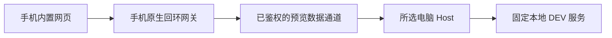

# F76 开发服务预览

日期：2026-11-15。状态：**macOS Codex Host／iOS 首期源码候选，分层验收中；Android 等后续范围未实现，日常服务未部署**。当前实现和证据以[首期验收记录](../acceptance/dev-service-preview-20261115.md)为准；下文保留完整目标设计，未交付子能力不因候选存在而自动完成。

目标：用户在电脑运行 DEV Web 服务后，能在手机 Agent Hub 内打开相同服务，包括仅监听电脑 `127.0.0.1` 的服务。打开网页不要求修改服务监听地址、公开端口或重新发送模型任务。可用条件是电脑与服务运行中、手机拥有对应目标权限，且所选通道实际支持预览。

本项为新增 F76，不计入既有 iOS × EasyWork F01–F75 对齐任务的完成数，也不改变 A6/F75 的暂停范围。共同定义见 [产品清单](../product/mobile-parity.md)，交互和验收关联分别见 [设计规格](mobile-parity.md)、[验收规范](../acceptance/mobile-parity.md)。本文维护目标设计，不记录虚构的运行结果。

## 1. 地址含义与当前缺口

| 电脑服务地址                                      | 实际含义                                           | 手机如何访问                                                                |
| ------------------------------------------------- | -------------------------------------------------- | --------------------------------------------------------------------------- |
| `http://0.0.0.0:5173`                             | 在电脑所有 IPv4 接口监听；不是手机应使用的目的地址 | 可选电脑可达 LAN/VPN 地址；默认由 Host 连接电脑本地服务                     |
| `http://127.0.0.1:3000` / `http://localhost:3000` | 仅电脑自身可达；手机上的同名地址指向手机           | Host 在电脑本机连接，再转发到手机                                           |
| `http://[::1]:3000` / `[::]` 监听                 | IPv6 回环 / IPv6 通配绑定                          | 使用准确地址族；不假定 IPv6 通配必然兼容 IPv4                               |
| 电脑 LAN/VPN IP 与端口                            | 在对应接口可达才允许直连                           | 校验路由、监听、防火墙及框架 Host 校验；同 Wi-Fi 不等于可达                 |
| 容器或 WSL 内的回环                               | 属于容器/WSL 的网络环境                            | 先提供 Host 所在环境可达的具名映射；不将宿主机 localhost 当作容器 localhost |

监听语义见 [Node 网络文档](https://nodejs.org/api/net.html#serverlistenport-host-backlog-callback)；Vite 对通配绑定、WSL 和域名校验有额外说明，见 [Vite 服务配置](https://vite.dev/config/server-options)。

本次源码核对：`apps/ios/Sources/MessageLinks.swift` 已将 localhost、回环及通配地址归为 `computerWeb`，点击后提示手机无法直接访问；普通网页使用 `SFSafariViewController`。`FilePreview.swift` 的 HTML 文件容器不等于动态 Web 服务代理。现有 Codex HTTPS 连接与 EasyWork 直连/中继能力，也不等于已支持任意网页、WebSocket 或流式字节转发。

## 2. 用户体验

功能名：**开发服务**；打开动作：**在手机预览**。

1. 聊天正文保留原链接，例如 `http://localhost:5173/products?q=demo#details`。点击时捕获该消息原属的电脑、Agent、workspace、runtime、项目及聊天，不使用后来切换到的电脑。
2. 识别本地链接后，显示“在手机预览”，首次展示“电脑 · 项目 · 端口”。已有设备授权覆盖且目标检查通过时，直接创建短期预览；只有超出既有授权或来源不明时才补所缺确认。
3. 从聊天右上角更多菜单进入“开发服务”，显示当前目标下已登记的服务及状态。可手动输入端口或完整本地 URL；无项目聊天明确显示“无项目”。持久保存的是服务配置，不是永久访问令牌。
4. 预览页提供后退、前进、刷新、关闭；顶栏显示服务名、来源电脑和连接状态。路径、查询和 fragment 保留；fragment 只在浏览器端使用，不发送到 Host。
5. 关闭预览释放转发资源，**不会停止电脑上的 DEV 进程**。“结束访问”撤销本次会话及子流。重新打开重新验证服务归属。

示意：

```text
开发服务                         ＋ 添加
电脑 A · 当前项目
前端页面        localhost:5173    可预览  ›
后端文档        localhost:8000    未启动  ›

预览：前端页面 · 电脑 A           关闭
‹  ›  刷新             已连接
┌─────────────────────────────────┐
│             实际网页             │
└─────────────────────────────────┘
```

两端复用现有背景、字体、状态颜色及按钮 token；iOS 44 pt、Android 至少 48 dp 触控范围，支持深浅色、横屏和大字体。错误必须区分“电脑未连接”“服务未启动”“端口归属已变化”“当前连接不支持预览”“网页需要配置访问地址”“访问已结束”，不能统一显示网络错误。页面显示成功与 HMR 可用分别记录，不能看到 HTML 就标记全部正常。

首期从真实消息链接或用户输入建立候选，不后台扫描全部端口、不因为模型输出出现 URL 就自动访问。服务列表保留最近配置；自动发现监听端口属于后续扩展，需按进程与项目核对归属。

## 3. 主方案：App 内受控转发



**默认路线：原生 App 内置网页 + 手机回环网关 + Host 具名 HTTP/WebSocket 转发。** 网关只绑定手机 loopback，网页使用标准 HTTP/WS，手机到电脑的实际网络流量使用现有身份体系下的新预览加密通道。电脑 DEV 仍可只监听 `127.0.0.1`，不新增对局域网或公网开放的 DEV 端口。

浏览器可见地址如 `http://127.0.0.1:<本次手机端口>/`，这是手机网关地址；它由会话映射到所选电脑的固定端口，与电脑原 URL 含义不同。该地址只供 App 内使用，不作为可分享链接。

选择标准回环网关是为了保留 `/assets`、`/api`、ES module、SPA 路由和 WebSocket 的正常 URL 行为。首期不将任意站点挂到 Host 管理接口的 `/preview/<id>/` 下，也不依靠全文替换 HTML/JS 重写所有 URL。iOS 不以自定义 URL scheme 冒充 HTTP/HTTPS；Apple 的 [WKURLSchemeHandler 文档](<https://developer.apple.com/documentation/webkit/wkwebviewconfiguration/seturlschemehandler(_:forurlscheme:)>)明确限制对 WebKit 原生已处理 scheme 的注册。

### 实施前技术门槛

此路线是设计选择，尚无原生 PoC 证据。开始产品实现前，必须在独立 iOS/Android 容器证明回环监听、平台网络策略、主页面/子资源/fetch、Cookie 隔离、WebSocket、SSE 和关闭清理。Android 如需 HTTP 策略例外，只限定回环，不全局放开明文；iOS 同样核对 ATS 及具体系统行为。

回环可能满足安全上下文判断，但不等于有效 HTTPS 证书，也不保证所有 Cookie、Service Worker、相机或 OAuth 行为。[W3C Secure Contexts](https://www.w3.org/TR/secure-contexts/)只提供安全上下文判断依据，实际浏览器和设备能力另验。需要严格 HTTPS origin 的应用进入后续独立 HTTPS 入口方案，不能关闭证书验证来勉强通过。

### 通道与平台边界

| 通道                | 设计行为                               | 交付条件                                                          |
| ------------------- | -------------------------------------- | ----------------------------------------------------------------- |
| LAN / VPN 直连 Host | 原生网关经认证 HTTPS/WSS 承载预览      | 原 Host 实现新能力，数据流和撤权已验收                            |
| EasyWork 远程通道   | 复用既有绑定与加密体系，增加有界预览流 | 桌面、手机、通道均声明此能力；已有聊天可用不能替代                |
| Codex 跨网          | 首期使用实际可达 VPN Host              | 不宣称仓库 Relay 草案已成为通用公网隧道                           |
| 外部 Safari/Chrome  | 后续独立浏览器入口                     | 可达 HTTPS 地址、可信证书、每服务隔离站点及短期浏览器授权全部就绪 |

每次切换连接路径均重新核对完整目标和预览能力。Relay 只路由密文，不解析网页内容、不保存 DEV 登录凭据。预览数据使用独立二进制/流式通道与限额，不放入聊天、协调正文或巨型 Base64 JSON 中；聊天、审批及回执优先于预览大流量。

## 4. 服务授权与隔离

预览权限是对具体服务的交互访问，网页可能发起 POST、文件上传和其他有副作用操作；它不是只读截图。已有 Host 连接不自动等于开放该电脑全部端口。

- 完整目标使用产品现有 Agent/Host/workspace/runtime 身份，来源额外绑定 project/thread/message 或显式手动登记；Codex 登录账号不作为新增门禁，其他 Agent 保留原协议约束。
- Host 接受规范化的 scheme、明确端口和来源信息，创建不可猜测 `serviceId`；转发流只能使用已授权 `serviceId`，不接受页面提交任意上游 URL、IP、CONNECT、shell 或方法名。
- 首期仅允许受控 HTTP/HTTPS Web 服务。`0.0.0.0`/`::` 只作监听提示，Host 依据实际监听和地址族选择回环目标；不直接拨号通配地址。保留并校验原 authority；`.localhost` 虚拟主机、其他 `127/8` 地址与 IPv4 映射 IPv6 不能粗暴折叠为另一服务。
- 核对监听进程、启动代际与项目归属；消息中的链接只提供候选，不是权限证明。无法自动证明归属时展示准确服务由用户登记。排除 Host 管理、调试器、凭据和基础设施管理端口；不能以“返回 HTML”证明适合开放。
- 服务重启、PID 重用、端口被其他进程接管时，旧会话失效或进入重新核对；已登记的服务配置可保留，但不自动把旧授权交给新进程。macOS 与 Windows 各实现具名平台检查，容器/WSL 映射另验。
- Host 长期密钥、设备私钥、管理接口凭据只存在原生层，不放到网页 JS、URL、Cookie 或转发请求。上游只接收该 DEV 应用自己的认证信息，不代用电脑浏览器的登录状态。
- 手机回环网关使用短期随机会话凭证，校验精确 Host/端口、访问会话及适用的 Origin，WebSocket upgrade 同样验证；禁止任意 CORS、跨会话访问与 DNS rebinding。引导凭证只供原生容器建立会话，不写历史/Referer/日志。
- 每个预览容器拥有独立非持久浏览数据存储。**不同端口不能隔离 Cookie**，见 [RFC 6265](https://httpwg.org/specs/rfc6265.html)；不能仅凭手机动态端口不同就宣称隔离。Android 若无法在支持的版本证明独立存储，则首期只允许一个活跃预览，关闭后完整清除该专用容器数据再打开另一个，不能复用其他 WebView 的认证数据。
- 网页不挂原生 Agent 管理桥，不共享已有文件预览的特权。会话过期、设备解绑、切换目标和用户结束访问时，撤销会话、关闭 HTTP/WS 子流与网关；清理仅涉及本次预览资源。

## 5. Web 兼容性契约

| 项目                               | 首期处理                                                              | 边界                                                                  |
| ---------------------------------- | --------------------------------------------------------------------- | --------------------------------------------------------------------- |
| HTML / CSS / JS / ES modules / SPA | 保留根路径、编码、查询、状态码、内容类型和二进制字节                  | 不把任意响应改写成 HTML；不依赖源码注入                               |
| API / 表单 / 上传 / 下载           | 同源请求走已授权服务，流式传输且施加体积、并发和超时限额              | 支持的 HTTP 方法显式列举；禁 CONNECT/TRACE，不自动重试业务请求        |
| WebSocket / HMR                    | 完整握手、双向文本/二进制帧、子协议、关闭、背压与存活策略             | 只支持声明并验证过的服务；HMR 绝对主机/端口按实际框架版本配置         |
| SSE / 流式响应                     | 端到端增量转发，避免全量缓存；尊重断流、取消和超时                    | 传输支持独立声明，不把轮询模拟成流式通过                              |
| Cookie / 登录                      | 同一会话保留 DEV 登录；按服务处理已登记 authority 的 Domain/Path 映射 | 不删除 Secure/SameSite 约束；HTTPS、OAuth、第三方登录另验             |
| 重定向                             | 仅将同一已授权服务的绝对 Location 映射回本次预览 origin               | 外部目标单独导航，跨本地端口先建立新授权；Host 不跟随到任意内网       |
| Origin / Host / CSP / CORS         | 将实际浏览器 origin、上游 authority 及框架配置作为明确映射契约        | 不统一去掉 Origin、不改成 CORS `*`、不移除 CSP，也不关闭 allowedHosts |
| 相机/麦克风/定位/Service Worker    | 单项能力提示与专项验收                                                | 普通网页成功不推定这些能力通过                                        |

WebSocket 需要专门处理 upgrade 和连接生命周期，见 [NGINX 官方说明](https://nginx.org/en/docs/http/websocket.html)。Vite 代理失效时可能回退直接连接 HMR 服务；手机不能因此自动访问电脑回环，见 [Vite 配置](https://vite.dev/config/server-options)。框架配置示例应读取项目实际安装版本后生成，不硬编码跨版本选项。

多服务的典型情况是页面在 `5173`、API 在 `8000`。首期优先让 DEV 前端通过自身 `/api` 代理访问后端，手机只访问一个授权服务。页面若硬编码 `http://localhost:8000`，该地址仍指向手机，不会被自动修好；提供明确诊断与项目配置建议。多 origin 映射是后续能力，必须逐服务授权，不能靠扫描或全局 JS 替换掩盖问题。

## 6. 拟议领域接口与恢复

以下是命名建议，**不是现有端点、wire schema 或 health 声明**。领域层放入版本化公共协议，平台/Agent 适配器各自实现，业务层不感知具体 WSS/Relay 帧。

| 操作                  | 用途                                                                                             |
| --------------------- | ------------------------------------------------------------------------------------------------ |
| `devServices.resolve` | 按完整目标、原消息引用或手动输入识别服务，返回状态、归属、地址族和支持模式；不执行模型或启动进程 |
| `devServices.list`    | 分页读取本目标已登记服务，区分配置、监听就绪和手机实际预览状态                                   |
| `devPreviews.create`  | 使用稳定 operation ID 创建短期、限定服务与设备的会话；同 ID 不同意图拒绝                         |
| `devPreviews.get`     | 查询会话、能力、到期、失效原因及创建/关闭回执                                                    |
| `devPreviews.close`   | 幂等撤销会话并关闭相关流，不杀 DEV 进程                                                          |
| 独立预览数据通道      | 使用 session/stream/generation ID 传送 HTTP 与 WebSocket；限制缓冲、并发、单请求及空闲预算       |

能力按 `preview:http:v1`、`preview:websocket:v1`、`preview:streaming:v1`、`preview:relay:v1`、`preview:external-browser:v1` 分开，名称待 Schema 评审。由实际实现与运行就绪共同决定；旧 Host 显示需要升级，不能因已有文件下载或模型代理就宣称支持。

重连只恢复控制通道、查询原会话或建立新连接，**不重放在途网页请求或 WebSocket 消息**。任意应用的 POST 不因本产品 operation ID 而自动具备幂等性。无完整响应时提示“连接中断，刚才的网页操作结果未确认”，用户核对业务状态后自行继续；代理不自动重载可能触发副作用的页面。页面自身的框架重试与代理行为需分别说明及验收。

App 进入后台不承诺持续提供回环网关；超出系统执行预算后关闭流并保留恢复信息，回前台查询原会话。网页登录默认只在本次预览生命周期保存；关闭再打开可能需要重新登录。服务配置可持久化，页面存储持久化不属于首期承诺。

## 7. 交付顺序与退出标准

1. **可行性门槛**：独立 iOS/Android 原生网关，验证标准 HTTP/WS、Cookie 隔离、平台网络策略及清理；未通过不进入“已实现”。
2. **首期**：Codex Host LAN/VPN，单个已授权 HTTP 服务、消息入口/手动登记、App 内预览、SPA/API/表单、WebSocket/HMR、SSE、会话隔离与可诊断失败。Vite、一个 Next.js 开发服务和普通 HTTP 应用按安装版本逐项实测，失败保留，不概括成所有框架可用。
3. **适配扩展**：EasyWork 对应桌面与手机适配、远程流通道、多服务明确映射及 HTTPS 应用兼容；每项单独声明能力与验收。未经指定不联系其他电脑/客户端执行开发。
4. **独立浏览器**：另行设计每服务隔离 HTTPS origin、DNS/证书及浏览器短期授权。App 内可用不自动生成公网分享地址；不能将手机临时回环链接交给 Safari 并承诺后台可用。

| 场景 ID | 必须核对的实际结果                                                                                             |
| ------- | -------------------------------------------------------------------------------------------------------------- |
| PV01    | 同一真实 DEV 分别绑定 `127.0.0.1`、`0.0.0.0`、IPv6；手机得到准确随机内容，电脑绑定与防火墙策略未被预览功能改变 |
| PV02    | 中文/编码路径、query/fragment、根路径静态资源、SPA 深链接刷新与前进后退                                        |
| PV03    | 同源 API、Cookie 登录与退出、表单/上传/下载；两电脑相同端口、两服务、切目标之间无认证或缓存串线                |
| PV04    | 改源码后真实 HMR 生效，WebSocket 双向与二进制、SSE 首块可在响应结束前显示，慢消费背压不拖垮聊天                |
| PV05    | 电脑离线/休眠、DEV 停止/重启、端口接管、Host 重启、App 后台/回前台，恢复不会盲目重放写请求或误连其他服务       |
| PV06    | 伪造来源、越权端口、管理端口、跨本地服务重定向、任意 URL/CONNECT、凭据泄漏、DNS rebinding 和跨会话访问均拒绝   |
| PV07    | 不支持的框架 Host/Origin、写死 API 地址、HTTPS Cookie、OAuth、Service Worker 给出准确边界，未验不标通过        |
| PV08    | 显式结束/到期/解绑后网关、流、会话授权与临时存储已回收，原 DEV 继续运行                                        |
| PV09    | LAN、VPN、蜂窝经 VPN/中继、iOS/Android、macOS/Windows 逐组合记录；没有通道能力的组合明确不支持                 |

一般页面、协议与恢复可使用原生模拟器验收；蜂窝、设备 VPN、实际相机/麦克风等断言需要对应物理设备。模拟器与开发机共享网络栈时，必须独立证明流量经过网关/Host，并注入错误目标反例，不能直接打开电脑 localhost 就宣称转发通过。本功能不必生成新模型输入；只有测试涉及真实模型或 Electron 行为的断言才增加对应证据。

每份证据绑定源/包摘要、Host、设备、平台、通道、框架版本与子断言；辅助检查、真实通过、失败与未验分开。首次设计阶段仅完成设计和官方资料核验；2026-11-15 后续已获用户授权进入首期开发与验收，实际范围见首期记录。资料核验 Agent 的创建请求为 Terra/medium；接口无速度参数，实际运行档位未独立核实，不记为指定模型验收证据。
