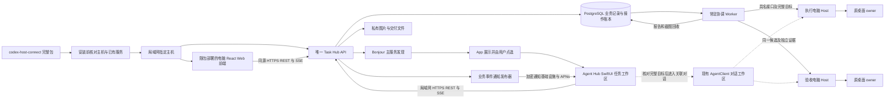
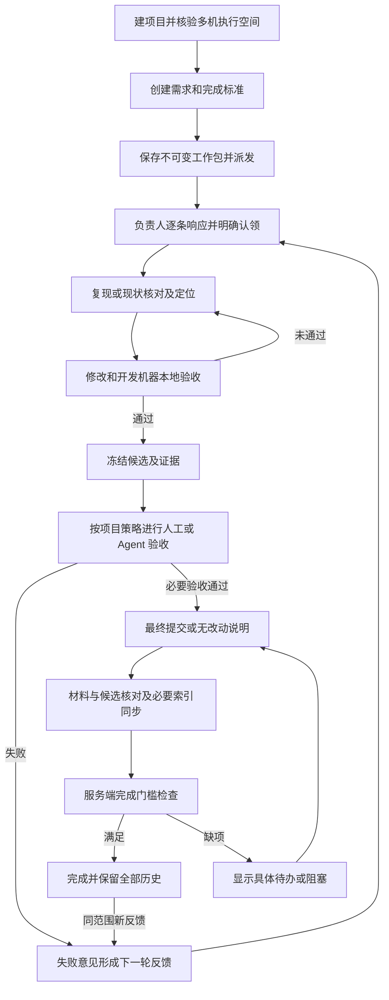

# Agent Hub App 任务管理整体架构与技术方案

版本：v1.0 桌面前后端随 Skill 部署、iOS 共用后端

日期：2026-10-14，Asia/Shanghai

状态：整体架构与 iOS UI/UX 已由用户确认定稿；开发与模拟器、真机真实任务验收进行中

目标：将 `projects manage/products/agent-task-hub` 的项目任务台和任务协同全流程接入现有 Agent Hub iOS App。

采用 **桌面 Web 前后端随接入 Skill 部署、iOS SwiftUI 原生界面复用局域网唯一后端、主服务负责多机协调** 的整体架构。本次 Agent Hub 局域网部署只指定一台常驻电脑托管电脑 Web 前端、任务 API、Worker、PostgreSQL 和附件库。电脑浏览器和手机 App 使用同一后端及业务记录；其他电脑通过各自 Host 执行任务。

已确认的部署要求：**电脑 Web 前端及电脑后端的完整部署程序和固定产物一起纳入 `codex-host-connect` Skill 接入包**；安装前核验已有主服务及主机登记；App 自动探测局域网主服务，展示后由用户点选连接。主机统一托管 Web 静态资源与 API，iOS 只增加原生客户端。主服务安装角色与每台电脑的 Host 接入角色分开，主机离线不会自动在其他电脑新建后端。

最终交付覆盖项目配置、任务创建与派发、认领、反馈响应、开发过程、证据、候选交付、人工或 Agent 验收、失败返修、最终交付核对、通知和恢复。下面的分期是工程实施顺序，完整交付以全流程验收为准。

## 1 已确认的整体决策

| 审核项       | 建议决定                                              | 对使用方式的影响                                       |
| ------------ | ----------------------------------------------------- | ------------------------------------------------------ |
| App 实现     | 在现有 SwiftUI App 增加原生任务工作区                 | 手机使用原生列表、看板、详情和表单                     |
| 数据归属     | 复用 Agent Task Hub API 和 PostgreSQL                 | Web、手机和后台协调共用业务记录                        |
| 执行责任     | 常驻任务服务派发及回收，Host 管理本机执行             | 手机锁屏或退出后，已授权流程继续推进                   |
| 后端部署     | 局域网中指定一台常驻主机运行唯一任务后端              | 全部手机、Web 和执行电脑共用同一任务库                 |
| 程序分发     | 电脑 Web 前端和后端随 `codex-host-connect` 完整包交付 | 主机托管完整任务台，其他电脑浏览器及手机复用同一后端   |
| 安装校验     | 探测服务、核对主机登记，再决定复用、升级或首次安装    | 主机离线或校验不明时不创建第二套后端                   |
| App 连接     | Bonjour 自动发现，真实探测后展示，由用户点选连接      | 默认不用填写 IP；发现、可连接和已登录分别展示          |
| 完成规则     | 服务端按项目策略核验，验收通过后继续检查交付门槛      | 显示“验收已通过，待最终提交”等真实阶段                 |
| 首期执行范围 | 完整接通源项目当前的 Codex Host 流程                  | EasyWork 既有对话功能继续使用；任务 Connector 单独扩展 |
| 业务迁移     | 先接通同源任务管理，再按项目决定飞书权威来源切换      | 不因安装 App 自动迁移或双写旧看板                      |

## 2 当前基础与需要补齐的差距

### 2.1 已有实现

源项目是独立业务工程，采用 React/Vite、Ant Design、NestJS/Fastify、PostgreSQL/Drizzle。当前代码已有以下基础：

| 领域       | 当前代码能力                                                 | App 接入方式                           |
| ---------- | ------------------------------------------------------------ | -------------------------------------- |
| 项目与身份 | 人类登录、项目权限、成员与 Agent 身份                        | 增加原生人类设备会话，复用项目授权     |
| 任务工作区 | 固定字段表格、四列看板、分页、搜索、状态和负责人筛选         | 原生重建相同业务能力，数据来自同一 API |
| 任务过程   | 首次需求反馈、逐条响应、进度、交付、验收、失败新轮           | 复用服务端业务操作和历史关系           |
| 并发门槛   | 任务 revision、事务、角色、反馈覆盖、候选和轮次校验          | App 处理冲突，服务端继续作最终判断     |
| 图片证据   | 私有图片上传、缩略图、预览、准确事件关联                     | 接入 PhotosPicker、原生预览及上传恢复  |
| 多机执行   | 自有 Host 自动认证、项目源与执行空间映射、任务派发和回报收集 | 由任务服务继续负责，手机不接管 Worker  |
| 事件同步   | 持久化 project_changes 和带 Last-Event-ID 的 SSE             | 原生事件连接与前台补同步               |

现有 Agent Hub App 已有 SwiftUI 界面、通用 AgentClient、完整运行时目标、Keychain、附件选择、原桌面对话、审批及通知基础。任务工作区应复用这些基础设施，并保持业务状态与执行状态各自的来源。

源项目核心 Web 流程已有两机浏览器验收记录。AH-06 的最新设计记录显示真实多轮 Host 闭环已运行，冻结后的独立全产品复验结果仍待回收；源工程当前还有未提交改动。实施前须与该任务对账并冻结输入，不能将正在变化的目录直接作为发布基线。390px 浏览器验收只证明移动网页布局，不构成原生 App 或实体 iPhone 的通过证据。

### 2.2 本次必须补齐

1. **原生人类认证。** 当前登录要求 Web Origin 并设置 Cookie；Bearer 入口对应 Agent Key。手机需要独立的人类设备会话，不能借用 Agent Key，也不能全局放宽浏览器来源校验。
2. **业务命令回执。** 现有任务 revision 和 Host 操作回执不能完整覆盖手机创建任务、添加反馈等请求超时。需为业务写操作增加稳定操作 ID、内容摘要和可查询回执。
3. **完整完成门槛。** 当前 `TasksService.decide` 在验收 passed 后直接写 done；复现、自验、最终提交、材料和索引同步等约定尚未分别成为结构化关闭条件。
4. **证据与候选结构。** 当前候选主要是 `candidateRef` 文本，任务附件入口仅支持最多 20 MiB 的图片。完整交付需要可核对的候选清单、自验结果和受控交付文件。
5. **移动端查询。** 当前列表主要筛选 q、status、ownerId；看板使用当前分页数据。需补齐“待我处理”、真实各列总数、按列分页和过程分页。
6. **任务与会话导航。** 需提供完整目标与关联会话的权限化描述，才能安全跳转现有 App 对话，不能按电脑名或目录名拼接目标。
7. **主服务安装与自动发现。** 当前接入包没有任务后端部署角色，App 也没有任务服务 Bonjour 类型。需新增唯一主机登记、安装前预检、局域网 HTTPS 发布、发现后点选连接及冲突处理。
8. **业务通知和服务运维。** 当前对话通知不等于业务验收通知；本机开发服务不等于具有启动恢复和备份能力的局域网唯一主服务。

## 3 整体架构与组件责任



| 组件            | 负责的事情                                             | 权威数据                     |
| --------------- | ------------------------------------------------------ | ---------------------------- |
| App 任务模块    | 展示、表单、草稿、命令提交、回执查询、离线缓存、导航   | 服务端确认的任务快照         |
| Task Hub API    | 人类身份、项目权限、流程门槛、事务、业务审计           | 项目和任务业务状态           |
| PostgreSQL      | 任务轮次、响应、候选、验收、操作回执、事件与派发记录   | 持久业务记录                 |
| 协调 Worker     | 已授权派发、准确目标核对、回报收集、返修及恢复         | 已持久化意图和真实 Host 回执 |
| Host 与 Adapter | 本机身份、原 owner、具名执行、附件、审批和真实运行状态 | 电脑上的执行事实             |
| 通知基础设施    | 设备订阅、加密投递、提醒和点击导航                     | 通知投递与去重记录           |

任务 API、协调 Worker、数据库和附件库只部署在指定主机上。后端启动受主机登记、本机实例锁和数据库执行锁保护，防止重复服务进程；调度使用持久业务账本。主机断线时保留该主服务归属，等待其恢复，不自动选举新主机或建立另一份任务库。未知执行恢复先查原回执。

任务业务服务需要读取任务内容以检查流程，并保存正文与证据。手机到任务服务采用 HTTPS；任务内容在该服务上可读。通知经过中继时使用加密载荷，不能将这一点扩展为整个任务数据库端到端加密。

### 3.1 源码维护边界

| 位置                                                         | 维护内容                                                               |
| ------------------------------------------------------------ | ---------------------------------------------------------------------- |
| `projects manage/products/agent-task-hub/apps/api`           | 任务业务、设备会话、业务回执、Worker、通知发布与数据库迁移             |
| `projects manage/products/agent-task-hub/apps/web`           | 保持与 App 一致的流程展示和权限，承接服务端门槛变化                    |
| `projects manage/products/agent-task-hub/packages/contracts` | 唯一任务领域契约、DTO 和导出 schema                                    |
| 本仓库 `apps/ios`                                            | 原生任务界面、任务客户端、缓存和会话导航                               |
| 本仓库 `packages/protocol`                                   | 通用运行时目标、Host 操作与通知公共契约                                |
| 本仓库 Host、Adapter、SKILL                                  | 必要的本机执行能力修复及统一分发                                       |
| 本仓库接入包构建与主服务部署脚本                             | 收录任务后端固定候选产物，维护预检、唯一主机登记、安装、升级和发现发布 |

两个工程保留各自 pnpm workspace 和锁文件。iOS 通过版本化 HTTP 契约集成任务服务；任务业务源码继续在源业务工程维护。公共 Host 协议或 SDK 的修复在本仓库维护并发布固定版本，业务 Connector 不复制或修改 Host 实现。

任务服务首期完整执行链使用现有 Codex Connector。后续 Agent 接入通过注册 Connector 扩展，并逐项声明真实能力；App 已能使用 EasyWork 对话，不代表任务服务已支持 EasyWork 的派发和回报协议。

## 4 App 信息架构与页面方案

### 4.1 一级入口

在现有侧栏的 **“文件互传”正上方** 增加 **“项目与任务”**，顺序为“新聊天 → 项目与任务 → 文件互传 → 最近／项目”。顶部右侧在现有新对话图标后增加 `checklist` 图标，顺序为“新对话 → 项目与任务 → 更多”；可访问性名称为“项目与任务”。两处打开同一个任务工作区，不新增全局模式切换栏或底部主导航。

任务工作区提供项目列表、项目管理和项目内任务；业务项目来自任务服务，现有对话项目来自对应电脑运行时。任务入口的可用性由任务服务决定，不依赖当前聊天电脑在线或能否新建对话。首次进入先连接服务，已连接时恢复上次业务项目与筛选。

一个业务项目可以映射多台电脑。选择业务项目不自动切换当前聊天电脑；选择某个执行记录进入关联会话时，才按完整目标切换。App 分别保存对话和任务工作区的项目、筛选、滚动位置和草稿。

首次打开任务工作区：自动探测局域网 → 展示发现的主服务 → 用户选择连接 → 验证服务身份与就绪状态 → 人类账号首次登录 → 读取有权项目。后续回前台和网络变化时自动核对已选择的同一服务，不重新要求用户填写 IP。详细状态和异常处理见第 10 节。

完整页面、导航、表单和异常状态按 [iOS UI/UX 设计稿](task-management-ios-ui-ux.md) 审核。当前先交付界面预览，用户确认后再实现生产 SwiftUI 页面。

### 4.2 页面与功能映射

| 页面       | 手机呈现                                                     | 核心动作                                   |
| ---------- | ------------------------------------------------------------ | ------------------------------------------ |
| 任务首页   | 项目选择、全部／我的任务／待响应／待验收／阻塞／逾期         | 搜索、筛选、刷新、新建                     |
| 主服务连接 | 自动发现的主机名称、服务身份、就绪与已连接状态               | 点选连接、刷新发现、查看离线或冲突原因     |
| 任务列表   | 紧凑行显示编号、标题、状态、负责人、设备、轮次、待办和缩略图 | 查看详情、修改允许编辑的属性               |
| 任务看板   | 四个固定业务列，手机按列切换或横向浏览，分别分页             | 打开任务、按实际权限开始处理               |
| 创建任务   | 需求、验收标准、类型、优先级、执行空间、验收策略、日期、附件 | 保存；保存并派发                           |
| 任务详情   | 默认当前轮过程，旧轮折叠；需求、证据、交付和执行记录可切换   | 反馈、本人响应、本人认领、进度、交付、验收 |
| 执行记录   | 开发／验收分开，显示实际设备、运行状态、回执和阻塞           | 核对未知操作、查看关联会话                 |
| 项目设置   | 唯一项目源、真实 Host 项目映射、执行／验收角色、流程策略     | 管理员配置和重新核验                       |
| 设备与权限 | 任务服务发现的连接、能力、核验时间及撤销状态                 | 管理员刷新发现和撤销任务服务连接           |
| Agent 授权 | 外部 Key 列表、范围、撤销，一次性秘密展示                    | 管理员使用；自有 Host 仍自动接入           |
| 待办与通知 | 当前身份需要处理的反馈、澄清和验收                           | 进入准确任务及轮次                         |

手机列表承接 Web 固定表格的全部业务字段；次要字段在详情查看，较宽设备可以展示固定列。筛选和详情在列表、看板间共用。看板拖动只是业务操作入口，响应、交付和完成校验仍由服务端执行。

任务详情建议布局：

```text
任务编号  登录后出现错误             进行中
第 2 轮 · 待负责人响应               查看执行会话
负责人：开发 Agent    验收：独立设备 Agent

过程  需求  证据  交付  执行

本轮反馈
  用户：重新登录仍然失败             [截图]
    ↳ 开发 Agent：已复现，准备修正

开发过程
  认领 → 复现 → 定位 → 修改 → 本地验收
  当前：本地验收已通过，候选已冻结

交付与验收
  候选版本及摘要  ·  查看逐项证据
  验收通过后：待最终提交和材料核对

底部按当前身份显示可执行动作
```

### 4.3 技术选型

| 选项                    | 适合的场景                                     | 本次结论                                               |
| ----------------------- | ---------------------------------------------- | ------------------------------------------------------ |
| SwiftUI 原生            | 与现有对话、附件、通知、草稿和原生导航深度整合 | 推荐，沿用 App 技术栈                                  |
| WKWebView 嵌入          | 快速提供既有网页入口                           | 可作临时入口；正式交付需要额外解决登录、导航和后台恢复 |
| React Native 或 Flutter | 同时新建多个移动平台                           | 当前仅 iOS 需求，新增运行时和双套界面维护成本较高      |

原生模块使用 SwiftUI、现有 ObservableObject 风格和 Swift Concurrency；HTTP 使用 URLSession，事件使用独立 SSE 客户端。图片选择与预览复用 PhotosPicker 和现有原生组件；缓存、草稿及操作账本采用系统 SQLite 和私有文件目录，凭据保存在 Keychain。

拟新增 `TaskHubClient`、`TaskHubStore`、`TaskHubRepository`、`TaskHubEvents`、`TaskHubUploadCoordinator`、`TaskHubViews` 等独立文件。`RootView` 只负责模式和导航装配，任务轮次及业务状态不继续堆入 `SessionStore`。共享附件选择、日期展示和通知展示通过窄接口复用。

## 5 任务全流程与完成规则



### 5.1 按项目承接验收策略

使用固定流程模板和少量明确策略，避免引入通用可编程工作流平台。策略保存版本，并在任务创建或新轮开启时冻结为快照。

- 开发、BUG 和已有功能核验要求认领、现状／复现、定位／实现差距、本地验收、候选、所选独立验收及交付闭环。
- 人工验收与 Agent Host 验收继续是两种选择；明确要求同时验收的任务保存多个必要验收请求。
- 项目要求异机验收时，校验实际不同设备和各自环境证据。不同 Actor 或 Thread 不能充当不同设备证明。
- 文档、规划和运维使用各自适用的完成条件，例如规划任务检查方案与审核，不伪造代码提交或模型执行。
- 项目既有覆盖规则按适用任务集合保存。AI Gateway 特定八项任务取消双机验收的规则只应用于指定任务，不扩展为所有新任务的默认策略。
- 推送、PR、合并、发布和部署是否必需来自项目与任务授权，普通验收动作不自动增加这些副作用。

### 5.2 分开维护业务与执行状态

保留 `todo / doing / review / done` 四个业务状态。增加 `workflowStage`、`blockers`、必要验收清单与完成检查结果。

`workflowStage` 表示待认领、复现、定位、修改、本地验收、独立验收、返修、待最终提交、待索引同步或待人工确认。验收通过但关闭条件未齐时，业务状态保持 review，并显示准确阶段；全部条件满足后才写 done。

Host 的 queued、running、completed、uncertain 等执行状态单独显示。模型 completed 只证明这一轮模型执行结束；Owner 丢失或 Host 离线保留最近事实和核验时间，不推断业务成功。

取消与归档使用独立生命周期字段和具名操作，保留历史业务状态。取消任务不自动停止远端 Turn；停止、队列取消和审批使用原生具名命令及准确目标。转交负责人须先核对旧执行和交接记录，同一任务只保留一个当前主负责人。

### 5.3 服务端关闭条件

关闭时在任务事务中同时核对：当前轮和需求版本、明确认领、逐条反馈及有效处理响应、必要过程记录、本地与所选独立验收、候选与最终交付一致、附件真实可读、无必要阻塞，以及该项目所要求的索引同步和人工接受。

检查结果直接返回缺项，例如“最终提交未登记”“验收对应旧候选”“本轮还有 1 条待响应”。普通记录可以在权限范围内更新；认领、验收、撤回反馈、转交和完成必须有明确操作者及不可覆盖的审计记录。

在任务系统作为唯一看板的项目中，数据库事务提交后按 taskId、revision 读回核对并保存关闭回执，项目索引由同一事务维护。需要同步工作台文件或外部看板的项目另有导出／同步回执；未启用这些集成的项目不添加无关关闭门槛。

## 6 数据模型与契约

### 6.1 复用和新增实体

复用现有 Project、Actor、Task、TaskRound、Feedback、FeedbackResponse、TaskEvent、Delivery、Acceptance、HostProjectBinding 和 ExecutionRun。新增实体用于承接现有约定中的明确事实：

| 实体                   | 核心字段与用途                                                                                 |
| ---------------------- | ---------------------------------------------------------------------------------------------- |
| WorkflowPolicySnapshot | 流程模板、版本、必要阶段、验收策略、异机要求、交付与同步要求                                   |
| VerificationRecord     | 类型、逐项标准、通过／失败／未验收、实际设备、环境、候选摘要、证据来源                         |
| CandidateManifest      | 基线、完整差异清单、源码内容摘要、产物摘要、受控文件、适用轮次和反馈版本                       |
| FinalDelivery          | 最终 commit 或无需提交说明、候选内容对应关系、结果包和材料版本                                 |
| TaskClosureReceipt     | 被核对的 task revision、policy、round、candidate、验收、交付、同步回执及关闭结论               |
| BusinessOperation      | 客户端稳定 ID、身份和设备、目标、内容摘要、提交状态、业务结果及错误                            |
| HumanDeviceSession     | 人类 Actor、设备、访问会话、刷新凭据摘要、有效期及撤销记录                                     |
| LanPrimaryRegistration | deploymentId、指定主机 Host ID、serverInstanceId、登记版本、状态和可信签名；用于安装及启动核验 |
| TaskDispatchGrant      | 任务授权范围、执行／验收目标、模型、数据范围、自动返修范围及撤销状态                           |
| TaskNoticeSubscription | 服务实例、身份、设备、项目权限、通知偏好和事件去重位置                                         |

一次交付固定 `taskId + roundId + feedbackRevision + candidateId + policyVersion`。每个必要验收绑定同一快照，新增反馈、候选改变或必要策略调整会使旧结论退出当前完成条件；历史记录仍保留。

当前每轮单个 acceptance 的读取投影可以保留；需要人工与 Agent 双重验收时新增验收集合，客户端通过能力及契约版本识别。既有历史 done 保持原记录及当时策略，不凭新字段倒填“已复现”“已双机验收”；历史能力不足时显示其实际证据范围。

### 6.2 契约发布

任务领域以源工程 `packages/contracts` 和其 OpenAPI 导出为唯一契约来源。iOS 使用 Codable DTO；在构建时校验生成或手写 DTO 与固定版本 schema 的一致性。OpenAPI 导出、Swift DTO 和代表性序列化样例随候选固定指纹，不能在正式 App 运行时下载代码生成器。

任务语义与通用 Host 语义分别维护。业务项目 ID、远端项目 ID、taskId、threadId、业务操作 ID、Host operation ID 和事件游标各有类型和用途，不能混用。Nest 可导出语言无关的 OpenAPI 描述，现有 Swagger 输出可继续作为跨语言入口。[Nest OpenAPI 文档](https://docs.nestjs.com/openapi/introduction)

## 7 手机认证与接口补齐

### 7.1 服务连接与人类设备身份

App 默认通过局域网 Bonjour 自动发现任务主服务，点选后保存 `deploymentId + serverInstanceId + primaryHostId`、HTTPS 入口、证书信任和人类账号上下文。地址或服务二维码是发现不可用时的补充入口。地址变化只更新路径，不能仅因同名电脑、相同 IP 或另一条广播自动切换任务数据库。

新增原生登录和设备会话路由，返回短期人类 access token 与可轮换 refresh token。服务端只存不可逆凭据摘要，识别人类 Actor 和设备，支持登录限速、单设备撤销、全部设备退出与刷新竞争检测。过期时间可配置，初始建议 access token 15 分钟、refresh token 30 天。

Web 继续使用 HttpOnly Cookie、既有 Origin 与 CSRF 边界。Agent Key 继续用于对应 Agent 身份。人类设备 token、Agent Key、任务服务到 Host 的连接凭据使用不同 token 类型和授权路径，错误类型明确拒绝。

Keychain 仅保存本机人类会话；密码不持久保存。任务服务保存它自己的 Host 连接授权，手机保存手机自己的 Host 授权。手机不会把 Host Key 上传给任务服务；服务端不会将私有 Host Key 返回给手机。

### 7.2 接口清单

以下“新增／增强”均是拟实现接口。路径为设计命名，冻结契约时逐项落到 OpenAPI；现有业务路由保持兼容。

| 能力           | 现有接口或基础                                                         | 拟新增或增强                                                                                    |
| -------------- | ---------------------------------------------------------------------- | ----------------------------------------------------------------------------------------------- |
| 服务描述       | 本地 API 和 Swagger                                                    | `GET /api/v1/service`：部署域、唯一实例、指定主机、登记版本、TLS 身份、契约版本、就绪与冲突状态 |
| 局域网发现     | 现有 App 能发现 Codex／EasyWork Host                                   | 新增 `_agenthub-task._tcp` 服务类型；公开描述只提供发现元数据，点选后再认证                     |
| 人类设备会话   | `/auth/login`、`/auth/me`、`/auth/logout`                              | `/mobile-sessions/login`、`/refresh`、`/revoke` 及会话查询                                      |
| 项目和成员     | `/projects`、`/actors`                                                 | 项目流程策略、当前身份允许的业务动作                                                            |
| 项目映射       | `/projects/:id/source`、`/host-bindings`                               | 返回权限化完整目标及映射核验版本                                                                |
| 列表和看板     | `/tasks` 分页查询                                                      | 优先级、Host、类型、日期、待我响应、待我验收、阻塞筛选；服务端排序、按列分页和真实总数          |
| 任务详情       | `/tasks/:id`                                                           | 完成缺项、阶段和流程策略；轮次／事件分页，避免一次拉取全部截图和历史                            |
| 现有业务动作   | 创建、编辑、start、feedback、responses、progress、deliveries、decision | 接收稳定 `Idempotency-Key` 并返回对应业务操作 ID                                                |
| 业务回执       | Host 有独立回执，任务动作没有统一入口                                  | `GET /operations/:id`，查询准确原请求结果                                                       |
| 流程事实       | 当前 progress 文本                                                     | 认领／转交、复现、定位、自验、候选冻结、最终交付及关闭检查的具名路由                            |
| 验收           | 当前单个 acceptance decision                                           | 多个必要验收、未验收／受阻、环境和候选结构校验                                                  |
| 图片和交付文件 | `/attachments` 的图片通道                                              | 上传操作票据、文件摘要和完成查询；交付文件独立受控类型与大小限制                                |
| 执行与会话     | `/tasks/:id/runs`、`/dispatches`                                       | `/runs/:runId/thread-link` 返回完整目标和导航权限；必要控制通过具名命令                         |
| 实时变化       | `/events?projectId=`，持久 SSE 游标                                    | 契约化补同步边界、游标过期信号、执行和待办变更通知                                              |
| 业务通知       | App 现有对话通知基础                                                   | 任务通知订阅、撤销、偏好、阅读位置及稳定业务事件 ID                                             |

兼容的字段和具名路由可放在 v1。若修改既有字段语义或状态枚举，发布新契约版本，并同时适配 Web 与 App；不以静默增加未知状态破坏旧客户端。

### 7.3 业务操作的可靠提交

手机提交前持久化不可变请求，保存 `serverInstanceId + actorId + deviceId + clientOperationId`、准确项目／任务、预期 revision、正文和附件引用、内容摘要。服务端将操作键的唯一约束、业务变更、原结果引用及事件写入放在同一事务。

同一操作 ID 和相同内容返回原结果；同一 ID 不同内容返回冲突。创建、反馈、验收失败和派发都必须覆盖，防止重复任务、重复反馈和重复新轮。业务操作 ID 与派发产生的 Host operation ID 分开保存并建立引用。回执查询重新校验当前身份和权限；晚到结果只更新原操作记录，不清空新草稿、不切换当前目标，也不以旧快照覆盖新 revision。

超时或断网标记“结果待核对”，先查询原业务操作 ID。服务端明确证明尚未接收时，可继续提交同一不可变请求和同一 ID；已接收或结果不确定时不新建 ID 重发。用户修改草稿构成新请求，但旧未知创建未核对前不自动再创建同一任务。

revision 冲突显示最新服务端内容与本机草稿。需求、反馈、验收等语义操作需要用户核对后重新提交；普通只读刷新可以自动继续。业务权限、轮次和完成标准不会由手机自动覆盖。

## 8 派发与现有对话功能的衔接

任务执行动作统一进入任务服务，由它保存工作包、准确映射、权限、轮次和操作 ID，再调用正式 Host 具名接口。工作包使用目标当前模型，显式请求 xhigh，并记录实际模型与实际档位；不支持 xhigh 时按该目标可用最高档位处理并展示限制。

首次任务在对应业务项目建立专用开发会话，首次验收建立专用验收会话；后续同任务反馈和返修沿用各自入口。运行中追加任务输入使用 queue，普通反馈不自动 steer 或打断任务。未知创建始终先核对原 ID；必要的新沟通与旧执行归属分别记录，不能把新操作伪装成旧操作成功。

任务台沿用当前结构化回报收集机制，严格绑定 run、task、round、输入窗口、作者、反馈和候选。首期对现有 Host 历史回收机制如实展示同步时间，不承诺未经接入的完整工具流。Host 的真实运行信息与 Agent 自报业务进度保留不同来源；模型普通正文不能直接制造验收通过。

进入关联会话前，App 核对服务实例、人类身份、项目权限，以及 `agentId + account + hostId + workspaceId + runtimeId + threadId`。匹配已保存客户端后调用现有导航；没有手机侧授权时进入正常连接流程，后台授权不能代替手机授权。身份或项目映射改变时拒绝旧目标写入。

关联会话先提供真实过程查看与原生审批。审批和问题回答仍固定准确原请求，不能用业务“验收通过”代替执行权限审批。关联任务的业务反馈、重新派发和返修统一从任务详情提交；会话中确需补充执行指令时登记业务关联并核对当前 Turn，避免绕过输入窗口和反馈义务。

“保存并派发”及后续自动验收／返修须有明确任务授权。App 接入现有 AI 数据共享许可，说明目标、实际模型和提交内容；后台保存任务授权快照，只能在已授权任务、执行／验收目标及数据范围内推进。授权撤销阻止新的派发，已提交的任务与未知结果继续按原回执核对，不能在许可变为允许时自动重放旧草稿。

## 9 同步与恢复

### 9.1 前台与离线

服务端快照是业务事实来源。SSE 提示变化后按 taskId、revision 拉取差异；事件游标以服务实例、账号和项目隔离。首次同步先取得快照对应游标，再补齐其后的事件，关闭“先拉取后订阅”之间的遗漏窗口。

客户端接受更新前核对上下文代际和 revision，较旧网络结果不能覆盖新任务。切换项目、退出账号或撤销权限时取消对应请求。SSE 重连复用 Last-Event-ID；游标过期时进行完整补同步，不能把缺少事件当成任务没有变化。

离线允许查看缓存和编辑草稿。需要执行的操作显示“尚未提交”；首期不自动补发离线创建、反馈、验收或派发。恢复前台先同步业务快照和未知回执，再由用户主动提交仍适用的草稿。

SQLite 缓存和私有附件按 `serverInstanceId + actorId + projectId + taskId` 分区。草稿再细分当前动作、roundId 和 feedbackId；已提交操作独立保存。退出可清理当前账号本机数据，不删除服务端任务；新账号不能读到旧账号图片、草稿或回执。

### 9.2 附件与候选文件

任务图片直接上传任务服务，复用真实字节类型校验和私有项目授权。Host 附件 ID 与任务附件 ID 不混用；Worker 向 Host 上传时建立目标、输入窗口及 SHA-256 对应关系。

图片继续限制 20 MiB。完整交付新增日志、文本、patch 和候选包的受控文件通道，首期建议单文件上限 50 MiB、按项目配额；大产物保存受控引用和摘要。候选包下载后先核对清单及摘要，预览不执行包内文件。

上传先取得稳定 uploadId、限定目标和内容摘要的上传票据，传完后查询服务端完成状态。使用磁盘文件驱动 URLSession 后台上传；既有 multipart 接口本身不提供断点续传，首期恢复依赖上传回执与同一 ID 去重。附件未确认完成时，业务正文保留且不能引用未登记文件。Apple 的后台 URLSession 支持文件上传，后台持续上传要求使用文件来源。[Apple 后台文件传输文档](https://developer.apple.com/documentation/foundation/downloading-files-in-the-background)

实际截图与报告关联到准确进度事件或验收，不从别轮、后续无关输入或另一设备复制证据。缩略图与原图分别加载，服务端权限撤销后旧下载入口立即拒绝。

### 9.3 业务通知

新增业务通知种类：待响应、待澄清、待验收、验收失败返修、完成、必要阻塞与提交结果待核对。通知目标包含服务实例、身份、项目、task、round、revision 和事件 ID；它与现有 Thread／Turn 通知分开命名和去重。

复用现有通知展示、铃声、设备能力及加密投递基础，新增任务服务发布身份、订阅、撤销和严格业务载荷。中继接触密文及最少路由信息。普通过程更新合并，状态未变不重复提醒；用户控制种类、预览和声音。

任务业务后端和数据库仍只在局域网主机运行；现有通知中继及 APNs 仅作为通知通道。通知通道不可用时，同网任务管理仍通过主服务同步，回前台补齐业务状态。

点击通知只同步并导航，必须重新核对账号、权限和当前轮次，不自动执行验收或派发。App 的现有聊天角标与业务待办数量分开维护，避免把同一任务的多条进度累计成多个待办。

锁屏后依靠服务端继续协调，App 的 SSE 不作为流程运行条件。APNs 未送达时，回前台仍必须补齐状态。后台任务调度是系统分配的运行机会，不能作为常驻协调器。[Apple 后台策略文档](https://developer.apple.com/documentation/backgroundtasks/choosing-background-strategies-for-your-app)

## 10 部署与运行方案

### 10.1 局域网唯一主服务

同一本次部署域内指定一台常驻电脑作为主机，只在该机托管一套 Task Hub 电脑 Web 前端、后端、协调 Worker、PostgreSQL 和附件库。接入包必须同时提供前端构建和后端部署；电脑浏览器通过该主机提供的 HTTPS 页面使用任务台，iOS 通过原生界面访问同一个 API。主机也可以运行自己的 Host，但任务服务进程和生命周期独立于 Host、原桌面及普通聊天。

电脑的部署角色分为 `primary` 与 `executor`：前者承担唯一后端，后者仅保留自己的 Host 和执行空间。安装完整 Skill 不代表该电脑自动获得 primary 角色；安装器必须核对已授权指定的主机。其他电脑默认发现并接入主服务，不初始化任务数据库。

局域网 HTTPS 是默认入口，手机同网即可发现和使用。任务 API 与数据库继续回环监听，增加绑定允许局域网接口的 TLS 入口供手机和 Web 访问；防火墙规则只覆盖必要网络和端口。已有 Tailscale 可以作为访问同一后端的补充路径，但局域网发现和连接不以 VPN 在线为前提，也不创建云端任务后端或第二份任务库。

主服务电脑及其 HTTPS 入口与各执行 Host 的入口分别登记，安装器不能覆盖现有 Host 端口或 Serve 路由。业务内容保存在主机私有目录，数据库不直接开放给手机。

### 10.2 部署程序随 Skill 交付

扩展本仓库 `skills/codex-host-connect` 和 `scripts/package-host-connect.mjs` 的完整包，拟增加下列内容：

| 包内容               | 用途                                                                           |
| -------------------- | ------------------------------------------------------------------------------ |
| `assets/task-hub`    | 同一冻结候选的电脑 Web 前端、后端、迁移及必要运行依赖；两者一起部署和升级      |
| 主服务预检脚本       | 查本机安装、局域网服务、可信登记、依赖、网络接口、端口和权限                   |
| 主服务安装与管理脚本 | 分角色安装、start／stop／status／upgrade、自启及保留状态的恢复                 |
| 独立主服务登记       | deploymentId、serverInstanceId、指定 primaryHostId、登记版本及可信签名         |
| 分发 manifest        | 接入包 SHA-256、Task Hub 候选摘要、Host/Adapter 指纹、契约与各平台角色支持范围 |
| Skill 参考文档       | 唯一后端规则、预检分支、发现连接、升级迁移及逐机验收                           |

安装脚本和分发规范统一在本仓库维护；任务业务源码仍在任务台源工程维护。打包只收录核对过的候选产物，不能从正在变化的工作目录临时拼装。包内不含数据库运行数据、主机登记私钥、用户任务、Host 令牌或机器验收证明。

PostgreSQL 和 Node 作为明确依赖检查并按平台安装或复用适用实例，部署时建立专用数据库和受限用户，不改动无关数据库服务。依赖不可用时报告缺项，不能退回临时数组或本地文件模拟业务库。

主服务角色首期建议在已具备任务台环境的常驻 Mac 验收；Windows 可继续作为执行电脑。Windows 主服务角色须另行补齐并验证数据库部署、私有 DACL、自启及发现发布，不能因 Windows Host 已通过就宣称 Windows 后端安装已支持。包内 manifest 必须如实声明当前平台的主服务角色是否可安装。

### 10.3 安装前预检与分支

预检综合三类来源：本机原安装与私有登记；Bonjour 发现及实际 HTTPS 服务描述；已授权 Host 的只读主服务目录提示。Host 提示只提供已验证的主服务身份和地址，不提供任务正文、登录 token 或数据库凭据。

发现提示必须通过真实 TLS 连接、服务身份和登记核验。安装器保存本次预检结果、时间和包指纹，分别报告“已发现”“身份已核对”“后端已就绪”和“业务验收已通过”。

| 核验结果                                         | 安装器动作                                         |
| ------------------------------------------------ | -------------------------------------------------- |
| 已有一个身份匹配且就绪的主服务                   | 复用；当前电脑作为 executor 接入，不部署第二个后端 |
| 本机就是已登记主机，需要升级或修复               | 保存原数据库和身份，按同一实例升级或恢复           |
| 已登记主机暂时离线或不可达                       | 保留登记并报告待恢复；禁止自动新建替代后端         |
| 初次部署，没有既有登记，已明确指定本机为唯一主机 | 生成一次部署登记，经预检后安装 primary 角色        |
| 初次部署，当前电脑没有被指定为主机               | 完成 Host 接入，等待已指定主服务，不自行提升角色   |
| 同一部署域出现多个不同主服务、登记冲突或证书不符 | 阻止后端安装和自动派发，保留现场并显示冲突详情     |
| 本机权限、依赖、端口、目录或发现条件未确认       | 报告准确缺项；结果不明不能当作“没有后端”           |

扫描没有响应不证明网络中不存在主服务。唯一性依赖固定主机登记及分角色安装，Bonjour 只负责发现；不能用等待数秒无结果代替唯一实例校验，也不通过“选最快机器”自动创建主机。

### 10.4 唯一实例与迁移约束

首次安装生成稳定 `deploymentId + serverInstanceId`，绑定已指定的 `primaryHostId`。公共登记可保存在已接入的 App 与 Host 中用于核对，私钥仅留主机；登记文件与原 Host 的 runtime、密钥和 hosts 清单分开保存。安装器不为增加一台执行电脑重新签发主机身份。

primary 启动先核对本机 Host 身份与有效登记，再取得本机实例锁和数据库执行锁。只有有效主服务能接受业务写入和调度；重复进程无法取得锁时退出。所有客户端按稳定服务身份合并多个网卡地址，广播名称不同不构成新服务。

部署登记的初次建立必须来自一次明确的主机指定；在没有共享登记且网络分区的条件下，仅靠各机器独立扫描不能保证唯一性。因此产品不自动引导每个无结果的安装器建立新主服务。

升级继续使用原实例、数据库、附件、操作账本及证书信任。迁移只在明确指定新主机，并确认旧主服务已停止且不再具备启动／写入资格后进行；旧主机状态未知时不提升新主机。迁移更新主机登记版本，核对旧未知操作后再启用 Worker，不同时启动两套后端。

### 10.5 自动发现协议

主服务发布独立 Bonjour DNS-SD 类型 **`_agenthub-task._tcp`**，与已有 Codex／EasyWork Host 类型区分。TXT 只含发现版本、deploymentId、serverInstanceId、primaryHostId、显示名称、契约版本及服务描述路径等短字段，不携带凭据、任务正文或验收证明。

App 复用现有发现基础，新增 `TaskHubDiscovery`，按稳定身份去重；网络路径变化、打开任务连接页和回前台触发核验，后台停止扫描。iOS 在 `NSBonjourServices` 声明新增类型，并说明局域网权限用途；权限被拒绝时展示具体状态和设置入口。[Apple 局域网权限说明](https://developer.apple.com/documentation/technotes/tn3179-understanding-local-network-privacy)

收到广播后获取真实 HTTPS `/api/v1/service` 描述，核对部署域、主机、登记版本、实例及契约。证书采用系统信任或明确建立并固定的主机信任，不关闭 TLS 校验；单条未经认证的广播不能授予登录或业务写入权限。

同网段 Bonjour 是默认发现路径。访客 Wi-Fi、客户端隔离或跨 VLAN 可能阻止发现；结合已授权 Host 的只读目录提示和保存入口探测补齐，并保留二维码／地址作为备用。mDNS 的默认作用域是本地链路，不能假定它天然穿透路由、VLAN 或 VPN。[mDNS 标准](https://www.rfc-editor.org/rfc/rfc6762.html)

### 10.6 App 点选连接流程


发现列表显示电脑名、主服务标识、是否当前已选择、就绪状态和必要错误。状态依次为“搜索中／已发现／核验中／可连接／连接中／已连接”，并单独支持“离线／权限受限／主服务冲突”。广播可见只表示已发现；通过认证和有权项目读取后才显示已连接。

即使只有一个候选，首次仍由用户点选；后续自动重连仅恢复已经选择和信任的同一实例。多地址合并为一行，不因地址变化重建登录或重复任务。若同一部署域发现不同主实例，展示冲突并停止新的派发，不静默切库。

未发现时提供重新探测、局域网权限说明及“在主机使用 codex-host-connect 部署／恢复任务服务”的入口说明。App 不因未发现而自行部署后端。主机离线时保留已选服务、缓存和草稿，显示等待主服务恢复。

### 10.7 自启 备份与运行边界

主服务默认配置本机当前用户登录自启、崩溃恢复和独立 status；原桌面未登录或 owner 未就绪时，仅相关任务执行受阻。主服务电脑须保持在线并避免任务期间休眠，不能用普通聊天归档或 Host 重启来重新初始化后端。

主机休眠或不可达时，已送达执行电脑的任务可能继续运行，新派发等待主服务恢复。恢复后先核对原意图、Host 回执及真实 owner，再处理待办。健康分别报告服务进程、数据库、Worker、局域网发现发布和各 Host 控制状态。

备份覆盖 PostgreSQL、附件字节及清单、操作账本、唯一服务登记与私有配置，采用受限加密存储；恢复须核对原实例和候选摘要。执行 Host 的身份、密钥和验收证明不随任务服务迁移复制。

两个工程保留各自锁定依赖，任务台运行环境与 Host 分别核验。当前 Host 接入包尚不包含本次 Task Hub 电脑前后端；前后端完整部署、局域网唯一主服务、安装预检和 App 自动发现均为本方案拟实现能力，实际安装与逐平台通过另行记录。

## 11 实施工作包与依赖

整体架构已按用户要求定稿，实施以 iOS 为首个平台。当前先完成 UX0 并交用户确认；确认后的生产界面按下列顺序推进，每项形成可评审差异和对应证据。正常开发、审查和真实验收使用 xhigh，实际回执另行核对。

| 阶段 | 工作包                     | 主要交付与通过条件                                                                   | 依赖                             |
| ---- | -------------------------- | ------------------------------------------------------------------------------------ | -------------------------------- |
| UX0  | iOS 整体 UI/UX 审核        | 两个指定入口、服务发现、项目管理、列表／看板、创建、过程、证据、交付、验收和异常状态 | 当前交付；生产 UI 等用户确认     |
| M0   | 基线与契约冻结             | 对账 AH-06；固定两个工程的提交及未提交输入摘要；确定流程策略与版本契约               | 架构已确认；吸收 UX0 结果        |
| M1A  | Skill 随包部署与唯一主服务 | 电脑前后端一起入包、分角色安装、预检、主机登记、实例锁、HTTPS、自启与升级保留数据    | M0                               |
| M1B  | 手机发现与服务接入         | Bonjour 与 Host 目录提示、点选连接、人类设备会话、服务身份及冲突核验、业务幂等回执   | M1A 的描述与安装契约             |
| M2   | 流程和数据门槛             | 结构化过程、自验、候选、必要验收集合、最终交付、关闭回执；Web 同步适配               | M0、M1B 的身份与回执             |
| M3   | iOS 原生任务工作区         | 指定入口、项目管理、列表、看板、创建、详情、反馈响应、证据、冲突和草稿               | UX0 已确认、固定契约；与 M2 并行 |
| M4   | 真实执行闭环               | 手机派发、原 owner 核对、回报收集、人工／Agent 验收、自动返修、关联会话              | M1A、M1B、M2、M3                 |
| M5   | 恢复与通知                 | 锁屏、网络变化、后台上传、通知、撤销和服务重启；未知操作不重复                       | M4                               |
| M6   | 正式候选与交付             | 冻结源码与产物指纹；普通 iPhone 和目标电脑真实验收；部署／升级／备份恢复             | M1A 至 M5                        |

服务端业务、iOS 界面和独立验收可以按互不重叠的写入范围分担。共享 contracts、迁移顺序和根依赖由一个集成负责人维护；Host 或 Adapter 修复统一从本仓库构建分发。当前产物是定稿架构与待确认的 UI/UX；UI 预览数据不构成真实后端或手机验收证据。Android 界面另行排期，共用本次冻结的 API。

## 12 真实验收与交付标准

### 12.1 必须跑通的用户场景

| 场景               | 验收要求                                                                                                                 |
| ------------------ | ------------------------------------------------------------------------------------------------------------------------ |
| 同源数据           | 在手机创建任务，Web 读到相同 ID；Web 修改后手机显示同一 revision                                                         |
| 随 Skill 安装      | 仅凭完整包在指定主机部署电脑前端和后端，浏览器可用；其他电脑只接入；重复运行保留身份和任务库                             |
| 安装前唯一性检查   | 已有后端时复用；已有主机离线、预检不明或出现冲突时不能创建第二份任务库                                                   |
| 主服务重复启动     | 同机并发安装及进程启动只允许一个有效实例；未指定机器不能启动 primary 角色                                                |
| App 自动发现与点选 | 同局域网实体 iPhone 自动发现主服务并点选连接，无需填写 IP；发现不冒充已登录                                              |
| 网络权限与隔离     | 未授予权限、访客 Wi-Fi、跨 VLAN 或发现超时如实显示；备用入口核对同一身份                                                 |
| 主服务重连与迁移   | 多网卡及 IP 变化仍为同一实例；离线不换库；迁移前旧主服务失去启动与写入资格                                               |
| 项目与多机映射     | 从真实项目目录绑定，重名项目及共享目录准确隔离；错误归属拒绝派发                                                         |
| 手机完整开发链     | 普通原生 App 创建、上传截图、派发、明确响应认领、复现定位、自验、冻结及交付                                              |
| 原桌面真实执行     | 目标电脑独立核对准确 Thread、原 owner、真实模型、实际 effort 和唯一首条输入                                              |
| 人工验收           | 只有指定人能决定当前候选；不通过自动进入新轮，旧历史和截图保留                                                           |
| Agent 验收与返修   | 准确验收项目和独立设备；先失败再由原开发入口返修、重新验收通过                                                           |
| 完成门槛           | 未响应、缺自验、旧候选、缺最终提交、缺材料或必要同步时不能 done                                                          |
| 已完成后反馈       | 原任务开启新轮，旧交付与旧失败保留；新轮不沿用过期通过结论                                                               |
| 并发与重复         | 两端同时改动出现明确冲突；重复点击或超时不会多建任务、多派发或多开返修轮                                                 |
| 网络与未知结果     | 局域网断开及恢复、响应丢失、重开 App：查询原 ID，唯一业务操作及模型输入；离开局域网显示离线，若配置补充 VPN 则另验同实例 |
| 锁屏与服务恢复     | 手机锁屏后任务继续；Worker／Host 重启后恢复准确回执与轮次，无未知输入重放                                                |
| 生命周期           | 安装或历史控制聊天归档后仍可创建任务会话；恢复不依赖反归档或重建控制聊天                                                 |
| 权限与撤销         | 人类会话、项目授权、服务 Host 连接各自撤销；新派发拒绝，旧回执可按权限核对                                               |
| 图片与文件         | 真实 Photos／Files 输入、传输字节和摘要、过程图片即时关联、准确轮次及私有预览                                            |
| 通知               | 正式签名 iPhone 收到业务待办／失败／完成提醒；点击准确导航；未送达时前台恢复                                             |
| 现有 App 回归      | 对话、草稿、多客户端切换、审批、附件、未读及 EasyWork 既有功能仍按原范围正常                                             |
| 运维与升级         | 任务服务启动恢复、旧账本保留、数据库迁移、附件一致性和真实备份恢复                                                       |

分别记录本次通过、匹配指纹的复用通过、失败和未验收。编译、API 测试、模拟器与 fixture 是辅助证据；真实 Electron、模型、普通 iPhone 和各目标设备的核对结果独立保存。

本仓库按改动执行 `pnpm check` 和相关原生 `pnpm build:ios`；源任务台执行其类型检查、构建及真实数据库／接口回归。必要平台条件缺失时记录未验收，不能用编译通过填补实体结果。

### 12.2 性能与证据要求

以下为拟定验收目标：在约 5,000 条任务、列表每页 50 条和常规私网条件下，首屏请求 P95 不超过 2 秒；前台业务变化通常在 2 秒内可见。大任务的旧轮和过程按页加载，图片默认缩略图，原图按需下载。主线程不执行数据库扫描、文件哈希或整段历史解析。

界面覆盖浅色／深色、动态字体、44pt 触控区域、VoiceOver、表单键盘和上传期间离开页面。性能测试记录设备、网络、数据量和实现指纹，不能把设计目标写成已测结果。

每项真实验收保存场景、时间、手机构建、服务及 Host/Adapter 指纹、任务／轮次、完整目标、操作回执、候选和最终交付对应关系，以及逐机截图／日志。提交与统一分发必须对应实际验收候选，现场变化须重新核对范围。

## 13 风险与审核结论

| 关键风险                             | 方案中的处理                                                           |
| ------------------------------------ | ---------------------------------------------------------------------- |
| AH-06 仍有并行现场与未完成的独立复验 | M0 先对账负责人和候选，保护未提交工作，按差异合并                      |
| App 独立接管派发导致两套执行入口     | 业务派发统一由任务服务登记；现有对话控制通过准确关联和权限接入         |
| 业务验收通过早于最终交付             | 独立 workflowStage 与关闭检查，Web 和 App 共用服务端门槛               |
| 局域网主机休眠造成流程暂停           | 保留主机登记，展示离线及待恢复，不在其他机器自动安装后端               |
| 发现无响应被误判为没有后端           | 结合可信主机登记和真实探测；结果不明时禁止自动创建主服务               |
| 重复后端或地址变动导致切换任务库     | 指定唯一 primary、实例锁、服务身份固定、冲突阻止派发；多地址只合并路径 |
| 未知网络结果产生重复任务或模型轮     | 业务与 Host 两层稳定操作 ID、持久回执及恢复核对                        |
| 手机授权与服务端 Host 授权混用       | 三类身份和凭据分开，导航与每次提交再次核对完整目标                     |
| 旧策略被新字段误写为已通过           | 历史策略快照和真实证据范围保留，新门槛用于适用任务及新轮               |

已定稿的方案是：**Skill 随包部署电脑 Web 前端和后端 + 局域网唯一主服务 + iOS 原生 UI 共用后端 + 安装预检 + App 自动发现并点选连接 + 服务端全流程门槛**。先确认整体 UI/UX，再冻结输入和安装／发现契约，并行推进流程补齐与 iOS 原生界面，最终以实体手机和真实桌面的完整闭环交付。

安装时明确指定局域网中哪一台电脑作为唯一主机，并按该平台实际支持范围部署；其余电脑接入这台主机。电脑前端和后端随统一 Skill 分发，基本局域网连接不要求 VPN。飞书迁移和 EasyWork 任务 Connector 仍为后续扩展，纳入首期时同步增加工作包与真实验收范围。

## 14 设计依据与源码核对入口

本方案依据当前文件内容及现有工程边界。源任务台已提交基线为 `b35441b34b820840ee2516c67993bb493cc4aa09`，App 仓库已提交基线为 `7d1e62f868399acced21464ca9e8c4e7d6eb8b39`；两个工程均有既有未提交现场，以上提交号不代表当前完整候选指纹。

- [源任务台 README](<../../../projects manage/products/agent-task-hub/README.md>) 与 [系统设计](<../../../projects manage/docs/system-design.md>)：产品范围、流程、部署和 AH-06 当前记录。
- [通用任务协同规则](<../../../projects manage/TASK-COLLABORATION.md>)：认领、复现、双机策略、最终提交和看板闭环。
- [源 API 契约](<../../../projects manage/products/agent-task-hub/docs/API-CONTRACT.md>) 与 [共同类型](<../../../projects manage/products/agent-task-hub/packages/contracts/src/index.ts>)：当前四状态、轮次及接口边界。
- [任务业务服务](<../../../projects manage/products/agent-task-hub/apps/api/src/tasks/tasks.service.ts>)：revision、反馈、交付和验收门槛；当前验收通过直接 done。
- [身份服务](<../../../projects manage/products/agent-task-hub/apps/api/src/identity/identity.service.ts>) 与 [身份路由](<../../../projects manage/products/agent-task-hub/apps/api/src/identity/identity.controller.ts>)：Web Cookie、Origin 和 Agent Bearer 的现有分工。
- [事件服务](<../../../projects manage/products/agent-task-hub/apps/api/src/events/events.module.ts>)：持久 project_changes、SSE 和 Last-Event-ID。
- [TaskHub](<../../../projects manage/products/agent-task-hub/apps/web/src/TaskHub.tsx>)、[TaskDrawer](<../../../projects manage/products/agent-task-hub/apps/web/src/TaskDrawer.tsx>)、[TaskBoard](<../../../projects manage/products/agent-task-hub/apps/web/src/TaskBoard.tsx>)：源前端功能映射。
- [现有 App 架构](../architecture.md)、[可行性记录](../feasibility.md) 与 [开发指南](../development.md)：Host、Adapter、原桌面和真实 DEV 边界。
- [RootView](../../apps/ios/Sources/RootView.swift)、[AgentClient](../../apps/ios/Sources/AgentClient.swift) 与 [SessionStore](../../apps/ios/Sources/SessionStore.swift)：原生任务模块和现有对话的装配位置。
- [现有通知领域](../../apps/ios/Sources/NotificationModels.swift)：Thread／Turn 通知与拟新增业务任务通知的区别。
- [规范接入 Skill](../../skills/codex-host-connect/SKILL.md)、[分发规范](../../skills/codex-host-connect/references/distribution.md) 与 [接入包构建脚本](../../scripts/package-host-connect.mjs)：随包程序、唯一源码和部署角色的扩展位置。
- [现有 Codex 发现](../../apps/ios/Sources/CodexDiscovery.swift) 与 [App 局域网声明](../../apps/ios/Info.plist)：新增任务主服务发现和点选连接的基础。
