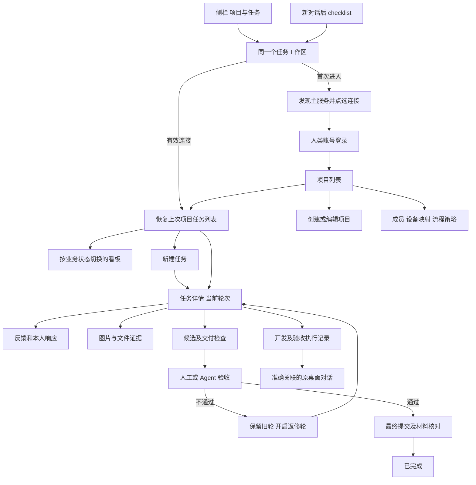

# Agent Hub iOS 项目与任务 UI/UX 设计

版本：v1.0，2026-10-14

状态：用户已于 2026-10-14 确认定稿，进入开发与真实验收；预览示例不作为程序验收证据

架构依据：[已定稿的整体方案与开发计划](task-management-app-plan.md)

静态审核图：入口与工作区（本地文件 `docs/design/assets/task-management-ios-navigation.png`）、任务全流程（本地文件 `docs/design/assets/task-management-ios-workflow.png`）、项目管理与恢复（本地文件 `docs/design/assets/task-management-ios-recovery.png`）。可交互设计稿另覆盖登录、组合筛选、需求响应、执行及主服务冲突，共 24 个页面状态。

## 1 已确定的产品边界

`codex-host-connect` Skill 在指定的局域网主电脑部署电脑 Web 前端与后端。电脑浏览器和 iOS 使用同一个 Task Hub API、身份与任务库。iOS 使用 SwiftUI 原生 UI；首次自动发现服务后，由用户点选连接。仅指定主机运行后端，发现不到服务或主机离线时不能创建第二套后端。

完整 UI/UX 已确认，按本稿实现生产 iOS 界面。图中的主机、项目、任务、人数、证据和提交摘要都是虚构示例；模拟连接、上传和验收只改变预览状态。

## 2 两个入口与导航

现有聊天侧栏的顺序固定为：

```text
电脑选择
新聊天
项目与任务       ← 新增，位于文件互传正上方
文件互传
最近
对话项目
个人空间
```

聊天顶部右侧固定为：`新对话 → 项目与任务 → 更多`。项目与任务使用 SF Symbol `checklist`，44pt 点击范围，可访问性名称为“项目与任务”。侧栏可显示业务待办数量，工具栏保持简洁。

两处进入同一个工作区。第一次进入展示服务发现；已有有效连接时恢复最近的业务项目与任务筛选。任务入口不依赖当前聊天电脑是否在线。进入任务工作区保留当前对话和未发送草稿；左上返回恢复原对话。执行记录中的“查看对话”带有返回原任务的导航关系。

任务工作区里的“项目”是后端业务项目，聊天侧栏里的项目是电脑运行时项目。业务项目可映射多台电脑；切换业务项目不会自行切换聊天电脑。



## 3 视觉与原生交互

沿用现有 App 的系统背景、浅灰分组、圆角浮动按钮与简洁工具栏。蓝色用于主要操作，状态文字同时说明颜色含义。业务内容以原生分组列表和紧凑任务行为主，不增加占据首屏的统计大卡片。

标题使用 iOS 标题层级；正文默认 17pt，次要说明 13–15pt，支持 Dynamic Type。图标使用 SF Symbols，主要控件不小于 44pt。浅色和深色跟随系统；错误和禁用状态保留足够对比度。VoiceOver 读出任务编号、标题、阶段和当前待办。

任务列表默认列表模式。手机看板以四个状态分段切换，每列独立分页，避免四列挤在一屏。任务行包含编号、类型、优先级、标题、状态、负责人、设备、轮次与待办；次要字段和完整证据在详情查看。

## 4 页面清单与关键行为

| 页面             | 首屏结构                                                 | 主要动作与返回关系                                                   |
| ---------------- | -------------------------------------------------------- | -------------------------------------------------------------------- |
| 侧栏入口         | 新聊天、项目与任务、文件互传及原聊天结构                 | 项目与任务进入工作区；待办数字只统计需当前用户处理的任务             |
| 聊天顶部入口     | 新对话、checklist、更多                                  | checklist 恢复同一工作区；不改变新对话原有行为                       |
| 发现主服务       | 当前网络、搜索状态、主机卡、身份核验与就绪状态           | 点选后才连接；未发现提供重新探测和备用地址；不在手机安装后端         |
| 人类登录         | 已选主机、账号、密码、登录状态                           | Keychain 保存设备会话；系统填写与密码可见性；会话失效回到此页        |
| 项目列表         | 服务连接行、搜索、业务项目及待办                         | 打开项目任务；管理员创建或编辑项目；非管理员隐藏管理动作             |
| 项目创建／编辑   | 名称、说明、项目源、开发与验收映射                       | 保存并核对实际映射；已有项目提供成员管理及归档确认                   |
| 任务列表         | 项目切换、搜索／筛选、待我处理／全部／我负责、列表／看板 | 进入详情、新建、项目设置；筛选同时影响列表和看板                     |
| 任务看板         | 待处理／进行中／待验收／已完成分段及实际总数             | 切换列、分页、进入详情；不通过拖动跳过流程门槛                       |
| 组合筛选         | 状态、负责人及已选择条件                                 | 同时应用多个条件，列表／看板共用；清除后恢复全部任务                 |
| 新建任务         | 需求及验收标准、类型／优先级、执行与验收、日期、附件     | 保存草稿、仅创建、创建并派发；派发前核验执行空间与权限               |
| 任务详情／过程   | 任务摘要、当前轮次和阶段、五个详情分段、本轮时间线       | 反馈、本人响应／认领、进度、候选和验收；底部只呈现当前身份允许的动作 |
| 需求             | 原始需求、验收标准、本轮反馈及响应覆盖                   | 查看本轮变化；管理员或有权人员编辑，提交时核对 revision              |
| 反馈／响应       | 内容、附件、本轮目标；响应显示原反馈                     | 添加反馈；只有负责人本人可响应，fix／clarify 不混用                  |
| 证据             | 按轮次、过程／自验／验收分组，缩略图及文件               | 原生预览、Photos／Files 添加；上传进度、失败重试、已关联事件可见     |
| 交付             | 冻结候选、逐条反馈覆盖、自验、材料和必要验收             | 提交候选、核验摘要、进入验收；旧轮候选只读                           |
| 人工／Agent 验收 | 当前候选及轮次、必要验收角色、证据                       | 人工通过／不通过；不通过必须给出意见；Agent 请求显示实际执行回执     |
| 失败返修         | 上轮结论、新轮反馈、原开发负责人及设备                   | 保留历史，进入新轮过程；新轮验收从未验收开始                         |
| 最终交付／完成   | 必要验收、最终提交、材料、索引同步逐项结果               | 缺项展示待补齐；服务端全部门槛通过后才能完成                         |
| 执行记录         | 开发和验收分组，电脑／项目／会话、运行状态、操作回执     | 查看准确关联对话；结果未知先查询，不再次派发                         |
| 项目设置         | 项目源、设备角色映射、成员角色、流程策略                 | 管理员维护；只读人员看到实际生效策略和阻塞原因                       |
| 服务／设备设置   | 当前主服务、登录、执行电脑真实能力和核验时间             | 重连、撤销连接、设备登录管理；外部 Agent Key 独立管理                |
| 主服务离线       | 已选服务、最后同步时间、恢复状态、缓存和草稿             | 重试同一服务；可看缓存和编辑草稿，业务写入等待恢复                   |
| 主服务冲突       | 两个不同实例及核验原因                                   | 只读核对，停止新派发；不能静默选择另一任务库                         |
| 操作结果未知     | 原操作、当前等待状态与可查询回执                         | 查询原回执；结束等待保留提交记录和附件，不表示取消远端               |

原型通过顶部“页面”选择器直接查看所有页面，也可点击图中两个入口、连接、项目、任务、详情分段、反馈、验收和返回按钮走完整路径。筛选、列表搜索、创建校验、失败意见校验和完成门槛均有可交互示例。原型固定的人类身份为项目管理员及验收人；负责人响应界面在角色预览中显示，不代表他人可代负责人响应。

## 5 任务过程的核心体验

详情顶部明确呈现业务状态与细分阶段，例如“待验收 · 第 2 轮”“验收已通过 · 待最终交付”。开发电脑的在线或运行状态单独显示，不能将在线当作任务完成。

过程默认只展开当前轮；旧轮折叠，保留原反馈、响应、候选与验收。用户反馈直接关联截图；响应以缩进关系贴近原反馈；进度和自验显示证据数量；验收总是绑定冻结候选。底部主动作随权限及阶段变化，禁止让普通成员通过修改状态直接关闭任务。

验收失败提交后自动显示新轮编号、失败意见和返修安排。验收通过后展示最终提交、材料和必要同步检查；缺项时完成按钮不可用并明确说明。所有写操作显示提交中、已确认、冲突或结果未知，原草稿与不可变提交记录分开。

## 6 关键异常与保存规则

| 状态                   | 手机提示与可继续动作                                                 |
| ---------------------- | -------------------------------------------------------------------- |
| 局域网权限未允许       | 说明自动发现需要的权限，打开系统设置；允许核验已知地址，不能跳过 TLS |
| 发现为空／网络隔离     | 重新探测、主机部署／恢复说明、备用地址或二维码入口                   |
| 证书或身份不符         | 显示身份核验失败，阻止登录和写入；管理员重新建立可信绑定             |
| 主机离线               | 固定原实例，缓存只读，保留表单草稿；不自动换后端                     |
| 登录失效／授权撤销     | 保留目标隔离草稿，重新登录并核对权限；无权内容隐藏                   |
| 多端 revision 冲突     | 提供当前服务端版本与本地草稿；重新核对后提交，不覆盖别人改动         |
| 上传失败               | 已上传和未上传分别标注，按同一附件记录重试；离开页面保留进度         |
| 任务派发／验收结果未知 | 先查询相同操作 ID；允许结束等待，仍保留可查询记录                    |
| 空项目／无筛选结果     | 提供新建任务或清除筛选；不能显示虚构统计                             |

正式原生界面的底部操作区避开安全区和键盘。页面离开时保存可编辑草稿，恢复时按服务实例、账号、项目、任务和轮次隔离。布局审核覆盖 320pt 至普通大屏、动态字体和两种系统外观；原型浏览器检查仅证明设计预览可用。

本次设计预览检查：24 个页面状态在 736px／320px 内容宽度、浅色／深色下未发现横向溢出或脚本异常。点击检查通过侧栏进入、主服务点选与模拟登录、搜索无结果、创建必填与附件草稿保留、组合筛选、验收失败意见校验、新轮不沿用旧通过、通过后最终交付缺项阻止完成、Agent 验收等待回报、离线缓存禁止写入及原回执查询。以上是界面原型证据，原生 App、局域网部署和真实任务闭环尚待开发与验收。

## 7 确认后的开发顺序

1. 固定本稿的两个入口、导航关系、默认任务视图、详情层级和表单字段；冻结源工程和 API 契约。
2. 完成 Skill 电脑前后端完整部署、唯一主服务预检和身份描述，开发 iOS 发现、连接与人类会话。
3. 开发 iOS 项目管理、任务列表／看板、创建、过程、反馈及证据，接入业务写操作回执。
4. 接通真实 Host 执行、候选、自验、人工／Agent 验收、失败新轮和最终交付核对。
5. 补齐通知、锁屏恢复、上传恢复和异常；用普通实体 iPhone、电脑 Web 和真实原桌面完成同源全流程验收。

架构、开发计划及界面位置、布局和流程呈现均已定稿。用户已授权 iOS 实现、模拟器与实体 iPhone 的真实任务和场景验收；实际功能与真实验收另行记录。

## 8 长材料候选的验收可达性（2026-10-15）

原生真实任务产生较多材料时，“交付”页先显示必要验收，验收人可直接核对被验候选并打开通过／不通过表单。候选引用、源码版本、产物摘要及冻结时间继续显示；完整材料列表默认折叠，以“冻结材料 · N 项”展开，避免自验和交付两份材料列表把验收入口推到长页末尾。人工验收仍只允许准确当前轮、当前人类验收人和待决定状态；Agent 验收保持真实运行回报。

此调整已进入隔离 native33 源码，模拟器 SDK 构建及真机签名构建通过，原生点击和真机安装结果待分别记录。构建通过不能代替实际验收通过。
