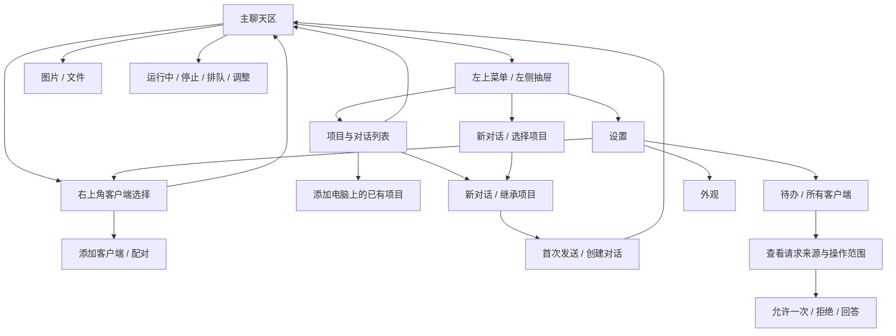

# Agent Hub：iOS 初版 UI / UX

2026-10-11：完整 Android 版本以当前 iOS 运行代码和合成画面为对照，新增[双端 UI 一致性规格](mobile-parity.md)与[功能清单](../product/mobile-parity.md)。本文保留初版设计及早期实现状态；双端扩展时同时核对当前代码和最新专项验收，不以旧状态遗漏 EasyWork、通知、创建恢复或其他已实现功能。

状态：紧凑版设计已落到原生 SwiftUI，并接入真实托管运行时的新建、回复、附件、流式输出、工具进度和审批。本文同时规定完整产品目标；扫码配对、跨电脑真机和当前官方桌面私有运行时接入尚未完成。实现与验收边界见 本机验收（本地文件 `docs/acceptance/ios-local.md`）。

## 设计目标与边界

用户在 iPhone 上管理多台电脑的 Codex：选择客户端、浏览该电脑的项目与对话、新建对话、发送文字和附件，以及处理待办。任务始终在明确选择的电脑上执行。

“客户端”在本产品中指一台已配对电脑的 Codex 连接。添加客户端是登记并授权一个连接，不是在手机上创建另一个 Codex 执行实例。首版面向个人使用，iOS 17 起，电脑端先支持 macOS。

用户提供的桌面截图用于参考“项目 → 对话”层级、最近入口、新建对话和状态提示。设计示例均为虚构内容；不将截图、真实聊天记录或附件纳入仓库。

按用户确定的方向，采用 ChatGPT APP 的左侧项目与对话导航、主聊天区和输入区样式。右上角增加 Agent 客户端切换，其余常用操作沿用熟悉的聊天结构。界面上的名称使用 `Agent Hub`，启动图标沿用 EasyWork 标志，缩小主体并采用浅蓝紫渐变背景，见 [图标设计](app-icon.md)。

已查看 OpenAI 在 App Store 发布的 iPhone 展示图，参考其中的左上菜单、圆角新建与更多操作、右对齐浅蓝消息气泡、无外框回复正文和底部胶囊输入区。官方 iOS FAQ 确认左上菜单打开历史侧栏；官方项目说明用于核对项目与对话的组织。参考页面与公开展示图不能证明所有账户、版本和场景均采用完全相同的样式。

## 设置中的批量管理（2026-10-17）

“设置 → 管理 → 项目与对话管理”管理当前客户端，项目和对话用分段按钮切换。列表支持搜索、多选、全选当前搜索结果及取消全选，底部显示选中数量；每批最多 100 项。删除项目和归档对话均在系统确认框确认后提交，取消不产生操作。项目删除说明明确保留文件和对话；对话归档保留历史，可在电脑端恢复。正在运行、待回答问题或被原桌面持有写入权的对话不允许选择；桌面占用项明确提示当前须在桌面归档。

操作记录分别显示成功、失败和待确认数量及失败项，未确认操作提供“核对结果”，重启保留原请求及操作 ID。电脑离线或能力缺失时显示具体原因并禁用按钮。功能面向当前客户端的聊天项目，与独立“项目与任务”业务管理分开。侧栏项目行的新建对话与全局新聊天使用同一 `square.and.pencil` 图标，添加项目继续使用加号。

## 确定的导航结构

- 默认进入聊天主内容区，未开始对话时显示简洁空状态与输入框。
- 左上角菜单打开左侧抽屉，依次显示客户端切换与搜索、新聊天、最近聊天、项目分组。
- 侧栏选择对话后关闭抽屉，在同一主内容区显示消息。
- 右上角显示当前 Codex 客户端，点击选择其他电脑或添加客户端。
- 新建与更多操作保留在顶部；设置由侧栏底部个人入口进入。

空白对话的输入栏不常驻展示此前新建的确认、未提交或未知结果。结束等待后的不可变回执继续保存，在顶部对话菜单的“新建记录”中按需查询；查询旧回执不改变新草稿或当前选择。具备发送时自动连接能力的历史聊天不显示输入栏连接说明，发送仍先确认准确原 owner。手机已读以实际可见、与回复版本匹配的正文为准；正文迟于列表摘要到达、可视区域变化及侧栏动画结束时都重新核对，浏览更早内容不提前清除新回复的未读状态。

这一结构取代前一版的“项目优先 / 对话优先”首页，以及工作区、待办、设置三个底部页签。待处理事项放入设置中的次级入口，也可在来源对话中处理。此次不继续提供互相竞争的首页方案。

## 信息架构

主结构为“侧栏导航 + 聊天内容区”。iPhone 上侧栏按需覆盖显示，不同时挤占聊天宽度。主聊天区右上角和侧栏顶部均可切换客户端，切换后项目与对话一起切换。

层级身份为“用户 → 客户端 → 项目 → 对话”。项目和对话必须以客户端 ID 作为所属边界。不能凭显示名称合并两台电脑上的同名项目。

## 页面与关键交互

审批提问的选项主文字、自定义回复和保密回复框统一采用动态 `.subheadline` 字号，选项说明保持次级字号。提交回复按钮使用与输入栏一致的主题对比配色：浅色下深底浅字，深色下浅底深字；未填写完整答案或正在提交时显示清晰的禁用状态，不依赖全局 tint 推断文字颜色。

Codex 异步问题只在主页显示一个待答入口，点开原生紧凑 sheet 后每次显示一题。左右按钮及横向手势切换问题，回答或跳过后自动显示下一道未处理问题，最后一题处理后收起。弹层可随时收起；翻页和收起保留各题草稿，按完整聊天目标隔离。默认高度 380pt，可展开处理长题，使用原生安全区域与 24pt 弹层圆角；内部与审批共用琥珀色卡片、12pt 卡片圆角、动态字号、44pt 点击区域及主题对比提交按钮。任务继续运行，结果与真实 DEV 范围见 异步问题验收（本地文件 `docs/acceptance/async-questions.md`）。

### 左侧项目与对话抽屉

- 从主聊天区左上角打开，也可在聊天区从左向右滑动呼出；抽屉打开后，在侧栏列表或外侧遮罩从右向左滑动关闭。点击外侧、关闭按钮或辅助功能返回操作同样收起。
- 横向手势不接管输入框编辑、滑块、代码／表格的横向滚动和弹出的页面；列表上下滚动与下拉刷新保持原生行为。手势打开时收起输入键盘，关闭时收起搜索键盘，保留草稿和搜索内容。
- 侧栏随手指连续移动，面板从左边缘横向滑入、滑出，不做淡入淡出；按钮开关使用相同的抽屉动画。面板保留固定布局，拖动直接更新原生容器的横向位移，不逐帧改变 SwiftUI 状态，也不在收尾时插入或移除列表；关闭后隐藏并移除触摸、辅助功能访问。短距离或取消的拖动回到原状态；超过宽度四分之一，或满足最小距离的快速滑动，提交开合并用 220ms 动画收尾。中途接续拖动从当前画面位置继续，反向拖动不误选聊天。拖动和收尾期间冻结聊天视图差异计算，开合状态在位移完成后提交。工作区、历史和事件响应延后到动画结束再应用；保留原响应、目标校验与事件游标，不重放输入。自动列表刷新在打开后等待 220ms。
- 列表采用按需构建；未读圆点查询同一份内存快照，不逐行读取共享账本。快照读取及通知档案解密使用后台任务，合并更新请求，并在抽屉停稳后更新界面。项目折叠仅持久保存展开状态，不触发全局未读核对。账本仍由 App 与通知扩展通过原跨进程锁更新，旧连接的内容版本在一次事务内合并。实测范围见 侧栏性能验收（本地文件 `docs/acceptance/ios-local.md`）。
- 顶部左侧显示当前客户端名称和切换入口，右侧为搜索按钮；点击搜索展开输入框，只检索所选电脑的项目与对话。
- 客户端名称下标明“桌面历史 · 只读”“Agent 托管 · 仅托管会话”或“共享运行时”，客户端选择器也显示对应来源，避免把同一电脑上的不同数据源混为桌面实时接管。
- 顶部下一行是“新聊天”，先选择当前客户端的项目。
- 对话列表支持从顶部下拉刷新，显示系统转圈 loading，等待当前客户端的项目与对话列表请求完成后自动收起。短列表和空列表也可下拉；刷新保留搜索、展开状态与草稿，失败保留缓存并提示错误。列表刷新不重新加载当前聊天正文。
- “最近”按当前客户端返回的最近顺序显示聊天，不按项目排除。默认最多 5 条；超过 5 条显示“展开显示”，展开后用“收起显示”恢复 5 条。
- 项目区使用文件夹行，包含名称、展开指示和独立“＋”入口。整个项目区也支持折叠。
- 点击文件夹行展开或收起对话；点击“＋”直接进入该项目的新对话。
- 每个展开的项目默认最多显示 5 条聊天，超过时提供独立的“展开显示 / 收起显示”。展开更多与项目折叠互相独立，不影响其他项目或客户端。
- 聊天标题直接使用会话返回的名称，保持单行，超出行宽截断；辅助功能保留完整标题，不在 UI 中另行改写名称。
- 当前对话使用轻量选中底色；其他对话以标题为主，保留未读、运行中和待处理提示。
- 同一聊天可同时出现在“最近”和所属项目，两处进入同一会话。搜索时不受 5 条折叠限制，并展开匹配项目；匹配项目名称时显示该项目的已加载聊天。
- “展开显示”展开已加载数据；存在服务端游标时，底部“加载更多”继续获取下一页，保持与本地折叠的区别。
- 添加项目位于项目区标题右侧。新客户端无项目时，主内容区和侧栏均提供添加入口。
- 底部个人入口进入设置与客户端管理。原生实现保存每台客户端自己的展开状态。

“运行中”只依据已确认的实时连接状态。只有历史时，使用“上次记录”或“状态未同步”；不能将独立服务中的 notLoaded 推断为官方桌面任务已经停止。

已实现：手机未读的聊天在标题右侧显示 7pt 蓝点，“最近”和项目列表与 App 图标角标共用设备阅读账本，VoiceOver 读出“未读”。图标汇总全部已添加电脑的未读对话数，同一完整目标／对话计 1。首次摘要使用已有桌面标记建立基线，之后手机实际查看最新内容才清除手机未读；电脑阅读独立。执行中／等待审批图标优先显示，看过后待处理卡片继续保留。前台刷新不打开聊天；缺少版本能力的旧 Host 仅提供已有摘要、缓存内容与通知的本地基线。真实验收范围见 角标专项（本地文件 `docs/acceptance/unread-badge.md`）。

已实现：执行中的蓝色虚线圆环以 4 秒一圈匀速旋转，“最近”和项目聊天列表共用该动效。旋转由独立 Core Animation 图层完成，不使用逐帧计时器或 SwiftUI 状态更新；偏好帧率为 15–30 FPS，实际帧率由系统决定。工作区刷新复用既有动画；离开执行状态、侧栏销毁或视图脱离窗口时明确移除动画。App 不在前台或系统开启“减少动态效果”时保持静止，恢复后重新启动。图标随系统字体大小缩放，VoiceOver 仍通过聊天行读出“执行中”。图层动画与帧率提示依据 [Apple Core Animation 文档](https://developer.apple.com/documentation/quartzcore/optimizing-iphone-and-ipad-apps-to-support-promotion-displays)。

### 客户端选择

采用底部弹层。每行显示昵称、电脑类型、在线状态或最后在线时间，当前项显示勾选。底部固定主要行动“添加客户端”。完整列表过长时，原生实现使用系统列表滚动；不会把所有客户端挤成横向小按钮。

已添加的真实客户端每行右侧提供“编辑”，预填名称、连接地址和钥匙串中的密钥。取消返回列表且不修改配置；只改名称可以离线保存。修改地址或密钥时先验证工作区及原 Host ID，验证成功后才保存；连接失败或电脑身份不同保留原配置。编辑保留当前客户端、对话、已加载列表与草稿，保存后返回管理列表。本地界面示例不显示连接编辑入口。

切换后进入该客户端上次打开的对话；没有可恢复对话时，展示新对话或添加项目空状态。侧栏只显示这台电脑的项目与对话。手机不将当前对话迁移到另一台电脑，也不会重新绑定已有草稿的发送目标。

客户端详情与撤销连接由设置进入。撤销必须显示具体客户端及影响；不让用户凭一个无来源的“删除”按钮断开电脑。

### 添加客户端

已实现的 Codex 连接表单提供“扫码连接 / 手动连接”两个可切换的标签，默认显示扫码连接。扫码页提供扫描、粘贴二维码内容及自动发现；手动页在同一表单组内依次显示客户端名称、连接地址、客户端密钥和“连接客户端”按钮，说明放在组尾。切换方式保留已输入内容，清除当前错误提示并收起键盘；从二维码链接打开时直接进入扫码页。编辑已有客户端直接显示预填表单，“保存修改”紧接在输入项下方。

以下六位配对码与电脑确认属于后续方案，尚未实现：

1. 在电脑连接程序中选择“连接手机”。
2. 手机填写客户端昵称和六位配对码。
3. 验证后显示“等待电脑确认”，提供取消；电脑明确批准本次配对。
4. 成功后进入该客户端聊天主界面；没有项目时引导添加项目。

昵称为空、配对码格式错误在对应字段下显示；过期允许重试；被电脑拒绝时说明拒绝状态。配对码不能单独代表成功授权，需要有效期、尝试限制以及电脑端确认。

设计原型对任意六位数字演示成功，仅在本地生成示例客户端，并提示“原型演示”。原型不发出网络请求，也不包含实际配对能力。

### 添加项目

首版“添加项目”表示登记电脑上的已有目录。手机选择的是电脑端允许访问的文件夹，不是 iPhone 的文件目录；不隐式新建 Git 仓库。

弹层固定显示当前客户端，提供远程文件夹选择和可编辑的显示名称。已加入的目录显示“已添加”，避免重复登记。目录不可访问时保留表单，提示重新选择或在电脑上授权。

原型用两个虚构目录演示选择与重复校验。真实文件夹浏览、权限和项目登记仍待实现。创建全新目录或仓库不属于本轮设计的必需流程。

### 新建对话

顶部或侧栏的新对话先选当前客户端的项目；项目内新建直接继承该项目。在空白对话顶部展示客户端与项目，主体提示“有什么可以帮忙的？”，底部保持相同的输入框。

首版要求明确项目目录。无项目对话需要先定义执行目录语义，暂不提供一个目标不明确的“无项目”选项。

真正的远程创建在首次发送时提交，单纯打开空白页面不生成空会话。文字、附件、模型配置形成同一次首次提交。名称先用首条消息摘要，再由实际会话更新。

如果上游服务必须提前分配线程，则需要暂存未发送状态，并从普通会话列表中隐藏；不能把取消页面视为已开始任务。创建请求需要幂等键，重试不能创建两个线程。

发送失败保留文字、附件选择及目标项目；显示“未发送 / 重试”。切换客户端后仍将原草稿保存在原目标下，重新进入时恢复，不自动向新电脑发送。

首次发送后、会话创建结果确认前，聊天正文立即显示不可变请求中的正文和附件名称，沿用用户消息气泡，前方显示 loading，下方标注“发送中…”。这条本地待发送消息不表示电脑已收到或模型已执行。明确拒绝后停止 loading 并显示“未发送”；确认后由真实会话历史替换。编辑或清空草稿不改变待发送消息，结束等待后移除当前消息展示并保留原回执查询入口。

### 对话详情

消息顶部只保留一个次要色、小字号的「显示更早消息」入口，触控高度为 44pt，与正文间距为 6pt，不叠放本地展开和远端分页按钮。到顶部继续下拉，正常幅度即可触发，一次手势只加载一批，小幅回弹和列表中间滚动不加载。先分批展开已读取的消息，再按当前对话游标读取更早页。读取中入口显示原生转圈并禁用重复操作，新增内容放在原阅读边界上方，保留当前阅读位置。后台读取最新消息保留已经展开的旧页及到头状态。手动加载失败显示重试提示，保留消息与游标，可再次点击或下拉；全部显示后用小字提示「已显示全部消息」。切换聊天后，旧加载结果不能改变新聊天的消息、阅读位置或加载状态。实现与实际验证范围见 历史分页交互（本地文件 `docs/acceptance/history-pagination.md`）。

用户消息正文超过实际排版的 6 行时默认折叠，气泡底部右侧显示小号“展开”与向下箭头；展开后显示完整正文，底部同一入口改为“收起”与向上箭头。保留浅蓝圆角气泡、正文选择和附件入口，短消息不显示折叠按钮。阈值随可用宽度和系统字号计算，历史消息与新建发送中的消息共用组件；每条消息独立展开，操作不修改原正文或发送请求。按钮触控高度为 44pt，支持中英文、深色模式和减少动态效果。

Markdown 超链接使用随浅色／深色主题适配的蓝色文字，不加下划线，保持正文的字号与排版。段落、列表、标题、引用和表格内的链接统一使用此样式，点击沿用现有网页打开或附件预览行为。

顶部使用三个悬浮控件：左侧菜单圆形按钮、中间客户端与项目胶囊、右侧新建与更多操作胶囊。客户端按钮内部用两行显示电脑短名称与当前项目，省去独立项目标签行；更多菜单保留“当前项目”入口。聊天区上方不再单独显示“Codex · 实时连接”等连接状态行；客户端切换按钮的辅助功能值保留当前连接状态。对话标题在侧栏中显示，辅助功能同时读出当前对话与项目。名称过长时可查看完整名称。

用户消息使用右对齐浅蓝气泡；Codex 回复直接排版为正文，支持段落、列表和加粗，不增加头像标题或整段外框。每次 run 结束后仅在结果底部显示一组复制和分享，使用最终回复正文；运行中的说明、工具之间的中间消息不显示这组操作。新 Adapter 按真实 run ID 归组，同 run 追加不拆组；旧 Host 或缓存缺少 run ID 时按用户输入后的回复序列兼容归组。工具详情和文件自己的复制／分享仍按其内容提供。工具活动按 Codex 截图使用灰色图标和紧凑文字行，不加外层卡片、行间分隔线或数量／状态汇总。单个工具直接显示「已运行命令」等工具行；多个连续工具才增加可折叠的动作摘要，默认折叠，展开后下方显示各次调用的单行列表，长列表在固定高度内滚动。组摘要使用相连四圆图标、普通字重灰色概括句和常驻折叠箭头；单工具标题更粗，工具行按类型使用终端、文件等图标。组内工具行默认灰色普通字重，悬停或展开详情时文字变黑加粗并显示箭头；MCP 工具行显示具体动作，来源保留在组摘要和详情中。组与工具图标左对齐，摘要与列表间保留小间距。点击组摘要展开／收起整个列表，点击单个工具行独立展开详情；收起后重新展开组时保留原工具详情的展开状态。详情使用浅灰边框面板，包含 Shell／Diff 等标题、命令或输入、复制入口、原始输出和右下角状态。用户消息或助手正文断开分组。完整编辑器留到后续。

底部使用悬浮胶囊输入区，附件“＋”在左侧，文字居中，语音和任务操作在右侧；默认单行，长输入自动增高至六行。输入区上方保留独立的权限胶囊，以及合并模型、推理强度与速度的胶囊；开启计划模式时同排增加可关闭的计划标签。顶部与底部均使用随浅深色变化的系统材质、细边框和轻阴影。正文滚动区延伸到悬浮控件下方，末尾按输入区实际高度保留滚动空间，跟随最新消息时最后一条内容不被遮挡。附件、排队、发送待确认等信息按实际状态在输入区上方显示。只有正文或附件存在且客户端可发送时才允许提交。模型选项来自当前电脑的可用配置；不硬编码虚构的模型权益。

运行中保留补充输入，并显示停止入口。发送补充信息时明确提供：

- 等任务完成后发送：进入当前对话队列，不新建对话。
- 调整当前任务：向当前运行任务追加要求；仅在上游能力确实支持时启用。

不支持某项能力时保留说明或降级为可用入口，不能用另起一个执行实例来伪装调整。对未知提交结果展示“正在确认送达”，确认前不自动重发。发送中与结果待确认时，底部操作区只显示状态、异常说明及查询、重试、结束等待和恢复草稿等处理入口，不重复显示已提交消息正文；原消息与附件继续保存在对应操作记录中。

### 图片与文件

附件“＋”打开系统风格菜单：选择图片、选择文件。原生实现使用 PhotosPicker 和系统文件选择器；拍照后续再加。语音输入使用发送按钮前的独立麦克风入口。

选择后在输入区上方展示缩略图或文件类型、名称、大小、状态，以及独立移除入口。状态依次为准备、传输、已就绪、提交；失败可以重试或移除。文件名过长可换行或打开完整详情。

文件传输到任务所在电脑后才提交引用。图片可以使用已验证的图片输入方式；普通文件需要在电脑侧提供文件路径并通过工具读取，不承诺所有格式均可直接被模型理解。单文件大小和格式限制由实际客户端能力配置返回。

原型可以调用浏览器文件选择器，但仅取名称、类型和大小；不读取文件内容、不上传，也不将文件信息保存到会话持久状态。

### 统一任务按钮与语音输入

输入栏最右侧为同一个任务操作按钮：正常结束或新会话且草稿为空时显示置灰的发送箭头；非运行状态填写文字或添加附件后允许发送；异常终止、停止或暂停且草稿为空时显示继续／恢复播放图标；运行中且草稿为空时显示停止方形。运行中有可发送草稿时切换为发送箭头，并显示 Host 实际支持的“排队执行”和“立即追加”选项，前者等待当前任务正常结束，后者立即补充到当前任务；长按发送按钮可停止任务。提交和停止确认过程中显示进度，阻止重复点击。辅助功能标签随状态变化，触控范围至少 44 pt。排队指令按提交顺序以 1、2、3 编号排列在输入框上方，每行显示指令预览和取消按钮；取消后连续编号，超过三行可滚动。任务正常完成后依次执行，中断／失败时暂停队列。

可用按钮采用实心高对比圆形与反色图标，禁用按钮采用系统浅灰填充与弱化灰色图标；浅色、深色和听写发送使用同一规则。创建从本地保存、上传到等待结果确认期间，发送按钮持续显示高对比 loading 并禁用重复提交，重启后恢复等待时也保持 loading；明确拒绝、确认或结束等待后恢复相应任务按钮。辅助功能明确报告可用、不可用或正在提交状态。

继续与长按菜单中的重新运行分别在当前电脑、当前对话追加明确指令；不重启电脑、Host 或 Codex 进程。非运行状态填写新草稿优先显示发送，继续／重新运行不清空已有草稿。恢复判断只使用当前响应及运行状态，旧轮次的中断不影响最新正常结束状态。离线、只读、状态未知与发送待确认时不提供可执行的继续／重新运行。

麦克风位于任务按钮左侧。首次使用请求麦克风和语音识别权限；按系统首选语言识别。听写时输入框展开为圆角面板，上方实时展示识别文字，下方为取消、点状基线及随音量变化的波形、停止听写和发送。波形下不显示状态文字，录音状态通过控件与无障碍标签表达。停止听写保留文字供修改；发送等待本次识别结束后提交；取消只撤销本次听写，恢复原正文和附件。浅深色均使用系统颜色。

前台听写从准备、录音到完成识别期间暂停自动熄屏，便于持续查看实时文字；停止、取消、失败、离开页面或 App 不再处于前台活跃状态时恢复系统自动锁屏。切换目标、打开侧栏／弹层或进入后台会结束本次录音，文字保存在原目标。离线或只读时可以听写草稿，发送继续受原能力限制。权限被拒、服务不可用或录音中断时显示原因并保留草稿，用户可重新启动。iOS 26 及以上优先使用本地分析器；首次使用可能需要联网准备语音资源。旧接口无法使用时提示检查 Siri／听写服务，不把系统错误直接当作开关关闭。系统麦克风静音或连续 8 秒全零音频时退出听写，提示检查系统麦克风及通话／其他录音占用；用户保持安静但麦克风仍有正常微弱输入时不强制退出。真实设备的麦克风、识别准确率和 Apple 服务可用性另行验收；模拟器 fixture 只验证界面与草稿路由。

### 待办与设置

设置从侧栏底部个人入口进入；待处理事项作为设置的次级入口。主聊天页面保持专注，不保留底部三栏导航。

待办聚合所有客户端的确认请求。每条必须显示客户端、项目、对话、请求内容和有效状态。进入处理页面再次固定展示来源与操作范围，允许一次、拒绝或回答后等待电脑确认，成功才移除。

从待办跳到来源对话时同步切换顶部客户端。已失效或已由电脑处理的请求不可再次提交。

设置的“连接”分组包含两个入口：“客户端”右侧显示列表中的客户端总数（包含离线连接；开启界面示例时包含示例客户端），点击查看和管理；“添加客户端”直接打开连接表单。打开设置时收起聊天输入键盘，避免遮挡选项。历史刷新保留在聊天菜单和侧栏下拉操作中。关于说明使用简洁的产品文案，介绍局域网内多电脑 Agent 管理、一键切换和任务发起，当前支持 Codex 和 Easy Work，更多客户端属于后续扩展。

## 关键状态

| 场景             | 页面表现                   | 行为                                     |
| ---------------- | -------------------------- | ---------------------------------------- |
| 未添加客户端     | 工作区空状态               | 添加客户端为唯一主要行动                 |
| 新客户端没有项目 | 当前客户端 + 项目空状态    | 引导添加已有目录                         |
| 客户端离线       | 客户端灰点、输入区离线提示 | 可读历史、可写草稿；禁用远程新建和发送   |
| 状态恢复中       | “连接中 / 正在同步”        | 历史可读；未确认实时状态前不显示运行结束 |
| 运行中           | 工具活动、停止、补充输入   | 排队与调整语义明确                       |
| 附件失败         | 附件级错误和重试           | 不丢弃其余正文或附件                     |
| 发送失败         | 消息级“未发送”             | 保留目标与幂等键后重试                   |
| 发送结果未知     | “正在确认送达”             | 查明后再决定重试，避免重复任务           |
| 配对过期或拒绝   | 表单内错误                 | 可重新获取配对码，不进入已连接状态       |
| 待办已处理       | “已在电脑上处理”           | 禁用重复处理                             |
| 切换电脑         | 切换工作区与上下文         | 原项目、对话和草稿归属保持不变           |

## 视觉规范

整体采用系统字体、黑白中性界面、右对齐浅蓝用户消息和低密度分隔线。顶部圆角操作与底部胶囊输入区使用轻阴影。未读使用蓝点，连接使用绿色，需要操作使用琥珀色，状态同时含文字或图形。产品图标在 SwiftUI 中使用 SF Symbols；交互原型中的线性图标用于占位。

| 元素           | 初版规范                                         |
| -------------- | ------------------------------------------------ |
| 页面背景       | 浅色白色；深色接近 #171717                       |
| 一级正文       | 浅色 #202020；深色 #F4F4F4                       |
| 二级正文       | 浅色 #676767；深色 #B2B2B2                       |
| 输入与选中底色 | 浅色 #F4F4F4；深色 #292929                       |
| 用户消息气泡   | 浅色 #E8F4FF / #245C91；深色 #203C55 / #CDE6FF   |
| 主行动         | 高对比黑白反转填充                               |
| 页面标题       | 28 pt，Semibold                                  |
| 对话与项目正文 | 15–17 pt，Regular / Medium                       |
| 二级说明       | 12–13 pt，保持可读对比                           |
| 间距           | 4 / 8 / 12 / 16 / 20 / 24 pt                     |
| 页面边距       | 聊天正文 16 pt，顶部与输入区约 12 pt             |
| 输入容器       | 约 26 pt 圆角，单行高度约 54 pt                  |
| 弹层           | 使用原生 sheet 的圆角和安全区域                  |
| 触控范围       | 至少 44 × 44 pt；视觉图标可以更小                |
| 动效           | 原生推入、sheet 和轻量状态变化，尊重减少动态效果 |

SF Symbols 建议：客户端 laptopcomputer / desktopcomputer；项目 folder / folder.fill；新建 square.and.pencil；附件 plus / paperclip；发送 arrow.up；待办 tray；设置 slider.horizontal.3；离线使用文字与状态图形。

紧凑版减少布局留白：消息间距约 18 pt，多工具组与上下消息的间距约 12 pt，组摘要保留至少 44 pt 的触控高度；正文保持 16 pt，行高约 1.55，段落间距约 8 pt。侧栏保留至少 44 pt 的项目与对话触控行，减少分组、搜索和列表之间的额外间距；客户端选择行约 64 pt。输入文字保持 16 pt，常用按钮仍保留至少 44 × 44 pt 触控范围。

原生实现必须支持 Dynamic Type、VoiceOver、浅深色和系统安全区域。辅助功能读出“当前客户端”“所属项目”“运行中”“未读”等信息。常用行动不依赖长按或悬停。正文放大时允许行高与列表高度增长，不强制保持样稿的固定高度。

原生使用 NavigationStack 与左侧抽屉，不再使用三栏 TabView。键盘出现后输入区随键盘移动；长历史以原生列表滚动和历史分页处理。弹层用于选择、添加和确认任务。侧栏在原生中支持返回手势和系统辅助功能，本轮浏览器原型主要演示点击与键盘操作。

## 设计稿覆盖与实现边界

| 内容                             | 本轮交互原型             | 原生与真实服务                                              |
| -------------------------------- | ------------------------ | ----------------------------------------------------------- |
| 主聊天区、左侧栏、搜索、项目展开 | 可点击                   | 原生已实现                                                  |
| 客户端切换、离线缓存提示         | 示例状态                 | 真实 Host 连接、目标隔离、缓存与重连已实现                  |
| 六位码添加客户端                 | 本地演示与字段校验       | 真配对待实现；当前用 HTTPS 地址和 Keychain 密钥             |
| 已有目录添加项目                 | 示例目录与重复校验       | 授权根内输入已有目录并登记；远程文件夹浏览待实现            |
| 新建对话和首条消息               | 本地演示                 | 真实持久线程、新建去重和首次投递已实现                      |
| 文字、图片、文件选择             | 本地演示，文件仅取元信息 | 原生选择、真实上传/下载、摘要校验及图片预览已实现           |
| 运行中停止、排队、调整           | 本地演示                 | 真实 Turn 控制、排队执行与取消已实现                        |
| 待办处理、浅深色                 | 本地演示                 | 对话内真实审批/问题回答和外观已实现；全客户端待办聚合待实现 |
| 电脑确认、异常恢复、撤销         | 本文规格                 | outbox、去重、结果查询和恢复已实现；扫码电脑确认待实现      |

当前对话中提供可点击的 iPhone 设计稿。所有示例回复、运行状态、配对成功和审批完成均由本地模拟产生；不代表官方桌面接入成功。工程实现状态以 README 和可行性文档为准。

## 原生落地建议

将 ChatShellView、ChatSidebarView、ClientPickerSheet、PairClientView、AddProjectView、NewConversationView、ConversationView、AttachmentPicker、InboxView 和 SettingsView 拆分为页面与组件。共享 ClientContext、ConversationContext、ComposerDraft 和 ConnectionState。

导航状态与草稿状态分别管理；草稿键至少包含客户端 ID、项目 ID 和对话 ID，新对话在没有线程 ID 时使用临时草稿 ID。客户端上下文改变时，不复用旧任务的发送目标。

UI 通过应用协议获取业务数据，不能直接读取电脑 Codex 的内部文件或依赖 JSON-RPC 细节。运行时能力已经由 Adapter/Host 实现并声明，历史模式继续禁止写操作。接入和故障语义见 [运行时协议](../protocol-runtime.md)。

## 首轮验收

1. 在至少两台客户端之间切换后，项目和对话均来自所选电脑；同名项目不会合并。
2. 全局新建可以选择项目；项目内新建继承项目；首次发送创建且只创建一次对话。
3. 对话页面与审批页面均可明确识别目标电脑和项目。
4. 切换电脑、退出页面或离线不会丢失草稿，也不会把草稿发到其他客户端。
5. 附件选择、移除、传输失败与重试均不会破坏正文；在目标电脑上确认实际可读取。
6. 运行中补充消息具有明确的排队或调整行为，能力不支持时正确降级。
7. 在小尺寸 iPhone、深色模式、大字体与 VoiceOver 下，关键标签和操作均可访问。
8. 真实配对在电脑明确确认前不进入已连接状态，撤销后不能继续操作。

以上为后续实现验收。原型检查仅覆盖本地交互、布局和样例状态。

## 本轮设计检查

2026-10-07 使用浏览器运行本次 ChatGPT APP 风格原型，检查通过：无底部导航、侧栏打开与关闭、当前对话选中、搜索与空结果、展开与搜索后的侧栏高度稳定、选择后返回聊天、客户端切换与草稿隔离、附件选择与移除、添加项目与字段校验、首次发送创建示例对话、排队与调整、停止、离线禁发、待办来源与处理、配对字段校验和深色模式。检查过程中未出现 JavaScript 运行错误。

已查看主聊天页、客户端弹层、左侧栏、新对话、深色和窄屏截图。320 px 外层宽度下主聊天区和侧栏均没有横向溢出；Escape 可收起侧栏，关闭菜单后聊天区恢复可操作。仓库文档格式检查通过。这些是浏览器设计检查，不替代 iOS 实机、真实网络、桌面共享运行时或辅助功能验收；后续原生落实与测试见 本机 iOS 验收（本地文件 `docs/acceptance/ios-local.md`）。

紧凑版复查通过：同一示例下首条消息提前约 67 px，回复区域减少约 71 px，输入容器由 60 px 收紧为 54 px。正文与输入文字仍为 16 px，侧栏对话行与顶部操作保留至少 44 px 触控高度。已复查侧栏选择、客户端切换、当前项目菜单、新对话发送和深色；320 px 外层宽度下顶部没有重叠、侧栏没有横向溢出。

## 参考

- [ChatGPT 官方 App Store 页面](https://apps.apple.com/us/app/chatgpt/id6448311069)：已查看 OpenAI 发布的 iPhone 展示图，用于消息与输入区视觉参考。
- [ChatGPT iOS App FAQ](https://help.openai.com/en/articles/7885016-chatgpt-ios-app-faq)：左上菜单、历史侧栏和设置入口。
- [Projects and chats](https://learn.chatgpt.com/docs/projects?surface=chatgpt)：项目与对话组织。
- [Apple UI Design Tips](https://developer.apple.com/design/tips/)：触控尺寸、内容布局和可读性。
- [Apple Human Interface Guidelines：Sheets](https://developer.apple.com/design/human-interface-guidelines/sheets)：任务型弹层。
- [产品范围与里程碑](../product/mvp.md)。
- [系统架构](../architecture.md)。
- [已验证能力与剩余门槛](../feasibility.md)。

## 计划模式（2026-10-09）

输入胶囊保留“＋”、语音和任务操作按钮。“＋”菜单增加计划模式，开启后在输入区上方的设置行显示灯泡与“计划模式”标签，可点击标签关闭。模式选择随当前电脑／聊天草稿保存，已有桌面聊天显示运行时同步的模式；运行中立即追加沿用当前模式，切换可用于排队的下一轮。

计划正文使用独立的灯泡卡片，可展开查看 Markdown 与复制。已完成且未处理的计划下方显示“实施此计划？”、“是，实施此计划”和“调整计划”；调整展开反馈输入与发送按钮。实施携带完整计划并切回普通模式；调整发送用户反馈并保留计划模式。执行步骤另显示原有进度列表。离线、只读或任务进行中禁用操作，过期计划在电脑端拒绝，原生 fixture 不代表真实电脑或 iPhone 验收。

## 模型、强度与权限（2026-10-09）

输入区上方的悬浮设置行保留一个权限入口和一个合并的模型／强度／速度入口，计划标签位于同排左侧。根据实际可用宽度逐步缩短模型名称、计划文字和权限文字，最窄时显示图标。宽屏显示完整信息；所有入口保留完整辅助功能名称和至少 44 pt 触控区域。点击设置入口打开原生弹层，选择当前电脑模型、在该模型支持的离散强度间滑动或点选，并通过重置按钮沿用电脑。权限列表包含请求批准、帮我批准、完全访问；完全访问使用橙色盾牌和文字。当前电脑未知或自定义权限显示“跟随电脑权限”，不替用户切换。

选择按聊天草稿保存；切换模型优先保留原强度，新模型不支持时采用其默认强度。任务运行时的补充指令、只读、离线和待确认发送禁用修改；排队输入可选择下一轮设置。设置随发送生效，弹层明确提示这一时机。模拟器截图与真机验收分开记录。

2026-10-10：设置页增加“速度”，当前模型只提供标准／快速两档时显示原生快速模式开关；提供极速档时显示档位选择。开关不调整倍数，关闭明确使用标准档。模型、推理、授权和速度的主动选择按完整客户端目标持久记忆，用于项目内和无项目新草稿，重启保留；已有内容的草稿和其他聊天不被新偏好覆盖。工具栏以蓝色闪电表示已选择加速，设置仍在下一条／排队消息时生效。

## 原生悬浮布局（2026-10-11）

已实现顶部三个独立材质控件与底部悬浮输入胶囊；顶部控件整体上移 4 pt，保持尺寸、横向间距与正文顶部留白。权限独立，模型／推理强度／速度保持一个合并入口。附件、计划、听写、排队、立即追加及发送／停止／继续／重新运行沿用既有行为。正文可滚动到控件下方，滚动底部通过透明安全区保留输入区实际高度；键盘与多行输入改变可视区域后重新定位最新消息，保留回复及复制操作的空间。上翻阅读时按实际可视底部判断是否继续跟随，跳转最新按钮位于设置行上方。

已验证原生布局的浅深色、横屏、多行键盘、防遮挡与跳转最新；设置 fixture 验证模型、强度、速度、权限和记忆。顶部上移后重新通过布局回归与真机检查。其余附件、听写、任务按钮、离线草稿与跨客户端草稿隔离保留先前七项原生回归基线，按源码差异和指纹记录复用范围。输入性能基线记录 242 次编辑、正文重绘 5 次、主线程写入 0 次。真实 iPhone 的普通存储启动、控件尺寸、原位更新和后台返回后的当前草稿保留已通过；主 App 与两个通知扩展保持构建号 19、相同 AppGroup 与 Keychain 身份。

真实桌面 owner 发现本轮未通过，手机仍可展示缓存历史；本轮没有提交模型输入，以上原生 UI 与 fixture 证据不代表实时模型链路通过。失败、复用与本次通过分别保存在本机忽略的验收目录，包含源码、二进制和环境指纹；未把模拟器证据扩展为真机或远端运行时通过。

## 文件互传入口（2026-10-11）

当前电脑侧栏在“新聊天”下方显示“文件互传”，作为电脑级工具入口。页面展示固定目标电脑、接收目录、文件选择按钮和接收回执；第一版仅手机向电脑上传，默认到下载目录的 Agent Hub 文件夹，不要求聊天或项目。输入栏“＋ → 选择文件”继续用于向当前 Agent 提交聊天附件。具体范围与恢复行为见 [文件互传](../file-transfers.md)。

## 连接状态、客户端未读与添加方式（2026-10-11）

已实现冷启动及回到前台时的“正在连接”状态，工具栏与输入区展示连接进度；临时断网、连接中断和超时进入“正在重新连接”，自动读取失败不弹操作错误。缓存和草稿保留，未验证连接期间禁止发送；身份、鉴权和不兼容数据错误仍按实际失败提示。用户主动提交任务的失败与未知结果继续沿用原回执规则。

客户端列表按手机账本展示未读对话数，仅非零时显示数字胶囊，与 App 总角标保持相同口径；离线保留最后已知数量。读取某台电脑的对话只减少该完整目标的数量，待处理审批不因读取而消失。

Agent 类型保留顶部切换控件；其下“连接方式”使用原生下拉。Codex 提供自动发现、扫码连接和手动连接；EasyWork 另提供中继连接。页面只显示当前方式的配置，切换方式保留未提交字段。连接链接打开时直接选中扫码。自动发现合并已保存与新发现的电脑，去重显示“已连接”勾选或“未连接”；新电脑点选后进入扫码，已保存电脑可直接选择。真实验证范围见 客户端连接界面验收（本地文件 `docs/acceptance/client-experience.md`）。

聊天右上角菜单新增“置顶／取消置顶”“在聊天中查找”“归档／恢复对话”和红色“删除”。删除二次确认说明会删除电脑端原始聊天；归档入口保留完整历史和恢复。搜索显示匹配上下文，点击跳转原消息并高亮，工具组中的匹配单独展开；读取失败明确标注缓存范围并提供重试。详见 [聊天管理与搜索](../chat-actions.md)。

已加载原桌面聊天的归档／恢复／删除当前受官方 active writer 拒绝及缺少具名释放入口阻塞，界面禁用该范围。未加载元数据的辅助通过不代表四项全功能已交付；见 [聊天管理与搜索](../chat-actions.md)。
