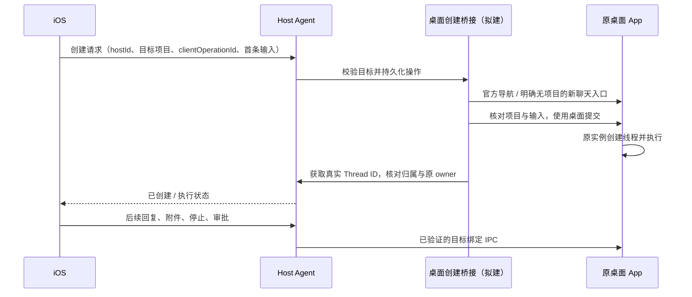

# 技术可行性与 PoC 验收

## Host Key 首次授权

实现、辅助检查、真实桌面与实体手机结果见[首次授权验收](codex-host-key-authorization.md)。

2026-10-23：Codex 自动发现只提供候选电脑。首次点选必须输入这台电脑的 Host Key；Host 的 `/connection/claim` 只接受有效 Host Key，缺失／错误密钥及设备令牌均不能颁发新凭据。公开描述声明 `host-key`，旧 `automatic` 可读取但新版手机不走其免密授权。手机仅在加密设备凭据和同一完整工作区目标验证成功后保存连接，原 Host Key 不保存；已有设备凭据继续重连。二维码包含密钥，视为显式凭据交付；手动路径仍校验密钥。实现与真实验收分开记录，旧免密验收不证明本次策略。

2026-10-22：Codex 双通道的源码现已具备：不安装 Tailscale 的局域网入口、同 Host 原 Serve 地址保留与新安装备用地址学习、独立 TLS 信任及前台失败切换。严格旧发现契约未改变，新增独立鉴权路径契约。实现不代表物理手机切网或其他电脑部署通过；本次结果见 docs/acceptance/codex-dual-channel-20261022.md。

2026-10-21 本次限定范围验收闭环：原应用正常重开后仅一个ChatGPT实例，正式Host保持原身份与desktop-runtime；本机共享服务和官方云端连接分离。恢复对话保留原草稿，仅新增一次真实xhigh跟进，删除按原回执确认；最新执行指纹的项目新建一次输入/回复通过。最终修复包完成归档列表及逐条选中菜单的完成/停止状态验收，两条操作前实际已加载且完成的对话经侧栏批量归档、卸载与App重开成功记录核对通过。此前六项生命周期、附件、队列、停止、审批及内置工具的真实结果按原环境单列保留，本次补验不伪装为整套重跑。完整检查和iOS构建通过；原始失败、只读回执核对与包指纹留在私有验收记录。正在执行中直接归档/删除、Android、Windows、实体手机、手机建议展示及跨网络本次不新增通过，F70完整跨端状态保持原标记。

2026-10-21 正常重开后已确认单个原应用、本机stdio共享服务与官方云端WebSocket分离；准确local owner恢复，保留草稿的跟进只提交一次，真实GPT-6.1-Sol/xhigh完成第二轮，删除原操作回执与完整官方目录核对通过。最新包项目内新建仅一次输入/回复通过。归档对话失去owner后仍保留已确认的终态，Host仅投影归档且已有completed/interrupted/failed的记录；活动、未完成及无终态记录保持unknown，执行控制不恢复。iOS归档列表与选中对话依据同一终态显示，原生辅助保留未知草稿、复用正式连接并只重查异步删除结果。归档状态修复、批量及最终交付另记；Android共享Host字段，原生F70实现及验收未新增通过，Windows和实体手机本次未验收。

2026-10-21 真实续验发现启动作用域错误：全局FORCE_CLI会绕开官方durable/云端WebSocket，把本机目录镜像到另一Host来源；恢复后原桌面尝试不适用的thread/items/list，准确local owner无法重建，跟进输入仍留草稿且未提交。版本2仅保留本机CLI路径，移除有私有旧清单证明的自有全局开关，拒绝覆盖其他及后续用户设置；采集器兼容两版私有清单。七项环境边界与十八项观察器边界通过；需正常重开原应用后复核独立本机/云端连接、恢复跟进和最终包批量归档。既有六项、附件、队列、项目新建和已完成任务重启回执通过仍绑定原指纹，不计整项正式通过；Android、Windows、实体手机本次不新增通过。

2026-10-21 正式接入适配已实现：macOS 原图标正常重开后由原桌面持有共享服务，Host 保持原桌面模式并连接相同服务完成管理。安装器不创建第二个应用实例；当前既有桌面的切换与正式 Host 模拟器回归仍需分别验收，不能复用先前隔离共享模式的结论。

2026-10-21 共享执行服务 DEV：外部独立启动 WebSocket 服务虽能连接原 Electron 和 Host，但缺少原桌面内置工具上下文，不能作为可交付方案。改为原 Electron 的 executable override 自然启动同一服务、保持官方子进程工具环境并桥接其 stdio 后，隔离原型中的真实模型 shell 与 get_usage_limits 已成功；没有复制管道或伪造调用者身份。已补充直接 WS、第二连接管理、活动及归档目录和轮次结局投影源码，本次启动器、发送／停止／审批／内置工具和六项限定的原生模拟器生命周期均已通过，完整旧功能及正式安装切换仍单独验收。正式方案不依赖第二个同名桌面应用，验收通过前不更新正式 Host 或手机。

2026-10-21 快照回收：EasyWork 的有效功能已在主线或后续实现中，跳过旧版本；UM06 接收领域规则、加密存储、回执、SSE 和上传恢复底层。应用及电脑连接继续免账号登录，不接入快照的 Android 登录表单和启动挂接。JVM／iOS Native、Swift/Kotlin、Android 原生领域及本机独立 DEV 服务会话验证按本次输入留证；完整业务页面和跨设备阶段门槛仍未完成，详见 [回收审查](plans/snapshot-integration-20261021.md)。

以下 UM06 的 2026-10-18 记录为原快照历史证据，不能替代本次验证。

2026-10-18 UM06：运行包在独立新候选恢复 349 个内部相对链接并通过完整清单，19 项部署／恢复辅助检查通过；原安装与既有 DEV 服务未更新。公共 Task Hub 规则及 Android 原生领域、加密 SQLite、回执、SSE／历史快照和上传恢复已进入实现，三安卓首轮各 8 项、后续各 13 项领域辅助检查按各自 APK 留证；新增范围及真实人类登录／业务写入、Mac24 独立 iOS 仍未闭环。公开 service／health 的真实 TLS 读取不代替业务验收，未进入 UM07，A6 暂停。

2026-10-20 弱网专项在原生 XCTest／URLSession 中复现目录阻塞：128 kbit/s、600 ms RTT、十页目录时，旧源码从首个工作区请求到开始读取当前对话为 19.973 秒，最终修复候选为 3.717 秒。该数值是单次合成工况下的读取开始时间，不包含真实蜂窝唤醒、TLS 或 Windows 原生处理时间。读取路径还发现 Swift／共享层交付时丢失网络错误类型，已在请求内保留原生错误并增加 13 项实际跨层边界检查。真实 iPhone、Windows 与蜂窝验收仍单列，不能由本机模拟器或既有通过证明替代。

## 已加载对话生命周期：共享服务候选（2026-10-21）

以下为早期 WebSocket 路径的历史探索与失败记录。主线后续已实现共享 stdio 路径并完成限定范围验收，最新状态见本页开头及[聊天管理记录](chat-actions.md)；本节不回退这些后续结论，也不扩大未验收范围。

隔离协议实测已确认：官方服务仍加载零 Turn 对话时，同一服务的第二连接可以归档和删除；独立元数据进程对相同目标仍报 active writer。legacy／paginated 四项通过，独立持久化读取及原订阅连接的真实卸载、归档／删除事件一致。没有模型调用、原桌面连接、正式启动配置或部署变化，因此不能视为后台保留、已完成、已停止或执行中真实对话的成功验收。

当前安装版桌面代码存在原生 WebSocket 连接路径，后续隔离 DEV 已实际完成原 Electron 握手；公开稳定性、访问控制、原内置工具和正常启动兼容性仍未验证。拟议方案先验证共享原服务，再接具名生命周期方法，最后完成真实双端各状态验收；涉及当前不改启动配置边界的变化单列评估。现有产品能力仍为部分完成。详见[验证结果与分阶段方案](chat-actions.md#共享原服务的可行性与拟议方案2026-10-21)。

后续真实原 Electron 隔离 DEV 已完成 WebSocket 握手及操作系统连接核对，但当前 Host 因协调 socket 缺失启动失败；安装代码的共享 WebSocket 分支会关闭旧本地协调。普通启动的隔离对照也未取得协调接口就绪，保留失败，不能据此宣称已完成原功能无回归。共享运行时适配及桌面工具来源尚未打通，后台保留／完成／停止的归档删除未进入原生模拟器真实验收。按用户此次缩小范围，模拟器通过即可满足本任务手机门槛；实体 iPhone 不作为本次阻塞原因。详见[原 Electron DEV 结果](chat-actions.md#原-electron-共享连接-dev连接通过host-接入未通过2026-10-21)。

## 客户端队列收敛（2026-10-19）

已移除 Host FIFO 自动续发、旧项立即执行和原生不可用回退。Codex 使用客户端原生队列；EasyWork 手机输入经类型化 IPC 进入桌面已有队列，共用列表与调度器。远程账本只保留不可变投递意图及回执，旧项只读核对，不自动迁移。客户端确认前不报告排队成功；同步失败明确提示。编译、边界测试、真实模型与 iPhone 16 结果按各自环境另列，不能互相替代。

## 大对话同步修复（2026-10-18）

后续实时恢复已实现有界原 owner 消息窗口、旧格式历史连续基线保留、独立历史精确回执对账，以及 Host 遗留队列来源标记和恢复时不自动执行。主库 `pnpm check` 通过；普通原生 iOS、真实 Electron 和单轮真实模型验证：测试接收器故意丢弃四个完整快照，仍收到三十一批原 owner 补丁、三十次消息更新和十二份 `live-window` 响应，最终正文及未发送草稿核对通过；准确原轮完成、实际 xhigh、单条输入。首次旧格式 ID 不匹配失败单独保留，未重放输入。此窗口不等于完整原始快照，仍不授予命令权限。目标机部署和实体手机结果按实际环境另记，不能用本机结果替代。

阅读状态保存已改用后台串行写入，合并同目标阅读位置并对通知扩展锁冲突有界重试；保留实际失败阶段及错误码，不再将所有错误归因为存储不足。锁持续占用超过两秒、百次阅读合并、旧读不回退及损坏账本保留的辅助回归通过。该原生修订在独立 iPhone 15 模拟器、真实 Electron 和单次真实模型中再次通过：丢弃三个完整快照，三十二批补丁及更新、二十五份实时窗口响应，原轮单输入完成且实际 xhigh；本轮手机本地保存八十五次、错误零次。目标 MacBook 已完成七组持续 128 秒的实时窗口只读复验，业务输入及原进程保持；实体 iPhone 15 专项仍因系统 UI Automation 密码授权待用户完成，不能记为本次真机通过。

随后用户重新提供实体 iPhone 16：同源 build 81 的正式 App 连续显示新增业务进度，已与电脑独立只读结果核对；旧未知提示未显示，遗留队列来源标记正确，百次本地保存无错误，既有草稿及提交摘要保持。该次目标运行态已恢复 `live`，不代表官方广播体积限制已消失。真机 XCTest 的 DTX 调试通道在进入测试前断开，自动化项记为失败；正式 App 观察与保存核验通过单列，不将其冒充自动化或真机强制断网通过。未提交业务输入、执行队列或重启目标服务。

性能与冷启动收尾后，主库再次通过完整检查和普通原生 iOS／真实模型验收；超大工具字符串在额外 JSON 正文复制前拒绝，健康增量不重复扫描基线。边界验证覆盖“原 owner 已就绪、原生队列尚未读取”的启动顺序，遗留输入没有自动执行；已确认原生方法不支持时的旧 FIFO 回退保留。最终产物与此前通过分开保存指纹和真实验收，原问题电脑只读部署结果单列。

用户报告的 MacBook 会话读取返回 503，并报告读取期间跳过超过旧 64 MiB 上限的帧；事件路径仍能返回与手机截图一致的旧缓存。已实现 256 MiB 有界接收、最近消息分页、有效流更新期间避免重复完整快照，以及独立的手机对话同步失败提示。70 MiB 工具输出的私有 socket fixture、分页与无执行请求检查是辅助证据；真实 Electron、模型、原生 App 与目标机部署结果单独记录，不由 fixture 推定通过。

首轮目标部署曾取得约 153 MB 的原 owner 快照，随后只收到无基础的增量补丁；原桌面日志同时记录约 332 MB 的广播超过自身 256 MiB 上限被丢弃，日志缺少 Thread ID，不能据此唯一归属。首轮持续 live 验收失败，进程及业务输入保持。追加实现独立历史最新页恢复、读取新鲜度与实时状态分别展示、无基础补丁退避及禁止最近页自动扩展完整历史；目标复验结果另记，不能把读取旧缓存或辅助 fixture 算成实时 owner 通过。

追加实现已完成真实 Electron、模型及普通原生 iOS App DEV 验收，失败提示、缓存事件不清除失败、实际历史读取不被缓存事件推迟、重试恢复与草稿保留通过。目标 macOS 的间隔只读采样为 `history`，实际读取时间前进且窗口有界；实体 iPhone build 79 未经手动刷新连续显示原业务任务的新进度。原桌面及模型进程、业务输入和原未知/排队回执保持。此结果验证进度恢复及明确提示，原 owner 完整实时快照仍不可用，运行状态与控制继续为 unknown/false；不将其写成实时控制恢复。真机自动显示由系统截图核对，物理机 XCTest 驱动因进入测试前 DTX 断连未取得通过，重试交互由原生模拟器 DEV 另验。

## 持久原生建议同步（2026-10-18）

2026-10-19，Windows 当前实现的完整原生检查为 315 项通过、2 项 macOS 跳过、0 失败，普通接口矩阵 50 次 GET 与 13 次有效建议读取通过。这些结果单列于实际环境，不能代替手机验收。随后实体 iPhone 的首轮读取暴露同一来源的重叠请求：前一个请求约 3.55 秒返回成功，约 0.93 秒后发起的另一个请求以“原桌面建议读取忙碌”返回 503；该轮未通过。iOS 在途请求协调的修复、辅助回归和修复后真机结果分别记录，不以重复读取或辅助检查覆盖该失败；原 XCTest 在测试启动前的 IDE 通道失败也继续保留。

安装流程按用户要求默认持久配置已实现平台的 Trace，简要说明建议同步、本机记录及正常重开动作，不再逐项索取记录授权；用户明确关闭时保留。该流程简化不等于当前进程或手机实测已经通过。Windows 原生 x64 适配与持久工具已回收到统一源码，实际 NTFS／DACL 边界与公共解析分别验证；正式部署、正常重开后的新 Trace、HTTP 和实体手机仍需逐机验收，不能把代码或合成测试写成正式通过。见 [Windows Trace](windows-native-trace.md)。

已实现当前实例内按请求顺序选择最新原生预测、拒绝最新未完成时回退旧版、Host 六秒租期和手机同轮次两秒刷新；原生 trace 与输入框实际显隐区分标记。持久环境、源码检查、正式部署和实体手机／桌面重启结果分别记录于本次验收，不能以辅助回归替代真实双端一致性。

2026-10-18 发送回执恢复已补充独立原 ID 自动查询、备用正向回执接纳及确认后的发送锁释放；迟到超时不能影响后续输入。全仓检查、原生编译、合成网络及真实 Electron／原生模拟器／两次 xhigh 模型任务通过。实体 iPhone 16 已更新 build 76，在提交确认及历史读取挂起、事件省略回执时发出一条真实 xhigh 输入；准确回执恢复后提示自动消失，未点击查询或结束等待，独立 owner 核对单轮单输入完成，重启后的活动等待为零。截图中的旧未知操作此前仅完成本地结束等待及保留记录，不宣称已找回准确回执；未重发旧消息。此前失败及各阶段范围见本地文件 `docs/acceptance/reply-receipt-recovery-20261018.md`。

提交前审查另外补强了冷启动／回前台先启动独立回执任务，以及手动历史补拉前释放查询占用的边界；这些新增边界按本次原生专项单独记证，不扩展上述 build 76 的实体手机结论。

2026-10-18 桌面侧栏规则对齐：仓库已实现最近交互时间与手动顺序、最近项目聊天开关、项目目录和文件夹顺序、项目内排序，以及置顶与归档排除的版本化只读投影。本机原桌面独立核对 352 条最近、10 个项目及全部项目子列表一致；实体 iPhone 15 Pro Max 已通过目录、示例会话位置、置顶／取消置顶及普通重启核对。只有一条真实模型输入，原 Electron owner 独立确认单轮完成、实际 xhigh；原生取消置顶在同一会话续验，未重放输入。辅助检查、过程失败与续验结果分别保存在本地文件 `docs/acceptance/sidebar-alignment-20261018.md`，不扩展为其他电脑通过。

2026-10-18 日常 Host 与手机原连接验收通过：升级保留原身份、密钥、静态配置、入口和 HTTPS，正式观察器实际捕获新建议并精确核对聊天及来源轮次；普通安装的实体 iPhone 15 Pro Max 经原有连接完成四次 A → B → A → B 全文匹配和本机草稿采用／撤销、已有正文保护、取消替换及编辑后旧撤销失效。五个原连接与当前选择不变，原 owner 前后各一个相同完成轮次，无手机模型输入。主库检查、iOS 编译及安装布局 helper 回归通过。该阶段另三台电脑已升级同一程序／SKILL，但两台 Mac 尚待正常重开及 trace 实测，当时 Windows 采集未实现。后续 Windows 适配已实现，逐机当前状态与尚待完成的真实验收见 [Windows Trace](windows-native-trace.md)。下方保留独立 DEV 与更早阶段的历史证据，该次正式部署范围见 [正式验收记录](research/desktop-suggestion-read-channel.md#2026-10-18-日常-host-与手机原连接验收)。

2026-10-17 第二阶段 UI：用户确认后已将独立只读卡片改为输入框内灰字和采用按钮，采用只写本机草稿、已有正文默认追加、替换另行确认。原生边界检查覆盖来源／编辑版本／有效期变化拒绝、追加原文保留和撤销失效；第二阶段已用另外两条原桌面真实建议，在实体 iPhone 15 Pro Max（iOS 27.0.1）普通安装 App 完成 A → B → A → B 四次来源与全文匹配。采用后撤销、已有草稿追加与撤销、采用后继续编辑并使旧撤销失效、跨聊天草稿保留、取消替换保留原文均通过。手机操作未新增模型输入，独立原 owner 前后仍为各一个相同的完成轮次；原连接已恢复，临时连接及 HTTPS 入口已清理。此次使用独立 DEV Host，日常正式 Host 尚未部署本功能；外接键盘 Tab、附件组合与其他平台未扩展为本轮真机通过。下方四次只读匹配继续作为第一阶段的独立历史证据。

2026-10-17 最新真实验收：原生 rollout trace 已取得两条原桌面预测的准确来源绑定。两条来源 Turn 重叠 25.268 秒，预测生命周期重叠 5.755 秒；Provider 请求／推理流没有重叠，不将其写成并发 Provider 验收。每条请求的 metadata 同时给出来源 Thread／Turn 和预测 Thread／Turn；原生响应的 `suggestion` 与通知正文完全一致，原 owner 前后核对各一个 `completed` 来源轮次，桌面日志均为 `suppressed=false`。该来源结果证明本机原建议提取与并发来源精确关联；实体手机卡片另以如下实际展示证据验收，原桌面输入框视觉读取仍未由来源日志证明。

Host 源码已实现 `GET /v1/threads/next-turn-suggestion` 与 `desktop:suggestions:read:v1`，本次通过临时独立 DEV Host 验收，日常正式 Host 尚未部署本功能；需显式启用采集器、配置私有 trace 根目录并实际就绪；每次读取前后重验原 owner 与原生证据。`runtime.suggestionSourceTurnId` 和原生 iOS 只读卡片已实现，真实 HTTP 预检已返回两条绑定建议及一致来源轮次；无采用、草稿写入或发送。

实体 iPhone 15 Pro Max（iOS 27.0.1）普通安装 App 经真实 HTTPS 完成 A → B → A → B 四次原生全文匹配，`threadId/sourceTurnId/contentSha256` 正确，草稿未改且建议卡片无采用／发送按钮，手机读取无新增模型输入。独立原 owner 前后仍为两聊天各一个相同 `completed` 轮次，整轮 `xcodeExitCode:0`、`physicalNativeVerified:true`。完整客户端列表核对确认原连接已恢复、临时连接已删除，临时 HTTPS 入口已关闭。

两次 `pnpm check`、`pnpm build:ios` 及各次真机构建通过，属于辅助证据；日常正式 Host 部署、Windows、其他电脑及默认启动下的持续可用性仍未验收。本次一次性 `--wait-and-launch` 已在获准正常重启前预置并成功等待普通退出、携带环境启动原应用，不作为默认产品能力。具体范围及私有证据索引见[原生 trace 实证](research/desktop-suggestion-read-channel.md)。

同日较早的 Host 集成实证：只读采集已接入运行时并提供独立 GET，原桌面两条执行时间重叠的预测均通过真实 Host HTTP 返回；401／405／错误 runtime 409 及同身份 Host 重启后原文和执行 ID 保持通过。该轮只验证采集与隔离，响应为 `source:null`，当时尚无精确来源绑定或手机展示。以下未取得正文、来源绑定缺失与未接入 App 的描述均保留为对应早期阶段结果，不覆盖上方最新状态。

2026-10-17 早期完成通知实证：**原 Codex 建议正文已实际提取两条**。用户授权新建验证聊天后，连续两轮正常完成，由原桌面自行生成预测；只读监听既有完成通知子进程的参数，取得真实建议 JSON。准确原 owner、两轮完成状态、桌面来源日志及正文内容完成受控单会话核对。仓库新增 macOS kqueue 监听工具，第二条由该工具真实捕获。通知没有父来源 ID，多聊天并发的自动精确关联仍缺失；正式 Host 服务、建议领域接口和 App 交互未接入，不声明完整同步通过。详情见[原完成通知实读](research/desktop-suggestion-read-channel.md)。下列失败或辅助验证保留为历史记录。

2026-10-17 较早的 DOM 路线：固定 CDP 只读采集器、本地探针和 `GET /v1/desktop/composer-suggestion` 已编码，按完整机器目标、准确聊天、前后稳定的原 owner 来源 Turn 校验。默认关闭，未部署正式服务；原 Codex 的实际 DOM 未实读，独立 Chromium 的测试页面不计作原环境验收。实现与边界见 [Host DOM Bridge PoC](research/desktop-dom-bridge-poc.md)。此前截图 OCR 仅保留历史证据，不作为核心目标完成项。

2026-10-17 建议备用通道取得实际通过项：对用户提供的截图运行本机 OCR，正文经已运行的真实 Host 附件接口进入原生 iOS 模拟器，实际下载、Quick Look 正文断言和沙盒独立字节核对通过；1 项测试通过，0 失败、0 跳过。验证代理只转发 GET，来源聊天和模型未收到写入。该结果依赖用户提供截图，OCR 与对照转录有一处空格差异，不代表无需截图的原进程自动读取、建议卡片或实体手机通过。补查 1.86 GB 原始数据库／WAL 和实际解压的 IndexedDB 外部 blob 仍未找到原预测。详见[只读尝试与备用实证](research/desktop-suggestion-read-channel.md)。生产程序未改，临时只读监听及专用模拟器已清理。

2026-10-17 用户补图后的建议实读：准确原 owner 快照确认目标两轮完成、测试回复各一次且最新 Turn 对应预测日志；快照及实际 legacy 历史均没有建议原文。继续读取两条时间关联临时分支的日志，记录消息输出及约 30 分钟后退出，内置读取找不到候选，日志没有正文；父来源关联尚未证明。补充递归解析 314 条历史 item 和解码 347 条 Chromium 存储记录也未取得结果。准确来源绑定已核对，自动提取和 App 同步仍未通过；截图原文仅作对照，详见[准确目标实读](research/desktop-suggestion-read-channel.md)。

2026-10-17 下一轮建议追加实读：复用语音转写的 metadata-only 鉴权，对已确认的预测配置 HTTP 接口一次请求返回 200，配置中没有建议正文，凭据文件保持不变。扩查桌面数据库、约 1.7 GB 历史库及解码后的 Chromium LevelDB；54 条历史匹配均为研究回显，295 条浏览器存储记录未找到预测数据。日志找到实际临时聊天候选，但来源关联未证明；内置读取／状态查询被 ephemeral 分页限制，owner 未发现，独立只读 legacy 查询也被拒绝。原建议提取和 App 同步仍未通过，详见[新增真实证据](research/desktop-suggestion-read-channel.md)。

2026-10-17 下一轮建议新版复核：桌面 `26.1013.40934` / CLI `0.163.0-alpha.10.2` 的本机日志确认预测实际生成。针对未归档目标核对原 owner、已完成的同一来源轮次后，15 秒被动读取仍未取得建议字段或预测通知；新版实验 schema 也未提供只读缓存模式。随后已具体定位原预测 `thread/fork` / `turn/start` 的请求、消息事件和返回对象，以及 renderer 的 `[data-cumberbatch] > .cumberbatch-content` 节点；11 项安装辅助函数隔离检查通过，真实响应截获和原页面 DOM 读取仍未验证。当前结果为“两个候选来源已定位，原正文接入未打通”，不是 Host / App 同步通过。安装指纹、存储旁路检查及观察局限见[只读通道调查](research/desktop-suggestion-read-channel.md)。本轮未改正式服务或提交模型任务。

2026-10-17 慢网发送与后台同步专项：已区分当前导航首次读取与后台补拉，已就绪对话的补拉不再禁用发送或反复插入读取提示；已确认可写的桌面对话省去提交前的打开和历史往返，实际执行仍由 Host 检查原 owner。原生 HTTP 对照复现旧版禁用及提示，修复版在历史响应挂起期间单击提交通过。连接方式改为分段选择，普通启动的原生模拟器在 512 Kbps/250 ms 下完成真实桌面两次 xhigh 输入；独立 owner 核对各一次执行、完成回复及零额外打开。原连接菜单自动点击失败记录仍保留，不将其当作通过。

正式 iPhone 15 Pro Max 已原位更新为构建 20，普通启动后在 HTTPS 响应带宽 128 Kbps、注入往返延迟 600 ms 的专用通道完成两次 xhigh 模型输入。连续 12 次发送可用性／无历史提示采样通过，第二条单击在历史补拉挂起期间被 Host 接收并确认，独立原 owner 核对恰好两轮且各一个输入。原 XCTest 的发送断言完成后，连接清理因选择器已自动关闭而失败；保留该失败，单独恢复用例通过并普通重启核对原选择，未重放输入。更新前后 5 个连接、71 份草稿及 5 条待确认输入保留，草稿／已提交输入摘要一致；验收结束仍为 5 个连接和 5 条待确认输入，已提交输入摘要一致，新增一份测试草稿缓存。临时 HTTPS 入口及专用模拟器已清理。本次不证明丢包、蜂窝切换、其他 Agent／Host 或公网拥塞通过。对照证据位于忽略的 `.local/composer-sync-20261017/`，普通启动、真机原始日志与独立审计位于 `.local/composer-sync-delivery-20261017/` 及 `.local/message-receive-desktop-ios/`，复现与恢复入口见开发指南。

## Host 队列同步与立即执行（2026-10-17）

手机队列立即执行、EasyWork main 的持久认领服务及桌面原生队列展示已实现。运行中走原 Run 的 guidance，空闲走原 Thread 执行，取消与执行共用账本，不确定提交不重放。本轮真实 Electron、原生 iOS、模型和原桌面独立核对逐场景记录，不能用编译或 fixture 代验。同步范围是 Host 接受的队列项，尚未合并既有桌面本地草稿队列。

本机 EasyWork 真实 DEV 已验证 macOS Electron、iOS 专用模拟器与实际默认模型下的局域网和本地中继两条路径：三条排队输入在双端可见、手机提升进入原 Run、电脑取消同步、FIFO 后续执行及 App 重启恢复；独立 canonical 输入无重复，中继限流与防重放拒绝为零。Windows、实体手机、公网中继和其他电脑未验收。

Codex 已按用户确认的短时延迟同步要求接入原生持久队列：活动任务的 Host 排队输入交给官方队列，Host 不再自行再次执行；手机提升先删除原项，再经原 owner 的 steer／next-turn 执行。原生列表可用后声明 `queue:native`，不支持的版本保留 Host FIFO；未知添加／删除只核对，不重放。该方式不提供双端同时操作时的跨端原子保证，不替换官方整队列状态，不修改官方安装或既有历史文件。当前实现的真实 DEV 另行记录，早期 Host FIFO 通过不能替代新版本。详见 [研究与当前边界](research/native-queue-boundary-20261017.md)。

本机新一轮原生 iOS、原生队列接口与原 owner 真实 DEV 通过：三项入队、Host 重启保留、电脑侧删除分别在 1190 ms 和冻结补验的 1062 ms 内同步到手机、手机提升进入原 Turn、FIFO 原桌面自然执行、最终队列为空、重复操作无额外输入，App 重启状态保留。实际 gpt-6.1-sol／xhigh、两个完成 Turn，三条有效输入各一次、取消为零。屏幕视觉未独立验收；界面仅有只读绑定代码核对，不扩展为 Windows、实体手机或其他电脑通过。

早期 Codex Host FIFO 版本已通过原生 iOS 与原 owner 的真实 DEV 核对：Host 重启保留三个排队项、手机提升进入原 Turn、取消项无输入、FIFO 新一轮一次、同 ID 重复提升不增加输入或 Turn。实际默认模型为 gpt-6.1-sol，原 owner 两轮均确认 xhigh。此结果不包含官方桌面原生队列同步或其视觉验收。

电脑间文件发送 CLI `transfer-host.mjs` 已实现，复用现有 HTTPS 接收协议，保存不可变机器目标、清单和字节快照。send/status/resume 分离，重复发送只查询，显式恢复复用同一 ID；九项本地真实接收器边界回归和主仓库 pnpm check 通过。macOS/Windows 的真实跨机发送、接收磁盘独立核对、原模型读取及统一包部署分别记录于 文件 CLI 验收（本地文件 `docs/acceptance/host-file-cli.md`），不将辅助检查等同于逐机或手机场景通过。

2026-10-12 Android A3：原生 UI、只读工作区／历史、连接编辑、缓存、发现、二维码与 Markdown／工具／Diff 已实现；两端共用 KMP 领域及读取契约。iOS 55 次、Android API 26／37 与字体 1.0／1.3 共 176 次、实际摄像头 3 次、原生分页／刷新／503／重试 8 次及真实已保存历史读取 1 次通过，322 张截图已逐张核对。[A3 证据](acceptance/mobile-evidence/A3.json)绑定当前实现及环境摘要；真实读取为 3 次 GET、0 写入，桌面 owner 未加载，不能作为执行闭环证据。A4–A8、真机、推送环境与发布门槛继续分别实施，Xiaomi 真机测试保持暂停。

2026-10-11 原生 UI 细节修复：此前新建记录移到对话菜单，输入栏去掉自动连接说明；手机已读增加正文版本匹配、目标可见边界及侧栏收尾后的确认。新建恢复 3 项、手机阅读 3 项、连接提示及单次发送 2 项原生回归通过。本次真实原桌面链路和实体手机范围分别记录于 [UI 细节验收](acceptance/ui-details.md)。
2026-10-14 用户要求取消 Codex 账号身份校验，连接只认机器运行目标、证书和设备密钥。已实现 Host 源码、机器键、历史 claim 加密兼容与旧阅读状态保留，并通过隔离编译及相关边界检查；旧账号字段作为历史元数据保留，已提交输入保持原指纹，未知结果不重放。本机 Host 已受控启用机器身份版，原设备令牌与机器目标、workspace、创建能力和当前桌面 owner 两次读取通过。业务 v8 已部署，native32 原位安装后的连接、草稿和入口已取得真机证据；完整真实模型／设备验收继续，见 本轮验收（本地文件 `docs/acceptance/task-management-ios-20261014.md`）。任务管理的人类登录与项目权限、其他 Agent 的账号规则不属于此次取消范围；旧账户隔离验收不能作为新策略通过证据。

## 项目与对话批量管理（2026-10-17）

设置管理页与 Codex 项目删除及未占用对话归档接口已实现；原桌面占用的对话受上游 active writer 限制，手机归档尚未打通（2026-10-20 起允许发起并显示官方实际拒绝，不再预先禁用）。支持最多 100 项的搜索选择、项目记录删除、对话归档和逐项持久回执；独立元数据白名单不启动模型或恢复现有对话。未知结果只读核对、同 ID 防重放和部分失败的边界回归通过，完整工作区检查、iOS 编译与双语检查通过。原桌面专用模型任务已独立确认各自唯一输入及实际 xhigh；原生操作与文件／历史保留的逐项结果记录在本地文件 `docs/acceptance/workspace-management-20261017.md`。EasyWork 尚未实现此入口的远程操作，Windows 和实体手机未由本次环境代验。

## 项目任务 iOS 与局域网部署（2026-10-14）

架构和 UI 已获用户确认，进入开发及真实任务验收。采用独立 SwiftUI 工作区和手机人类 Bearer 会话，共用原任务业务服务；接入 Skill 包包含电脑 Web、API、迁移及固定运行依赖。当前支持 macOS 主服务，Windows 主服务未实现；执行机保留既有 Host 能力。

真实安装预检已识别现有任务 API 和数据库，独立 MacBook 的 Chrome、HTTPS 鉴权及准确原 owner 准备完成。部署边界检查与 TypeScript 构建是辅助证据，不能代替原生模拟器、实体 iPhone、原桌面模型及独立电脑全流程通过。唯一主机迁移、正式数据接管与业务推送须另有对应证据，不从隔离 DEV 安装或历史通过推断。范围与逐场景状态见[架构计划](design/task-management-app-plan.md)和验收记录（本地文件 `docs/acceptance/task-management-ios-20261014.md`）。

本次真实手机已创建带受控附件的任务并登记一次派发，原 Host 创建结果尚未确认；旧未知输入保持原操作 ID，不自动重放。真实业务事件的 `accepted` 回执不能替代手机展示及点击证明。已实现待重验的修复包括通知 pending 有界只读核对、草稿恢复保留验收人，以及同业务版本的执行状态事件和原生详情更新。前向迁移和独立冻结升级完成后，继续模拟器、原 App 数据保留、真机及真实模型两轮交付验收；当前没有宣布全流程通过。

2026-10-13 独立 Codex 桌面转写接口已真实返回 WAV 的完整转写，Host 与 iOS 录音上传/回填已实现。普通聊天模型拒绝音频输入的结果不能代表此独立服务。版本相关接口、账户限制及逐项证据见 [录音转写](voice-transcription.md) 与 本次验收（本地文件 `docs/acceptance/voice-transcription-20261013.md`）。

2026-10-12 手机回复分支已实现：复制与分享之间增加分支入口，提供当前工作目录及新 Git 工作树两个选项。官方 `thread/fork` 用准确 `lastTurnId` 继承选中轮次及之前上下文，元数据准备器退出后原桌面接管；工作树带入当前改动而不改变源暂存区。持久回执、同 ID 查询、结束等待和迟到目标隔离进入专项回归。专用原生模拟器与原桌面真实模型联动通过；iPhone 15 Pro Max 构建 42 从同一回复完成两种分支及真实续聊，独立 owner 核对唯一输入、准确历史前缀和源 Git 状态，普通 App 重启后两条回执恢复并能打开准确分支。本机正式 Host 按统一包更新且保留身份／私有配置。指纹、辅助证据、原失败记录和未覆盖环境分别记录于 分支验收（本地文件 `docs/acceptance/thread-forks.md`）。

2026-10-11 原生 UI 细节修复：此前新建记录移到对话菜单，输入栏去掉自动连接说明；手机已读增加正文版本匹配、目标可见边界及侧栏收尾后的确认。新建恢复 3 项、手机阅读 3 项、连接提示及单次发送 2 项原生回归通过。本次真实原桌面链路和实体手机范围分别记录于 UI 细节验收（本地文件 `docs/acceptance/ui-details.md`）。

2026-10-11 独立文件互传第一版：手机侧栏增加电脑级入口，文件直接上传到 Host 固定接收目录，不要求聊天或提交模型任务。本机真实原桌面 26.1007.30912、原生 iOS 26.0 模拟器、系统 Files 选择器、App 重启回执恢复、真实模型读文件及独立原 owner 唯一输入核对通过。正式 iPhone 15 Pro Max 已更新构建 37，四台 Codex Host 均按同一包升级；真机向 M4、M5、Windows、MacBook 上传和普通 App 重启回执恢复通过。完整工作空间检查及文件完整性、路径隔离和幂等恢复边界通过，Windows 补正测试执行器启动方式后在真实 win32 与本用户 DACL 上通过。各机磁盘独立核对、实现指纹及尚未覆盖的网络场景分别记录，详见 文件互传验收（本地文件 `docs/acceptance/file-transfers.md`）。

2026-10-11 EasyWork 长历史切换：已在用户开发者模式连接的 iPhone 15 Pro Max 上复现“信息太长”与正文空白。Foundation 默认 WebSocket 接收上限实测为 1 MiB；EasyWork 手机适配器已显式设置有界的 32 MiB 接收上限。真实 Foundation/TLS/WebSocket 辅助检查复现旧限制、核对 2 MiB 响应及后续响应并验证超限拒绝。当前真机复验与全功能状态逐项保存于 EasyWork iPhone 结果（本地文件 `docs/acceptance/easywork-iphone.md`），不以该辅助检查宣称完整通过。

2026-10-11 手机角标口径：已实现设备未读对话数，全部已添加电脑汇总，同一对话计 1，电脑阅读独立，已看过的待处理事项继续保留操作卡片。编译、跨进程账本、通知边界及本机真实 Electron／原生模拟器／模型／独立 owner 阅读隔离通过。iPhone build 21 已安装并保留连接、草稿，本机正式 Host 已更新；真机系统角标、远端和新 APNs 静默链路仍须分别验证，见 角标验收（本地文件 `docs/acceptance/unread-badge.md`）。

2026-10-11 手机未读修复：原历史读取没有手机阅读确认，单靠原桌面 `hasUnreadTurn` 导致读后蓝点保留。已实现按设备及完整 Agent／账户／Host／workspace／runtime／thread 隔离的阅读基线、内容版本、严格确认和待同步恢复。原桌面与手机阅读分别维护；真实本机 Electron、原生模拟器、两次模型任务及独立 owner 专项通过，App／隔离 Host 重启恢复通过。该轮对未声明确认能力的旧 Host 和 EasyWork 保留原展示，真机、远端及正式部署未纳入该轮验证；后续手机本地角标与部署进展见上方角标验收。详细结果见 未读专项（本地文件 `docs/acceptance/unread-state.md`）。

2026-10-11 权限专项新增真实证据：独立冻结 DEV Host、原生 iOS 模拟器、原 Codex 桌面 owner 与真实模型完成电脑默认完全访问、只读、重新完全访问和替我审批四场景。完全访问真实写入指定工作区外文件，具体沙盒／审批／审查者、工具成功、文件内容及输入无重复已独立核对；原生 1 项、0 失败、0 跳过。该证据只证明对应冻结 Adapter 与本机环境的权限场景，正式 iPhone、远端电脑及后续包须分别验收或核对精确复用范围，见 权限验收（本地文件 `docs/acceptance/permissions.md`）。

2026-10-10 手机创建性能诊断及优化：性能采样发现约 104 MB 的全量缓存反复编码，已将操作恢复状态与分目标历史保存分离，省去已确认创建后的重复打开，并增加同 ID 查询恢复与本地结束等待。同一有线 iPhone 优化前后各六组真实创建均通过原桌面单次输入及模型回复核对；点击至准备平均由 2.365 秒降至 0.577 秒，但创建确认平均由 16.460 秒变为 16.902 秒，尚无平均端到端提速证据。真机原无记录操作结束等待、保留正文及图片、重启恢复通过；Swift 持久边界五项及专用模拟器恢复三项通过。下一瓶颈在首条输入后的电脑确认，具体阶段、产物范围及前后对比见 创建性能专项（本地文件 `docs/acceptance/creation-performance.md`）。基线一组确认后因模型网络重试历时近九分钟，模型网络失败与创建 HTTP 超时分别核对，不宣称本地缓存优化解决了上游网络或所有间歇失败。

2026-10-10 本机重启后的 iOS 连接故障定位为 Host job 仅存在于旧登录会话，Tailscale 在线且 Serve 路由保留，但后端未启动。恢复原私有 plist 后回环／HTTPS 鉴权及 Host 身份检查通过。macOS 服务脚本新增当前用户登录自启注册与显式停止移除注册，保留原程序、身份、密钥、端口与桥接配置；隔离 fixture 和本次运行验证单独记录，尚未用真实注销／电脑重启证明自动恢复。恢复网络连接不能替代原生手机与模型任务的完整功能验收。

2026-10-10 未读列表已接入原桌面 `hasUnreadTurn`、已读事件与刷新 owner 快照。真实 DEV 定位 follower 缓存未随已读变化更新，已补只读快照刷新与目录页缺失 owner 的回归。原生 fixture 覆盖蓝点、已读清除、状态优先和重启；真实任务与桌面视觉核对的独立结果见 未读专项验收（本地文件 `docs/acceptance/unread-state.md`），不将 fixture 或桌面状态读取扩展为完整双端视觉通过。

2026-10-09 多电脑维护规范：Host、Adapter、桥接工具及 SKILL 的唯一实现标准为主开发仓库；远端已有修复回收合并后，由本机检查、构建并统一分发。创建与主动打开已实现独立证明和能力判断，Windows 私有文件 DACL 与创建日志目录 fsync 的平台差异已回收至统一源码。源码合并和编译不代表目标 Windows／Mac 已通过；逐机真实原生客户端、原桌面 owner、任务和恢复结果按实际部署指纹独立保存。

同日后续联合验收在构建 26.1002.52244 的目标 Mac 和 Windows 分别通过八个核心原生场景及普通 App 新建；用户实际 iPhone 的正式 App 分别完成两个既有连接的新建和真实模型回复，并通过已有回复/草稿隔离。各目标独立核对原 owner、原内置创建工具、项目归属、一次首条输入和回复；连接及原草稿保留，私有记录按环境指纹保存。这关闭该范围的两实体电脑/iPhone 待验项，不替代跨网络切换、其他构建或未覆盖功能的专项验证。SKILL 默认完整接入并执行 [完整功能清单](../skills/codex-host-connect/references/full-functions.md)，逐项区分真实通过、匹配复用、失败和未验收，不把清单策略当作所有功能已经通过。

验证记录日期：2026-10-07。环境：单台 macOS 电脑；早期 Codex CLI `0.160.1`，本轮已安装桌面 `26.1002.52244` / CLI `0.162.0-alpha.2`。早期协议实验、当前真实实现和产品剩余门槛分开记录；本机模拟器验收不等同于两台物理电脑与 iPhone 真机验收。

**当前结论：正常启动的原桌面创建/打开入口已接入 iOS，按本机专项结果验收。** 用户要求手机新建由原桌面执行；控制聊天调用原内置工具，新聊天正文与附件进入其原 owner，没有降级为 Host 托管执行。跨物理电脑、iPhone 真机、冷启动与多版本仍是独立门槛，不能以本机模拟器替代。

2026-10-09 定位新建与主动打开能力丢失：控制聊天实际已加载，但每次刷新从磁盘重算 Adapter 摘要，开发构建替换文件后与旧验收记录不一致。已改为绑定 Host 进程启动时加载的构建，并区分版本／证明失败和 owner 未加载。隔离构建回归确认运行中替换文件保持原能力，新进程加载不同构建仍拒绝旧证明；该 fixture 不替代新版本的真实原生验收，当前部署结果另记 本机验收（本地文件 `docs/acceptance/ios-local.md`）。

恢复入口后的真实创建请求还复现了共享目录歧义：原控制聊天 list_projects 返回两个项目，旧命令要求目录唯一，因此未调用 create_thread。已改为在准备阶段确认所选 native projectId 并持久绑定，在实际工具结果中核对 ID、目录和 local 环境；fixture 覆盖同目录不同项目、目标改变拒绝、恢复不重放与旧意图兼容。原生复验分别核对这些共享目录项目和无项目创建，结果另记本机验收。

2026-10-09 修正原桌面侧栏的数据来源：App Server metadata 与桌面侧栏使用不同项目 ID，且目录相同不能证明聊天归属。Adapter 新增只读 ID/明确归属映射，刷新读取完整 metadata 并替换展示顺序，保留执行恢复缓存。fixture 覆盖同目录项目隔离、无项目、跨 Host、移动归属、分页与旧条目移除；这属于 metadata 验收，不替代 owner 控制或其他电脑实机证明。

2026-10-09 在真实桌面复现侧栏运行状态遗漏：独立 IPC 显示 active，新 Host 的工作区却为 unknown，只有打开历史建立 owner 跟随后才变为 running。已实现工作区刷新时的有界 owner 发现和后台摘要同步；真实桌面 API 复测确认首次列表即返回 running。边界 fixture 覆盖未打开、Host 缓存恢复、等待审批、自然完成、owner 丢失／恢复及单条发现超时，不以这些合成场景代替原生手机验收。原生专项及实现／环境指纹另存本机验收记录。

同轮普通 App 原生专项 **1 通过、0 失败、0 跳过**：手机不打开目标聊天，仅刷新侧栏，同一真实模型任务从执行中到自然结束均正确同步；独立 owner 核对命令、随机码与 Turn，目标历史／桌面打开请求均为 0。搜索焦点曾使手势不发请求，新增键盘处理后按实际请求补验。此前编译与手势失败保留，当前通过的实现和环境指纹见 本机验收（本地文件 `docs/acceptance/ios-local.md`）。

本轮核对当前桌面协调协议仍没有可调用的新建/打开会话命令，默认 App Server control socket 仍不存在。桌面内置工具管道有调用进程身份验证，外部 Host 的只读工具目录探测被关闭，未获得可用于产品的新建入口。没有关闭身份验证、伪造调用上下文或修改桌面安装包。

2026-10-08 根据目标 Mac 构建 26.928.20755 被白名单阻止的实际报告，改为版本建议：服务与 Adapter 对未知构建告警后继续，使用实际安装版本，真实 IPC/owner/stream 检查决定控制可用性。回归 fixture 覆盖该版本正常握手及旧环境标签不会阻止连接；这不是 26.928.20755 的实机通过记录。该轮仍使用 Windows 正式控制证明门槛；2026-10-09 按用户要求移除基础回复门槛，记录仅用于报告。原桌面新建/自动打开证明仍绑定实际安装版本和 Adapter，不能复用不匹配证明。

2026-10-08 一次文字 PoC 后已继续实现 iOS 创建和主动打开：原控制聊天用实际项目目录调用内置 create_thread；新聊天完成初始化轮，再通过 IPC 收到 native userMessage、localImage 与受控文件输入。原内置 navigate_to_codex_page 打开原 ID 后才接回写操作。实际工具结果、原 owner、首条字节和 UI 分开核对；官方启动方式不变。官方 project_id 可能仍为空，所选项目的显示归属保存在本产品缓存，历史刷新不以共享目录推断覆盖这项明确选择。最新结果见 本机验收（本地文件 `docs/acceptance/ios-local.md`）。

官方 [App Server 文档](https://learn.chatgpt.com/docs/app-server) 提供 `thread/start` 与 stdio/WebSocket/Unix socket 传输，但没有在本机找到原桌面现有执行实例向本 Host 暴露的对应入口；另起 App Server 不符合此用户要求。官方 [手机 Remote 工作流](https://developers.openai.com/blog/mastering-codex-remote-for-engineering) 说明官方手机端可选择 Host/项目并新建，不能据此推断第三方 Host 具备同一接入权限。以上本机观察与文档核对均不构成“所有未来版本都无法支持”的结论。

## 仓库初始化前的协议实验

| 能力            | 实际观察                                                                                            | 证明范围                                                    |
| --------------- | --------------------------------------------------------------------------------------------------- | ----------------------------------------------------------- |
| 版本对应 Schema | CLI 成功生成实验性 JSON Schema，440 个文件                                                          | 当前安装版本可提供协议定义，不代表跨版本稳定                |
| 项目列表        | `project/list` 返回 5 个项目和后续游标                                                              | 一页列表成功，5 不是全部项目总数                            |
| 对话列表        | `thread/list` 返回 5 条记录和后续游标                                                               | 本机存储对话可检索                                          |
| 历史读取        | `thread/read` 读取完整历史；`thread/turns/list` 返回分页结果                                        | 存储内容可读取；另一次读取成功加载桌面来源的 paginated 历史 |
| 文字输入        | 独立会话回复预期校验字符串                                                                          | 文本提交与模型完成事件正常                                  |
| 图片输入        | `localImage` 输入红色 PNG，模型回复“红色”                                                           | PNG 原生图像输入成功，未验证所有图像格式                    |
| 文件读取        | 将 TXT 放在测试工作目录，模型通过工具读回随机校验字符串                                             | 文件已在电脑上时可读取，未验证手机上传                      |
| 流式输出        | 收到 `item/agentMessage/delta`、开始和完成事件                                                      | 客户端可呈现增量消息                                        |
| 双客户端        | 同一 Unix socket 服务中，A 完成首次 Turn 后，B 恢复同一持久线程并回复，A/B 均收到校验文本和完成事件 | 单服务、多客户端的持久会话与事件同步成功                    |

文本、PNG 和 TXT 三项测试在隔离的临时内存会话中完成。双客户端实验使用临时持久会话，测试后已通过 `thread/delete` 删除该测试线程。上述是实验记录摘要，没有在本仓库保存真实用户的历史或凭据。

## 本仓库新增的实现与单机验收

紧凑 SwiftUI 界面已接入完整 Host 运行时：授权目录内添加项目、创建持久对话、文字/图片/文件输入、真实流式输出、工具日志与 Diff、执行计划、文件下载和图片预览、停止、补充指令、排队/取消、审批与问题回复、模型设置、Keychain 与 HTTPS。手机先上传真实字节并校验摘要，再将图片以 localImage、普通文件以受控路径交给 Codex。

本机 iOS 模拟器已从真实 PhotosPicker 和 Files 选择器导入图片和 TXT，经 Host 上传后，模型读取未写在提示词中的随机校验码，生成 TXT 与 PNG，再回传 App 下载及预览；输出文件已校验真实校验码。这是完整混合输入链路，超出早期“文件预先在电脑上”的实验。原生真实文字发送、流式状态和应用重启恢复也已通过。

真实托管服务另行验证了未发送空会话的重启恢复：重启前上传 TXT，重启后仍使用原手机会话 ID，模型实际读取该附件中的随机校验码，回执完成。恢复只重建本服务从未提交任务的空线程；不适用于已有任务或官方桌面会话，不会自动重放消息。

协议 fixture 另外验证了目标隔离、消息 ID 去重、排队执行和取消、停止、审批竞争和提问、事件补同步，以及 RPC 响应前后断开时保留 uncertain、恢复连接后不自动重复提交。真实 Codex 停止、补充指令、取消队列和命令审批已在独立测试会话执行。fixture 不是模型或官方桌面接入的证明。

保留 `history-only` 专用只读路径，不加载执行任务，状态为 unknown，写操作禁用。本机曾读取 8 个项目、首批 100 条对话和文字历史；不提交真实历史内容。复现命令及原生结果见 本机 iOS 验收（本地文件 `docs/acceptance/ios-local.md`）。

进一步完成本机历史分页，读取到 8 个项目、158 条已保存聊天，并验证项目内历史消息可读。旧桌面聊天没有 `projectId` 时，根据工作目录与项目根目录精确匹配展示；共享目录可在多个项目视图中显示同一线程，原官方归属仍保持为空。来源标签区分桌面只读历史和 Agent 托管会话。这解决项目下聊天遗漏，不代表桌面运行时实时接管通过。

**P1 在固定桌面版本上已通过。** 进一步检查已安装桌面构建 26.930.61225，发现其用户私有协调 IPC。新增 desktop-runtime 通过会话 owner discovery 与版本 11 的快照/patches 连接官方桌面同一运行时；当前进行中的原任务状态、工具执行与消息已从 owner 收到。随后在专用验收会话由手机完成真实回复、流式文字、停止与审批，原桌面独立读取确认校验文本一致。未修改历史/安装包、未重启桌面、未通过 reader resume 任意原任务；此前测试服务的执行实例先退出，再由原桌面加载该专用会话。

这条入口是内部协议，构建升级须重新验证，不能宣布所有 Codex 桌面版本通用。未配置已验证控制聊天时，未加载历史只读；配置后可使用独立创建/打开流程。手机新增桌面项目暂不支持；模型、推理与权限的下一轮设置已实现，专项验证范围另行记录。2026-10-09 已补充原 owner 的 steer 和 Host 持久 FIFO 队列；真实验收范围见本机验收记录。两台物理电脑和 iPhone 跨网络门槛仍未通过。详细适用范围见 [运行指南](runtime.md)。

当前桌面 26.1002.52244 / CLI 0.162.0-alpha.2 的早期 **3 项原生用例、0 失败、0 跳过** 覆盖已有会话的切换、混合附件、流式/停止/审批。后续创建、首条附件、恢复与主动打开另行验收，不用这三项旧结果替代新门槛。独立 owner 快照继续核对随机码、中断回执与待审批清除。

## 已观察到的限制

- 2026-10-08 新增 iOS 统一任务按钮与语音草稿（以下为历史实现，2026-10-13 已由 Host 转写替代）。继续／重新运行复用已有 `next-turn` 提交，没有新增 Host 或 Codex 生命周期 API；语音不上传给 Host。iOS 26 及以上的受支持语言使用本地 `SpeechAnalyzer` / `DictationTranscriber`，旧版保留 `SFSpeechRecognizer`。统一按钮真机用例通过，新听写服务可启动，但实际识别仍因当时麦克风原始输入持续为零而未通过；独立 AVAudioRecorder 对照同样未收到声音，具体系统或设备原因尚未确定。模拟器 UI 用例使用固定 transcript，不能替代实际中英文识别、蓝牙／来电中断验收，详见本机验收记录。

- 新启动服务的 `thread/loaded/list` 返回空列表；读取已有历史时状态为 `notLoaded`。这不说明官方桌面端当前没有运行任务。
- 当前环境的默认 managed-daemon App Server control socket 不存在；原桌面接入使用另一个已有的协调 IPC socket，不与 proxy 协议混用。
- 临时内存线程以及尚未形成持久历史的新线程，不能直接按存储线程恢复路径当作已有持久会话处理。双客户端验证是在首次 Turn 完成、历史建立之后进行的。
- 上游 `UserInput` 没有统一普通文件的 `file` 类型。已实现手机上传与受控路径引用；文件传输成功不表示模型能解析所有 PDF、Office、音视频格式。
- 同一服务双客户端通过，不代表两台电脑、中继、APNs 或 iOS 后台恢复已经通过。

## 完整产品剩余门槛

| 编号 | 实验               | 通过标准                                                         | 失败时处理                                 |
| ---- | ------------------ | ---------------------------------------------------------------- | ------------------------------------------ |
| P1   | 官方桌面已有运行时 | 查看原任务真实状态，向原会话回复，桌面收到更新；没有重复执行实例 | 阻止按原需求进入 MVP，重新确认托管会话范围 |
| P2   | 两台电脑 + iPhone  | 明确切换 Host，相同项目名称与相似线程不会错误路由                | 修复设备身份与目标绑定                     |
| P3   | 混合输入           | 文字、截图与文件一起发送，电脑确认附件完整，模型引用真实内容     | 分别定位上传、访问权限、解析或模型能力问题 |
| P4   | 中断与恢复         | 切换网络、断开中继、重启连接程序后能补历史，不盲目重复执行       | 增加持久状态、结果查询与不确定状态         |
| P5   | 审批竞争           | 两端看到同一请求，一端处理后另一端失效，过期操作被拒绝           | 修复请求归属、状态同步与前置条件           |
| P6   | iOS 后台           | 锁屏后电脑继续工作；返回前台状态一致，推送未送达也能恢复         | 修复前台同步机制，不以常驻连接替代         |
| P7   | 版本兼容           | 支持版本通过；不支持的能力清晰降级或拒绝                         | 调整兼容范围，不静默重启执行实例           |

P1 需要特别覆盖运行中的会话和需要用户介入的会话，不能只测试新建且空闲的独立线程。验证过程中必须保持原任务的权限、目标和设置。

P3 的单机模拟器链路已通过，物理手机和跨网络还需验收。P4 已覆盖协议断开与原生应用重启；本轮新增当前登录会话的 launchd 桥接服务崩溃恢复与身份/密钥保持检查，公网断网和锁屏不是同一项验证。P5 已覆盖协议竞争、原桌面单次审批及手机同步移除；桌面与手机同时点击的完整竞争矩阵仍待扩展。P7 按明确桌面构建锁定适配；当前安装的新构建需通过独立原生验收，不能只因版本号加入白名单就宣称通过。

## 复现基础检查

本地实现与协议边界检查：

```bash
pnpm install --frozen-lockfile
pnpm check
pnpm build:ios
```

这些命令不调用模型或回复现有会话。`pnpm test:live:ios` 使用本机 Codex 登录执行真实模型任务，创建明确独立的验收线程；步骤见 验收文档（本地文件 `docs/acceptance/ios-local.md`）。

在专用测试目录检查本机上游版本与 Schema：

```bash
codex --version
codex app-server --help
codex app-server generate-json-schema --experimental --out .local/codex-schema
```

`.local/` 已忽略，不将机器专属数据或未经选择的整套生成文件提交到仓库。生成结果应按实际接入版本归档，不能把当前 Schema 当作永久保证。

Adapter 已完成 initialize/initialized 和独立验收会话的真实链路。原桌面新增版本固定的 desktop-runtime IPC 接入步骤与真实验收脚本，见运行指南；它不保证公开稳定 API 或多版本兼容。

## 原桌面新建入口研究（2026-10-07）

**结论修正：原桌面有新建入口；当前缺的是本产品可调用、能确认结果的完整创建通道。** “协调 IPC 没有创建命令”不等于“桌面不能从外部打开新聊天”。本轮重新检索官方文档，并只读核对已安装构建 26.1002.52244 的入口、创建流程与授权边界。以下是方案研究，未据此开放创建 capabilities。

### 官方入口与本机证据

官方 [Commands / Deep links](https://learn.chatgpt.com/docs/reference/commands) 列出了 `codex://threads/new`、带查询参数的 `codex://new` 和 `codex://threads/<thread-id>`。新聊天可用 `path` 指定本机目录、用 `prompt` 预填输入；文档明确预填不会自动发送。这提供了原桌面的导航入口，也提供了主动打开历史会话的候选路径。

本机构建注册了 `codex` URL scheme。其 `newThread` handler 解析项目/目录后导航到首页，传入项目、预填文本和输入焦点；没有在该 handler 中提交 `thread/start` 或返回新 Thread ID。真正创建发生在桌面的 `startConversation → createConversation → thread/start` 流程，随后登记项目归属、建立 owner 状态并提交首条消息。桌面内部还存在预热线程，因此不能从出现一条未知空线程推断它就是手机的新建结果。

本轮从安装包的只读副本提取真实路由函数，在隔离环境提供 fixture 依赖，分别检查项目目录、无目录，以及附加 `send=true&autoSubmit=true` 的 URL：三者均只产生导航/预填；没有创建请求、返回 Thread ID 或解析自动提交开关。无目录的状态也没有明确将项目清空。此检查证明安装代码的路由行为，**不是原桌面真实新建验收**。副本及摘要保存在忽略的 `.local/desktop-creation-research`；未修改安装包、历史、运行中任务或权限。

无项目聊天需要显式选择桌面的 standalone/projectless 入口；不能以省略 `path` 替代。项目没有聊天、项目没有源目录、完全无项目是三个不同场景。目录深链接适用于有真实根目录的项目；没有源目录的项目仍需核对桌面项目选择和其生成工作目录的流程。当前解析器还识别内部 `projectId` / `mode` 字段，但公开文档没有承诺这些字段，不能作为跨版本公开契约。

### 方案比较

| 路径                                       | 原桌面执行                               | 当前证据 / 主要限制                                                                                                                                        | 取舍                                         |
| ------------------------------------------ | ---------------------------------------- | ---------------------------------------------------------------------------------------------------------------------------------------------------------- | -------------------------------------------- |
| 官方深链接 + 桌面 UI 创建桥接 + 现有 IPC   | 是，前提是 UI 由原桌面提交并验证原 owner | 导航已获官方文档和本机代码支持；UI 提交、结果关联和完整链路未验收。要求桌面登录会话可操作、允许辅助功能，可能切换前台                                      | 短期优先验证的 macOS 路线                    |
| 原桌面专用控制对话调用内置 `create_thread` | 可保持原桌面创建和执行，须验证目标 owner | 工具实际在桌面创建流程内执行，支持项目 / projectless；外部 Host 不能直接调用。要让一条原桌面对话收到手机命令后请求工具，增加推理成本、延迟、调度与去重难度 | 可作独立 PoC，不能默认启用或当成稳定 API     |
| 官方 Remote 的第三方接入                   | 官方客户端可以；第三方尚未建立证据       | 官方支持手机新建并访问同一电脑的项目/聊天。本机还核对到设备登记、签名 challenge 和逐设备配对；查阅文档未找到本产品的公开接入授权流程                       | 长期争取受支持接口，不复用官方设备凭据       |
| 接入原桌面已使用的同一公开 App Server      | 同一实例被原桌面实际使用时可以           | `thread/start` 是公开协议，但当前原实例通过私有 stdio 连接，未暴露可供 Host 使用的 control socket。另起 daemon 不满足这个前提                              | 若将来桌面开放共享入口，可替换 UI 桥接       |
| 外部直接调用桌面私有工具 pipe              | 当前不可用                               | 已有只读 `tools/list` 探测被进程身份验证关闭；工具调用还绑定真实 Thread/Turn 上下文                                                                        | 不把关闭验证、伪造上下文或注入安装包作为方案 |

官方 [Remote connections](https://learn.chatgpt.com/docs/remote-connections) 证明官方手机工作流能够新建项目聊天，并要求账户、workspace 和设备配对。它没有为本产品提供可直接照用的第三方控制接口。官方 [App Server](https://learn.chatgpt.com/docs/app-server) 描述了线程创建及传输协议；[Developer commands](https://learn.chatgpt.com/docs/developer-commands) 描述的 `remote-control start` 启动的是 managed daemon，不能仅凭该命令成功就认为连接到了当前原桌面实例。

本机桌面确实有内置 `create_thread` 的项目 / projectless 分支，以及一方插件的任务桥接。后者由桌面显式注册到一方插件，而非普通插件自动获得的接口。官方 [插件 UI](https://developers.openai.com/plugins/build/chatgpt-ui) 公开的是组件初始化、工具调用和后续消息等桥接；安装自建 MCP server 只会给桌面增加可调用的工具，并不会给外部 Host 反向调用桌面内置工具的权限。不能伪装成一方插件来接入。

### 早期 UI 创建桥接方案（未启用）

以下保留此前 UI 路线的设计与未通过项。当前采用正常启动下的控制聊天入口，实际实现见本文开头与 [入口记录](research/desktop-normal-start-entry.md)，不使用这条 UI driver 或启动代理。

先实现可单独验收的 macOS 创建桥接，已有任务继续走已验证 IPC。创建时需要桌面 UI 的行为必须在产品连接设置中明确展示，不承诺锁屏或未登录情况下可用。



桥接执行按每台 Host 串行处理 UI 创建，避免两个请求竞争同一输入框。目录来自已授权项目索引，不执行手机拼接的任意 shell 命令。提交前核对当前桌面构建、窗口、Codex 模式、项目和草稿；用户在操作中切换窗口/改写草稿时停止操作，保留未发送内容。单纯打开 URL 或看到新标题都不能返回创建成功。

创建结果应从原桌面的真实 Thread ID 和 owner 确认，核对项目归属 / projectless、实际首条输入及附件。不能按“列表里最新一条”猜 Thread ID。无任务的空白聊天可以先作为手机本地草稿；首条发送才触发桌面创建。若要求首条发送前就有持久空线程，必须另验桌面是否支持该行为，不能发送占位消息伪装空线程。

首条混合附件可以在原桌面输入框附加后一起提交，也可先由原桌面创建经验证的空线程，再用现有 IPC 发送；后一种方式依赖真正的零 Turn 创建入口，当前不能默认成立。PoC 必须从文字首条扩展到图片 + TXT 首条，而非只证明后续附件能发送。

`clientOperationId` 在 Host 持久化，阶段区分 prepared、submitted、confirmed、outcome-unknown。桌面提交没有已验证的外部幂等键时，断线/超时必须查证结果，不能自动再点发送。新能力只有实际 UI 权限可用、兼容构建确认且专项验收通过后才声明；普通数据读取或路由 fixture 成功不能开启 `threads:create`。

### 控制对话的准确含义

这条备选由**原桌面中的专用对话**请求内置 `create_thread`，由原桌面的创建实现建立用户会话；Host 不托管第二个 Codex 执行服务。它与已被用户拒绝的 Agent 托管执行是不同机制，但仍是模型介入的控制通道，需独立判断产品是否采用。

该控制对话只接收绑定 Host 的创建操作，固定使用已保存项目与 local 环境，不自动选择 worktree/cloud。每次工具结果中的实际 Thread ID 与新会话 owner 复核；无项目、空 prompt、创建失败、重复请求、控制对话忙碌或关闭均需验证。控制模型说“已经创建”不是成功证据。普通工具 schema 未提供客户端创建幂等键，首条正文的精确传递、额外控制对话、模型额度与潜在重复创建也是产品成本。文字 PoC 后继续实现了持久操作日志、实际工具回执恢复和原生首条输入；正式能力仍以匹配当前代码/构建的真实专项记录为条件，结果见 本机验收（本地文件 `docs/acceptance/ios-local.md`）。

### 创建与打开的验收范围

1. 在有历史的项目中创建，以及在零聊天项目中创建；手机与原桌面指向同一真实 Thread ID，归属正确。
2. 显式无项目创建，不沿用桌面之前的项目；覆盖有目录、无目录项目与无项目之间连续切换。
3. 首条文字、首条图片 + TXT 均由原桌面提交；核对上传随机码、原 owner 和本轮实际输出。
4. 主动打开一条未加载的持久会话，原桌面加载原 ID 后建立 owner，随后手机继续回复；不由 reader resume。
5. UI 创建与手机后续 IPC 控制衔接：流式、进度、停止后续聊、审批均工作，原桌面能立即看到同一会话。
6. 双击创建、连续请求、发送后断网、Host 重启、用户改草稿/切换窗口、桌面锁定与权限撤销：结果准确，无重复执行或跨项目提交。

这些场景需逐项区分真实通过和未验证。当前专项覆盖项目内、零聊天项目首聊、无项目、首条混合附件、主动打开、原 owner 控制及 App/Host 重启；锁屏、权限撤销、原桌面冷启动和完整竞争矩阵仍是后续范围。最新结果见 本机验收（本地文件 `docs/acceptance/ios-local.md`）。

### 早期 UI driver 实现进度（2026-10-08，未启用）

已新增持久创建 journal、首条附件暂存/校验、串行 UI 请求与唯一 writer、状态查询、真实 owner 确认和 iOS 新建状态处理。macOS driver 使用公开深链接与原生辅助功能 API，拒绝未核对的窗口、模式、草稿、项目和附件；从桌面复制实际深链接取得 ID，不按最新记录猜测。旧创建接口仍拒绝原桌面新建，新接口与新能力独立。

driver 尚未在真实 UI 树上校准选择器，也未验证所有首条附件序列化。不能认为“代码已写、编译通过”就可投入使用；需要真实 PoC 证明精确路径/无项目标记、原生文件选择器、深链接复制和元数据验证可以衔接。生成生产启用记录前，能力保持关闭。

本轮电脑操作工具明确拒绝访问原桌面 App，返回安全限制。未改用其他操作通道绕过拒绝、未执行编译后的 driver 操作原桌面，也未伪造真实通过记录。继续执行可独立完成的 broker 边界检查和原生构建；真实创建六项保持未通过。

### 替代入口：原桌面同一执行进程（2026-10-08）

**后续产品约束已排除此路线**：用户要求官方启动方式不变，准备 / 启动器已停用。下文保留前期原型证据；当前研究见 [正常启动入口研究](research/desktop-normal-start-entry.md)。

安装包只读检查发现 CLI 启动路径可配置，已落实原桌面 → stdio 代理 → 唯一官方 CLI 的通信研究原型。新请求进入桌面同一执行服务，原初始化、通知与审批继续回到原桌面；固定项目/首条文字探针与正式产品 API 分开。未重启当前原桌面，尚未真实验证，不能开放手机新建。

该原型的缺口是桌面收到外部新建通知后只登记 `needs_resume` 对象，不自动成为 stream owner；默认权限、插件和内置工具也需验证。此路线现已排除，后续转向不改变官方启动方式的控制聊天 PoC。前期证据与停用说明见 [同一执行进程 PoC](research/desktop-stdio-poc.md)。

## 桌面渲染兼容补验（2026-10-08）

手机能创建并收到原运行时回复，不代表原桌面能打开相同聊天。本轮用户反馈暴露了发送缓存缺少 `text_elements` 的兼容问题：执行服务会补空数组，桌面保留的原始输入则触发渲染异常。Desktop Adapter 已在 start/steer 的文字输入边界补齐字段；真实验收增加缓存结构检查，并与桌面页面打开及错误日志分开记录。此前 owner／导航成功不能补作此前页面渲染通过，补验状态见 本机验收（本地文件 `docs/acceptance/ios-local.md`）。

## 决策

2026-10-08 增加 Windows 原桌面实验实现：命名管道、原服务进程/用户/签名检查、DACL、计划任务以及真实回复/停止/审批验收脚本。命名管道和版本 profile 的依据来自当前安装桌面公共代码中的 Windows 分支；本次未在 Windows 上运行，不能据此宣称 Windows 实机通过。早期边界 fixture 检查归档识别、损坏条目和专用验证目标隔离，最初由真实证明启用正式控制。2026-10-09 按用户要求取消 Windows 基础回复的专用 Thread 白名单、能力抑制和报告门槛，旧配置更新后解除限制；已有聊天仍逐条检查真实 owner。辅助回归覆盖无测试 Thread 启动、旧配置迁移、缺失/过期记录不阻止控制及身份失败拒绝。Windows 实机结果仍需目标电脑报告；新建/自动打开仍由独立控制聊天证明开放。完整 Skill 分发同时携带程序、依赖和源码，部署不再要求另找仓库。

已确认具备构建产品的部分核心协议能力。按用户当前范围，原桌面项目内新建、空项目首聊与无项目新建均是必需门槛；未接通前不交付“原桌面全功能已验收”的结论。现有会话控制的验证范围与最新测试结果见 本机 iOS 验收（本地文件 `docs/acceptance/ios-local.md`）。跨电脑实机实验仍独立验收，其他阶段见 [产品里程碑](product/mvp.md)。

参考：[OpenAI App Server](https://learn.chatgpt.com/docs/app-server)、[官方手机 Remote 工作流](https://developers.openai.com/blog/mastering-codex-remote-for-engineering)。官方文档与本机实验是两个证据来源，不相互替代。

2026-10-09 工具展示补验：真实 Codex 未加载聊天的历史读取曾过滤全部工具，现改为与 owner 快照共用 item 映射。专用历史 14 条命令全部恢复；真实单工具／双工具的三次命令及原生折叠详情通过独立 owner 核对。三页实际历史共 171 条可显示工具映射与缓存重访顺序通过，历史 canControl=false，不以历史工具完成记录充当运行时连接证据。客户端类型现由工作区独立字段表示，当前仅实现 Codex。

2026-10-09 计划模式已实现桌面 plan／planImplementation 到手机计划卡片的映射、实施／调整、输入栏模式选择，以及回复、排队和创建首条的模式传递。协议 fixture 覆盖模型／推理设置继承、完整计划输入、目标与过期计划校验、去重和创建模式指纹；这不是原桌面或物理 iPhone 的真实计划模式验收。当前实际构建与原生模拟器专项结果见本机验收文档。

2026-10-09 模型／推理／权限已接入手机草稿、不可变发送与创建操作，原 owner 的计划模式请求同步使用所选模型和强度。当前安装 CLI 的只读模型目录已实读，包含各模型支持的强度；这仅证明 metadata 获取，不证明实际模型任务或权限升级成功。公开运行时和桌面 IPC fixture 核对传输参数与拒绝无效组合；原生专项覆盖设置、目标隔离、草稿重启与只读禁用。真实桌面任务和物理 iPhone 专项仍需独立验收。

## EasyWork 通用接入的开发状态

2026-10-09：独立工作树的 EasyWork 通用接口、原生适配器、内置 Host、局域网 WSS 和加密中继完成本地真实 DEV 验证。严格矩阵包含 EasyWork 27 项与原 Codex 8 项；另有普通 App 模式新建证据。最终 4 项隔离本次通过，其余按精确源码及环境范围复用；模型、桌面与原生下载结果独立核对。详见 EasyWork 本地验收（本地文件 `docs/acceptance/easywork-dev.md`）。中继 loopback 开发身份已覆盖，真实账号 OIDC、物理设备、公网和其他平台仍未验收。

2026-10-09 Windows 回复策略更新后的本机 DEV 回归：真实 macOS Codex 桌面、原生 iOS 模拟器与真实模型完成 3 项原生用例，0 失败、0 跳过，覆盖聊天切换/草稿隔离、图片文件上传下载、回复/流式/停止/审批。另用独立 IPC 客户端读取原 owner，核对随机码回复、中断状态、真实审批命令输出、文字 text_elements、最终空闲与无待审批；实现/原生源码摘要及结果包留在私有验收记录。Windows 配置与迁移测试仅是辅助证据，Windows 真机本次未验收，不能用这组 macOS 结果代替；已有聊天的回复继续按实际 owner 开放。

## 2026-10-09 桥接生命周期的产品失败

控制聊天被归档导致新建能力中断，已在目标电脑诊断确认。恢复同一聊天只能临时恢复 owner；用户要求桥接服务独立于普通聊天，当前控制聊天 driver 未达到这一门槛，历史创建通过记录不能视为根治。外部 reader 的 `thread/start` 不证明原桌面创建，不能默认用零 Turn 元数据加导航替代；公开 paginated 新建当前不支持，独立原桌面入口仍待验证。现有草稿／回执分离、提交前拒绝和 owner 缓存修复可独立验证，但不等于该架构缺口已消除。

## 独立空会话方案的新增证据

2026-10-09 用户接受 Host 准备空元数据、原桌面独占执行。统一隔离探针在 macOS 本机、MacBook 128 和 Windows 保存零模型 Turn 空会话并确认准备进程退出；本机进一步通过原桌面真实 owner 接管，以及项目和无项目新建的原内置工具与回复。新实现不调用受保护的 App Tools pipe，不改变官方启动，不使用初始化模型轮。完整创建六项、归档生命周期、远端和正式 iPhone 仍待本次验收；详见 [研究及边界](research/desktop-empty-thread-handoff.md)。

## 任务通知的当前覆盖

2026-10-17 已补齐会话标题、审批／问题／计划概要及按原操作隔离的未知提交摘要。新设置默认预览，已有关闭选择保持。全仓检查、原生编译和边界检查通过；真实原桌面请求、同一候选的真实本地通知投递与原生通知中心展示已分别核对。原生复验沿用已投递事件，不重发原任务；正式手机、其他电脑及 APNs 后台投递仍单列未验收。

通知领域契约、Codex／EasyWork 真实状态观察边界、加密 APNs Relay、iOS 设置／音频转换及通知扩展已实现。没有推送配置的连接只提供前台本地提醒。Node 边界、原生解密／音频和模拟器是辅助证据，不能扩展为正式签名 iPhone 的后台、锁屏或铃声播放通过；APNs 接受和实际收到分别记证。正式团队登录、描述文件、App Group、APNs 密钥和云端部署缺失时，保留未验收项。详见 任务通知验收（本地文件 `docs/acceptance/task-notifications.md`）。

## EasyWork 手机任务管理补齐（2026-10-10）

模型目录、推理／权限设置、正式计划批准与版本修订、FIFO 队列及取消、同 Run 追加已实现窄适配；运行仍由原 Thread/Run 执行器负责。手机终态、计划和压缩显示采用权威快照和真实运行记录。速度档位须有 Provider 实现才开放，当前 EasyWork 不声明。

上述新实现已完成隔离工作树的真实 Electron／原生 iOS／真实模型矩阵：EasyWork 48 项、原 Codex 8 项及普通 App 新建 1 项，共 57 项（当前精确指纹 16 项本次通过、41 项按源码／环境／原始断言复用）。当前源码的队列迁移和双通道 Host 重启已独立核对；主工作区并行源码的合入构建另检查。补充发现 GLM-5.2 目录声明的 none 在一次调用中被上游拒绝，仍是未解决兼容性失败；矩阵不证明所有模型档位。详见 本轮验收（本地文件 `docs/acceptance/easywork-dev.md`）。本轮范围不包括 APNs、真实 OIDC、公网、iPhone 真机、Windows 或物理多电脑。

## 安装启用与真实验收分离（2026-10-11）

Mac Mini 回收增量已合入规范源码：独立桥接按本机私有配置、Host ID、实际桌面版本和真实运行时就绪开放正式新建、无项目新建与主动打开。普通安装不要求 Xcode、模拟器、iPhone 在场、控制聊天或报告；`verification` 仅引用证据，报告缺失、过期或不可读取不关闭能力。用户明确选择的 `validationOnly` 保留，实际私有权限、鉴权、准备进程退出、准确原 owner 和未知结果不重放仍生效。

真实 DEV 继续按最新 `AGENTS.md` 实际执行完整场景并单列结果，不能删除生命周期、手机、真实模型或桌面独立核对要求。安装完成、能力启用、辅助边界测试和实测通过分别表述；历史证据不自动成为本次构建通过。本次源码合并不代表已部署 Mac Mini 或完成新的真机验收。

## Host 发送路径优化（2026-10-11）

已实现核心回执与历史缓存分离、增量分支复制、重复／旧版本增量去重和并发目录刷新合并。本机同一约 103.55 MB 缓存的五次保存基准，中位耗时从 288.69 ms 降到 6.13 ms；这是 Host 持久保存辅助证据，不是手机端到端效果。独立 Host 已由原桌面执行并独立核对真实模型任务；原生 App 回归、正式部署及真机／远端结果见 专项记录（本地文件 `docs/acceptance/send-performance.md`），不能由编译或旧构建证明替代。

## Run 回复操作（2026-10-11）

复制与分享已改为每次 run 结束后仅在结果底部显示一组，过程消息不显示回复操作。可选任务归属和回复阶段由各 Adapter 映射，旧连接与缓存兼容展示。真实本机原桌面、普通启动的原生 iOS 模拟器、两次模型任务和独立 owner 核对通过；复制后的实际粘贴仅包含最终正文，工具详情回归通过。同轮追加、旧缓存和多段回复的归组为辅助检查；正式真机更新、其他 Host 及 EasyWork Electron 的本次实测未覆盖。范围与指纹见 回复操作验收（本地文件 `docs/acceptance/run-reply-actions.md`）。

## 局域网连接简化（2026-10-11）

已实现 EasyWork 局域网自动发现后点选连接，去掉手机与桌面的手动指纹、配对码和核验步骤。手动地址与二维码保留为补充入口。中继支持桌面已有固定连接密码，首次连接后沿用持久设备绑定自动重连。局域网初次信任由程序完成，继续加密、完整目标校验、严格具名操作与设备撤销；中继账号认证沿用既有协议。旧配对接口保持兼容。本机真实 Electron、专用原生 iOS 模拟器及真实模型完成四项连接／重启验收（两项本次通过、两项按原始指纹复用）；相关 22 项边界及 DOM 回归通过。正式 iPhone 已安装构建 22 并普通启动，活动状态的 4 个连接、47 份草稿和 5 条 outbox 保留；本轮未更新桌面端，物理 Bonjour、真机模型任务、真实 OIDC 和公网未覆盖，详见 局域网连接验收（本地文件 `docs/acceptance/lan-connection.md`）。

## Codex 异步问题（2026-10-11）

已实现原 owner 消息问题到原生 App 的可选领域投影、选项／自由输入／跳过、同轮追加与结束后续聊。问题不阻塞运行、不进入等待审批；回答沿用原桌面的关联格式，Host 保存不可变处置与同一消息回执，未知结果不重放。旧同步问题保持兼容。实现、辅助回归和真实 DEV 结果分别记录在 异步问题验收（本地文件 `docs/acceptance/async-questions.md`），模拟器证据不扩展为正式 iPhone、其他 Host 或后台推送通过。

2026-10-14 用户报告手机回答后原 Codex 桌面窗口残留。当前安装代码的隔离回归确认：外部回答更新答案基线和已提交状态，却未按已回答身份清除弹窗的选中题目列表；桌面本地提交另有收起步骤。这是安装代码 fixture 的证据，尚不能记为实际窗口验收。Host 已补充答案意图／接收确认的区别，修复失败或未知回复提前移除手机待答的问题；此改动不宣称根治官方桌面窗口残留。接收确认、原生 App 与桌面窗口的结果在 专项记录（本地文件 `docs/acceptance/async-questions.md`） 分开列出。

## EasyWork VPN 发现（2026-10-11）

已实现“首次扫码，之后自动”的已知电脑探测，不引入云端设备目录。Tailscale 通过本机官方 CLI 的固定 `status --json` 获取本机 IP、MagicDNS 和运行状态；系统接口提供其他 VPN 私网地址。手机保留完整目标、公钥、证书及全部入口，可从任一仍可达的旧入口补齐新地址。HTTP 与 WSS 统一准确 CGNAT／私网来源边界，继续绑定、加密和撤销校验。动态地址和健康会话分离，未知操作仍查询原 ID，不重放输入。边界、工程检查、真实 DEV 和实体手机跨网结果分别记录在 VPN 发现验收（本地文件 `docs/acceptance/vpn-discovery.md`）；未测试平台及 VPN 不据此声明通过。

## Codex 发现与扫码（2026-10-11）

已实现局域网 Bonjour 与已保存 VPN 入口探测，首次扫码后保留全部地址、完整目标及证书。旧鉴权 HTTPS 入口可补齐新直连入口，传输不重放未知命令。辅助检查与真实桌面／原生 App／模型证据分别记录在 专项验收（本地文件 `docs/acceptance/codex-discovery.md`），实体和 Windows 结果独立列出。

2026-10-12 已实现 VPN 新电脑发现。初版从已授权 Codex Host 获取提示，实体 iPhone 已由用户完成发现、点选、真实模型任务和重开恢复，电脑独立核对唯一输入／模型轮次及手机 VPN 来源。构建 45 取消已接入来源要求，Bonjour 未接入 Host 可供发现目录，Codex／EasyWork 点选自动授权，无需二维码。无凭据目录、加密凭据互通、持久鉴权及 EasyWork 自动授权的辅助检查通过；正式 iPhone 16 在初始无客户端、同 Wi-Fi 且 VPN 已开启时，实际 XCTest 通过四台 Codex／一个 EasyWork 发现、本机两 Agent 首次点选连接、普通重开及真实 Codex 模型任务。独立原 owner 核对唯一提交、输入与模型轮次；旧版远端 Host 的发现不作为新自动授权部署或连接证明。首次纯跨网 VPN 无任何目录入口及标准端口等限制见 本次验收（本地文件 `docs/acceptance/vpn-peer-discovery.md`）。

## Host HTTP 与附件性能修复（2026-10-11）

已实现异步有界附件扫描、元信息／摘要缓存与失效、快照合并、workspace 有界 owner 补刷新以及下载时重新完整校验。513 个合成文件、约 1.91 GB、101 个线程的冷扫描与真实 HTTP 路由并发回归通过；这是 fixture 证据，不能替代 Windows 原桌面部署和 CPU／HTTP／下载实机验收。本任务由 Windows 负责人部署主仓库生成的统一完整包并留存该机结果，详细边界见 专项验收（本地文件 `docs/acceptance/host-http-attachments.md`）。

## Codex 应用版本不作为接入门槛（2026-10-12）

取消安装与启动时的构建清单比较、版本兼容性提示和独立桥接配置版本匹配。`desktopVersion` 可省略，已有版本字段、身份、证明引用及其他配置保留；应用升级无需校正桥接版本字段。可取得的版本只记录验收环境，旧验收结论保持原范围。实际身份、私有权限、IPC 协议、准备进程退出和原 owner 检查仍生效。本机真实 Codex 26.1007.30912 的隔离只读 IPC 就绪检查通过旧版本字段、缺少配置版本、缺少运行时版本元数据及错误 Host 拒绝四项；未提交模型轮、新建或主动打开，配置及旧失败证据字节保持不变。辅助回归与就绪检查不代表各目标已部署，也不补作手机新建／主动打开的真实通过。

2026-10-17 Windows Host 恢复源码补齐后台保存／历史缓存耗尽后的空闲冷却唤醒、可信官方 CLI 摘要路径发现和 worker 启动刷新、PS7 经 Node 启动 PS5 的模块环境隔离。监督器区分进程退出重启、HTTP 不健康、桌面未运行、配置刷新和持久化降级；活进程 HTTP 异常仅诊断，不自动杀进程。隔离故障注入、原子文件检查与真实 Node 子进程属于辅助证据，Windows 真实安全模块／DACL／owner 路径刷新、正式计划任务及原生手机／模型验收须由目标 Windows 独立记录。历史 Windows 已通过的进程退出恢复不扩展为本次全部自愈通过。

## 聊天管理与搜索（2026-10-17）

已实现原生菜单、Codex 元数据管理窄接口、归档读取／恢复入口，以及完整可读历史的分页搜索和原消息定位。真实已加载聊天的归档与删除返回 `already has an active writer`；现有 IPC 缺少具名释放入口，本次四项整体仍未完成，原 owner 生命周期入口未实现，不能用未加载元数据通过替代。当前安装 CLI 的实验性 schema 与桌面 server-owned section 已独立复核，接口存在不代表所有版本通用或手机实测通过。辅助检查、真实 Electron／模型／原生 App 和实体设备结果按 [专项边界](chat-actions.md) 分开保存。

对话菜单不重复当前聊天标题、项目名或常驻连接限制说明。2026-10-20 起补充归档状态与独立任务状态，删除确认与列表使用相同状态。单项归档／恢复／删除及批量归档移除运行、审批、owner、待回答问题和输入回执的预先限制，保留准确目标、离线、正在提交和未知管理操作的去重边界；官方 active writer 拒绝仍准确显示，不能把可点击或合成回归视为已加载真实场景通过。实现检查、模拟器与真实手机验收分别记录。

2026-10-18 来源 Windows 已核对前一恢复包确实加载；外层 supervisor 与 child 一并消失后，原登录＋RestartOnFailure 任务未自动恢复。原 child 崩溃恢复证据不能覆盖此场景，现有证据也不能确定终止来源。规范程序已增加同一任务的无限期每分钟触发，保留 IgnoreNew 与显式 stop 禁用，并以独立 outer-recovery fixture 检查 Ready／0xC000013A 后的模拟补启及不重复／不复活边界；Windows 真实定时补启、任务生命周期和现有连接仍由该机独立验收，不以 Mac 或历史结果替代。

## UM03 Android分支迁移状态（2026-10-16）

已接既有Host具名分支接口、KMP共同判定和Android原生菜单／持久回执，iOS改用相同纯规则与严格响应Schema并保护新草稿。未知只查原ID，无Git能力禁用工作树；原Electron继承准确终态Turn、Git源码与暂存区保持，由双模拟器／小米、本机iOS及独立Mac24的真实双环境核实。原生边界、完整iOS56／分支11与实际原owner／HTTP／工具文件分别记证，不能用编译或合成Host代替。当前适用门槛通过，F64仍待UM05，A5未封存，A6暂停，见[独立摘要](acceptance/mobile-evidence/UM03-ios-independent.json)。

2026-10-18 UM06 Android缓存补验：当前流式实现的三机各15领域项及同4MiB新格式实际进程重启通过。API37／小米有效旧4MiB迁移通过；API26有效旧1KiB迁移通过，旧大样本认证失败仅作拒绝重置负例，不能写作迁移通过。48MiB堆原整JSON读取OOM保留，流式修复使用相同库／正文／断言通过；未降低负载或清库。三机合成HTTPS、TLS针、SSE和一次性上传辅助通过，不能替代登记DEV主服务真实人类业务验收。

升级区分历史免密设备凭据与已通过 Host Key 授权的凭据：旧免密绑定缺少 `hostKeyAuthorized` 时不再通过鉴权，用户可在原连接失败后点“使用 Host Key 重新授权”，输入一次后沿用原设备密钥与凭据，保存连接和草稿不清空。原 Host Key 手动／二维码连接及新版已授权设备照常重连。

2026-10-23 已实现原桌面助手消息引用的项目外文件资源及原链接具名解析，权限绑定准确 Host/thread/消息来源与首次成功检查的真实文件路径；历史搜索、缓存链接与缺失文件来源证明有界持久化。它不扩张执行目录或开放任意路径接口。iOS 保留实际文件错误、HTTP/code/诊断编号，Host 私有有界日志覆盖注册、解析、下载及 HTTP 失败。正式部署与真机结果单列，不代替 Android／Windows 或完整产品验收。
