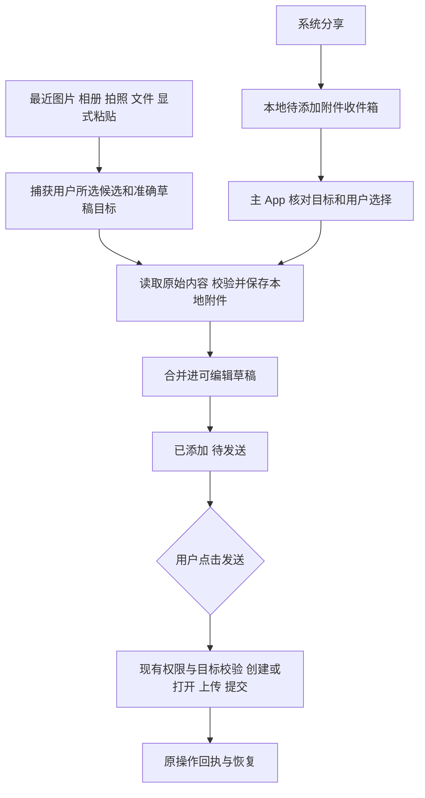

# 手机附件快捷入口执行计划

2026-10-26 外部分享批次增量：已新增iOS文档打开注册、系统Action扩展、本地收件箱与文件URL/字节粘贴；本计划此前“后续”的外部分享部分已有实现。发送前仍不上传，20 MiB限制保持，实际验证与未覆盖来源见[专项记录](../acceptance/external-attachments-ios-20261026.md)。Android A6暂停保持。

初稿：2026-10-24。更新：2026-10-25。状态：**iOS 首批已获授权并实施中，真实 DEV 按环境逐项验收**。

本计划让用户在微信保存图片、用相机拍照或查看文件后，更快地把内容加入手机端的消息草稿。提供最近图片轻提示、加号附件快选和系统分享接收三个入口，并保持用户已确认的发送方式：**添加附件只在手机本地准备；点击发送后，才按现有流程上传到准确目标并提交消息。**

2026-10-25 用户明确授权先实施 iOS 首批功能，并在完成后做真机验收。本轮推进 Q0、Q1、Q2 以及 iOS 对应的 Q5、Q6，使用独立验收 App 和本机隔离 DEV；不包含正式 Host 部署、跨电脑分派或 Q4 外部分享。Android 的 A6 及相关系统功能仍按原人类指令暂停。

## 1 产品决策与交付范围

### 1.1 已确定的交互规则

1. 最近图片卡片的主按钮为“添加”；添加成功显示“已添加 · 待发送”。入口、缩略图选择、拍照确认、粘贴和外部分享均不得预上传。
2. 点击发送时，继续使用现有目标校验、AI 数据共享许可、创建或打开、附件上传、消息提交及回执恢复流程。任务运行中，沿用用户选择的排队或立即追加模式。
3. 尚无 thread 的项目内新对话、空项目首聊和无项目草稿，都可以本地准备附件；添加附件不会创建远程会话或打开原桌面。
4. 电脑离线、原对话暂时只读或运行时尚未就绪，不影响本地准备附件。发送能否执行仍由现有能力和权限判断。
5. 系统分享只接收源 App 实际交付的内容，不读取微信私有目录，也不假设所有微信页面都提供系统分享。
6. 最近图片提醒由用户主动开启。未开启、未授权或仅授权部分照片时，保留系统选图和文件选择流程。
7. 同一来源图片的重复提醒与同一次导入的重复回调分别去重；用户仍可以主动在另一份草稿中选择同一图片。

此前 UI 预览中的“上传”“已上传 · 未发送”“上传到此对话”和预上传设计，由上述规则替代。预览仅可参考布局，本文中的文案、状态和上传时机为后续实现依据。

### 1.2 两个交付批次

| 批次     | 内容                                                                               | 完成要求                                                                      |
| -------- | ---------------------------------------------------------------------------------- | ----------------------------------------------------------------------------- |
| 首批     | 最近图片轻提示、加号快选、系统相册和文件选择、拍照加入草稿、显式粘贴图片、本地恢复 | iOS 完成适用真实 DEV；共享规则双端核对；Android 可执行项与 A6 暂停项分别登记  |
| 后续批次 | iOS 分享扩展、Android 系统分享接收、待添加附件收件箱、明确选择草稿                 | 分享与主 App 交接可靠，重复回调只导入一次；两个平台分别验收，不用首批结果代替 |

两个批次都属于完整方案。首批完成只能报告该批次的范围，不能把外部分享记为已交付。

### 1.3 保持现有边界

- 不增加预上传开关、自动发送、后台相册扫描、后台自动上传或新的 Host 远程命令。
- 不改变图片或文件理解能力；模型能否解析 PDF、Office 等内容，继续按既有能力单独判断。
- 不改侧栏独立文件互传 F59。该功能有独立传输语义，本计划只处理聊天附件。
- 不加入 Task Hub 业务任务或项目管理，不恢复 A6，不联系其他电脑或 Agent 客户端。

## 2 当前源码与接入位置

以下是制定计划时核对的源码入口。实施开工时重新核对准确 HEAD 和未提交差异，保存本任务输入指纹，不覆盖其他正在进行的修改。

| 位置                                                                                               | 当前行为                                                                                                                                 | 拟增加或调整                                                                   |
| -------------------------------------------------------------------------------------------------- | ---------------------------------------------------------------------------------------------------------------------------------------- | ------------------------------------------------------------------------------ |
| [iOS RootView](../../apps/ios/Sources/RootView.swift)                                              | `PhotosPicker` 单次最多五张；`fileImporter` 文件多选；加号含清空草稿、选择图片、选择文件和计划模式；已有本地附件展示                     | 最近图片卡片、附件面板、拍照和显式粘贴入口；保留原菜单功能与目标捕获           |
| [iOS SessionStore](../../apps/ios/Sources/SessionStore.swift)                                      | `importData`、`importFile` 保存本地附件；总数最多十个，单文件输入及规范化结果不超过 20 MiB；图片沿用 PNG 或 JPEG 规范化；`send` 阶段上传 | 为新入口提供统一的本地导入事务、草稿代次校验和本地去重；保持 `send` 的上传时机 |
| [iOS SessionPersistence](../../apps/ios/Sources/SessionPersistence.swift)                          | 持久化草稿、附件引用及不可变发送记录                                                                                                     | 向后兼容的本地导入记录、提醒偏好和分享交接；保留旧草稿及未知发送记录           |
| [Android AgentHubApp](../../apps/android/src/main/kotlin/com/agenthub/android/AgentHubApp.kt)      | 输入栏通过 `OpenMultipleDocuments` 导入文件，流式读取限制 20 MiB；没有与 iOS 等价的独立图片快选面板                                      | 在允许实施的阶段补系统图片选择与附件面板；新增系统能力按 A6 门槛处理           |
| [Android MobileSession](../../apps/android/src/main/kotlin/com/agenthub/android/MobileSession.kt)  | `attachmentDestination` 捕获目标与选择代次；`addAttachment` 会拒绝过期选择，最多十个附件                                                 | 与共享导入规则一致；明确切换后原导入的保留、提示和清理，不让旧结果落到当前草稿 |
| [Android 原生命令](../../apps/android/src/main/kotlin/com/agenthub/android/NativeCodexCommands.kt) | 附件上传、首条创建附件和消息提交已有具名操作                                                                                             | 快捷入口不直接调用这些写操作；发送时仍复用原入口                               |
| [mobile-core](../../packages/mobile-core/README.md)                                                | 已有完整目标、操作与输入栏等共享规则                                                                                                     | 候选提醒资格、草稿导入事务、去重、限额和过期结果判断等纯规则                   |
| [iOS 权限文案](../../apps/ios/Resources/zh-Hans.lproj/InfoPlist.strings)                           | 相机用途目前为扫描配对二维码                                                                                                             | 拍照接入时同步中英文用途；主动读取相册时增加准确用途说明                       |
| [Android Manifest](../../apps/android/src/main/AndroidManifest.xml)                                | 已有相机权限和扫码用途；未声明接收附件的 `ACTION_SEND`、`ACTION_SEND_MULTIPLE` 入口                                                      | 分享批次增加严格类型与来源处理；不因扫码权限已存在而跳过拍照流程验收           |

当前 iOS App 与通知扩展已有共享容器，但这不代表分享扩展已实现。分享批次应评估独立的最小共享容器，避免把通知账本、连接凭据和附件交接混放。

## 3 UI 与文案规格

### 3.1 返回聊天时的轻提示

在现有浮动输入区上方显示一张可关闭的卡片，不弹确认窗口，不抢输入焦点，不改变正文阅读位置。卡片属于当前可见草稿的辅助入口，只有用户点“添加”时才捕获导入目标。

```text
┌─────────────────────────────────────┐
│ [缩略图] 要添加这张图片吗？  [添加] × │
│          最近新增 · 1 张图片          │
└─────────────────────────────────────┘
┌─────────────────────────────────────┐
│ ＋  询问 Codex                 🎙  ↑ │
└─────────────────────────────────────┘
```

| 操作或状态     | 界面行为                                                                    |
| -------------- | --------------------------------------------------------------------------- |
| 点缩略图       | 本地预览；底部“添加到当前草稿”，关闭预览不添加                              |
| 点添加         | 显示“正在添加…”，防止重复点击；完成本地保存后卡片消失                       |
| 导入完成       | 进入现有附件条，显示名称、大小和“已添加 · 待发送”；用户可移除               |
| 有多张候选     | 只展开一张主要缩略图，显示“最近新增 · N 张图片”，提供“查看最近图片”进入面板 |
| 点关闭         | 当前候选记为已忽略，不在切换对话或重绘后重新弹出；手动选择仍可使用          |
| 电脑离线       | 仍可添加；不出现上传进度或“已到达电脑”提示                                  |
| 未开启或无权限 | 不展示未经授权的缩略图；从加号使用系统选择器                                |

卡片不自动短时消失。候选过期时在下一次稳定刷新中移除，不在手指点击或预览中途替换内容；添加动作携带的是用户所见候选的固定标识。

### 3.2 加号附件面板

保持加号位置，在面板中提供最近图片和主动选择入口。最近图片最多展示三张，更多内容交给系统相册选择器，不制作完整自定义相册。

```text
┌─────────────────────────────────────┐
│                ━                    │
│ 添加附件                           × │
│ 最近图片                 点选加入草稿 │
│ [图片一]     [图片二]     [图片三]    │
│                                     │
│   拍照       相册      文件    粘贴   │
│                                     │
│ 最近图片提醒                开启/关闭 │
│ 计划模式                    原有入口 │
│ 清空草稿                    原有入口 │
└─────────────────────────────────────┘
```

- 无相册读取授权时，不显示自定义最近图片行；“相册”仍打开系统选择器。iOS 可评估内嵌系统选图器，但不能把系统内嵌界面当作 App 已读取全部照片。
- 图片快选点击一次即导入本地草稿；多选沿用单次最多五张和草稿总数十个的规则。系统回退选择器不保证执行选择上限时，由 App 再校验。
- 拍照进入原生拍摄界面，确认“使用照片”后加入原草稿；取消或重拍不添加。默认只保存在 App 草稿目录，不额外写入系统相册。
- 文件使用系统文件选择器，不在面板中扫描微信或下载目录。
- 粘贴使用用户显式触发的系统粘贴机制。没有兼容图片时禁用或隐藏，不在前台恢复时读取剪贴板图片并生成缩略图。
- 清空草稿仍只按原行为清理当前可编辑草稿；已提交或未知操作引用的附件不能随之删除。

### 3.3 添加后的附件条和发送状态

```text
┌─────────────────────────────────────┐
│ [缩略图] 参考图片.jpg                × │
│          2.4 MB · 已添加 · 待发送     │
└─────────────────────────────────────┘
┌─────────────────────────────────────┐
│ ＋  请帮我调整这个界面          🎙  ↑ │
└─────────────────────────────────────┘
```

“正在添加”“已添加”“发送时上传”是本地准备状态；“上传附件 1/N”“等待回执”等只在实际发送流程开始后出现。不得因为本地文件复制完成显示“上传成功”。

导入仍在进行时，当前草稿的发送按钮暂时禁用，避免附件晚到而被遗漏；同一目标的其他只读查询和其他对话草稿不被锁住。批量部分失败时保留已成功项目，并明确指出失败文件及原因，不自动发送成功部分。

### 3.4 外部分享接收

源 App 提供系统分享时，用户选择 Agent Hub，查看附件并明确目的地。界面只显示本地已保存的客户端、项目和对话信息，不需要分享扩展连接 Host 或读取凭据。

```text
┌─────────────────────────────────────┐
│ Agent Hub                          × │
│ [缩略图] 1 张图片 · 2.4 MB            │
│ 电脑      [用户选择的电脑          ⌄] │
│ 草稿      [项目/对话/新对话        ⌄] │
│                                     │
│ 先保存在手机，发送消息时再上传。      │
│           [保存到草稿]               │
│           [稍后选择对话]             │
└─────────────────────────────────────┘
```

分享扩展只把文件和意图原子写入本地交接区。点击“保存到草稿”后的准确提示为“已保存，打开 Agent Hub 后加入所选草稿”；主 App 核对目标并完成合并后，才能显示“已加入草稿”。选择“稍后选择对话”时显示“已保存到待添加附件”。

不保证 iOS 分享扩展可以主动打开主 App，不使用私有跳转或响应链技巧。用户手动回到 App 后，在独立的“待添加附件”入口继续；不得自动加入此刻恰好打开的另一份草稿。

### 3.5 布局 语言与无障碍

- 沿用 [移动设计 token](../../design/mobile/tokens.json) 的表面、文字、圆角与输入区间距，卡片优先采用既有附件详情圆角 16；不重新设计正文或全局导航。
- iOS 点击区域至少 44 × 44 pt，Android 至少 48 × 48 dp。窄屏和大字体时允许换行或纵向排布，不能压缩关闭、添加和移除按钮。
- 最近图片提示在录音或转写主交互期间收起，不终止原语音流程；审批和问题弹层优先，关闭后再判断候选是否仍有效。
- 保留模型建议、计划模式、生成设置、任务队列和回最新按钮。新卡片不得遮挡这些入口，也不能把附件文案写进模型建议或消息正文。
- 所有新增文案同步中文与 English；主动作统一为“添加 / Add”，“已添加 · 待发送 / Added · Not sent”，“保存到草稿 / Save to draft”。
- 屏幕阅读器读出候选数量、文件名、大小和本地状态；添加完成只播报一次，缩略图刷新不反复抢占朗读。

## 4 最近图片发现与权限

### 4.1 触发条件

最近图片提示必须同时满足：用户已开启提醒、系统授权允许读取该资源、App 在前台且当前处于可编辑聊天草稿、候选未被忽略或加入该草稿、当前没有会抢占输入的模态交互。

前台恢复做一次合并后的检查；前台持续运行时由相册变更事件触发有界刷新。不引入定时轮询，不使用后台保活任务来持续观察相册。

首次开启或冷启动缺少可靠基线时，先建立基线并保留手动快选，不把已有相册全部视为新图片。权限范围改变、照片库重建和云端批量同步须识别为基线变化，不能直接生成大量提醒。

### 4.2 如何判断最近新增

1. 优先使用当前系统与 SDK 实际支持的新增时间、可验证的新增集合或相册变更中的插入记录。使用前在目标最低系统版本核对 API 可用性。
2. 有限窗口的资源标识快照差分只在同一照片库、同一授权范围及有效前后台基线下使用；扫描截断导致的窗口换位不能被当作新增证据。
3. `creationDate` 或 EXIF 拍摄时间不等于保存时间。微信今天保存一张旧照片时，不能仅因拍摄时间很旧而漏掉；也不能按今天的拍摄时间认定来自微信。
4. 缺少可靠新增证据、基线过旧或发生权限扩展时，只提供“最近图片”手动选择，不展示“刚保存”“刚拍摄”等未经证实的提示。
5. 长时间后台后的候选按实际新增证据判断；只有本次第一次看见资源、没有可靠新增时间时，不以当前时间伪造保存时间。

### 4.3 初始产品参数

以下为拟实施参数，均需通过目标设备测试后冻结，不代表当前性能实测。

| 参数               | 初始值与用途                                                       |
| ------------------ | ------------------------------------------------------------------ |
| 轻提示主要候选     | 一张，其他候选通过数量入口查看                                     |
| 面板缩略图数量     | 最多三张                                                           |
| 单次候选元数据窗口 | 最多 64 项；无法在有界窗口内证明新增时回退手动选择                 |
| 前台与相册事件合并 | 250 ms 内的重复触发合并为一次                                      |
| 提醒时效           | 有可靠新增时间时为十分钟；仅有有效观察区间时，该区间也须在十分钟内 |
| 忽略账本           | 最多 256 条，按照片库与资源标识区分；淘汰旧项不使过期照片重新提醒  |
| 缩略图内存缓存     | 总量上限 8 MiB；退出前台停止请求，内存警告立即释放可重建项         |
| 原图读取           | 用户点添加后才读取；缩略图阶段不主动下载 iCloud 原图               |

### 4.4 两端权限路线

| 能力             | iOS                                                                | Android                                                                                |
| ---------------- | ------------------------------------------------------------------ | -------------------------------------------------------------------------------------- |
| 手动选图         | `PhotosPicker`；无需为单次选择取得整个相册的读取权限               | 系统 Photo Picker；不可用时回退系统文档选择器，并在 App 校验数量                       |
| 主动最近图片提示 | 用户开启后申请 PhotoKit 所需访问；完整与 limited 授权分别处理      | 仅在系统和发行渠道允许的媒体读取范围内通过 MediaStore 实现；权限不满足时使用系统选图器 |
| 部分授权         | 只展示可访问资源；新增未授权照片不会自动可见，提供主动管理选择入口 | 按系统版本处理选定照片访问、撤销和重新选择；不能因已获得部分 URI 就枚举整个库          |
| 拍照             | 调用原生拍摄能力；相机用途文案包含拍照添加附件，取消不落草稿       | 原生拍摄流程或系统相机契约；使用应用专属临时文件和受限 URI                             |
| 显式粘贴         | 系统 PasteButton 或 UIPasteControl 等可用入口；不自动读图片字节    | 用户点粘贴时读取兼容内容；版本差异按原生规则登记                                       |
| 拒绝或撤销       | 停止观察、清除未授权候选和缓存；已导入的本地草稿附件继续保留       | 同左；临时 URI 不能当作永久可读凭证                                                    |

Android 广泛媒体读取受发行用途限制。实施前核对目标分发渠道的实际要求，不默认增加 `READ_MEDIA_IMAGES` 或历史存储权限来取得整库访问。若只能交付系统选择器路线，必须在双端差异中说明主动提示缺失及后续条件，不能将其计为完整一致性通过。

## 5 本地数据流和可靠性

### 5.1 统一数据流



候选发现、添加和分享交接路径不依赖网络客户端。上传服务仍由现有发送协调器调用；不得通过监听草稿变化、前台恢复、后台任务或分享完成事件触发上传。

### 5.2 拟增加的本地模型

字段名称为设计草案，实施时与现有模型合并，避免平行维护两套生产附件列表。

| 模型           | 必要内容                                                                                       | 约束                                                                   |
| -------------- | ---------------------------------------------------------------------------------------------- | ---------------------------------------------------------------------- |
| 最近资源候选   | 照片库标识、平台不透明资源标识、授权代次、可用新增证据、缩略图请求标识                         | 不含远端附件 ID；发现时间与新增时间分开存储                            |
| 草稿导入目标   | Agent、Host、workspace、runtime、已有 thread 或本地新草稿 ID、草稿代次、导入时捕获的选择上下文 | Codex 账号变化不增加目标拒绝条件；其他 Agent 按既有身份协议            |
| 本地导入记录   | 独立 import ID、来源、捕获目标、条目清单、文件大小与摘要、准备和提交状态                       | import ID 与远程发送 operation ID 分开；同一回调可核对，不触发远程查询 |
| 分享收件箱条目 | 稳定 incoming ID、局部文件引用、用户明确选择的目标或未选状态、交接进度、错误                   | 主 App 与扩展通过事务交接，不互相覆盖整份草稿                          |
| 忽略与提醒偏好 | 是否开启、授权范围指纹、忽略候选及版本                                                         | 不跨机器复制授权状态，不把相似文件名当作同一资源                       |

### 5.3 导入事务和目标变化

1. 用户点添加时，为每个待导入条目预留槽位，捕获准确草稿和代次；并行导入的总预留量必须计入十个附件上限。
2. 在后台队列读取内容。按实际字节数限制 20 MiB，不信任文件名、声明的 MIME 或提供方报告大小；预览下采样，超高像素和异常图片在解码前检查资源边界。
3. 沿用现有图片规范化和附件存储路径，记录实际保存字节的大小、类型和摘要。写入临时文件后原子发布，持久化成功后才显示“已添加”。
4. 完成前再次核对原目标、草稿代次、取消标记和预留槽位。用户只编辑正文时，以字段级合并追加附件，不能用旧的整份 Draft 覆盖新文字或设置。
5. 切换到其他对话后，旧导入不能落到新目标。原草稿仍存在且代次未被清空或替换时，可以完成到原草稿；不满足条件的内容保留到本地待处理区并提示用户选择，不静默转投当前草稿。
6. 原草稿在等待期间被清空、恢复旧消息或重新建立时，旧结果不得复活附件。仅删除本次仍无其他引用的临时内容，不删除共享附件或原发送记录。
7. 同一 import ID 的重复完成只合并一次。不同目标主动选择同一图片，或用户移除后重新选择，是新的本地操作，不能被全局内容摘要去重误拒绝。
8. 进程中断后核对导入记录和实际本地文件。文件已落盘而草稿未提交时可完成本地事务或保留待处理；记录缺失或损坏时禁止自动发送或上传。

当前 Android 的过期选择拒绝行为与上述“可完成到原草稿”存在差异。共享规则实施时须明确迁移，删除对应旧生产分支，并用双端同一向量验证；不能只新增 iOS 路径后宣称一致。

### 5.4 分享扩展与主 App 交接

- iOS 使用 `NSExtensionContext` 和 `NSItemProvider` 获取用户交付的图片、PDF、文本或受支持文件。接受的类型和数量按实际处理能力声明，网页链接不会被自动下载成附件。
- 先复制到应用拥有的共享暂存目录，再写入不可变条目清单。提供方临时 URL 不能只存引用后等主 App 再读。
- 分享扩展不上传、不创建远程聊天、不连接 Agent，也不需要取得 Host 密钥。客户端和对话选择只使用最小的本地展示快照；用户上次选择最多作为清晰可见的建议，不能视为本次确认。
- 主 App 通过原子领取、按 incoming ID 导入、写入完成标记实现交接。恢复时先核对原标记和草稿引用，不能在崩溃窗口重复加入附件。
- Android 使用 `ACTION_SEND`、`ACTION_SEND_MULTIPLE` 和受限 URI 读取。冷启动、`onNewIntent`、系统重投递都交给同一收件箱去重；先落应用本地再释放来源 URI。
- 已选目标失效、相同标题但不同 Host、项目被移除、对话归档或目标无法准确还原时，保留附件并让用户明确重选。已有草稿只能追加附件，不覆盖正文、模式或设置。
- 新对话必须保留用户选择的项目或显式无项目属性。分享保存不会准备远程空会话；首次创建仍发生在实际发送流程。

### 5.5 本地状态与清理

| 状态         | 用户可见文案                     | 后续动作                         |
| ------------ | -------------------------------- | -------------------------------- |
| 准备读取     | 正在添加…                        | 取消或等待；当前草稿暂缓发送     |
| 本地导入成功 | 已添加 · 待发送                  | 预览、移除、继续编辑、发送       |
| 分享待归属   | 已保存到待添加附件               | 选择准确草稿或显式移除           |
| 来源不可读   | 无法读取这份附件，请重新选择     | 保留原草稿；由用户重选来源       |
| 超限或不支持 | 文件过大、附件已满或图片无法识别 | 标明具体文件；不替换已有附件     |
| 本地保存失败 | 附件未保存，请重试               | 不显示成功，不释放仍需恢复的原件 |
| 用户已点发送 | 沿用现有上传、提交、回执文案     | 同一原意图恢复，未知先查询       |

草稿、导入记录、分享交接和原操作共用引用核对。清理只处理没有任何引用、没有活跃导入且归属明确的临时项；不以固定时间直接清除待添加收件箱。用户移除附件不等于取消已提交远程操作。

## 6 代码组织与双端登记

### 6.1 窄接口与依赖方向

平台层负责相册枚举和权限、原生选择器、相机、粘贴、来源 URI 及文件 I/O。共享层只接收不透明资源标识、时间证据、完整目标和导入结果，决定提醒资格、限额、去重与草稿合并资格。UI 负责展示和用户动作；现有发送层继续独占上传和提交。

拟按职责增加最近图片服务、本地导入协调器、分享收件箱和附件面板组件，具体文件名在开工核对后确定。不要继续把相册权限、文件事务和分享生命周期全部堆进 `RootView.swift` 或 `AgentHubApp.kt`。

### 6.2 既有功能关联

| 既有 ID             | 本计划共同断言                                                                   | 双端影响                        |
| ------------------- | -------------------------------------------------------------------------------- | ------------------------------- |
| F25                 | 本地附件按完整目标保存；正文编辑与附件导入字段级合并；已提交输入保持不可变       | 两端草稿与持久化                |
| F26 F27 F28 F29     | 项目内、空项目、无项目及已有聊天添加附件都不提前创建、打开或执行；发送继续原流程 | 两端创建与发送回归              |
| F30                 | 图片、文件、拍照、粘贴和分享统一导入；十个总量、五张图片单次选择、晚到隔离       | 两端入口与平台能力              |
| F31                 | 只有发送后出现上传；全部附件按现有校验完成后提交                                 | 两端发送共同断言，Host 协议不变 |
| F43 F44 F45 F46 F48 | 新入口不改变 operation ID、未知查询、结束等待及迟到回执边界                      | 两端提交与恢复回归              |
| F56                 | 原生选择器返回、前后台、进程恢复、深浅色、大字体和辅助功能一致                   | 两端原生验收                    |
| F59                 | 独立文件互传保留原行为，不挂接本计划的聊天快捷动作                               | 无新增实现；邻接回归            |

最近图片提醒和外部分享属于新增产品能力。实施阶段在 `mobile-parity.manifest.json` 中为它们分配当时未占用的新 F ID，分别记录两端 planned、in-progress、code-present 及真实验收状态，并关联 UI04、UI07、UI12 与 S04、S05、S11、S13、S18。不得复用 F30 或 F59 的 ID 来掩盖新增能力，也不得手改生成表。

iOS 首批在 manifest 登记为 F71，当前为开发中；Android 保持待开发。外部分享仍是后续批次，不计入 F71 首批交付。通过 manifest 生成 [功能清单](../product/mobile-parity.md)，同步 [UI 规格](../design/mobile-parity.md) 与 [验收规范](../acceptance/mobile-parity.md)，辅助结果和真实通过分别升级。

## 7 分阶段执行清单

Q0、Q1、Q2 已在本机独立工作树推进，实际结果在本文末尾持续登记。负责人列表示执行角色，不表示跨电脑分派；正常开发与审查按项目要求使用 xhigh。各阶段保存提交或未提交输入摘要、检查结果、剩余问题和交付范围，再进入下一阶段。

| 工作包                   | 依赖                            | 执行角色                 | 主要任务                                                                                                   | 退出条件                                                                                 |
| ------------------------ | ------------------------------- | ------------------------ | ---------------------------------------------------------------------------------------------------------- | ---------------------------------------------------------------------------------------- |
| Q0 基线与平台验证        | 用户后续启动实施                | 本机实施负责人           | 冻结当前输入；核对系统版本、原草稿/发送入口、相册新增证据、权限与 Android 发行条件；登记新 F ID 和暂停范围 | 明确各平台实际可做能力；旧照片新保存、limited 授权和冷启动策略有辅助验证；没有预上传路径 |
| Q1 本地导入与共享规则    | Q0                              | 共享规则及双端实施负责人 | 导入槽位、稳定 import ID、草稿代次、字段级合并、重复回调与崩溃恢复；迁移对应旧判断                         | 同一规则双端向量通过；添加期间目标切换、清空和正文修改不丢数据、不串附件；零上传         |
| Q2 iOS 首批 UI           | Q1                              | iOS 实施负责人           | 轻提示、附件面板、拍照、系统粘贴、提醒设置、中英文权限与文案                                               | 原生适用场景通过；正文、语音、建议、模式和队列入口保持；本地状态准确                     |
| Q3a Android 既有附件对齐 | Q1 且不触及暂停范围             | Android 实施负责人       | 既有 F25/F30 路径接入统一规则，按允许范围补系统选图与快选 UI                                               | 与 iOS 共同断言对照；未完成系统能力单列，不把只完成文件选择记为整项通过                  |
| Q3b Android 新系统能力   | Q1 与人类明确恢复相关 A6 范围   | Android 实施负责人       | 最近图片观察、拍照、显式粘贴等系统能力及权限差异                                                           | 恢复范围明确后才启动；物理 Android 逐项验收，权限不满足的行为准确登记                    |
| Q4 外部分享与收件箱      | Q1 Q2；Android 部分另受 A6 约束 | 各平台实施负责人         | 最小共享容器/本地收件箱、系统分享、目标选择、交接去重、进程恢复                                            | 附件只落本地；手动返回后进入准确草稿；冷启动与重复投递不重复添加                         |
| Q5 发送回归与真实 DEV    | 待交付的平台工作包完成          | 本机验收负责人           | 原生完整交互、真实 Electron/原 owner、真实模型、独立桌面核对；故障与性能验收                               | 添加前后零附件出站；明确点击发送后单次准确提交；证据按环境和指纹分别登记                 |
| Q6 文档与交付收尾        | 相应范围 Q5 通过                | 实施负责人及审查负责人   | 更新 manifest、产品/UI/架构与验收记录；按实际范围发布；清理本任务临时工作树                                | 实现、辅助证据、真实通过与未验收分别可查；没有遗留本任务无用途工作树                     |

### 7.1 首批实施顺序

1. 先完成 Q0 与 Q1，使所有入口可以安全复用本地导入。
2. Q2 优先完善 iOS 首批体验；Q3a 根据既有 Android 开发现场差异合并，不覆盖并行任务。
3. Q3b 保持暂停直到获得对应恢复指示；其未完成项始终留在总清单。
4. 首批进入 Q5 时只验实际已实现范围。分享 Q4 可以后续实施，但整体状态必须继续列明未完成。
5. Q4 完成后重跑分享与发送的关联场景，再关闭第二批交付。

### 7.2 文档和配置更新位置

- 功能登记：`docs/product/mobile-parity.manifest.json` 和生成的 `docs/product/mobile-parity.md`。
- UI 和文案：`docs/design/mobile-parity.md`、`design/mobile/tokens.json` 中确实新增的 token、双端本地化资源。
- 架构说明：`docs/architecture.md` 附件管线补入“本地准备”和“发送后上传”的入口边界；分享交接实现后补实际数据流。
- 可行性说明：`docs/feasibility.md` 分别登记主动提示、有限授权、外部分享和目标版本限制，不将平台 API 存在记为产品通过。
- 验收证据：在 `docs/acceptance/` 新建本功能结果记录并由 `docs/acceptance/mobile-parity.md` 索引；敏感原始日志和设备标识保留在私有验收区。

## 8 验收矩阵

以下 QA 编号只用于本计划用例，不替代正式 F、UI、S 编号。每项按平台、Agent、接入模式和构建指纹分别记结果；当前全部为未验收。

| 编号 | 场景                                            | 必须观察到的结果                                                         | 关联                    |
| ---- | ----------------------------------------------- | ------------------------------------------------------------------------ | ----------------------- |
| QA01 | 微信保存图片后回到已有对话                      | 授权和可靠新增证据满足时出现轻提示；点添加只入本地草稿                   | F30 UI07 S04            |
| QA02 | 系统相机拍照后返回 App                          | 新照片在权限允许范围内成为候选；不误称来自其他 App                       | F30 UI07 S04            |
| QA03 | 旧照片今天保存到相册                            | 不能单凭 EXIF/拍摄时间漏判；不能可靠确认时按既定手动路线呈现             | F30 UI07 S04            |
| QA04 | 第一次开启、冷启动、批量云同步                  | 建基线、显示手动最近入口，不把历史或权限扩展当作大量新照片               | 新提醒功能 S11          |
| QA05 | 未授权、拒绝、limited、撤销、管理选择           | 自定义缩略图严格受权限约束；系统选择器仍可用；不循环弹授权               | F30 F56 UI12 S18        |
| QA06 | 多张候选、关闭提示、同图再手选                  | 最多三张缩略图；忽略不再弹；另一草稿主动选择不被全局去重拒绝             | F25 F30 UI07            |
| QA07 | 在 App 内拍照、重拍、取消                       | 确认后才有本地附件；不保存到系统相册、不上传；取消无残留草稿项           | F30 F56 S18             |
| QA08 | 显式粘贴图片和无兼容内容                        | 使用系统显式入口；不主动读取图片内容或在回前台时弹剪贴板预览             | F30 F56 S18             |
| QA09 | 五张/六张选择、十个/十一个总量、并行点添加      | 上限按实际导入与预留量判断；不越界、不覆盖原附件                         | F30 UI07 S04            |
| QA10 | 超过 20 MiB、空数据、异常 MIME、超高像素        | 有界读取与可解释错误；无主线程长时间解码、崩溃或成功假象                 | F30 F56 S04 S18         |
| QA11 | 导入中 A 切 B、相同标题不同 Host                | 附件只可能归原捕获目标或待处理区；B 草稿不变                             | F25 F46 S05 S11         |
| QA12 | 导入中编辑正文、清空草稿、恢复原消息            | 正文和设置不被旧快照覆盖；清空后旧附件不复活                             | F25 F30 S11             |
| QA13 | 导入中点发送、批量部分失败                      | 未完成导入不会漏进已提交输入；成功部分保留且不自动发送                   | F29 F30 F31 S04         |
| QA14 | 离线、无 owner、项目内/空项目/无项目草稿        | 仍可本地添加；无提前创建/打开；发送时再沿用原门禁                        | F25 F26 F27 F28 S13     |
| QA15 | 本地导入或分享交接时进程退出                    | 文件和交接状态可核对；恢复只完成本地事务，不自动上传或重复合并           | F25 F56 S11             |
| QA16 | 分享单图、多图、PDF、文本文件                   | 类型与数量准确；显示本地状态；原 App 分享不可用时记录真实限制            | 新分享功能 F30 S04 S18  |
| QA17 | 分享无目标、新对话、目标已失效                  | 进入待添加附件或用户明确选择的本地草稿；不投递到当前其他对话             | F25 F27 F46 S05 S13     |
| QA18 | 分享重复回调、冷启动、onNewIntent               | 同 incoming ID 只导入一次；跨进程崩溃窗口不丢文件、不重复追加            | 新分享功能 F25 S11      |
| QA19 | 添加后不发送，切换和重启                        | 本地草稿仍有附件；对应 Host 上传/创建/输入写操作全部为零                 | F25 F30 F31 S11         |
| QA20 | 纯图片、纯文件、图片与 TXT 混合的首次及后续发送 | 明确点击发送后才上传；目标、内容摘要与设置准确；原桌面只有预期的一次输入 | F26 F27 F29 F31 S04 S13 |
| QA21 | 上传或提交中断、未知回执、结束等待              | 沿用原操作记录查询，不重新添加或重放输入；新草稿和旧附件隔离             | F43 F44 F45 F46 S11     |
| QA22 | 语音、模型建议、计划、queue/steer 和审批并用    | 输入焦点、模式、建议与权限保持；添加不触发任务执行或改变发送方式         | F25 F29 F56 UI07        |
| QA23 | 中英、深浅色、窄屏、大字体和屏幕阅读器          | 文案语义一致、按钮可触达；状态有文字，焦点和阅读锚点保持                 | F56 UI07 UI12 S18       |
| QA24 | 多次前后台切换及相册连续变更                    | 触发合并、请求可取消、窗口与缓存有界；无新增周期网络/相册轮询            | F56 S11 S18             |

### 8.1 证明发送前未上传

用本轮专用合成图片和文本随机码贯穿验收。按附件摘要及目标记录 Host 侧附件上传、会话创建、打开和输入写操作数量，结合原生操作时间线区分添加前、添加后和明确点击发送后。正常历史同步 GET 不算附件出站，也不要求为此停止现有连接。

QA19 必须覆盖轻提示、系统相册、文件、拍照、粘贴与分享六种来源。测试不能仅检查按钮文案或 mock 调用次数；需在实际 DEV 运行中核对 Host 未收到附件字节、没有相关创建/打开/输入操作。

上述六种来源是完整方案门槛。本轮 iOS 首批只实施前五种，分享来源继续保留为后续批次未验收，不能将首批结果记为六来源全部通过。

### 8.2 真实 DEV 与环境矩阵

- iOS 使用本机已配对、独立验收 bundle 的物理 iPhone，通过 Xcode、CoreDevice 与 XCTest/XCUIAutomation 操作；不把 CUA 当作前置条件。保护正式版和原 DEV 版数据。
- Android 在已获准的实施范围使用当前登记的物理设备和原生自动化。模拟器结果单列；A6 暂停项不因验收准备而启动。
- 实际发送须核对真实 Electron、准确原 owner、真实模型输出和桌面独立记录。模型输入使用附件中的随机码，不能在提示文本中泄露答案。
- Codex 与 EasyWork 分别验证实际发送入口；macOS 与 Windows、LAN 与其他链路分别登记。未实际执行的平台保留未验收，跨电脑沟通另遵循明确的人类目标授权。
- 每次证据绑定源码/差异摘要、App 与 Host 构建、Adapter 指纹、平台和设备环境、用例及随机码指纹。真实用户附件、会话导出、设备密钥和绝对私有路径不进入 Git。

### 8.3 辅助检查与性能目标

| 类别       | 计划执行的检查                                                                                              | 通过条件                                                                      |
| ---------- | ----------------------------------------------------------------------------------------------------------- | ----------------------------------------------------------------------------- |
| 共享规则   | 新增有意义的目标/代次/去重/限额/恢复边界向量，分别运行 Kotlin 和 Swift 接入验证                             | 双端同输入同结论；删除被迁移旧生产规则，不以声明型测试充数                    |
| 工作空间   | 相关 TypeScript、共享规则、工具或生成清单变更后运行 `pnpm check`                                            | 相关全链检查通过，失败准确定位，不覆盖其他未提交工作                          |
| 原生构建   | iOS 变更运行 `pnpm build:ios`；Android 变更运行 `pnpm build:android`；共享规则运行 `pnpm check:mobile-core` | 实际目标编译通过，SDK 或签名限制单独记录                                      |
| 功能登记   | `pnpm generate:mobile-parity`、`pnpm check:mobile-parity`                                                   | manifest 与生成文档一致，状态没有提前升级                                     |
| 前台反馈   | 有本地缩略图且无需云端下载的适用场景，提示可见延迟 p95 目标不超过 500 ms                                    | 目标设备配对采样；超过目标先定位，不让候选读取阻塞输入或发送                  |
| 输入与能耗 | 追加功能前后使用相同设备、场景与构建条件采样，核对候选请求次数、主线程、内存和热状态                        | 无新增定时轮询，缓存/枚举有界；明显退化须修复或保留失败，不由合成计时推导降温 |

上述命令是实施阶段的检查入口，实际结果以本轮证据为准。构建、规则向量、模拟器和真实手机分别登记，不能以安装或 XCTest 引导成功代替功能执行。

## 9 交付与回退条件

首批关闭条件为：适用入口均只添加本地附件，权限降级可用，目标切换和恢复不丢数据，真实发送仅由用户明确动作触发，适用真实 DEV 与既有输入栏回归完成。第二批另外要求分享交接和收件箱恢复通过。Android 暂停或尚未通过的项继续可见，不以 iOS 通过替代。

最近图片提醒提供本地开关，关闭后回到现有系统选择流程；不会删除已经准备的草稿附件。新版本存储字段须向后兼容，遇到未知版本保留原件并明确提示，不以空草稿覆盖。扩展接收功能停用时保留未完成收件箱，不能自动清空或上传。

若任务创建临时工作树，记录路径、分支、所属任务和输入指纹；交付后按仓库规则核对占用和独有内容并清理。本计划不包含提交、推送、PR 合并或部署请求，后续分别按实际授权处理。

## 10 依据与关联文档

项目依据：[架构附件管线](../architecture.md#7-附件管线)、[可行性与真实验收门槛](../feasibility.md)、[功能清单](../product/mobile-parity.md)、[UI 规格](../design/mobile-parity.md)、[验收规范](../acceptance/mobile-parity.md)、[Android 当前开发计划](android-alignment-20261022.md)。

平台资料用于确定实现边界，不代表本产品已完成接入或验收。实施时按实际系统、SDK 和发行渠道再次核对：

- [Apple 系统 Photos Picker](https://developer.apple.com/videos/play/wwdc2023/10107/)：系统选择器只交付用户选中内容；支持的系统可嵌入 App 界面。
- [Apple PhotoKit 授权](https://developer.apple.com/documentation/photokit/delivering-an-enhanced-privacy-experience-in-your-photos-app)：主动相册读取与 limited 授权的可访问范围。
- [Apple 相册变化观察](https://developer.apple.com/documentation/photokit/observing-changes-in-the-photo-library)：在已有读取结果上观察插入、删除及内容变化，不作为后台常驻保证。
- [Apple Share Extension](https://developer.apple.com/library/archive/documentation/General/Conceptual/ExtensibilityPG/Share.html) 与 [共享容器交接](https://developer.apple.com/library/archive/documentation/General/Conceptual/ExtensibilityPG/ExtensionScenarios.html)：接收外部附件与主 App 共享本地内容；本方案不采用扩展上传路径。
- [Apple 系统粘贴控件](https://developer.apple.com/videos/play/wwdc2022/10068/?time=1224)：使用用户明确触发的系统粘贴交互。
- [Apple PHAsset.addedDate](https://developer.apple.com/documentation/photos/phasset/addeddate)：加入当前相册的日期，与拍摄日期区分；本轮编译 SDK 的 API 可用性为 iOS 26 起。
- [Android Photo Picker](https://developer.android.com/training/data-storage/shared/photo-picker)：用户选择式访问与系统不可用时的文档选择回退。
- [Android 媒体访问](https://developer.android.com/training/data-storage/shared/media)：MediaStore、读取范围和广泛媒体权限的发行限制。
- [Android 接收分享](https://developer.android.com/develop/ui/compose/sharing/receive)：具名分享 Intent、单个与多个附件的接收。

## 11 2026-10-25 iOS 首批交付与验收

首批核心实现已完成。四项真实 iPhone 场景按未变化的生产源文件指纹**匹配复用**，最后一项受控图片与 TXT 的真实发送**本次通过**；模拟器、编译与共同规则结果分别登记。完整权限、主题、字体、无障碍和未知回执组合矩阵继续保留，不将核心切片扩大为完整产品验收。源文件、App／UI 测试二进制、Host／Adapter、原桌面和结果指纹见[结构化记录](../acceptance/mobile-evidence/quick-attachments-ios-20261025.json)。

| 阶段 | 已落实内容                                                     | 实际结果                                                                     |
| ---- | -------------------------------------------------------------- | ---------------------------------------------------------------------------- |
| Q0   | F71、UI04／UI07／UI12、共同断言及双端影响登记                  | 已登记；Android A6 保持暂停                                                  |
| Q1   | KMP 槽位、目标／草稿代次及去重规则；异步有界读取与本地导入日志 | 16 个共同向量在 JVM、iOS Kotlin Native 和 Swift 桥接通过，32 条套件记录      |
| Q2   | 最近图片轻提示、三张手动快选、拍照、系统选图／文件及显式粘贴   | iOS 实现；相关原生与模拟器结果单列                                           |
| Q5   | 中英文、本地恢复、既有输入栏及共享边界检查                     | 本地化、相关差异／功能登记检查通过；最新模拟器 7 passed、0 failed、0 skipped |
| Q6   | 独立物理 iPhone App、真实本机 Host、原 Electron owner 和模型   | 四项核心匹配复用；最终发送 1 passed、0 failed、0 skipped，独立桌面核对通过   |

### 11.1 实际实现

`QuickAttachmentViews.swift` 提供入口。按钮同步捕获原目标与草稿代次；附件面板、相机和系统选择器由稳定的输入区容器托管，避免灰字建议布局切换时重建入口。粘贴导入期间防止重复点击，本地准备结束后关闭面板，状态使用“已添加 · 待发送”。原清空、计划、生成设置和既有 DEBUG 入口保留。

`RecentAttachmentPhotos.swift` 只在前台工作，最多枚举 64 项、制作三张有界缩略图；提醒默认关闭。显式开启后建立基线，iOS 26 起完整授权按 addedDate 判断最近加入；部分授权与旧系统只手动快选，冷启动不猜测历史图片是新增。用户点添加后才读取原资源；拍照确认只加入草稿、不另存系统相册；粘贴只由系统显式控件触发。

`LocalAttachmentPreparation.swift` 使用后台读取与规范化：单个非空且不超过 20 MiB、图片像素上限 100M，继续沿用十个附件总量及预留槽位。导入仅追加附件字段，保留期间编辑的正文和设置；清空改变代次并取消旧任务，旧回调不能恢复新草稿。已准备文件的受保护日志记录原目标、代次、文件及 SHA-256，重启仅核对并恢复本地事务。

所有新增来源继续进入现有 `SessionStore` 发送协调器。本地添加不调用上传、创建、打开或模型输入接口；当前草稿导入未完成时不能发送。原操作 ID、未知结果查询和源附件保留路径未改变。

### 11.2 真机与独立桌面结论

| 场景                                   | 验收状态 | 证据范围                                                             |
| -------------------------------------- | -------- | -------------------------------------------------------------------- |
| 原生拍照与系统显式粘贴                 | 匹配复用 | 准确 iPhone、独立 bundle，两个本地附件状态及无提前上传               |
| 受控最近新增旧照片、本地边界与重启恢复 | 匹配复用 | 仅添加／删除本轮记录的合成相册资源，含重复、清空、期间编辑和大小边界 |
| 配对真实 Host 后只添加、不发送         | 匹配复用 | 图片与 TXT 本地准备；无新增创建、附件上传或模型提交                  |
| 系统文件／相册入口展示与取消           | 匹配复用 | 原生选择器；不冒充真实手机图库选择通过                               |
| PNG 与 TXT 明确发送                    | 本次通过 | 原生 Files 选择已生成两份文件，真实 HTTPS Host、原桌面及模型独立核对 |

最后只调整严格独立 bundle 下的 DEBUG 夹具与 UI 测试输入路线；上述四项已通过场景的生产源文件保持相同指纹。四项匹配复用与最新候选发送的 App／测试二进制指纹分别保留，不宣称不同验收二进制是同一次运行。

发送前附件、创建、打开和输入写操作为零。最后一次明确发送只产生一次创建、两份上传、一次提交，首次相关写入晚于第一次原生发送点击 **6836 ms**。PNG 实际 68,967 字节，TXT 39 字节，实际落盘字节数及 SHA-256 与提交清单一致。正常 `POST /v1/threads/read` 是既有阅读位置回执，严格契约不接收附件或执行字段，单独计数；其他写接口仍全部纳入核对。

原 Electron owner 独立读取确认：一个 completed 轮次、一条用户消息，实际模型 `gpt-6.1-sol`，请求与实际推理档位均为 `xhigh`。图片和 TXT 使用两个独立随机码，两码均不在提示正文中，且各自出现在最终回复。本轮最后复验只新增这一条输入；较早的模拟器与手机测试操作均已确认，没有未知结果遗留或重放。

### 11.3 辅助检查与失败留存

最新模拟器七项通过，覆盖原目标草稿隔离、离线编辑、输入栏多行／计划／深浅色／横屏、受控旧照片与本地恢复、PhotosPicker 实际选择及 Transferable 导入、系统选择器，以及配对真实 Host 后不发送。辅助结果不替代实体 iPhone、原桌面或模型结果。

`pnpm check` 曾完整通过；首次完整运行因选择 Command Line Tools 而在 macOS 框架链接失败，指定完整 Xcode 后重跑通过，原失败仍保留。生产 UI 修正后，主工作区与隔离候选的 `pnpm build:ios`、功能登记、本地化及相关差异检查通过；最后的 DEBUG 夹具／测试调整另经物理设备签名 build-for-testing 编译和实际发送用例验证。

前三次真机初始化在启用系统自动化时超时，未执行功能用例；用户完成授权后继续，按要求未重启。早期真实发送因另一验收 bundle 的前置参数不适用而停止，没有写入或模型输入。系统选择器测试曾因面板未展开、按钮不可点击失败，已使用展开／滚动后的原生定位修正。

后续阶段日志确认，一次发送前粘贴失败的提供器含 `dyn.com.rustdesk.owner` 和 remote-clipboard 元数据，验收用本地图已被远程剪贴板内容替换。已保留类型／阶段记录及零附件／零输入证据；仅将 DEBUG 用图设为 local-only PNG，最终发送从系统文件选择器选择已生成的 PNG 与 TXT，未停止远控服务或修改系统设置。有效本地图片的拍照／粘贴和配对后不发送用例已在真机通过，不能将被替换的验收输入当作模型发送成功。

### 11.4 边界与收尾

外部分享扩展、Android 产品实现、真实微信 UI 操作、完整权限／字体／主题／无障碍矩阵，以及上传中断与未知回执组合继续保持未验收。系统相册的真实资源选择与 Transferable 路径本轮只在受控模拟器执行，手机侧仅声明实际展示／取消及受控 PhotoKit 资源添加结果。

正式 App、原 DEV 数据和正式 Host 未替换；独立验收 App 与 runner 已按准确 bundle 移除，临时 Host 在所有测试操作均确认后停止。临时工作树与其余自有资源按实际清理回执更新结构化记录，不以另一电脑、另一端或历史通过代替本轮证明。

### 11.5 PR 集成范围

按用户后续授权，将本任务相对实施前快照的附件增量合入最新远端 `main` 的独立分支；保留主线已有的 iOS／Android 行为，未纳入主工作区的其他未提交任务。实施与真机候选的原始源码指纹不改写，PR 源码与辅助检查另记在结构化验收记录的 `pullRequestIntegration`。合并后再按实际回执清理本任务工作树和临时分支。
