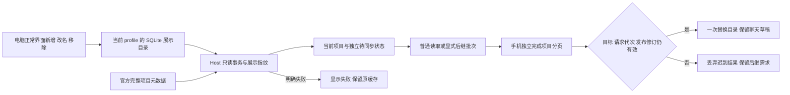

# 电脑项目与手机目录同步修复方案

本方案处理 Codex 电脑端新增、改名、移除项目后，手机目录及时收敛，以及手动刷新确实获取新数据的问题。范围包括 Host 的桌面显示数据适配、目录读取并发、iOS 缓存合并、Android 对应刷新入口和原创建回执的只读恢复；保留项目文件、聊天、草稿、机器身份与设备授权，并保持未知业务操作不自动重放的原则。当前功能状态仍维护在双端唯一清单 F12，本文件维护设计、实施顺序和验收断言。

## 问题与来源

### 白名单的来历

`b91fa061`（2026 年 10 月 18 日）为使手机侧栏与电脑一致，在 `DesktopSidebar.projects()` 中将官方 `project/list` 与桌面 `local-projects` 取交集，同时采用桌面名称、排序和项目归属。它是一份由桌面维护的显示目录，并非安全授权表。原目的有合理依据：底层元数据中还可能有桌面已移除、延期删除或未采用的项目，不能将数据库全部记录直接显示为当前项目。

`9f32802b`（2026 年 11 月 25 日）增加“手机已确认创建项目”的补充入口，解决手机创建记录尚未进入桌面目录的问题；没有覆盖电脑新建项目或桌面存储迁移。

当前故障的直接原因是数据源迁移：官方桌面已使用 `.codex-global-state.sqlite` 的 `settings(scope,key,value)`，现有 Host 仍只读取旧 `.codex-global-state.json`。只要旧文件仍存在，Host 就会继续拿停止更新的旧清单过滤新目录。现场 SQLite 和桌面目录均有 28 项，旧 JSON 与 Host 返回 27 项；目标项目存在于当前桌面目录与官方项目接口，经过旧过滤器后消失。

官方桌面移除项目会先更新本地目录并登记延期删除，再调用底层 `project/delete`，因此直接取消全部过滤同样不能保证手机与桌面一致。修复应恢复当前桌面显示目录这一事实来源，而不是新增人工名单或用项目路径猜测归属。

### 相邻缺陷

| 位置                                    | 修复前行为                                           | 后果                                                             |
| --------------------------------------- | ---------------------------------------------------- | ---------------------------------------------------------------- |
| Host `DesktopWorkspaceView.workspace()` | 所有并发目录请求共用已开始的读取                     | 手动刷新可能得到刷新动作以前就开始采集的快照                     |
| iOS `SessionStore.refresh()`            | 侧栏手动刷新遇到占用时只等待；仅历史刷新登记后续动作 | 手动刷新动画结束，但没有新增目录读取                             |
| iOS `refreshMobileUnread()`             | 保留原项目对象，仅追加未知 ID                        | 同 ID 改名不更新，已移除项目留在缓存；晚到扫描也可能覆盖较新目录 |
| Android `MobileSession.refresh()`       | `loading` 时直接返回                                 | 手动刷新请求可能被丢弃                                           |
| 目录采集                                | 同时读取全部活动、归档、置顶聊天以及运行时目录       | 项目读取延迟随聊天历史增加；现场一次完整目录含 3643 条聊天       |

## 最终数据流程

SQLite 确实缺失时才走旧 JSON 兼容路径；原项目创建意图和回执独立于这条目录读取链。

## 完成标准

1. 电脑新增项目（包括零聊天项目）后，手机普通前台侧栏轮询能显示对应项目；不会要求重新添加电脑或重启 Host。
2. 同一项目改名后保持项目 ID、聊天归属、选中项和草稿，只更新名称；同名不同项目不合并。
3. 电脑移除项目后，手机不再把它显示为当前项目；不删除电脑目录、聊天或手机草稿，不把底层延期删除误当作项目仍可见。
4. 手动刷新的成功结果来自该动作之后发起的权威目录读取；已有在途请求结束不算完成手动刷新。读取失败明确结束并保留原缓存。
5. 旧请求、旧分页、旧未读扫描及切换前的结果不得把较新目录覆盖回去；失败、空目录与完整目录必须可区分。
6. 旧桌面 JSON、当前 SQLite、已有 Host 接口和设备凭据继续兼容。SQLite 已成为数据源但读取失败时，不以旧 JSON 假装“最新读取成功”。
7. 完整验收断言涵盖真实桌面新增、改名、移除与原生手动刷新；本轮按用户 2026 年 11 月 27 日最新指示，以已创建的“测试项目”核对原生显示和手动刷新，改名、移除采用各自回归证据。逐项区分实际交互、辅助回归及未测时间，不以新建通过推断其他操作通过。

“及时”按已有前台侧栏刷新节奏验收：正常本机网络、Host 健康时，项目变化应在下一轮成功刷新可见，记录实际耗时；每轮结束后等待 3 秒不等于端到端固定 3 秒。失败时显示状态和重试入口，不新增业务超时或把慢请求当成功。

## 桌面显示数据的唯一来源

### 当前 SQLite 与旧 JSON

在 `packages/codex-adapter` 内增加窄范围桌面显示状态读取器，供 `DesktopSidebar` 使用：

1. 按实际 Codex profile 定位同目录 SQLite 和 JSON，不扫描其他 profile，不将登录账号作为连接许可。
2. SQLite 存在时，通过 Node 已有 `node:sqlite` 以 `readOnly: true` 打开，禁止创建、迁移、修复、checkpoint、写 PRAGMA 或写任何官方表。使用正常只读事务读取单一一致快照，包含 WAL 中已提交的更新；不能使用忽略 WAL 的 immutable 模式。
3. 还原官方已核实的三种 `settings` 作用域，按下表投影，不读取登录 Token、正文或凭据。当前 owner 来自 global 的 `electron-renderer-content-owner` 字符串，只用于选择显示偏好，不作为机器连接许可。owner 不明时保留全局项目与映射，使用原有通用显示后备，不混用其他 owner 或旧 owner-value。

   | 数据                                                                       | 官方读取位置与优先级                                                                                                                                                                                                                                                    |
   | -------------------------------------------------------------------------- | ----------------------------------------------------------------------------------------------------------------------------------------------------------------------------------------------------------------------------------------------------------------------- |
   | 当前项目、legacy/native 映射、项目顺序、置顶项目、项目归属与每项目聊天顺序 | `scope=global` 对应普通键：`local-projects`、`app-server-project-id-by-legacy-project-id-by-host`、`project-order`、`pinned-project-ids`、`projectless-thread-ids`、`thread-project-assignments`、`thread-project-membership-host-ids`、`sidebar-project-thread-orders` |
   | 当前根目录 hints、迁移后的置顶、延期删除                                   | global 中 `electron-owner-value:<key>:<currentOwner>`；具体 key 为 `thread-workspace-root-hints`、`app-server-migrated-pinned-thread-ids-by-host`、`app-server-pending-project-deletions-by-host`。按官方 accessor 选择，不把同名陈旧 global 值或另一 owner 作为当前值  |
   | 侧栏排序、项目显示模式等 atom                                              | `scope=electron-owner-atoms:<currentOwner>` 与 `scope=atom` 合并，同键 live atom 优先；旧 JSON 继续使用其既有结构                                                                                                                                                       |

   上述键缺省和结构验证必须逐键与官方 accessor 对齐；读取器只发布这份窄投影，不导出整个数据库。

4. 先用文件系统 stat/lstat 对准确 SQLite 路径判定是否明确 ENOENT；仅这种确实不存在的旧端情形进入 JSON 原读取行为，旧端不需要升级存储。Node SQLite 的 CANTOPEN/ERR_SQLITE_ERROR 本身不能证明文件不存在。读取旧 JSON 前后复核同一路径；若迁移期间 SQLite 已建立，则放弃 JSON 结果并读取新源。已存在 SQLite 的权限、打开、锁冲突、损坏、已有值 JSON 无效或结构不兼容错误均明确返回；手机保留缓存，不回退旧 JSON 报成功。结构仍兼容的新 schema 版本允许读取，不能仅按版本数字拒绝。
5. 官方合法初始状态中 `local-projects` 行缺失、null 或显式 `{}` 均按官方默认值视为当前空目录，不是连接故障；不得用旧 JSON 补回来。已有非空目录却缺映射时，先检查 native ID 是否与 legacy ID 本来相同，再按下文协调规则处理；不能把坏 JSON、错误类型或冲突映射吞成空目录。
6. 每次新采集读取桌面当前维护的数据；不长期缓存名单、不以文件修改时间代替内容更新、不手动同步一份副本。只读事务及时关闭，Host 不长期持有阻塞桌面写入的事务。

### 可见性与显示投影

官方当前显示目录决定项目是否可见；官方 `project/list` 提供 native ID 和服务元数据；legacy/native 映射继续留在 Adapter。当前目录决定的名称不被旧 JSON 覆盖。排序只影响显示次序，不决定项目是否被允许出现。

保留手机确认创建项目的访问能力，但将其“创建成功”与“属于当前桌面目录”分开。新增 Host 自有 `project-visibility-v1.json`，使用既有私有目录、writer 所有权与原子持久化入口，按完整机器目标、profile 和 native project ID 隔离。该文件独立于不可变创建输入/回执，旧程序不识别也不会重写删除；不能把状态写回官方数据库。

| provenance 状态       | 正面证据与转移                                                                                                                             | 是否加入当前桌面项目                                   |
| --------------------- | ------------------------------------------------------------------------------------------------------------------------------------------ | ------------------------------------------------------ |
| `waiting-for-desktop` | 本版本同一目标显式创建成功，当前尚未采用。该状态只描述当前观察，不由旧 receipt 的缺字段推定                                                | 不宣称已与桌面一致；保留待同步访问入口                 |
| `desktop-observed`    | 完整有效当前显示目录正面包含同一 native ID，并持久保存该目录观察；仅有 legacy/native 映射不能证明曾显示或采用                              | 只有当前目录仍包含时加入                               |
| `removed`             | 已持久保存完整目录曾包含该 ID 的正面观察，随后从完整当前目录消失；或当前 owner/本机 namespace 中有准确延期删除证据。移除证据优先于创建回执 | 不加入，不因重启或回执查询复活                         |
| `unknown`             | 升级旧 completed receipt，或缺少证据区分“从未采用”和“在两次观察间已采用后移除”                                                             | 不冒充当前目录；原回执与准确项目访问仍保留并标为待核对 |

当前目录再次正面包含同一 ID 时，`removed/unknown` 可转为 `desktop-observed`，表示官方恢复；不得自行创建。native=legacy 时不要求一定有单独映射。映射仅用于核对同 profile/Host namespace 的身份关联，不能证明曾采用或移除；准确延期删除须另核当前 owner 与本机 namespace，不能拿他人 owner 或别的电脑的数据当证据。只有映射、未持久观察到目录且无准确删除证据的项目保持 waiting/unknown，按准确 ID 保留待同步访问；以后目录正面纳入才成为 desktop-observed。持久观察先保存成功，再发布相应目录；保存失败保留原缓存并明确失败，不发表更强已采用/已移除结论。

Host 未在线时发生“采用→移除”的窗口无法仅靠轮询证明历史。此时不设任意 TTL、不假定未采用、不重复创建。为保留既有手机创建访问，Workspace 保留受原回执约束且仍由官方 project/list 返回的有效项目对象，对非当前项目增加可选 `ProjectSummary.desktopVisibility: pending | unknown`；缺省仍表示既有普通项目。Sidebar v1 增加可选 `pendingProjectIds`，当前 `projectIds` 只列当前目录。双端原生增加“待同步项目”分组，分别标明尚未并入或待核对，仍允许按准确原项目 ID 进入项目选择和查询原回执。新字段是可选兼容扩展；旧端保留原读取与项目选择路径，不把缺少新展示能力宣称为新契约验收通过。未知项目不影响无关正常项目、聊天和控制能力。

目录采集要检查显示目录、native 项目和映射的一致性。读取显示投影指纹，完成 native 项目分页后再用短只读事务核对当前投影；SQL 事务不跨聊天/RPC等待。指纹变化或有效目录项未匹配时，在现有读取截止/恢复语义内重新取同一权威源核对；仍不能协调则明确返回目录暂不可用，手机保留原目录，不能发布拼接后假称完整的成功快照。不能静默把未匹配项当不存在，也不能为补映射写官方历史或自动创建项目。官方当前桌面在支持项目接口时，会先完成 `project/create` 和映射，再写本地目录；不依赖聊天创建。本机全部 28 个项目均已映射。旧服务明确不支持项目接口时可能只有 legacy 项目，沿用既有降级能力，不为读取目录自动写入/import；本轮不能冒称该旧组合已通过新增验收。

## 手动刷新与并发顺序

### Host 新鲜读取边界

为既有 `/v1/workspace` 增加可选 `refresh=1`，通过现有 capabilities 增加具体的新鲜读取能力标识。原响应形状、完整机器目标和认证不变。旧客户端不传参数，仍可使用新 Host 的数据源修复；新手机连接未声明能力的旧 Host 保留原读取能力，只不宣称更强新鲜度保证，不关闭无关功能。

采集调度由 Host 实例 epoch、单调 `readSeq`、唯一在途批次和待开始批次管理：

1. 普通请求加入当前批次；无在途请求时创建新批次。
2. 显式请求收到时登记最低后继序号：当前批次已开始，则必须进入至少 `currentSeq+1`；没有在途批次时创建下一批。同一后继批次开始前到达的显式请求共享该批，批次一旦开始便封口，其后到达的刷新再进入下一批。
3. 每个等待者绑定具体批次和 epoch，只由该批的新采集结果结算。A/B 等待后继时，旧请求完成不能先结束它们的刷新 UI。
4. 旧批失败仍结清自己，并按原恢复策略处理后继。若既有 `retryAt` 当前不允许读取，后继明确返回同一可重试错误与重试状态；不无限等待、不将旧失败改成成功。恢复计时器不取得更高于显式后继的发布权。
5. 关闭/实例代次更换拒绝所有旧等待者；单个 HTTP 等待者取消只释放自己的等待，不取消健康共享采集。每批最终释放 promise/监听器，不遗留待处理占位。

HTTP 标记仅表达目录新鲜度，不能透传任意方法，不产生模型 Turn，不改变已提交业务操作或重放输入。

### 手机唯一发布门槛

iOS 与 Android 均在 `loading` 或交互保护 guard 之前登记显式意图。同一机器/连接代次的目录维护 `requestSeq`（最新请求意图）与 `appliedRevision`（实际发布次序）；同一目标所有目录写入——首次读取、刷新、加载更多、未读扫描、管理回执与恢复——必须经过共同发布入口，不能各自直接覆盖缓存。

显式意图一登记便使旧扫描失去目录发布权；正在进行的读取/手势结束后，新采集承担对应显式批次。多个意图在该采集开始前合并，开始后的意图进入后继。刷新界面等待自己的完整项目目录实际发布或确切失败后结束。iOS 历史补读与目录需求分别登记，侧栏刷新不加载聊天正文；Android 用可等待的刷新任务/完成回执承接入口，不再把 fire-and-forget 的排队登记当完成。

自动扫描捕获完整目标、连接代次、requestSeq 与 appliedRevision，发布前逐一核对；同目标管理操作、更新连接和目标切换都会撤销旧结果。选中同电脑另一聊天不无故取消目录刷新，只撤回不再适用的历史补读。单个等待者取消不关闭健康共享读取，切换目标后旧意图不能被新目标继承。

Provider 将共同新鲜读取意图映射到现有传输：Codex 发送 `refresh=1`；其他客户端使用其实际请求，不为 EasyWork 另造业务协议，不新增按客户端名称分叉的公共状态规则。更强新鲜度只在真实支持并声明该契约的组合中验收。

## 完整目录与缓存替换

完整的项目目录成功后，项目对象按当前 ID 更新，消失 ID 从“当前目录”退出，名称和 roots 同步替换；保留同 ID 的本地展开、选中、最近访问与草稿数据。列表移除不等于业务数据删除。失去项目归属的聊天沿原规则仍可从最近聊天、搜索或归档阅读，不能仅因移除项目使聊天无法打开。

分页不能用“第一页没出现”判删除。iOS 在既有完整 collector 上补齐项目游标，Android 增加直接服务当前 Workspace 的完整项目 collector，不能复用仅更新 unread ledger 的线程扫描来冒充项目发布。

每个 collector 都包括 Host 的 `DesktopWorkspaceView.refresh()` 在完整 `desktopWorkspace()` 之后调用 `RuntimeSession.workspace()` 登记可打开 ID 的 hydration。该生产循环同样独立追踪 project/thread 的 cursor 与 exhausted；一条耗尽后即使后续省略参数重新返回第一页，也不得重启该条游标。项目同 ID 的后页值更新对象，身份/连接代次逐页校验并检测重复 cursor。普通目录刷新可以先取聊天第一页，但要完成全部项目页后才发布新的项目集合和对应项目侧栏；未读完整扫描则在两条游标都耗尽后才整批发布。

项目第一页或后页失败时，保留原完整项目目录，不根据部分结果确认移除；不会把旧尾部拼接后标为完整成功。项目已经耗尽但后台聊天扫描失败时，该完整扫描整体失败、保留其原目录；当前侧栏独立的项目完整刷新仍可正常收敛。现有服务没有跨请求快照游标时，只保证一次成功遍历和后续最终收敛，不宣称数据库跨接口线性一致。 Host hydration 额外覆盖项目 2 页/聊天 3 页及相反组合；已经耗尽维度返回的第一页和新 cursor 均不重新采纳，不能靠两条游标偶然同时为空结束，也不把该旧行为误报为用户目录循环。

所有目录写入共享同一目标与刷新代次检查。后台扫描开始时保存目录版本，发布前确认没有更晚的显式刷新、目录管理操作或新快照；过时结果只丢弃，不重新插入旧项目。未读统计更新与目录发布分开判断，不能为更新未读而恢复过时目录。

## 刷新节奏与性能

本轮复用现有前台侧栏轮询、前后台恢复及手动入口；不为了修目录引入新的后台常驻服务或未经核实的项目推送接口。仅当官方已有可靠项目变更通知且能够保留断线补读时才复用，不把新增推送当作修复前提。

先修权威来源与一致性，再按真实测量处理重复采集：同一时段的后台读取可共用一次完整快照，显式刷新必须越过它的新鲜度边界。记录项目采集、聊天采集、Host 返回和原生应用耗时，评估大历史是否妨碍下一轮更新。若确有项目刷新被历史阻塞的证据，再在原协议中拆分只读目录采集；不以盲目提频、截断项目/聊天数量或新增硬上限解决。

## 预计修改位置

| 位置                                                           | 改动职责                                                                               |
| -------------------------------------------------------------- | -------------------------------------------------------------------------------------- |
| `packages/codex-adapter/src/desktop-sidebar.ts` 与新增窄读取器 | 当前 SQLite 与旧 JSON 显示快照、作用域还原、名单与名称更新                             |
| `packages/codex-adapter/src/history-reader.ts`                 | 官方项目分页与当前桌面目录映射、一致性核对                                             |
| `packages/codex-adapter/src/desktop-workspace-view.ts`         | 普通合并与显式后续采集、新鲜读取边界                                                   |
| `apps/host-agent/src/runtime-server.ts`                        | 可选 `refresh=1` 的固定只读参数映射                                                    |
| `apps/ios/Sources/SessionStore.swift`                          | 显式刷新意图、完整项目分页、目录发布代次和缓存替换                                     |
| `apps/ios/Sources/AgentClient.swift`、`HostService.swift`      | 共同读取意图到 Codex HTTP 的适配                                                       |
| Android `MobileSession.kt`、`HostReads.kt` 与 Provider         | 显式刷新保留、同一新鲜度参数、受影响分页合并                                           |
| `packages/protocol`、双端 Project/Sidebar codec 与共享侧栏投影 | 可选 pending/unknown 与 pendingProjectIds 的向后兼容契约、待同步分组；旧项目不改变语义 |
| 现有边界测试及原生 UI 用例                                     | 扩展可复用行为验证，不重复测试静态声明                                                 |
| 唯一清单 F12、原架构/协议说明                                  | 记录同一功能双端影响与实际验收，不新增当前完成率总表                                   |

## 验证与实际验收

辅助用例先复用并扩展 `desktop-sidebar.test.mjs`、现有目录并发和原生目录刷新用例。新增用例分别解决如下问题：

| 用例                                       | 预期结果                                                                                                                                                   |
| ------------------------------------------ | ---------------------------------------------------------------------------------------------------------------------------------------------------------- |
| SQLite 比旧 JSON 新，WAL 尚未 checkpoint   | 采用 SQLite 已提交项目与名称；不会漏新项目                                                                                                                 |
| 旧版仅 JSON                                | 原目录、归属和排序保持兼容                                                                                                                                 |
| SQLite 当前目录为空或合法初始缺省          | 展示空当前目录，旧项目不复活，合法初始状态不报连接错误                                                                                                     |
| 两个 owner、冲突 global/owner-value/atom   | 只采用当前官方有效值，live atom 同键优先；归属 hints、迁移置顶与延期删除各自正确                                                                           |
| SQLite 锁冲突/损坏/结构不符                | 显式失败，原缓存保留，不返回旧 JSON 成功                                                                                                                   |
| 同 ID 改名、多项目同名、目录移除和延期删除 | 正确更新/移除，不按名字或路径合并，不复活历史项目                                                                                                          |
| 手机创建、采用/移除、Host 重启及漏观测窗口 | provenance 持久化；准确原回执与待核对访问保留，已移除项目不复活；旧 receipt、仅映射未采用、native=legacy、同名/同路径不同 ID、owner 切换及保存失败分别覆盖 |
| Host 读取已开始后收到显式刷新              | 后续采集开始时间晚于请求，返回后续目录                                                                                                                     |
| 手机旧请求/分页/未读扫描晚到               | 不覆盖较新的目录，不污染另一目标                                                                                                                           |
| 项目超过一页与中途失败                     | 耗尽后才判移除；失败不发表完整成功目录                                                                                                                     |
| 手动刷新多次、取消、断连再重试             | 合理合并、有界结束等待、不重复业务写入                                                                                                                     |

人类 2026 年 11 月 26 日最新指定：涉及 Xcode 或手机 SDK 的验收交由 Mac mini 24 直接执行。该机 Host 鉴权、准确机器目标、`desktop-runtime` 与项目根目录已由本机核对；专用对话、模型/权限、冻结输入和回执保存在本任务私有交接记录。本机继续负责方案与产品修复，不要求用户在本机安装 SDK，不把跨机验收当作其他普通任务的默认门禁。

原生验收使用该机本任务独立状态/端口及独立模拟器内的原生验收实例，连接授权的真实原桌面元数据源；模拟器中的生产 bundle ID 不代表已切换正式手机 App，正式 App、原 DEV 版、正式 Host 和其他任务继续保留。使用本任务空目录与具名测试项目；只通过桌面正式项目界面/受支持 API 新增、改名、移除，不直接编辑官方 JSON/SQLite。不采集用户正文、不发送模型任务。

1. 本机当前 `agent-hub-app` 作为只读见证，确认真实桌面存在与修复 Host 返回；Mac mini 24 的原生端按已授权目标读取这一准确 Host，或使用该机同等真实空项目见证，分别标注机器来源，不用一机数据冒充另一机。
2. 对用户已经通过桌面创建的“测试项目”，先从真实 Host 的完整新鲜目录取得准确身份，再核对原生 App 显示与一次手动刷新后的同一项目；手动证据绑定动作后的手机显式新鲜请求、成功响应及稳定界面。项目早于观察器建立时，不补记新增时刻或自动出现耗时。
3. 改名采用独立回归：同 ID 名称更新，旧未读扫描/分页不得覆盖新名称，选中项和草稿保留；按用户最新指示不再要求人工改名。
4. 移除采用独立回归：完整目录收敛、延期删除不复活、待同步状态与草稿保留；按用户最新指示不再要求人工移除。此证据不写成实际桌面移除验收。
5. 完整受控并发断言是在旧目录请求在途时改变测试目录再下拉刷新，核对后续采集与最终目录；本轮复用对应受控回归，不要求人类再次改变现有“测试项目”，真实手动刷新另按第 2 项留证。
6. 断开本任务通道后刷新失败，恢复后同一连接刷新成功；切换目标与后台恢复不接受旧结果。
7. Mac mini 24 执行 iOS 与 Android 原生模拟器增量验收；纯目录 Android 真机不适用。若使用该机已配对物理设备，走 Xcode/CoreDevice 与 XCTest；不将本机历史设备写成目标机设备，不以 CUA 是否可用作为前置条件。SDK/模拟器未就绪时由该机先做可恢复准备和磁盘预检，缺少必须人工处理的条件则记录阻塞，不能把 HTTP 或 fixture 补签为原生通过。

源码/辅助测试、真实 Host、原生手机、正式部署分别记录。TypeScript/工具变更按正式 `pnpm check` 入口，原生 iOS 按 `pnpm build:ios`；先阅读聚合步骤并复用有效结果，不机械重复。测试执行交给规定的 Terra medium 执行方，主会话复核动作和证据。

## 审核 实施与交付

1. 已核实上游 SQLite 作用域与零聊天映射契约，完成本方案初稿。当前官方产物的读取/迁移、owner/live 合并、空项目及延期删除证据保存于本任务私有 `catalog-source-review.json`；最终交付引用准确文件指纹。
2. 独立上下文审核 Agent 按人类最新规则使用 `gpt-6.2-astra / ultra` 完成最终复核，审查来源、业务目标、并发保证、兼容、权限、可实施性及验收；规则更新前已执行的 `gpt-6-astra / ultra` 首轮意见及证据继续保留。接口没有速度参数时如实记录限制；请求设置与可取得的实际运行信息分别保存。
3. 主会话逐项处理意见，在同一方案记录接受/调整/不接受及依据。高优先级问题修订后回交复核，最终结论绑定方案指纹；不能把发起审核当作审核通过。
4. 按审核后的顺序实施 Host 数据源与新鲜度、双端刷新和合并；扩展对应回归并完成独立测试及真实交互。产品实现仍在当前聊天负责，不另开修复聊天。
5. 正式切换的准入条件是：独立方案审核的高优先级意见关闭、实际修改对应的必要检查通过、真实 Host 和适用原生增量验收完成。分别记录新 Host+旧手机的数据源修复、新 Host+新手机的新鲜读取；旧 Host+新手机只记录兼容，不冒称强新鲜度通过。按统一来源构建冻结包，比较当前正式程序/状态与候选，核对活跃任务和未知写入后安全切换，保留身份、凭据、回执及准确回滚程序。失败按原正式入口恢复旧程序，新 provenance 文件保留且不擦除；旧程序不支持的新语义不再宣称生效，重新前进时继续读取原 provenance。正式 Host 升级及普通手机连接另行留证，不用旁路验收代替部署。
6. 更新 F12 同一行的平台实现、模拟器/真机适用状态。只回收本任务创建、确认无其他依赖的临时测试资源、空目录、服务和构建中间物；用户创建的“测试项目”及其原目录保留。保存最小原始证据与必要回滚资料，未解决的证据缺口如实列明。

## 独立审核意见处理

| 审核项                                       | 处理                     | 落地条款                                                                                                                       |
| -------------------------------------------- | ------------------------ | ------------------------------------------------------------------------------------------------------------------------------ |
| R1 P1 owner-value 域遗漏                     | 接受                     | 三类存储投影表补齐 hints、迁移置顶和延期删除，新增冲突 owner 验证                                                              |
| R2 P1 手机创建项目可能复活                   | 接受                     | 独立持久 provenance、四态和正面证据规则；漏观测与旧回执为 unknown，保留待核对访问，不伪称当前项目                              |
| R3 P2 合法初始空目录                         | 接受                     | 明确官方缺省与损坏的区别；文件系统确认 ENOENT 才使用 JSON，并复核迁移竞态                                                      |
| R4 P2 并发批次与唯一发布门槛                 | 接受                     | Host epoch/readSeq 批次封口；双端 requestSeq/appliedRevision；UI 等待对应新结果                                                |
| R5 P2 双游标与映射不一致                     | 接受                     | 双端项目完整 collector 与 Host hydration 均独立 exhausted；覆盖 2/3 非整除分页、项目与聊天失败、指纹对账及非跨请求线性一致边界 |
| R6 P2 原生与部署门槛                         | 按最新人类授权调整并接受 | Mac mini 24 执行 SDK/原生验收；新旧组合、正式切换与 provenance 保全分别留证                                                    |
| 最终审核 P1 映射不能证明曾采用               | 接受并调整 R2 的证据边界 | 映射只关联身份；仅完整目录正面观察或准确删除证据可支持采用/移除，仅映射仍保留 waiting/unknown 访问                             |
| 最终审核 P1 SQLite CANTOPEN 不等于文件不存在 | 接受                     | 使用文件系统确认缺失并在 JSON 读取前后复核迁移；旧 JSON 组合必须实际通过                                                       |
| P3 能力声明与性能                            | 接受                     | 新鲜读取能力明确协商；保持先测后改，无预设新增 watcher/硬上限                                                                  |

实施前须取得绑定本文件 SHA-256 的独立复核结论；原始 R1 与复核报告、实际模型记录及文件指纹保存在本任务私有证据目录。本文不以方案写入代替代码已实现、部署或实际验收，具体产品状态只回填 F12。

## 独立源码审核后的实施补充

源码审核发现并修订了原创建回执与目录读取耦合的边界。Host 在 `workspace:refresh:v1` 之外可选声明 `projects:create:receipts:v1`，鉴权 GET `/v1/projects/creations` 必须携带准确 hostId、完整机器 target 和原 id。已完成回执直接从本机独立账本读取，不依赖目录读取器；没有终态的操作按本机保存的官方响应 ID 或官方项目的精确原操作/Host 标记只读核对，不调用创建。回执同时区分规范名称/绝对根目录和原始 requestName/requestDirectory，不能把用户合法的相对目录或名称空白误判为另一次操作。已完成回执不因项目之后改名或移除而降级。

iOS 创建意图按每个 operation ID 保存，包含不可变完整目标、原输入和发送阶段。明确未发送时才允许首次 POST，发送阶段在网络调用前落盘；结果不明或重启后只查询原回执，不因读取失败或目标核对失败自动补发。POST 和 GET 均在请求发送前绑定原 workspace/runtime，响应后的检查不代替写前门槛。表单保留待确认操作的查询入口，各独立项目互不封锁；明确拒绝记录结束等待并保留历史。旧 Host 缺少回执查询时保持未知及电脑核对入口，不关闭其他既有能力。

同时补齐 Android 可见侧栏唯一的轮询任务与健康前台更新，禁止在每个聊天行另起轮询；iOS 连续有效下拉、已归档页和首次能力协商都进入同一显式需求管线。连接、配对、未读扫描在开始读取前捕获发布令牌与完整目标，迟到响应不能先失效新版本再覆盖。项目可见性先于线程归属计算；原始元数据兼容展示没有桌面目录证据时，不写入 adopted/removal 旁账。旧 JSON 与 SQLite 对参与目录的类型/身份冲突都明确失败并保留缓存；无关窗口或编辑器设置不参与展示指纹。

验收绑定最终源码/锁/环境指纹。本机仅执行 Node 辅助检查；所有 Xcode、Swift、Gradle、手机 SDK 和原生交互均由人类指定的 Mac mini 24 专用会话执行。原生 fixture 的并发、分页和创建恢复结果与真实桌面 GUI→独立 Host→原生 App 的新增零聊天项目、改名、移除结果分别记录；不能互相替代。当前是否完成只见唯一 F12 清单，审核通过不代替实际验收，候选通过也不代表正式 Host 或正式 App 已部署。

源码复核又补齐了恢复入口的可达性：待确认记录在侧栏有独立只读入口，冷启动后即使目录持续 503 仍可查询；新建 POST 继续受当前目录就绪门槛约束。Host 对官方写入前明确未受理的请求保存该 ID 的 rejected 回执，不能用裸 404 推断未执行；前一同根操作解除后，后续合法新操作照常处理。未知查询按本机已保存的官方响应 ID 或精确原操作/Host 标记归属，不以后来改名或改根目录推翻原操作。旧账本没有原始相对输入时，以已鉴权完整目标和原不可变操作 ID 的终态条目恢复，保留手机原输入，不在手机解析远端路径。

表单成功、错误提示和后续读取由原客户端代次及该表单自己的提交标记、原输入和存活状态共同约束；用户编辑、关闭或打开别的表单后，晚到响应只保存原操作结果。验收补充目录持续失败下冷启动只读恢复、旧回执相对路径兼容、明确拒绝/前一未知解除后合法创建，以及 A 晚到不能关闭 B。原生恢复用例必须使用保留真实会话的测试启动参数，不能将 demo 重置后的界面当作重启恢复。

Mac mini 24 的电脑操作工具对 Codex 返回安全拒绝，不更换入口绕过。用户随后已自行创建“测试项目”，并明确改名、移除以回归测试为主；本轮真实交互据此收敛为已创建项目的原生显示与手动刷新，不再等待三阶段人工操作。原生实际观察尚未取得的项目保持未验收；改名、移除仍分别保留回归依据与未做桌面实操的边界。

写边界按实际 `beforeWrite` 确定：准备元数据连接或第二次运行状态/路径核对失败，尚未跨越官方写入时保存明确拒绝；已经跨越边界而结果未知时继续保留原未知操作。只读查询成功后，目录恢复只针对仍相同的客户端进行自动读取，不把原操作的迟到读取或错误转交给新客户端。查询另一操作时，只有名称与目录都保持表单初始默认值，或输入正好属于该操作，成功才可关闭该表单；仅填目录的草稿也必须保留。

对于准备阶段中断，只有单写者恢复且无对应在途任务、没有已保存官方响应 ID 的 `prepared` 记录，才可利用原子预写保证确定尚未派发，保存为 rejected；GET 原回执与直接提交另一新操作都执行这项恢复，活跃 prepared 不被终止。首次持久化失败也进入确定未写入的拒绝处理，不能把孤立准备记录变成永久同根占用。已经保存 submitting 或存在正向响应证据的记录仍按原未知/确认规则核对，不据此释放可能执行中的操作。

表单查询和提交的忙碌门槛按同一操作识别。在途 A 的“查询 A”与相同输入提交暂不可操作，并在动作入口再次核对后才切换表单标记；其他独立输入照常可用。这样空操作不会抢走 A 原确认回调，重复相同动作仍保留同一操作与同一表单归属。

项目表单自己承接当前操作错误提示；表单存在时根页面不竞争展示同一错误，关闭拒绝提示只关闭提示，不收起表单或丢失名称、目录和独立草稿。按钮和系统关闭回调共同核对捕获的错误修订及当前展示路由，旧提示不能清除切换后的新错误。恢复场景中的半屏表单按原生滚动与展开行为操作；验收必须先让控件进入实际可见区域，填写合法原名称与目录，再核对目录不可用时的禁用状态、原回执恢复和单次 POST，不能将视口外未加载控件或空名称自带禁用当作通过。
