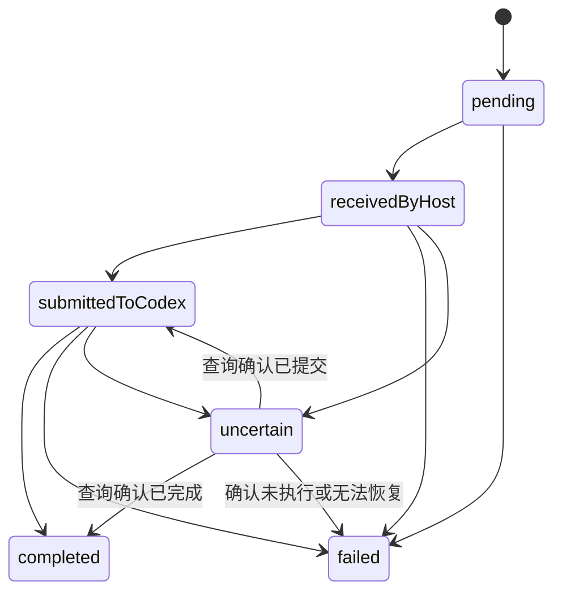

# 应用协议与领域契约

状态：`0.1`。默认服务仅提供健康检查；显式启用本机历史模式时额外提供以下只读接口。回复与远程授权的领域类型仍是草案。

完整直接 Host 接口已单独实现，使用 [运行时 HTTP 协议](protocol-runtime.md)：真实回复、上传/下载、事件、停止、排队和审批。下文 Relay 领域对象仍是设计草案，不能混用为实际运行时端点。

## 协议分层

1. iOS ↔ Relay ↔ Host Agent：本产品的版本化应用协议。
2. Host Agent ↔ Codex：上游 App Server JSON-RPC，具体字段取决于安装版本。

手机不直接使用本机 Codex RPC，Relay 不解析其完整调用语义。Adapter 负责把领域命令转换为受支持的上游操作。应用协议版本与 Codex CLI 版本分别协商。

## 已实现：健康检查

`GET /healthz` 返回 HTTP 200：

```json
{
  "service": "host-agent",
  "status": "ok",
  "protocolVersion": "0.1",
  "capabilities": ["health"]
}
```

Relay 使用相同结构，`service` 为 `relay`。`status` 只描述 HTTP 进程存活；不能解释为 Codex、手机或另一台电脑已连接。默认服务的其他路径返回 HTTP 404。历史模式连接就绪时，capabilities 增加 `projects:read`、`threads:read`、`history:read`；读取进程退出后降为 `health`，读取接口返回 503。

契约源位于 `packages/protocol/src/index.ts`。Smoke 检查验证实际构建产物的启动、健康响应，以及尚未实现的对话路由不会返回成功。

## 已实现：本机历史接口

仅 `pnpm dev:history` 或 `CODEX_HISTORY_READ=1` 启用。监听固定限制为 `127.0.0.1`，拒绝带 Origin 的请求以及不匹配的 Host 头，不提供 CORS。该开发接口没有远程配对与授权，不可用于公网服务。

| 接口                                  | 返回                                                            | 约束                                                          |
| ------------------------------------- | --------------------------------------------------------------- | ------------------------------------------------------------- |
| `GET /v1/workspace`                   | hostId、name、connectionMode、projects、threads、两个下一页游标 | connectionMode 固定为 history-only，线程 state 固定为 unknown |
| `GET /v1/history?hostId=…&threadId=…` | hostId、threadId、messages、nextCursor                          | Host ID 必须一致，线程必须已经由此服务列出                    |

工作区参数 `projectCursor` 与 `threadCursor` 分别使用服务返回的不透明游标，每页最多 100 个。iOS 合并列表时按 ID 去重。历史参数 `cursor` 用于继续加载更早消息；分页线程每页读取 100 个上游 item，映射用户、助手及工具消息，按时间先后返回。旧式历史使用 includeTurns 读取，当前没有旧式历史的应用层分页。

工作区增加 `clientType: { id, name }`，当前实际实现为 `{ "id": "codex", "name": "Codex" }`。客户端类型与电脑名称、connectionMode 独立；未来类型可使用其他字符串 ID，不表示已接入其他客户端。旧 Host 缺少该字段时，iOS 按已有 Codex 接入兼容显示。

项目字段为 id、hostId、name、roots。线程字段为 id、hostId、projectId、title、state。消息字段为 id、role（user/assistant/tool）、text、files、kind、status、detail。历史和实时路径共用工具映射：命令输出、文件 Diff、工具结果和公开推理摘要保持原 item ID 与顺序，跳过空推理及独立计划条目。历史附件只显示通用标记，不传输原附件文件；工具正文可能包含上游原始命令与路径，但不会因此获得下载权限。当前历史接口不返回实时状态，历史工具不能作为运行时连接证明。

历史线程优先保留上游明确的 `projectId`。旧桌面会话的该字段可能为空；Adapter 将 `cwd` 与本 Host 已读取项目的 `roots` 做规范化后的目录精确匹配。唯一匹配时补充显示用的 `projectId`；共享目录有多个匹配时，`projectId` 继续为空，可选 `projectIds` 列出包含该目录的项目视图。iOS 在这些项目下展示同一个线程，点击时保留所选项目上下文与原 Host/Thread 身份。此映射不写回 Codex，不代表新增了官方项目归属。不会按名称或父目录前缀合并；不能匹配的聊天仍在最近列表显示。项目映射保留到当前分页遍历结束，保证后续线程页可匹配前面项目页。

`desktop-runtime` 另读取同一 Codex Home 的桌面侧栏元数据，优先采用本机明确归属与无项目标记，将桌面 legacy 项目 ID 映射为既有 App Server ID；已移除的明确项目不会改按目录串入其他项目。手机创建时保留的归属仅在桌面没有明确标记时兜底。`GET /v1/workspace` 在该模式返回完整 metadata 分页合成的当前快照，两个 next cursor 均为 null；项目顺序和聊天顺序来自本次目录读取，旧列表项不从持久化执行缓存补回。目录中尚无记录但已验证原 owner 的聊天可补入。metadata 文件损坏时刷新失败并保留手机上次缓存，不将该文件作为原运行时在线证据。

非 GET 请求返回 405；无效目标返回 400；本机访问校验失败返回 403；上游读取失败返回 502；读取器不可用返回 503。错误响应只返回固定错误码，不输出历史、路径或上游诊断。Adapter 仅允许 initialize、project/list、thread/list、thread/read、thread/items/list，不存在回复入口。

Swift DTO 使用 Decodable 校验必需字段，客户端额外校验工作区归属和历史目标。版本化 JSON Schema 与自动生成流水线仍待实现；当前只读 DTO 不表示回复草案已经接通。

## 草案：领域对象

| 类型              | 语义                                               |
| ----------------- | -------------------------------------------------- |
| `ConversationRef` | `hostId` + `threadId` 唯一定位目标会话             |
| `ProjectSummary`  | 电脑本地项目，路径不参与跨电脑全局身份判断         |
| `ThreadSummary`   | 会话摘要；不能确定实时状态时用 `unknown`           |
| `Page<T>`         | 列表与不透明 `nextCursor`，不能在客户端构造游标    |
| `AttachmentRef`   | 逻辑附件标识、归属、名称、类型、长度与摘要         |
| `ReplyRequest`    | 唯一消息 ID、目标会话、文字、附件与发送模式        |
| `DeliveryState`   | 发送与执行状态，包含无法确认提交结果的 `uncertain` |

这些类型暂时是 TypeScript 草案，不是完成了运行时输入验证的 Schema。接入网络输入前必须增加版本化 Schema、字段限制与跨语言验证。iOS Swift 模型生成或一致性验证尚未实现。

## 草案：回复状态



图中为概念状态，TypeScript 使用 `received-by-host` 和 `submitted-to-codex` 等字符串。不能把中继收到消息作为电脑已收到或 Codex 已开始执行的证据。

`steer` 必须带 `expectedTurnId`；只有当前 Turn 与前置条件一致时才能执行。`queue` 和 `steer` 根据目标电脑能力开放，不能假定所有版本都支持。

## 草案：事件恢复与错误

- Host Agent 为输出事件持久化本机递增序号。每台 Host 独立管理恢复位置，多个订阅者收到同一事件标识。
- 重连按客户端确认位置补发，重复事件由客户端去重；日志已过期时重新拉取快照。
- 拟区分离线、未配对、版本不支持、附件未完整上传、Turn 前置条件失败、已失效审批、限流与结果不确定。
- 机器身份及附件归属不能仅依靠手机传入字段，应由配对授权和 Host 本地映射校验。
- 审批 ID 的有效范围包含所属运行时连接；恢复连接后先查询是否仍待处理，不盲目复用旧请求 ID。

具体 WSS 消息信封、密文格式、错误码和 JSON Schema 在跨电脑 PoC 实现时定稿；本次不生成虚构的远程端点。

## 聊天管理与完整历史搜索

新增严格具名 `POST /v1/threads/actions`、同路径 GET 回执查询，以及 `GET /v1/threads/search-history` 分页只读历史。管理动作固定完整目标、Thread 和稳定操作 ID；上游 wire 只在 Adapter，未知结果不重放。字段、阶段及边界见 [聊天管理与搜索](chat-actions.md#协议)。

工作区及历史中的聊天摘要可带 `lastTurnStatus`（`inProgress`、`completed`、`interrupted`、`failed`），只由原 owner 最新有效轮次投影；旧 Host 可缺省。它用于在 `state:idle` 时区分空闲、已完成及已停止，不改变原 `state`、输入条件或归档状态。`state:unknown` 不因持久化的旧轮次结果被显示为空闲或已停止，单条工具消息的完成也不作为任务完成证据。

已加载原桌面聊天的归档／恢复／删除当前受官方 active writer 拒绝及缺少具名释放入口阻塞，2026-10-20 起界面允许提交并显示官方实际拒绝，原 owner 执行入口仍未完成。未加载元数据的辅助通过不代表四项全功能已交付；见 [聊天管理与搜索](chat-actions.md)。

## UM03 分支严格HTTP契约（已实现并通过适用验收）

共同Schema新增 threadForkRequest、threadForkOptions、threadForkOperation。请求仅hostId、threadId、turnId、clientOperationId、environment；完整本地目标不额外写入严格POST正文。具名GET选项和原ID状态不产生输入，confirmed必须返回不同的准确新Thread ID，所有原请求字段均绑定；终态不得回退或改写。Android和iOS使用同一Schema及KMP判定，编译／向量与实际原owner和Git验收分别记录。
