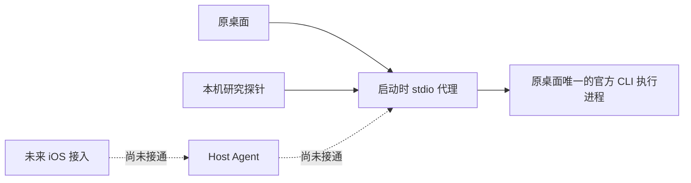

# 原桌面创建替代路线：同一 stdio 执行进程代理

研究日期：2026-10-08。状态：**已被产品约束排除并停用**。用户要求保持官方启动方式不变；旧启动/准备脚本已改为拒绝执行，pnpm 准备入口已移除。本页保留前期研究记录，以下启动步骤不再可用。后续见 [正常启动入口研究](desktop-normal-start-entry.md)。Host/iOS 创建能力保持关闭。

## 新入口与证据

本机桌面构建 `26.1002.52244` 的启动代码读取 `CODEX_CLI_PATH`，允许指定其启动的 CLI 可执行文件。正常运行的原桌面通过私有 stdio 连接自己启动的 `app-server`。这两个观察来自安装包的只读检查；尚未找到 OpenAI 对该启动变量的公开稳定承诺。

候选方案是在原桌面下一次启动时，把 CLI 路径指向一个透明代理。代理再启动同一份官方 CLI，继承原桌面的参数、环境、初始化与配置，只把手机创建请求加入这条连接。



不增加第二个执行实例，不修改桌面安装包或历史文件。原桌面只初始化一次；代理为请求重映射 ID，保留原响应 ID、原生通知和审批请求。研究探针不能初始化、回答审批、操作已有聊天或调用任意方法。公开 [App Server 文档](https://learn.chatgpt.com/docs/app-server) 支持 `thread/start` / `turn/start` 协议；该文档不能证明当前代理已经连接原桌面。

## 尚待证明的关键行为

安装包检查显示：外部 `thread/started` 通知会加入最近列表，但新对象的 `resumeState` 为 `needs_resume`，通知本身不会赋予桌面 stream owner。必须实测桌面是否接收实时事件、如何取得 owner，以及后续回复、停止和审批能否仍由原桌面处理。不能把相同 CLI 进程等同于桌面 UI 已接管。

还需核对桌面默认模型、权限、插件、动态工具及项目归属。原桌面的内置工具可能依赖其注册的进程身份，代理改变父子进程关系后是否兼容尚未确认。当前仅有固定项目、文字首条研究入口；无项目、图片/文件首条和手机产品流程尚未实现。

## 原型与验证边界

通信与 Codex wire 实现在 `packages/codex-adapter/src/desktop-stdio-router.ts` 和 `desktop-stdio-bridge.ts`；Host 入口仅调用适配器。`desktop-stdio-smoke` 检查请求 ID 冲突、乱序、初始化、原生通知、审批路由、断线及真实 fixture 进程 stdio。`desktop-stdio-entry-fixture` 使用假的桌面与执行程序，检查私有 socket、认证、父进程/构建绑定、固定项目限制、一次首条提交和重启不重放。

研究端点只监听用户私有 Unix socket，默认只读。写探针需启动器显式设置 `CODEX_MANAGE_STDIO_CREATE_POC=1`。写请求在转发前写入独立、私有且 fsync 的 operation journal；断线结果不确定，重复 operation ID 拒绝执行。探针只操作本次代理创建的线程，不允许发送任意 JSON-RPC。所有检查都保留 `realDesktopCreationVerified: false`，不会产生产品创建能力或真实通过记录。

## 一次性真实 PoC 启动

先准备可审查的本机启动器，不操作正在运行的桌面：

```bash
pnpm prepare:desktop-stdio --app /path/to/ChatGPT.app \
  --codex /path/to/original/codex \
  --project-id <saved-project-id> \
  --project-directory /path/to/project
```

准备结果保存在忽略目录 `.local/desktop-stdio-poc`，包含固定原桌面构建、已保存项目及官方 CLI 路径。不要提交这些本机配置。结束正在运行的任务后，用户退出原桌面，再双击生成的 `launch.command`；启动器在原桌面仍运行时拒绝执行，不杀进程或另开第二个桌面。环境变量只影响这次启动；退出后正常打开原 App 即回到原启动链路。

启动后先运行只读进程链检查：

```bash
node scripts/probe-desktop-stdio-poc.mjs
```

只有确认桌面 → 代理 → 官方 CLI 的真实父子关系、构建及初始化状态后，才显式运行单条研究创建：

```bash
node scripts/probe-desktop-stdio-poc.mjs --create --text '<first acceptance input>'
```

该探针核对实际 Thread ID、保存项目 ID、工作目录和首条提交，并另用现有桌面 IPC 查证 owner。结果存入私有 `acceptance.json`，不保存对话正文或导出历史；即使单条研究成功，也不能替代项目/空项目/无项目/附件/owner 控制/故障恢复六项产品验收。

## 其他路线的筛选

| 路线                               | 当前结论                                                                                                                                       |
| ---------------------------------- | ---------------------------------------------------------------------------------------------------------------------------------------------- |
| 原桌面同一 stdio 代理              | 原型已准备，需真实启动验证 owner 与内置工具兼容性                                                                                              |
| 原桌面专用控制聊天调用内置创建工具 | 仍是备选；需用户明确授权创建并向控制聊天发送请求，有模型成本、延迟与幂等风险                                                                   |
| 直接打开本地 daemon 开关           | 本机构建的启动条件受配置覆盖和打包资源约束，不能仅设置一个变量就证明共享原桌面                                                                 |
| MCP Events 回调                    | [官方说明](https://developers.openai.com/plugins/build/mcp-events) 当前适用 Work 云端 / dots，不能据此接入本机桌面创建                         |
| 普通 MCP UI bridge                 | [官方接口](https://developers.openai.com/plugins/build/chatgpt-ui) 可调用自身 MCP 工具或发后续输入，没有据此获得反向调用桌面内置创建工具的入口 |

当前结论是新的同进程入口值得实测，尚未达到“手机创建已由原桌面执行”的交付标准。
